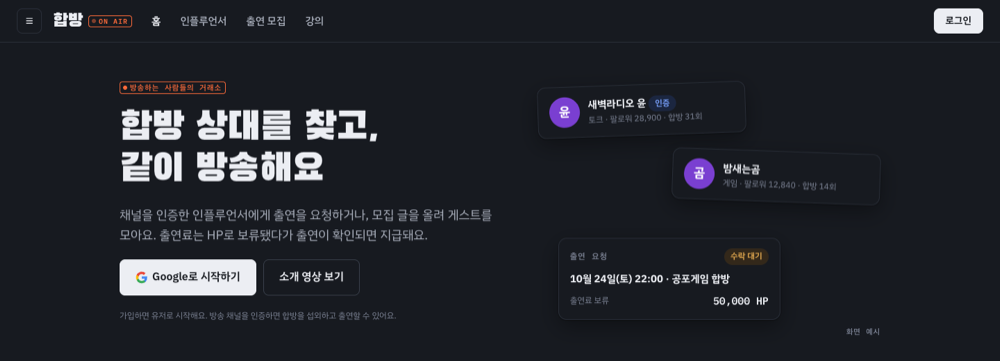
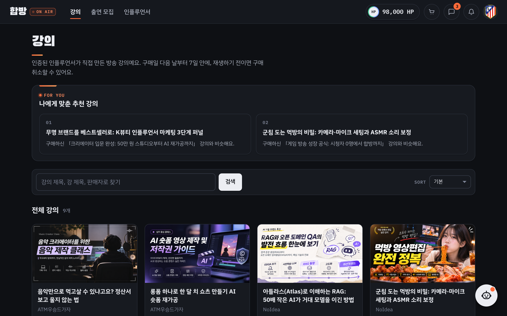
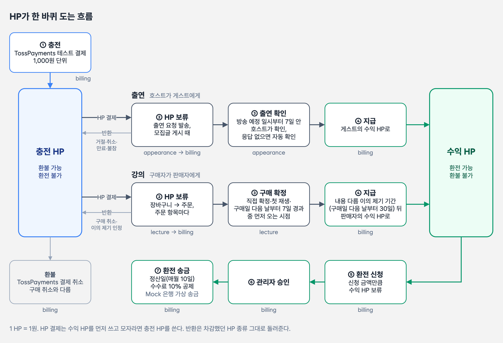
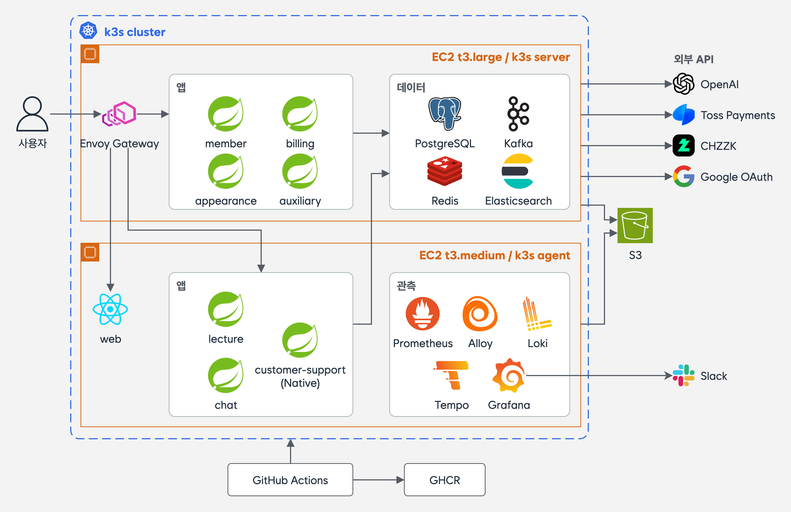
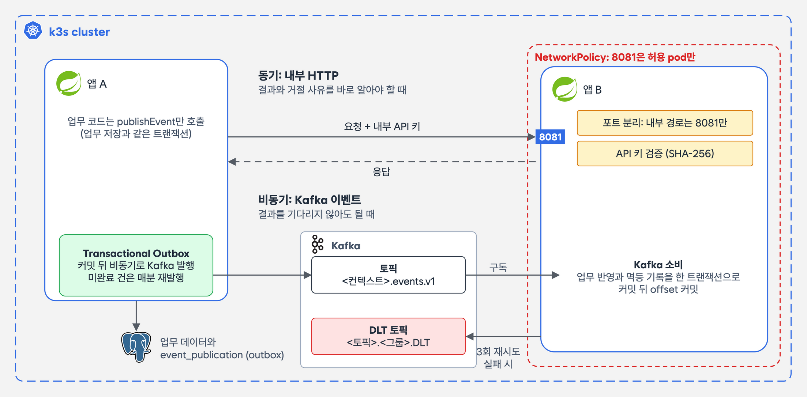
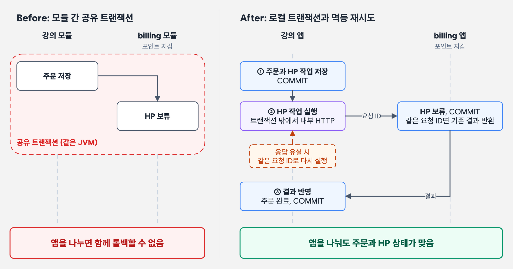
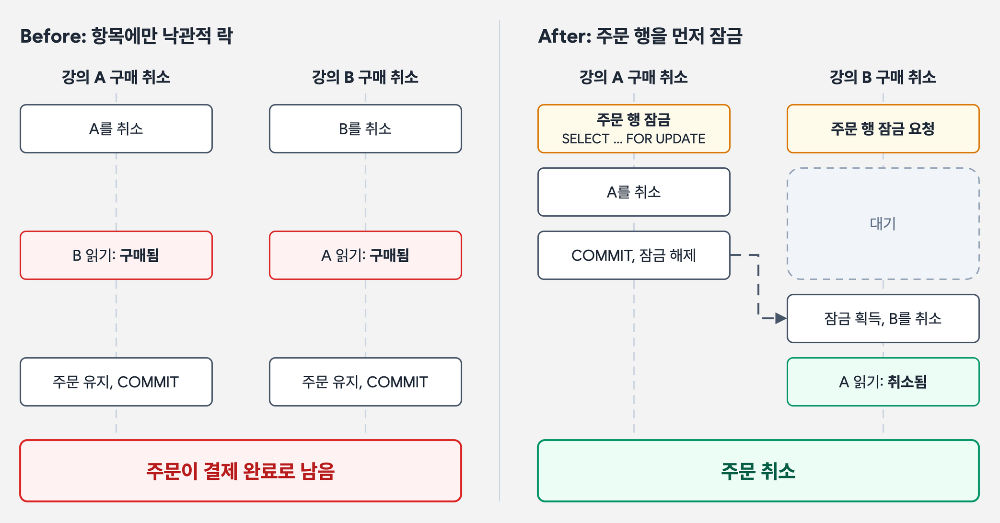
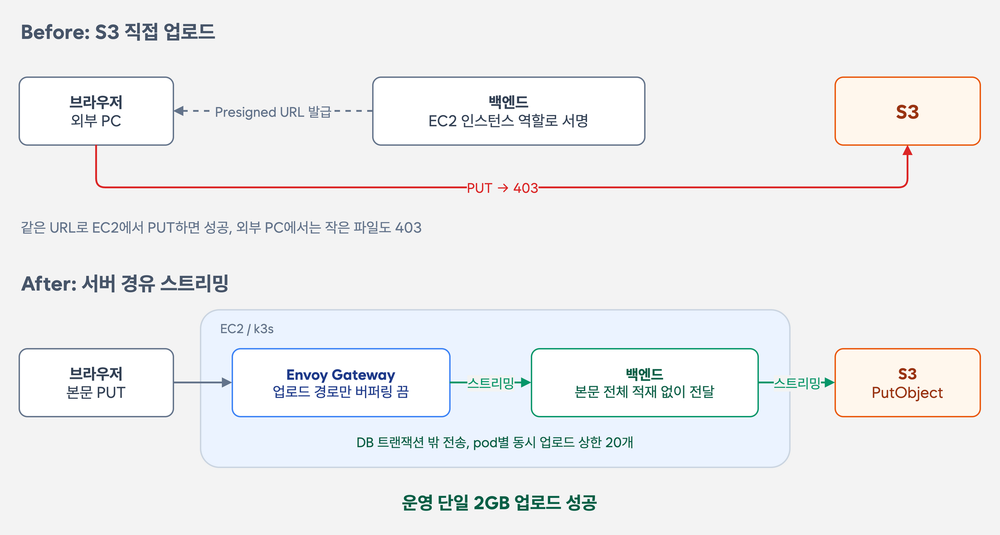
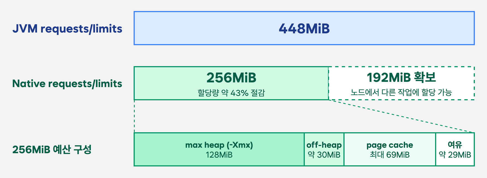

# 합방 — 백엔드

인플루언서 합방 출연을 중개하고, 인증된 인플루언서의 강의를 판매하는 HP 기반 플랫폼이다.

데브코스 백엔드 단기심화 8기 8팀 **남(은)자들 (Last Men Standing)** · 2026-10-07 시작


[서비스](https://hapbang.duckdns.org) · [API 문서 (Swagger)](https://hapbang.duckdns.org/api/v1/members/swagger-ui/index.html) · [프론트엔드 레포](https://github.com/prgrms-be-adv-devcourse/beadv8_8_LMS_FE)

규모 (2026-11-25 기준): 앱 7개 · 병합한 PR 499개 · 이슈 528개 · 테스트 클래스 1,033개 · 결정 기록 약 480건

| 홈 | 강의 목록 (맞춤 추천) |
| --- | --- |
|  |  |

## 목차

1. [서비스 소개](#서비스-소개)
2. [주요 기능](#주요-기능)
3. [아키텍처](#아키텍처)
4. [앱 간 통신](#앱-간-통신)
5. [기술 선택](#기술-선택)
6. [핵심 기술 판단](#핵심-기술-판단)
7. [성능·부하 테스트](#성능부하-테스트)
8. [배포·운영](#배포운영)
9. [테스트](#테스트)
10. [협업 방식](#협업-방식)
11. [진행 이력](#진행-이력)
12. [팀원](#팀원)
13. [문서 지도](#문서-지도)

## 서비스 소개

합방은 방송 인플루언서가 함께 방송할 상대를 찾고, 인증된 인플루언서가 자기 방송 노하우를 강의로 파는 곳이다. 모든 거래는 플랫폼 포인트인 HP(1 HP = 1원)로 한다.

- **출연 (코어)**: 호스트가 게스트에게 출연 요청(1:1)을 보내거나 출연 모집(1:N) 글을 올린다. 출연료는 HP로 보류해 두었다가, 방송 뒤 호스트가 출연을 확인하면 게스트에게 지급한다.
- **강의 (서포팅)**: 인증된 인플루언서가 강의를 올리고, 유저는 장바구니에 담아 HP로 구매한다. 구매 확정과 이의 제기 기간이 지나면 판매자에게 지급한다.
- **완성 기준은 "돈이 한 바퀴 도는 것"이다.** 충전한 HP가 거래·확인·지급을 거쳐 받는 쪽의 수익 HP가 되고, 환전으로 다시 현금이 되기까지 끊김 없이 이어져야 한다.



### HP 규칙

- **충전 HP와 수익 HP는 서로 바뀌지 않는다.** 충전 HP는 환불만, 수익 HP는 환전만 된다. 결제할 때는 수익 HP를 먼저 쓰고 충전 HP를 쓴다.
- **거래 중인 HP는 보류한다.** 확정되면 받는 쪽의 수익 HP로 지급하고, 거절·취소·만료·불참이면 차감했던 HP 종류 그대로 반환한다. 강의는 주문 항목마다 따로 보류한다.
- **구매 취소와 환불은 다르다.** 구매 취소는 보류한 HP를 돌려받는 것이고, 환불은 충전 HP를 PG(TossPayments 테스트 결제)로 현금화하는 것이다.
- **환전은 관리자 승인 뒤 정산일(매월 10일, 주말이면 다음 월요일) 배치가 처리한다.** 수수료 10%는 플랫폼 수수료 수입이 된다. 은행 송금은 가상 송금이라 실제 현금은 움직이지 않는다.

규칙 전체는 [`docs/policy.md`](docs/policy.md), 용어는 [`docs/GLOSSARY.md`](docs/GLOSSARY.md)가 원본이다.

### 역할

| 역할 | 되는 방법 | 할 수 있는 일 |
| --- | --- | --- |
| 유저 | 이메일 인증 가입 또는 구글 로그인 | 강의 구매·구매 취소, HP 충전·환불, 채널 인증 신청 |
| 인플루언서 | 치지직 채널 인증 (팔로워 10명 이상이면 자동 승인) | 출연 요청·모집(호스트), 수락·지원(게스트), 출연 취소 요청, 채팅, 환전 |
| 인증된 인플루언서 | 승급 심사 통과 | 인플루언서 기능 + 강의 등록·판매 |
| 관리자 | 지정 | 채널 인증·승급 심사, 강의 검수, 환전 승인, 이의 제기 판단, 문의 답변 |

## 주요 기능

| 앱·모듈 | 주요 기능 |
| --- | --- |
| 회원 (`member-app`) | 이메일 인증 가입·로그인, 구글 소셜 로그인<br>치지직 채널 인증(팔로워 10명 이상 자동 승인), 승급 신청·심사, 관리자의 인플루언서 지정<br>프로필, 인플루언서 목록, 받은 출연 리뷰<br>탈퇴 뒤 30일 안 다시 로그인하면 복구, 지나면 파기(마스킹). 돈 기록은 남긴다<br>access token 발급·재발급·로그아웃, JWKS 공개 |
| 지갑 (`billing-app`) | 지갑과 HP 거래 내역<br>충전(TossPayments 테스트 결제)과 결과가 불분명한 결제 복구 배치<br>환불(충전 HP를 PG 부분 취소)<br>환전 신청 → 관리자 승인 → 정산일 배치(가상 송금)<br>수익 조회, 플랫폼 지갑(수수료 수입), 프로모션 지갑(쿠폰 예산)<br>다른 앱이 부르는 보류·반환·지급·위약금 내부 API |
| 출연 (`appearance-app`) | 출연 요청(1:1): 발송 때 보류, 수락·거절·취소·만료<br>출연 모집(1:N): 게시·지원·지원 수락·마감, 모집 목록 검색<br>출연 취소 요청과 합의 취소, 호스트 일방 취소(위약금 30%)<br>출연 확인·불참, 방송 후 7일 자동 확인<br>출연 리뷰(블라인드 공개) |
| 강의 (`lecture-app`) | 강의 등록 → 관리자 검수 → 공개, 썸네일·영상·자료 업로드(서버 경유)와 재생<br>장바구니 → 주문(바로 구매 포함) → 구매 확정(직접·첫 재생·자동), 구매 취소<br>리뷰·평점, 내용 다름 이의 제기 처리<br>HP 작업 재시도·서비스 간 HP 대사 관리자 API |
| 쿠폰 (`lecture-app`의 `coupon`) | 판매자 쿠폰(신청 → 관리자 승인), 플랫폼 쿠폰<br>선착순 발급(접수 → 결과 조회), 쿠폰함<br>할인 계산 미리보기(가장 큰 할인 조합 추천)<br>Redis 유실 복구·DLT 재처리 관리자 API |
| 채팅 (`chat-app`) | 1:1 채팅(STOMP over WebSocket), 이력·읽음·나가기<br>출연 모집용 단체 채팅방: 초대·강퇴·폐쇄, 메시지별 안 읽은 사람 수<br>1회용 연결 티켓, 관리자 기록 조회·전달 재처리 |
| 고객센터 (`customer-support-app`) | 문의 등록, 관리자 답변<br>내용 다름 이의 제기 판단: 강의 앱에 접수하고 판단·철회를 이벤트로 보냄 |
| 알림 (`auxiliary-app`의 `notification`) | 알림센터: 목록, 안 읽은 수, 읽음 처리<br>실시간 알림(STOMP, 연결 티켓)<br>즉시·예약·하루 묶음 알림 53종, 받는 사람마다 최신 20개 보존 |
| 챗봇 (`auxiliary-app`의 `chatbot`) | FAQ 검색과 FAQ 대화(SSE 스트리밍)<br>자유 질문 대화(Tool Calling으로 FAQ 검색·강의 추천·인플루언서 추천)<br>강의·인플루언서 맞춤 추천과 추천 이유<br>대화 내용은 서버에 저장하지 않는다 |
| 검색 (`auxiliary-app`의 `search`) | 인플루언서·강의 검색(비회원 포함)<br>자동완성, 초성 검색, 오타를 고친 검색어 제안<br>회원·IP별 호출 제한 |

## 아키텍처



- **진입점은 Envoy Gateway 하나다.** TLS 종료(cert-manager, Let's Encrypt), 경로별 라우팅, JWT 서명 검증을 Gateway가 맡고, 앱은 검증된 사용자 헤더로 인가만 한다.
- **EC2 2대가 k3s cluster 하나를 이룬다.** AWS 범위는 EC2 2대, VPC 1개, public subnet 1개, S3 버킷 1개다. EKS·RDS·MSK 같은 managed service는 쓰지 않는다.
  - `t3.large` (k3s server, `core-data`): PostgreSQL·Kafka·Redis·Elasticsearch와 앱 4개(member, billing, appearance, auxiliary)
  - `t3.medium` (k3s agent, `app-observe`): 앱 3개(lecture, chat, customer-support), 프론트엔드 정적 서버, 관측 스택
- **고가용성 구성이 아니다.** stateful workload가 node 하나에 있고, Kafka도 broker 1개(replication 1)다. broker가 멈춘 동안 발행할 이벤트는 각 앱 DB의 outbox에 남았다가 다시 발행되고, 소비는 그만큼 늦어진다([장애와 복구](docs/architecture/infrastructure/kafka.md#장애와-복구)).
- **포트를 셋으로 나눈다.** 외부 API 8080, 앱 간 내부 API 8081, actuator·Prometheus 8082다. NetworkPolicy가 8080은 Envoy만, 8081은 허용한 앱 pod만 들어오게 막는다.

### 앱 구성

앱 하나가 bounded context 하나이고 database 하나를 가진다. PostgreSQL 인스턴스는 1개이고 database만 앱마다 나눈다. 앱끼리 테이블 JOIN, database 간 FK, 다른 앱의 엔티티 참조를 하지 않고 회원 ID(Long)와 이벤트로만 연결한다.

| 앱 | 안의 모듈 | database (schema) | 외부 API | node |
| --- | --- | --- | --- | --- |
| `member-app` | — | `member` | `/api/v1/members` | large |
| `billing-app` | — | `billing` | `/api/v1/wallets`, `/api/v1/settlements` | large |
| `appearance-app` | — | `appearance` | `/api/v1/appearances` | large |
| `lecture-app` | `lecture`, `coupon` | `lecture` (`lecture`, `coupon`) | `/api/v1/lectures`, `/api/v1/coupons` | medium |
| `chat-app` | — | `chat` | `/api/v1/chats` (WebSocket `/api/v1/chats/ws`) | medium |
| `customer-support-app` | — (GraalVM Native Image) | `customersupport` | `/api/v1/inquiries` | medium |
| `auxiliary-app` | `notification`, `chatbot`, `search` | `auxiliary` (모듈별 schema) | `/api/v1/notifications`, `/api/v1/chatbot`, `/api/v1/search` | large |

- `auxiliary-app`은 검색·챗봇·알림을 JVM 하나에 담는다. 셋을 앱으로 따로 띄울 메모리가 없어서 앱 안에 모듈로 두고, Spring Modulith 검사로 모듈 경계를 지킨다([README](apps/auxiliary-app/README.md)).
- 쿠폰은 강의 앱 안에 있지만 따로 떼어낼 것을 전제로 `coupon` schema만 쓰고, 강의와는 내부 HTTP와 Kafka로만 통신한다.
- 공통 코드는 `common/`의 Gradle 라이브러리다. `kafka`, `redis`, `shared`(모듈 간 이벤트·DTO와 내부 API Client), `test-support`(Testcontainers 설정과 E2E 픽스처)가 있고, 앱은 필요한 것만 쓴다. 앱끼리는 프로젝트 의존을 두지 않는다.

## 앱 간 통신



모듈 사이는 이벤트가 기본이다. 결과와 거절 사유를 바로 알아야 하는 경우만 내부 HTTP를 쓴다.

| | 동기: 내부 HTTP | 비동기: Kafka 이벤트 |
| --- | --- | --- |
| 쓰는 때 | HP 보류·반환·지급(강의·출연 → 지갑), 이의 제기 접수(고객센터 → 강의), 쿠폰 계산·예약(강의 → 쿠폰)처럼 결과를 기다려야 할 때 | 가입, 거래 상태 변화, 알림·검색·추천 데이터 동기화처럼 결과를 기다리지 않아도 될 때 |
| 경로 | 내부 포트 8081의 `/api/v1/internal/<모듈>/...`. Envoy에 route가 없어 서버 밖에서는 닿지 않는다 | 발행 컨텍스트마다 토픽 하나: `member`, `appearance`, `billing`, `lecture`, `customersupport`, `coupon`, `chat`의 `.events.v1` |
| 인증·보호 | `X-Internal-Api-Key`(SHA-256 비교), NetworkPolicy로 허용한 pod만 | 컨텍스트 안에서 이벤트 타입을 섞고 `eventType` 헤더로 구분한다([ADR 0001](docs/adr/0001-context-topics-with-mixed-event-types.md)) |
| 실패 처리 | `common/shared`의 API Client에 timeout·retry·circuit breaker. 호출은 호출하는 쪽 로컬 트랜잭션 밖에서 하고, 응답을 잃으면 같은 요청 ID로 다시 보낸다 | 업무 저장과 같은 트랜잭션에 outbox(Modulith event publication)로 기록하고 커밋 뒤 발행한다. 소비는 3회 재시도 뒤 `<토픽>.<그룹>.DLT`로 보낸다 |
| 중복 처리 | 받는 쪽이 요청 ID에 UNIQUE를 걸어 같은 요청이면 처음 결과를 돌려준다 | eventId 없이 자연 키로 멱등 처리한다([ADR 0002](docs/adr/0002-modulith-externalization-without-event-id.md)) |

자세한 규칙은 [모듈 연동](docs/dev/module-integration.md), 토픽·재시도·DLT 재처리는 [Kafka](docs/architecture/infrastructure/kafka.md)에 있다.

## 기술 선택

AWS 범위(EC2 2대, 메모리 8 GiB + 4 GiB)라는 제약 안에서 고른 것이다. 근거와 대안 비교는 [최종 프로젝트 인프라 설계](docs/architecture/final-project-infrastructure.md)에 있다.

- **k3s (server 1 + agent 1) + Kustomize·Helm**: managed Kubernetes를 쓸 수 없어 EC2에 직접 올린다. rolling update, probe, node별 배치와 pod별 메모리 예산을 다룬다. 같은 manifest를 로컬 k3d와 CI에서 검증한다.
- **Envoy Gateway**: TLS 종료, 앱별 라우팅, JWT 서명 검증, 내부 API 차단, trace 시작점을 한 곳에 둔다. edge nginx와 k3s 내장 Traefik은 쓰지 않는다.
- **JWT (RS256, JWKS)**: 세션을 없앴다. member-app이 발급하고 Envoy가 검증하므로 앱은 인증 상태를 갖지 않는다.
- **Spring Modulith + Kafka**: 업무 저장과 같은 트랜잭션에 이벤트를 기록(outbox)하고 커밋 뒤 Kafka로 내보낸다. 모듈 경계 검사도 Modulith로 한다.
- **Redis**: 채팅 전달(Streams·Pub/Sub), 쿠폰 선착순 재고(Lua), refresh token, WebSocket 연결 티켓처럼 짧게 살거나 빨라야 하는 데이터에만 쓴다.
- **Elasticsearch 하나로 검색과 벡터 검색**: nori 한국어 검색과 챗봇의 벡터 검색을 같은 클러스터에서 한다. 별도 Vector DB를 두지 않는다([조사](docs/architecture/elasticsearch-consolidation-research.md)).
- **Prometheus·Loki·Tempo·Grafana·Alloy**: 지표·로그·trace를 한 화면에서 본다. Mimir와 Elastic Observability는 2노드 메모리를 더 쓰므로 뺐다.
- **Resilience4j**: rate limit은 Gateway가 아니라 각 앱에서 하고, 앱 간 HTTP 호출에 timeout·circuit breaker·retry를 건다.
- **GraalVM Native Image**: JVM 앱 하나가 heap과 상관없이 280~355 MiB를 고정으로 쓴다. 트래픽이 가장 적은 customer-support-app 하나만 native로 바꿨다. 다른 앱으로 넓히면 앱마다 CI가 native 컴파일 10~14분만큼 늘어 보류했다([Native Image](docs/architecture/infrastructure/native-image.md)).

## 핵심 기술 판단

각 판단은 "문제 → 판단 → 결과"로 적고, 근거 문서를 단다.

### 앱 간 정합성

#### 앱을 나눠도 주문과 HP가 맞게: 로컬 트랜잭션과 멱등 재시도 (강의·출연 ↔ 지갑)



- **문제**: 모놀리스에서는 주문 저장과 HP 보류가 한 트랜잭션이었다. 앱을 나누면 database가 달라 함께 롤백할 수 없다.
- **판단**: 업무 상태와 "HP 작업"(요청 ID 포함)을 먼저 커밋하고, 트랜잭션 밖에서 지갑 내부 API를 부른다. 지갑은 같은 요청 ID면 처음 결과를 돌려준다. 응답을 잃으면 같은 요청 ID로 다시 보낸다.
- **결과**: 앱을 나눈 뒤에도 주문·출연과 HP 상태가 맞는다. 매일 서비스 간 HP 대사가 양쪽을 비교하고, 어긋나면 알림을 보낸다. ([D62](docs/lecture/decisions.md), [모듈 연동](docs/dev/module-integration.md))

#### HP 작업은 기록하고, 끝까지 실패하면 격리한다 (출연)

- **문제**: 지갑 호출은 순간 장애, 결과 불명, 커밋 직후 종료로 실패할 수 있다.
- **판단**: 출연 상태를 바꾸는 트랜잭션에 HP 작업을 PENDING으로 기록하고 커밋 뒤 실행한다. 결과를 받지 못하면 지수 백오프(1분 → 최대 1시간)로 최대 10회 다시 하고, 그래도 안 되거나 지갑이 거절하면 DEAD로 격리한다. circuit breaker가 열려 보내지 못한 경우는 시도 횟수에 넣지 않는다.
- **결과**: DEAD가 생기면 알림이 울리고 관리자가 다시 시도한다. 매일 대사가 규칙 11종으로 출연 상태 ↔ HP 작업 ↔ 지갑 보류·지급을 비교한다. ([출연 문서](docs/appearance/module.md) 4.3·8.4·25장)

#### 이벤트를 잃지 않는 발행과 멱등 소비 (공통)

- **문제**: DB 커밋 뒤 Kafka로 보내기 전에 앱이 죽으면 이벤트가 사라진다. 다시 보내면 같은 eventId를 만들 수 없어 소비자가 중복을 가릴 수 없다.
- **판단**: Spring Modulith의 event publication을 outbox로 써서 업무 저장과 같은 트랜잭션에 기록하고, 미완료 건은 재시작과 배치로 다시 보낸다. 소비자는 eventId 대신 `(대상 ID, 원본 버전)` 같은 자연 키로 중복을 가린다. 3회 재시도 뒤에는 그룹별 DLT로 보낸다.
- **결과**: broker가 멈춰도 이벤트는 outbox에 남았다가 다시 발행된다. 장애 복구 테스트와 DLT 재처리 절차를 갖췄다. ([ADR 0001](docs/adr/0001-context-topics-with-mixed-event-types.md), [ADR 0002](docs/adr/0002-modulith-externalization-without-event-id.md), [Kafka 장애와 복구](docs/architecture/infrastructure/kafka.md#장애와-복구))

#### 인증은 Gateway가, 인가는 앱이 (회원·Gateway)

- **문제**: 앱 7개가 각자 세션이나 토큰을 검증하면 인증 코드와 상태가 앱마다 생긴다. 세션은 앱끼리 공유되지도 않는다.
- **판단**: member-app이 RS256 JWT(15분)를 발급하고 JWKS로 공개 키를 연다. Envoy가 서명을 검증해 `sub`·`role`을 `X-User-Id`·`X-User-Role` 헤더로 넘기고, 앱은 `@PreAuthorize`로 인가만 한다. 외부에서 들어온 `x-user-*`·내부 API 키 헤더는 Gateway가 지우고, NetworkPolicy로 앱의 8080 포트에는 Envoy만 닿게 한다. refresh token(14일)은 Redis에 해시로 두고 Lua로 원자 회전하며, 유예 10초를 넘긴 재사용은 거절한다.
- **결과**: 앱은 인증 상태를 갖지 않는다. 헤더 위조 경로는 Gateway 테스트(`k8s/gateway/tests`)로 검사한다. ([API Gateway](docs/architecture/infrastructure/api-gateway.md))

### 강의

#### 마지막 두 항목 동시 구매 취소: 주문 행을 먼저 잠근다



- **문제**: 낙관적 락이 주문 항목에만 있었다. 한 주문의 마지막 두 항목을 동시에 구매 취소하면 둘 다 상대 항목을 "구매됨"으로 읽어, 모든 항목이 취소됐는데 주문은 결제 완료로 남았다.
- **판단**: 주문을 닫을 수 있는 변경(구매 취소, 이의 제기 인정)은 주문 행을 `PESSIMISTIC_WRITE`로 먼저 잠그고 항목을 읽는다.
- **결과**: 두 번째 취소가 첫 번째 커밋을 기다린 뒤 최신 상태를 읽어 주문을 취소한다. ([D46](docs/lecture/decisions.md))

#### 큰 파일 업로드: Presigned PUT에서 서버 경유 스트리밍으로



- **문제**: EC2 인스턴스 역할로 서명한 Presigned PUT URL은 EC2 안에서는 성공하지만, 사용자 PC에서는 작은 파일도 `403 AccessDenied`가 났다.
- **판단**: 업로드를 서버 경유로 바꿨다. Envoy는 업로드 경로만 본문 버퍼링을 끄고, 앱은 본문을 메모리에 쌓지 않고 S3 PutObject로 흘려보낸다. 전송은 DB 트랜잭션 밖에서 하고, pod마다 동시 업로드를 20개로 제한한다. 조회는 Presigned GET을 그대로 쓴다.
- **결과**: 운영에서 단일 2 GB 파일 업로드에 성공했다. heap보다 큰 파일로 메모리에 쌓이지 않는지를 `largeUploadTest`로 검사한다. ([S3 업로드](docs/deploy/s3.md))

### 지갑

#### HP 원장은 쌓기만 하고, 같은 요청은 한 번만 반영한다

- **문제**: 잔액이 바뀐 근거를 잃거나 재전송으로 HP가 두 번 움직이면 정합성을 증명할 수 없다.
- **판단**: 원장은 수정·삭제하지 않고 잔액 변경은 한 경로로만 한다. 작업마다 멱등 키(예: `HOLD:{유형}:{ID}`)를 만들고, 같은 키에 다른 내용이 오면 거절한다.
- **결과**: DB 트리거가 원장의 UPDATE·DELETE를 막고, 아키텍처 테스트가 잔액 변경 경로를 강제한다. 멱등 키는 DB UNIQUE로 최종 보장하고, 같은 키를 다시 보내면 처음 결과를 돌려준다. ([지갑 문서](docs/billing/module.md) 4·5장)

#### 교착 없는 잠금 순서와 매일 잔액 대사

- **문제**: 여러 지갑을 바꾸는 지급·위약금이 서로 다른 순서로 잠그면 교착이 생긴다. 캐시한 잔액과 원장 합이 어긋나도 알아챌 수단이 없었다.
- **판단**: 지갑은 ID 오름차순으로 `PESSIMISTIC_WRITE` 잠금하고, 잠금 순서는 지갑 → 보류 → 충전 건으로 고정한다(lock timeout 3초). 매일 새벽 최근 72시간 안에 바뀐 지갑의 잔액을 원장과 대사하고, 불일치는 고치지 않고 알린다.
- **결과**: 지갑 유형별 고정 순서로는 판매자 지급과 같은 판매자의 구매 보류가 겹칠 때 교착이 생겨 ID 순서를 골랐다(BD-155). 대사 실행 기록을 DB에 남기고 실패한 지갑은 다음 회차로 넘긴다. ([BD-10, BD-139](docs/billing/decisions.md))

### 쿠폰

#### 선착순 발급: Redis Lua로 접수하고 Kafka로 확정한다

- **문제**: 1,000명이 동시에 재고 100장을 노릴 때 과발급·중복 발급 없이 빠르게 접수해야 한다.
- **판단**: 접수는 Redis Lua 스크립트로 재고 차감과 중복 검사를 원자적으로 한다. 접수 직후 Kafka로 보내고 소비자가 DB에 확정한다. DB에는 `(회원, 쿠폰)`과 `(쿠폰, 요청 ID)` UNIQUE를 최종 방어선으로 둔다. 전송 실패는 재발행 배치가, Redis 재시작은 `run_id` 변경 감지와 5단계 복구가 맡는다.
- **결과**: 로컬 3회 모두 과발급·중복·미확정이 0이었고, 모든 접수가 2.3초 안에 확정됐다. Redis·Kafka·PostgreSQL 장애 주입에서도 정합성이 유지됐다(아래 [성능](#성능부하-테스트)). ([쿠폰 문서](apps/lecture-app/boundedContext/coupon/docs/README.md))

### 채팅

#### PostgreSQL outbox → Redis Streams → Pub/Sub → STOMP

- **문제**: Redis Pub/Sub은 받지 못한 메시지를 다시 보내지 않는다. DB 커밋과 Redis 적재 사이, 소비 중 종료 때 메시지를 잃는다.
- **판단**: 메시지를 PostgreSQL outbox에 업무와 함께 저장하고, relay가 Redis Streams에 넣는다. consumer group이 꺼내 Pub/Sub으로 발행하고, DB 체크포인트를 커밋한 뒤 ACK한다. 연결은 30초짜리 1회용 티켓으로 연다.
- **결과**: 커밋과 적재 사이 공백은 outbox가, 소비 실패는 PEL 회수가, Redis 데이터 유실은 DB 체크포인트 대조가 메운다. 전달이 멈추면 알림이 울린다. ([채팅 Redis](docs/architecture/infrastructure/redis-chat.md), [채팅 설계](apps/chat-app/docs/final-design.md))

### 알림

#### 여러 앱의 이벤트를 알림 53종으로, 실시간 전달은 저장을 막지 않게

- **문제**: 6개 토픽에서 오는 이벤트를 알림으로 만들어야 하고, 받는 사람마다 알림이 끝없이 쌓이며, Redis가 느려도 저장이 기다리면 안 된다.
- **판단**: 리스너 6개가 토픽별로 받아 즉시·예약·하루 묶음 알림 53종을 만든다. 받는 사람 행을 잠가 저장을 직렬화하고 최신 20개만 남긴다. 실시간 전달은 커밋 뒤 큐(1,000건)에 넣고 한 스레드가 100건씩 묶어 Redis로 발행한다. 큐가 차면 버리고, 화면은 REST로 맞춘다.
- **결과**: 격리 환경에서 저장 → 수신 p95 9.8 ms, 유실 0/6,000, 밀린 이벤트 10,000건을 46.7초에 따라잡았다. ([알림 설계](docs/architecture/infrastructure/notification.md), [알림 문서](docs/notification/module.md))

### 챗봇

#### Elasticsearch 벡터 검색 + LLM 리랭킹 + Tool Calling, 장애에도 답한다

- **문제**: FAQ와 추천을 자연어로 다뤄야 하지만, LLM이나 Elasticsearch가 죽으면 챗봇 전체가 멈춘다.
- **판단**: FAQ 53건과 강의·인플루언서 취향을 임베딩해 Elasticsearch `dense_vector`(HNSW, cosine)에 넣고 kNN으로 후보 20개를 뽑는다. LLM이 5개를 골라 순서와 추천 이유를 붙인다. 자유 질문은 Tool Calling(`searchFaq`, `recommendLectures`, `recommendInfluencers`)으로 답하고 SSE로 흘려보낸다. 대화는 저장하지 않고 FE가 매 요청에 이력을 보낸다.
- **결과**: LLM·ES가 죽어도 health는 UP이고, 검색 상위 1건이나 안내 문구, 인기순 추천으로 답한다. LLM 회로 하나와 동시 호출 상한 4개를 모든 챗봇 기능이 나눠 쓴다. 오프라인 평가에서 리랭킹으로 인플루언서 추천 hit@5가 0.188 → 0.225가 됐다. ([auxiliary-app](apps/auxiliary-app/README.md), [리랭킹 평가](docs/chatbot/recommend-rerank.md))

### 검색

#### nori 한국어 검색과 alias 무중단 재색인

- **문제**: 사전이나 mapping을 바꾸면 index를 새로 만들어야 하고, ES가 잠시 멈추면 회원 이벤트가 DLT로 간다.
- **판단**: nori 형태소 분석에 사용자 사전·동의어를 더한다. 설정 해시를 이름에 넣은 새 index를 채운 뒤 alias를 옮기고, 쓰기는 alias로만 한다. 10분마다 회원 변경분을 내부 API로 읽어 version 조건부로 다시 반영한다.
- **결과**: 검색을 멈추지 않고 재색인한다. 사람이 DLT를 되돌리지 않아도 다음 회차에 맞춰진다. 동의어는 재색인 없이 바꾼다. ([검색 문서](docs/search/module.md))

### 인프라

#### EC2 2대에 앱 7개와 플랫폼 전체를: pod별 메모리 예산

- **문제**: 8 GiB + 4 GiB에 JVM 앱 7개, PostgreSQL·Kafka·Redis·Elasticsearch, 관측 스택을 모두 올려야 한다. JVM 앱 하나가 heap과 상관없이 280~355 MiB를 고정으로 쓴다.
- **판단**: node마다 pod별 메모리 예산 표를 두고, 운영 실측(working set, heap·heap 밖 영역, GC)으로 `-Xmx`와 limit을 정한다. 상태를 가진 workload는 large에 고정하고, 앱 배포는 한 번에 하나씩 rollout한다.
- **결과**: 컨테이너 메모리 alert가 울릴 때마다 원인을 heap·Metaspace·native로 나눠 보고 예산 표를 고친다. 그 기록이 [k3s 자원 예산](docs/architecture/infrastructure/k3s.md#ec2-2노드-자원-예산)에 남아 있다.

#### 트래픽이 가장 적은 앱 하나를 GraalVM Native Image로



- **문제**: 두 node의 메모리가 거의 차서 새 앱을 올릴 자리가 없었다.
- **판단**: 트래픽이 가장 적고 외부 연동이 적은 customer-support-app 하나만 native로 바꿨다. AOT가 빌드 때 굳히는 조건(프로필, 내부 포트, trace exporter)과 reflection 메타데이터를 하나씩 찾아 넣었다.
- **결과**: 운영 기동이 22.9~27.8초에서 1.10~1.16초로, working set이 391 MiB에서 120~129 MiB로 줄었다. limit을 448 → 256 MiB로 낮춰 192 MiB를 확보했다. ([Native Image](docs/architecture/infrastructure/native-image.md))

## 성능·부하 테스트

측정 조건(운영, 격리 k3d, 로컬)을 함께 적는다. 운영은 EC2 t3(CPU credit standard)이다. k6로 부하를 주고 Grafana와 JFR로 서버 쪽을 본다.

| 대상 | 조건 | 결과 | 문서 |
| --- | --- | --- | --- |
| 강의 조회 | 운영, 100 RPS × 10분 (2026-11-09) | k6 p95 132.9 ms(목표 500 ms 이하), 59,980건 중 5xx 0. 서버 쪽 앱 p95 22.4 ms, CPU 약 0.4 core. JFR로 보니 요청 처리 CPU의 25%가 S3 Presigned URL 서명이었다 | [기록](docs/load-test/lecture-baseline.md) |
| 쿠폰 선착순 발급 | 로컬, 1,000명 × 재고 100장, 3회 | 과발급·중복·미확정 0, 모든 접수 2.3초 안에 확정. 접수 p95 669 / 206 / 369 ms | [기록](docs/load-test/coupon-issue.md) |
| 쿠폰 장애 주입 | 로컬 컨테이너 | Redis 재시작: 30초 뒤 감지해 발급을 막고 복구 5단계 8.6초. Kafka 60초 중단: 다시 띄운 뒤 44.6초 안에 20건 모두 확정. PostgreSQL 중단: 접수는 35~40 ms로 계속 받고 DB가 돌아온 직후 모두 확정 | [기록](docs/load-test/coupon-issue.md) |
| 쿠폰 운영 측정과 개선 | 운영 3회 (2026-11-11) → 로컬, 앱 CPU 2개 제한 | 운영에서 정합성은 통과했지만 접수 p95 2,975 / 2,392 / 1,446 ms, 5xx 최대 1.36%로 불합격했다. 원인은 vCPU 2개 node에서 요청당 CPU 비용이었다. Tomcat 대기열(`accept-count` 1024), Kafka ACK 대기 제거, Spring Security 앞의 매진 빠른 경로로 로컬 접수 p95를 1,025 → 146 ms로 줄였다. 운영 재측정은 아직 하지 않았다 | [결정](apps/lecture-app/boundedContext/coupon/docs/decisions.md) |
| 알림 실시간 전달 | 격리 k3d, 회원 100명 × 초당 20건 × 5분 | 저장 → 수신 p95 9.8 ms, 유실 0/6,000 | [기록](docs/load-test/notification-load.md) |
| 알림 밀린 이벤트 회복 | 격리 k3d, 10,000건 | lag 0까지 46.7초(기준 300초) | [기록](docs/load-test/notification-load.md) |
| Native Image | 운영, customer-support-app | 기동 22.9~27.8초 → 1.10~1.16초, working set 391 → 120~129 MiB, limit 448 → 256 MiB | [기록](docs/architecture/infrastructure/native-image.md) |
| 챗봇 추천 리랭킹 | 오프라인, 더미 데이터 80명 × 3회 평균 | 인플루언서 hit@5 0.188 → 0.225, 강의 0.346 → 0.383 | [기록](docs/chatbot/recommend-rerank.md) |

## 배포·운영

서버는 EC2 k3s의 prod 한 벌뿐이다. dev 브랜치에 병합하면 바뀐 앱만 운영에 자동으로 배포된다.

```
PR (dev 대상)
 └─ CI: 바뀐 앱만 test → bootJar → 이미지 빌드 (native 앱은 nativeCompile까지)
        manifest를 kustomize로 렌더링 → kubeconform 검사, 운영 호스트·JWT issuer 검사
        필수 체크 verify
dev 병합
 └─ Publish: GHCR에 없는 앱 이미지만 sha 태그로 발행
     └─ Deploy: GitHub OIDC → AWS 역할 → SSM Run Command
                → large node에서 kubectl apply, 앱마다 rollout을 기다림
                → 실패한 앱만 rollout undo
```

- **SSH와 k3s API(6443)를 쓰지 않고 배포한다.** GitHub Actions는 OIDC로 받은 임시 AWS 역할로 SSM 명령만 보낸다. 같은 Deploy workflow로 롤백과 따라잡기 배포도 한다.
- **비밀 값은 SealedSecrets로 암호화해 레포에 둔다.** manifest는 앱마다 `apps/<앱>/k8s/`(base·overlays)에 두어, 앱 디렉터리만으로 배포할 수 있다. 여러 앱이 함께 쓰는 인프라만 루트 `k8s/`에 둔다.
- **공급망**: GitHub Actions는 커밋 SHA로 고정하고 Dependabot이 올린다. 앱 이미지의 JRE 태그(`eclipse-temurin`)도 Dependabot이 지켜본다.
- **관측**: Alloy가 지표·로그·trace를 모아 Prometheus(7일)·Loki(7일)·Tempo(3일)에 보낸다. Envoy에서 시작한 trace가 OpenTelemetry로 앱까지 이어진다.
  - Grafana 대시보드 5종: 앱 개요, Gateway(Envoy), JVM·Spring Boot, Kafka, Kubernetes 자원
  - 알림 규칙 18개를 Slack으로 보낸다. 지갑 잔액·서비스 간 HP 대사 불일치, HP 작업 DEAD, Kafka DLT 적재, circuit breaker 열림, 컨테이너 메모리·재시작, 채팅 전달 멈춤, HTTPS 인증서 만료 임박 등이다.
  - 대시보드 화면은 [강의 조회 부하 테스트 기록](docs/load-test/lecture-baseline.md)에 있다.

배포 절차와 운영 가이드는 [`docs/deploy/README.md`](docs/deploy/README.md), manifest 구조는 [`docs/deploy/k8s.md`](docs/deploy/k8s.md)에 있다.

## 테스트

- **실제 인프라로 통합 테스트**: Testcontainers로 PostgreSQL, Kafka, Redis, S3Mock, Elasticsearch를 띄운다. 공통 설정과 픽스처는 `common/test-support`에 있다.
- **강의·쿠폰은 진짜 billing 서버와 테스트한다**: 강의 테스트가 `:billing-app:e2eServerJar`로 billing 서버를 별도 프로세스로 띄우고, 전용 PostgreSQL에 붙여 HP 보류·반환·지급을 실제 HTTP로 주고받는다. 가짜 billing으로는 잡지 못하는 계약 불일치를 잡는다.
- **모듈 경계를 빌드가 검사한다**: `verifyModuleStructure`가 앱끼리의 프로젝트 의존과 필수 파일(Dockerfile, 설정, jar)을 검사하고, `auxiliary-app`은 Spring Modulith 검사로 모듈 사이 직접 참조를 막는다.
- **따로 도는 테스트**: `largeUploadTest`(heap보다 큰 파일을 서버 경유로 올려 메모리에 쌓이지 않는지 확인, member·lecture), `llmTest`(로컬 Ollama로 챗봇 응답 확인), `chatPerformance`·`chatK6Performance`(채팅 성능)
- **부하 테스트**: `loadtest/`의 k6 스크립트와 JFR 기록 도구로 잰다. 측정 규칙은 [`docs/load-test/README.md`](docs/load-test/README.md)에 있다.
- 테스트 클래스는 1,033개(`*Test.java`, 2026-11-25)다. PR마다 바뀐 앱의 테스트가 CI에서 돈다. 실행 방법은 [`docs/dev/testing.md`](docs/dev/testing.md)에 있다.

## 협업 방식

- **이슈부터 만든다**: 모든 작업은 GitHub Project 보드의 `[모듈] 요약` 이슈에서 시작해 `feature/tkt-<이슈 번호>` 브랜치 → dev PR(squash merge)로 끝난다. dev 병합이 곧 운영 배포다.
- **main은 멘토 리뷰 제출용이다**: `release/review-N` 브랜치를 main에 병합하는 PR로 코드 리뷰를 받는다. main으로 가는 PR은 dev와 `release/review-N`에서만 열 수 있게 workflow가 막는다.
- **리뷰는 사람과 AI가 함께 한다**: 팀원 리뷰에 더해 dev 대상 PR마다 CodeRabbit과 Claude가 자동으로 리뷰한다. CodeRabbit은 경로별로 모듈 경계, 원장·HP 규칙, 테스트가 요구사항을 검증하는지를 본다.
- **규칙은 한 곳에 둔다**: 용어는 [`GLOSSARY.md`](docs/GLOSSARY.md), 돈·권한 규칙은 [`policy.md`](docs/policy.md), API 응답·오류 형식은 [`conventions.md`](docs/api/conventions.md)가 원본이다. 팀원과 AI 에이전트가 함께 따르는 작업 규칙은 `AGENTS.md`에 둔다.
- **결정을 번호로 남긴다**: 모듈 문서마다 결정 기록을 둔다. 지갑 BD-1~BD-163, 강의 D1~D86, 알림 ND-001~ND-229이고, 모듈을 넘는 결정은 [ADR](docs/adr/)로 남긴다. "왜 이렇게 했는지"를 코드 리뷰와 다음 작업에서 번호로 가리킨다.
- **커밋 규칙**: `Feat: 요약 (#이슈)` 형식이다([`commit.md`](docs/contributing/commit.md)). 절차 전체는 [`git-workflow.md`](docs/contributing/git-workflow.md)에 있다.

## 진행 이력

세미 프로젝트는 Gradle 멀티모듈 모놀리스로 시작했다. 최종 프로젝트에서 모듈마다 독립 앱으로 나누고, EC2 k3s에 올렸다.

| 날짜 | 변화 | PR |
| --- | --- | --- |
| 2026-10-07 | 세미 프로젝트 시작. 회원·출연·강의·지갑·채팅·고객센터를 모듈로 둔 멀티모듈 모놀리스 | — |
| 2026-10-28 | 최종 프로젝트 시작. 모듈마다 독립 Spring Boot 앱과 공통 라이브러리로 재편 | #363 |
| 2026-10-28 | 최종 인프라 결정: Envoy Gateway, JWT, prod 단일 k3s | #376 |
| 2026-10-29 | Envoy Gateway·TLS, 내부 API 포트 분리 | #407 |
| 2026-10-30 | EC2 k3s에 cluster·platform 적용, 바뀐 앱만 발행·SSM 배포, Docker Compose·dev 서버 제거 | #414, #436, #448 |
| 2026-11-02 | 세션을 JWT·JWKS 인증으로 전환 | #496 |
| 2026-11-02 | dev 병합 때 운영 자동 배포 | #559 |
| 2026-11-02 ~ 11-03 | Grafana 대시보드 5종, Kafka 재시도·DLT와 장애 복구 | #531, #599, #605, #634 |
| 2026-11-04 | customer-support-app GraalVM Native Image 적용 | #628 |
| 2026-11-06 | `auxiliary-app`(챗봇·검색·알림)과 쿠폰 모듈 추가 | #736 |
| 2026-11-12 | 쿠폰 선착순 접수 경로를 운영 자원에 맞춤 | #898 |
| 2026-11-17 | 알림 본 부하 시험 | #978 |

멘토 코드 리뷰는 `release/review-N` 브랜치를 main에 병합하는 PR로 받는다. 2차(10-28, #330), 3차(11-04, #567), 4차(11-11, #756), 5차(11-15, #889), 6차(#951)를 받았다.

## 팀원

| | 이름 | GitHub | 담당 |
| --- | --- | --- | --- |
|  | 홍진수 | [kaameo](https://github.com/kaameo) | 강의, CI/CD·인프라, 고객센터 Native Image |
|  | 조상근 | [Sanggeun-Cho](https://github.com/Sanggeun-Cho) | 출연, 챗봇 |
|  | 박원용 | [impwy](https://github.com/impwy) | 채팅, 쿠폰 |
|  | 최민규 | [Artiffect](https://github.com/Artiffect) | 회원, 검색 |
|  | 유현수 | [gustn395](https://github.com/gustn395) | 지갑, 알림 |

## 문서 지도

| 분류 | 문서 |
| --- | --- |
| 기준 | [용어](docs/GLOSSARY.md) · [정책](docs/policy.md) · [ADR](docs/adr/) |
| 아키텍처 | [최종 인프라 설계](docs/architecture/final-project-infrastructure.md) · [앱 구조](docs/architecture/app-modules.md) · [API Gateway](docs/architecture/infrastructure/api-gateway.md) · [Kafka](docs/architecture/infrastructure/kafka.md) · [채팅 Redis](docs/architecture/infrastructure/redis-chat.md) · [알림](docs/architecture/infrastructure/notification.md) · [검색](docs/architecture/infrastructure/search.md) · [database](docs/architecture/infrastructure/database.md) · [관측](docs/architecture/infrastructure/observability.md) · [k3s와 자원 예산](docs/architecture/infrastructure/k3s.md) · [Native Image](docs/architecture/infrastructure/native-image.md) |
| 모듈 | [강의](docs/lecture/module.md) · [출연](docs/appearance/module.md) · [지갑](docs/billing/module.md) · [알림](docs/notification/module.md) · [검색](docs/search/module.md) · [auxiliary-app](apps/auxiliary-app/README.md) · [채팅](apps/chat-app/docs/final-design.md) · [쿠폰](apps/lecture-app/boundedContext/coupon/docs/README.md) · [고객센터 결정](apps/customer-support-app/docs/decisions.md) |
| API | [응답·오류 규칙](docs/api/conventions.md) · [챗봇](docs/api/chatbot.md) · [알림](docs/api/notification.md) · 내부 API는 `docs/api/internal-*.md` |
| 개발 | [로컬 실행](docs/dev/local.md) · [테스트](docs/dev/testing.md) · [모듈 연동](docs/dev/module-integration.md) · [영속성](docs/dev/persistence.md) · [로그](docs/dev/logging.md) · [DB 마이그레이션](docs/db-migration.md) |
| 배포·운영 | [배포](docs/deploy/README.md) · [k8s manifest](docs/deploy/k8s.md) · [AWS·k3s](docs/deploy/aws-k3s.md) · [보안](docs/deploy/security.md) · [S3 업로드](docs/deploy/s3.md) |
| 성능 | [부하 테스트](docs/load-test/README.md) |
| 협업 | [작업 흐름](docs/contributing/git-workflow.md) · [커밋 규칙](docs/contributing/commit.md) |
