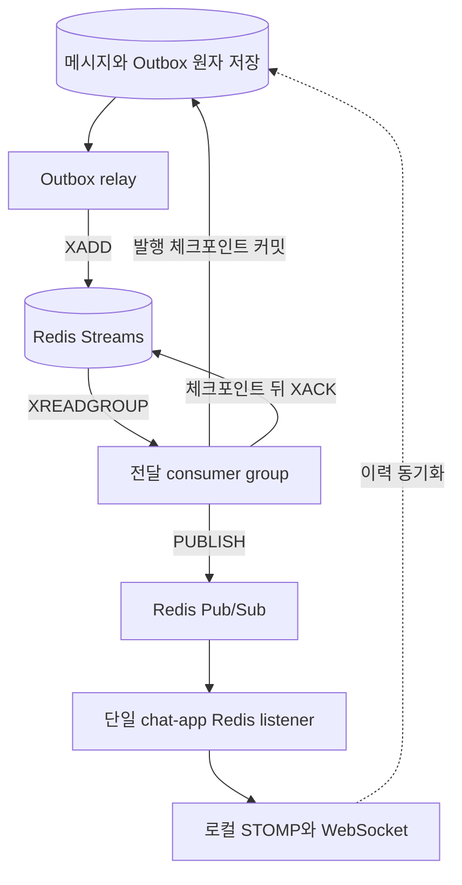

# 채팅 모듈 고도화 설계 — 전달 복구, 회원 이벤트 Kafka 전환, 단체(그룹) 채팅

앱 분리(#363) 뒤 독립 서비스가 된 `chat-app`을 Final 범위에서 고도화하기 위한 설계 문서다. 현재 코드(dev `da834b1`)를 기준으로 회원 이벤트·Redis 전달·인증의 전환과 단체(그룹) 채팅을 설계한다. 현행 구현은 1:1이며, 2026-10-29 사용자 결정으로 단체채팅을 이번 설계·구현 범위에 포함한다. 현재 구현, 목표 기술 설계, 팀 결정이 필요한 정책을 구분하고, 미정 사항은 8장에 모았다.

- 상위 결정: [최종 프로젝트 인프라 설계](../../../docs/architecture/final-project-infrastructure.md) 1장(Kafka)·2장(PostgreSQL outbox·Redis Streams·Pub/Sub)·8장(알림 모듈 분리)
- 관련 이슈: #339(Kafka 구축), #340(Redis 구축), #370·#371(JWT 인증 전환), #193(알림 모듈), #262·#310(보류)
- 공통 규칙: [AGENTS.md](../../../AGENTS.md), [모듈 연동](../../../docs/dev/module-integration.md), [테스트](../../../docs/dev/testing.md)
- 설계 검토 반영: 마지막 메시지 유실, 연결 제어 유실, 참여 세대, 백필 갱신, JWT 세션 매핑, 그룹 방장·행위 대상 기록, REST 시스템 메시지 전환을 보완했다. 이 수정은 문서 변경이며 업무 코드의 구현 완료를 뜻하지 않는다.
- 전달 경로 변경 결정(2026-10-29): 사용자의 Streams 도입 요청으로 같은 날의 미도입 결정을 대체한다. **PostgreSQL outbox → Redis Streams → 전달 consumer group → Redis Pub/Sub → 로컬 STOMP**를 목표로 한다. outbox는 DB 커밋과 Stream 적재 사이를, Streams는 후속 작업 배분·미확인 작업 회수를 담당한다. replica 1개는 유지하며 이번 변경은 설계 갱신이고 구현 완료가 아니다.
- 수신 관리 결정(2026-10-29): 메시지별·수신자별 이력 행 대신 **방·회원의 현재 참여 세대별 누적 수신 커서**를 PostgreSQL에 관리한다. 클라이언트 누적 ACK, 기존 읽음 커서, 각 기기의 이력 동기화를 함께 사용한다. 수신 커서는 이번 고도화에 포함하는 목표 설계이며 상세 계약은 4.4를 따른다.
- 범위 결정(2026-10-29): 단체채팅의 도메인·API·마이그레이션·FE·관리자 기록·테스트를 이번 고도화에 포함한다. 단체채팅 포함 여부의 별도 승인은 필요하지 않으며, 미정인 세부 정책·FE 계약은 해당 구현 전에 확정한다.
- 급증 대응 결정(2026-10-29): 오픈 직후 인기 방의 동시 전송·입장·재접속 폭주를 전제로 한다. 순서 정합성을 불변식으로 두고 비관적 락은 교체 가능한 초기 구현으로 둔다. 잠금 구간 축소·불변 수신자 집합·과부하 제어·확장 후보와 출시 기준은 4.6·4.7을 따른다. 이 문서의 설계는 성능 검증 완료를 의미하지 않는다.

---

## 1. 요약

| 주제 | 제안 | 근거 |
| --- | --- | --- |
| 회원 이벤트 | `common/shared`의 `UserJoinedEvent`·`UserModifiedEvent` 레코드를 그대로 `member.events.v1`에 싣는다(팀 결정, 2026-10-29). chat-app은 `createIfAbsent`·`memberVersion` 비교로 멱등 소비한다. 기존 회원은 생성·버전 기반 갱신을 지원하는 백필로 대조한다 | Kafka 수신과 백필은 채팅 재개 전제다(5장) |
| 실시간 전달 | 메시지와 outbox를 원자 저장하고 DB relay → Redis Streams → consumer group → Pub/Sub → 로컬 STOMP로 전달한다 | 적재 실패는 outbox, 소비 실패는 PEL 회수, Redis 데이터 유실은 DB 체크포인트 대조로 복구한다. 사용자 수신 누락은 이력으로 복구한다(4장) |
| 전달 보장 | at-least-once 전달 시도와 이력 재동기화를 함께 사용한다. 마지막 유실을 발견하는 주기적 대조·전송 결과 확인을 FE에 추가한다 | 기존 순번 간격·재연결 복구만으로는 연결이 유지된 마지막 유실을 발견하지 못한다(4.4) |
| 수신 상태 | 기존 참여 행에 누적 수신 순번을 추가하고 인증된 클라이언트 ACK로만 전진시킨다. 읽음과 별도로 관리하며 각 기기는 자기 확인 위치로 복구한다 | 메시지 × 수신자 이력 행을 만들지 않는다. 회원의 ACK를 모든 기기의 수신으로 해석하지 않는다(4.4) |
| 단체(그룹) 방 | 이번 구현에 `GROUP`·방장·제목·최대 인원, 참여 관리·FE·관리자 기록을 포함한다. 방장 퇴장·초대·강퇴 등의 미정 정책과 FE 계약을 먼저 확정한다 | 사용자 범위 결정(2026-10-29). 기존 1:1을 유지하며 용어·정책·테스트도 함께 확장한다(3장, 8장) |
| 전달 모델 | 회원별 큐를 유지하고 영속 불변 수신자 집합 참조로 회원 ID·참여 세대를 확정한다. 커밋 뒤 대상을 펼치고 실제 전달 직전에 현재 참여·가시 범위를 다시 확인한다 | 메시지마다 전체 참여자 처리를 잠금 안에서 반복하지 않고 이전 참여의 지연 메시지 유출을 막는다(4.2·4.6) |
| 로그아웃·강제 종료 | 회원 상태 반영과 연결 제어 작업을 같은 DB 트랜잭션에 기록한다. Pub/Sub과 로컬 연결 상태 재검사를 함께 쓴다 | 회원 반영 커밋 뒤 제어 발행 실패도 복구해야 한다. JWT 기기별 로그아웃 식별 계약은 미정이다(5.3, 6장) |
| 출연 알림 | 알림 모듈·FE 이관 완료 전까지 기존 기능을 유지하는 전환 경로를 마련한다 | 서비스 분리로 끊긴 상태는 복구 대상이다. 별도 팀 결정 없이 기능을 중단하지 않는다(5.5) |

진행 순서는 7장과 [작업 절차](workflow/process.md)를 따른다. 회원 이벤트 Kafka 전환을 검증한 뒤 PostgreSQL outbox relay·Redis Streams·Pub/Sub으로 전환하고, 각 전환에서 [서비스 인터페이스 경계](rules/decisions.md#서비스-경계-규칙-사용자-결정-2026-10-29)를 적용한다. 이어 단체채팅을 구현하고 JWT 연결 관리·이력 복구·장애 검증을 통합한 뒤 서비스를 전환한다. 단체채팅과 기존 1:1의 통합 검증을 이번 고도화의 완료 조건에 포함한다.

## 2. 현재 상태

### 2.1 구조

| 영역 | 현재 구현 |
| --- | --- |
| 테이블(`chats`) | `chat_user`(회원 복제본), `chat_room`(1:1, `direct_key` 유일, `last_sequence`), `chat_room_member`(`visible_from_sequence`, `participation_version`, `last_read_sequence`), `chat_message`(`room_sequence` 유일, `client_message_id`), `chat_room_log` |
| 전송 | STOMP `/pub/chats/{roomId}/messages` → `ChatMessageFacade.send`가 방을 `PESSIMISTIC_WRITE`로 잠그고 순번 발급·저장 → 커밋 뒤 `ChatMessageSender`가 현재 참여자에게 회원별 큐로 전달 |
| 수신 | 회원별 큐 `/user/queue/chats/messages`·`/errors`(FE 구독), `/notifications`(FE 미구독). 방 topic 없음. `ChatStompInterceptor`가 자기 큐 구독과 `/pub` 전송만 허용 |
| 브로커 | `enableSimpleBroker` 내장 브로커. 서버 1대 전제 |
| 연결 제어 | `ChatWebSocketSessionRegistry`가 이 프로세스의 WebSocket 세션만 기억하고, 로그아웃(세션 ID)·정지·강등(회원 ID)에 닫는다 |
| 회원 복제 | `UserJoinedEvent`로 생성, `UserModifiedEvent`로 갱신. `ReplicaUser.memberVersion`으로 옛 이벤트를 무시한다(#262의 버전 비교는 이미 구현됨) |
| 알림 | 출연 이벤트 2종을 1:1 방의 `NOTIFICATION` 메시지로 남긴다 |
| 멱등·복구 | `clientMessageId` 재전송 방지(#261, #311), `participationVersion`으로 옛 퇴장 요청 무시, 읽음은 조건부 UPDATE로 단조 증가. FE는 `appliedIds`로 중복을 거르고 `roomSequence` 간격이 보이면 이력을 다시 조회한다(`incoming.ts`), 재연결마다 채팅 데이터를 다시 부른다(`ChatConnection.tsx`) |

### 2.2 앱 분리로 끊긴 것

Spring Event와 `@ApplicationModuleListener`는 같은 프로세스 안에서만 전달된다(모듈 연동 문서). chat-app이 혼자 뜨면 아래가 도착하지 않는다.

| 이벤트 | 발행 | 채팅의 처리 | 끊긴 결과 |
| --- | --- | --- | --- |
| `UserJoinedEvent` | member-app(가입, 테스트 계정) | `chat_user` 생성 | 새 회원은 복제본이 없어 `CHAT_USER_NOT_FOUND`. STOMP CONNECT도 거절된다 |
| `UserModifiedEvent` | member-app(프로필·역할·상태 변경) | 복제본 갱신, 채팅 불가가 되면 연결 닫기 | 정지·탈퇴·강등이 채팅에 반영되지 않는다 |
| `UserLoggedOutEvent` | member-app(세션 삭제 직전) | 그 세션의 연결 닫기 | 로그아웃해도 연결이 남는다. JWT 전환(#370) 뒤에는 세션 ID 자체가 없다 |
| `AppearanceRequestSentEvent`·`AppearanceApplicationSubmittedEvent` | appearance-app | 1:1 방에 알림 메시지 | 출연 알림이 채팅에 남지 않는다 |

이 중 회원 2종은 채팅이 동작하기 위한 전제라 Kafka 전환의 첫 대상이다. 로그아웃은 설계를 바꾸고(5.3), 출연 알림은 알림 모듈로 옮긴다(인프라 문서 8장).

### 2.3 단일 replica의 전환 기준

chat-app은 **replica 1개**로 운영하고 개발·통합·k3d E2E도 같은 기준으로 검증한다(사용자 결정, 2026-10-29). 복수 replica 배치·전달은 이번 설계·구현·완료 조건에서 제외한다.

- `SimpMessagingTemplate.convertAndSendToUser`와 `ChatWebSocketSessionRegistry`는 단일 프로세스의 로컬 세션을 처리한다. 한 앱에 여러 회원과 동일 회원의 여러 연결을 붙여 전달·종료를 검증한다.
- PostgreSQL outbox → Redis Streams → consumer group → Pub/Sub으로 전환한다. DB 적재 재시도·PEL 회수·Redis 유실 재구성은 4.5를 따르고, Pub/Sub 구독 유실은 이력 복구·회원 상태 재검사로 회복한다.
- 앱 재시작 후 미완료 작업 회수와 WebSocket 재연결·이력 동기화를 검증한다. 단일 replica의 중단 중 가용성을 보장하지 않는다.

## 3. 다대다(그룹) 채팅방

**이번 설계·구현 범위에 포함한다(사용자 결정, 2026-10-29).** 현행 구현은 1:1이며 단체채팅을 추가한다. 단체채팅 작업은 이슈로 관리하고, 세부 권한·운영 정책과 FE API를 확정해 용어·정책에 반영한다. 범위 결정이 Q1~Q5·Q10의 세부 정책 전체를 승인한 뜻은 아니다. 기존 1000명·자유 재입장 안은 유지하며, 남은 정책·계약은 8장에서 확정한다.

### 3.1 지금 모델에서 그대로 쓰는 것

- `chat_room_member`: 방·회원당 1행. `visible_from_sequence`(입장 이후 메시지만 보임), `participation_version`(재입장 세대), `last_read_sequence`(읽음)가 모두 참여자 단위라 N명에 그대로 맞는다.
- `chat_message.room_sequence`: 방 단위 단조 순번. 그룹에서도 FE 간격 복구·커서 조회·안 읽은 수 계산의 기준이 된다.
- `countUnread`·`findLastVisible`: 회원 기준 집계 구조를 재사용한다. 참여자·메시지 수 증가에 따른 비용은 별도 실행 계획과 부하 테스트로 확인하며, 현재 쿼리가 N명에서도 같은 비용이라고 가정하지 않는다.
- 재입장 시 `clearClientMessageIds`와 재입장 안내, 퇴장 안내 시스템 메시지.

### 3.2 바꾸는 것

| 항목 | 변경 |
| --- | --- |
| `ChatRoomType` | `GROUP` 추가. `direct_key`는 `DIRECT`만 쓰고 `GROUP`은 null이다. PostgreSQL 유일 제약은 null을 여러 개 허용하므로 DDL 변경이 없다 |
| `chat_room` 컬럼 | `title`(그룹 제목, nullable), `owner_user_id`(방장, nullable), `max_members`(nullable, 기본값은 정책) 추가. Flyway `V<시각>__add_chat_room_group_columns.sql` |
| `ChatRoomEventType` | `MEMBER_INVITED`, `MEMBER_REMOVED`, `ROOM_CLOSED` 추가(방장 강퇴·폐쇄 이력) |
| 생성 | `ChatRoomUseCase.createGroup(ownerId, title, memberIds)`: 방장 포함 전원이 채팅 가능 회원인지 확인, 방장 포함 최대 인원 검사, 전원 `ChatRoomMember.join`. 1:1의 `openDirectRoom`은 그대로 둔다 |
| 초대 | `invite(roomId, actorId, userIds)`: 방을 잠그고 활성 참여자 수 + 초대 수 ≤ 최대 인원 확인. 이미 나간 회원이면 `rejoin`과 같은 규칙(이전 메시지 안 보임). 누가 초대할 수 있는지는 Q1 |
| 강퇴·폐쇄 | 행위자가 현재 활성 참여자이자 방장인지 검사하고 그룹 방에서만 허용한다. 강퇴는 대상 참여 세대를 검증하고, 폐쇄는 전원 퇴장과 방 종료를 한 트랜잭션으로 처리한다. 방장 자신에 대한 강퇴·방장 퇴장은 Q10 결정 전 구현하지 않는다 |
| 전송 규칙 | `ChatMessageUseCase.send`의 "상대가 없으면 `CHAT_PARTNER_LEFT`"는 1:1 규칙이다. 그룹은 혼자 남아도 보낼 수 있게 할지 Q2. 수신자(`deliverToUserIds`)·알림 대상(`notifyUserIds`)은 지금처럼 활성 참여자 목록에서 계산한다 |
| 종료 | 마지막 참여자가 나가면 `ENDED`(현행 유지). 그룹은 방장 폐쇄도 `ENDED` |
| 응답 | `ChatRoomResponse`에 `roomType`이 이미 있어 FE가 분기할 수 있다. `title`, `ownerUserId`, `maxMembers`를 추가한다. `members`는 N명이 된다 |
| 관리자 기록 | `chat_room_log`에 nullable `target_user_id`를 추가하고 초대·강퇴의 행위자와 대상을 구분한다. 기존 기록은 null을 유지한다. `ChatRoomLogResponse`와 Swagger·FE 관리자 기록도 함께 확장하며, enum 추가만으로 감사 기록이 완성된다고 보지 않는다 |

API 초안(기존 `/api/v1/chats` 아래, [API 규칙](../../../docs/api/conventions.md) 준수):

| 메서드·경로 | 역할 |
| --- | --- |
| `POST /api/v1/chats` | 1:1 시작(현행) |
| `POST /api/v1/chats/groups` | 그룹 생성 `{title, memberIds}` |
| `POST /api/v1/chats/{roomId}/members` | 초대 `{userIds}` |
| `DELETE /api/v1/chats/{roomId}/members/{userId}` | 강퇴(방장) |
| `DELETE /api/v1/chats/{roomId}/members/me` | 나가기(현행, 그룹도 동일) |
| `DELETE /api/v1/chats/{roomId}` | 폐쇄(방장) |

### 3.3 동시성과 비용

- 초기 순번 발급은 짧은 방 잠금 트랜잭션을 사용한다. 현재 코드는 잠금 뒤 전체 참여자 조회·검증·재전송 조회·수신자 목록 생성을 수행하므로 이미 충분히 짧다고 가정하지 않는다. 4.6의 수신자 집합 버전 참조와 트랜잭션 분리로 메시지당 전체 참여자 처리 비용을 잠금 밖으로 옮긴다.
- 초대·강퇴·나가기는 전송과 같은 방 잠금 규칙을 따른다. 활성 참여자 수는 방의 집계 값으로 함께 갱신해 상한을 검사하고, 참여 행과 불변 수신자 집합의 새 버전을 같은 트랜잭션에 저장한다. 기존 데이터의 집계 초기화·정합성 대조·중복 요청·롤백을 검증한다. 집계 값만 수정하고 참여 행을 나중에 맞추지 않는다.
- 초대 목록의 중복·이미 활성인 회원을 정리한 뒤 실제 새 참여 인원을 센다. 방장 퇴장은 위임·퇴장 제한·방 폐쇄 중 Q10에서 정한 정책을 같은 방 잠금 아래 적용한다. 방장 없는 활성 그룹을 허용할지 임의로 결정하지 않는다.
- 전달은 메시지당 참여자 수만큼 `convertAndSendToUser`가 호출된다. 정상 경로의 전달 작업은 메시지당 Stream 적재 1회·Pub/Sub 발행 1회이며 재시도 때 중복될 수 있다. 참여자마다 별도 outbox를 만들지 않는다(4.2).
- 최대 1000명(Q3)은 참여 인원 목표이며 처리량 보장이 아니다. 같은 방의 메시지 빈도·동시 명령·온라인 기기 수·재접속·수신 지연을 독립 축으로 시험하고, 측정한 한도를 초과하면 즉시 입력을 제한한다(4.7).

### 3.4 1:1 방과의 관계

- 1:1 방의 `direct_key` 재사용·재입장 규칙은 바꾸지 않는다.
- 같은 두 사람이 그룹에도 함께 있을 수 있다. 그룹은 `direct_key`가 없으므로 충돌하지 않는다.
- 알림(`NOTIFICATION` 메시지)은 1:1 방에만 남긴다. 알림 모듈 이관 전까지만 유효한 규칙이다.

## 4. 실시간 전달: PostgreSQL outbox → Redis Streams → Redis Pub/Sub

### 4.1 역할

| 구성 요소 | 역할 |
| --- | --- |
| PostgreSQL | 메시지·참여·읽음의 진실의 원천. 메시지와 outbox를 원자 저장하고, Stream 적재 상태·Pub/Sub 발행 체크포인트·실패 내역과 Redis 유실 후 재구성 근거를 보존한다 |
| DB outbox relay | 작은 배치로 작업을 선점하고 DB 트랜잭션 밖에서 `XADD`한다. 적재 실패·처리권 만료는 outbox로 회복한다. 후속 소비 완료와 구분한다 |
| Redis Streams | 커밋된 전달 작업의 참조를 보관하고 consumer group에 배분한다. PEL(미확인 목록)·ACK·회수를 사용하며 원본 DB를 대체하지 않는다 |
| 전달 consumer | Stream을 읽어 불변 수신자 집합을 펼치고 Pub/Sub에 발행한다. 발행 성공을 DB에 체크포인트로 남긴 뒤 `XACK`한다. 사용자 수신 ACK를 기다리는 역할이 아니다 |
| Redis Pub/Sub | 커밋된 메시지와 연결 제어 작업을 단일 chat-app 구독자에게 전달한다. 수신 완료를 보장하지 않는다 |
| chat-app의 simple broker | 단일 앱에 붙은 WebSocket 세션으로 최종 전달(현행) |
| REST 이력 API + FE 복구 | 기존 순번 간격·재연결 복구에 마지막 유실 대조와 전송 결과 확인을 추가한다 |

Streams는 전달 작업을 독립적으로 소비·회수하기 위해 도입한다. DB outbox polling, 같은 방의 DB 잠금, 사용자 수신 누락은 이 도입만으로 해결되지 않는다. Stream 적재·Pub/Sub 발행·Stream ACK·브라우저 수신은 서로 다른 완료 경계다. [Redis Pub/Sub](https://redis.io/docs/latest/develop/pubsub/#delivery-semantics)은 수신 실패한 메시지를 다시 보내지 않으므로 4.4의 이력 복구를 유지한다. 사용자 수신은 4.4의 참여자별 누적 커서로 추가 관리하며, 메시지별 사용자 수신 이력이나 서버의 기기별 ACK 테이블은 추가하지 않는다.

### 4.2 Stream·그룹·채널과 payload

아래 이름은 환경 namespace를 앞에 붙이는 채팅 소유 계약이다. Stream ID는 전송 위치이고, 안정적인 `deliveryId`·`controlId` 및 `roomSequence`를 대체하지 않는다.

| Stream | 필수 consumer group | 저장할 참조 |
| --- | --- | --- |
| `chat:delivery:stream:v1` | `chat-delivery-v1` | `deliveryId`, `type`, `messageId`, `roomId`, `roomSequence`, 불변 수신자 집합 참조·전달 규칙·스키마 버전 |
| `chat:control:stream:v1` | `chat-control-v1` | `controlId`, `type: RECHECK_USER`, `userId`, `memberVersion`, `reason`, 스키마 버전 |

- 메시지 본문과 1000명의 수신자 목록을 Stream에 복제하지 않는다. consumer가 자기 chat DB의 메시지·불변 집합으로 아래 Pub/Sub payload를 만든다. 제어 작업은 메시지 적체에 굶지 않도록 별도 Stream·worker 예산을 사용한다. Redis 프로세스·CPU·메모리는 공유하므로 자원 격리나 고가용성이라고 표현하지 않는다.
- 각 Stream의 필수 그룹은 초기 생성 때 `XGROUP CREATE ... 0-0 MKSTREAM`으로 보존된 작업부터 읽는다. 이미 있는 그룹은 재설정하지 않고 `BUSYGROUP`만 정상적인 기존 상태로 취급한다. `NOGROUP`·Stream 유실은 4.5의 재구성 절차로 처리한다. 재시작 때 `$`로 만들어 미처리 작업을 건너뛰지 않는다([XGROUP CREATE](https://redis.io/docs/latest/commands/xgroup-create/)).
- replica 1개 JVM 안에서 제한된 수의 consumer worker를 둔다. 이름은 실행 인스턴스 식별자와 worker 식별자를 결합해 충돌을 막고, 블로킹 읽기의 연결·스레드·배치 상한을 정한다. 같은 그룹은 작업을 분담하고 서로 다른 그룹은 독립적으로 소비한다. 방마다 그룹이나 스레드를 만들지 않는다.
- 이번 필수 소비자는 채팅 전달·연결 제어뿐이다. notification-app의 모듈 간 입력은 기존 Kafka를 유지한다. 향후 같은 채팅 이벤트를 별도 기능에서 소비할 때만 독립 그룹·계약·보존 예산을 추가한다. 다른 앱에 이 내부 Stream의 DB 참조를 넘겨 chat DB를 읽게 하지 않는다.

| 채널 | payload | 구독자 동작 |
| --- | --- | --- |
| `chat:fanout:v1` | `{deliveryId, type: MESSAGE, roomId, recipients: [{userId, participationVersion}], message: ChatMessageResponse, notifyUserIds: [...], senderClientMessageId}` | 로컬 연결이 있는 수신자의 현재 회원 자격·참여 세대·가시 범위를 확인한 뒤 회원별 메시지·알림 큐로 보낸다 |
| `chat:control:v1` | `{controlId, type: RECHECK_USER, userId, memberVersion, reason}` | 최신 채팅 회원 상태를 조회하고 채팅 불가일 때 그 회원의 로컬 연결을 닫는다. 옛 제어 명령으로 복구된 자격을 다시 취소하지 않는다 |

- 신규 메시지의 수신 자격과 참여 세대는 메시지 저장 트랜잭션에서 불변 수신자 집합 버전 참조로 확정한다(4.6). Stream consumer가 해당 버전을 읽어 위 Pub/Sub payload의 `recipients`를 만든다. 원래 수신자가 아니었던 새 참여자를 나중에 추가하지 않는다. 알림 대상도 동일한 수신 자격 검사를 거친다.
- chat-app 구독자는 로컬 STOMP 전달 직전에 자기 chat DB에서 회원의 채팅 가능 여부, 현재 활성 참여, `participationVersion` 일치, `roomSequence >= visibleFromSequence`를 검사한다. 불일치하면 메시지·알림 모두 버린다. 전달 판단 뒤 이미 소켓으로 전송 중인 프레임을 회수하는 보장은 하지 않는다. FE도 현재 참여 세대와 맞지 않는 실시간 응답을 적용하지 않도록 수신 계약을 맞춘다.
- 방 topic 구독 모델로 바꾸지 않는다. 회원별 큐를 유지하면 퇴장자 차단·참여 검증이 서버에만 있고, `ChatStompInterceptor`의 SUBSCRIBE 규칙도 그대로다.
- 단일 chat-app이 메시지·제어 채널을 구독한다. 방별 동적 구독 관리와 복수 replica fan-out은 이번 범위에 넣지 않는다. Redis 연결·구독 비용과 로컬 STOMP 전달 비용을 측정한다.
- 직렬화는 JSON. `type`과 채널 이름의 `v1`으로 호환성을 관리한다. 수신자 참여 세대는 STOMP 수신 메타데이터에도 전달하는 계약 초안이며 FE·Swagger 합의 후 확정한다. 재시도해도 `deliveryId`·`controlId`는 유지한다.
- 보낸 사람 본인에게 `clientMessageId`를 돌려주는 현행 규칙은 유지한다. payload의 `message`는 `clientMessageId`가 없는 공용 응답이고, 보낸 사람 분은 `senderClientMessageId` 필드로 따로 싣는다.
- 한 메시지의 payload를 Redis 채널에 발행하고 단일 chat-app 구독자가 로컬 세션에 전달한다. Redis 발행과 STOMP 전달이 성공해도 브라우저의 처리 완료로 기록하지 않는다.

### 4.3 코드 변경 지점

| 현재 | 변경 |
| --- | --- |
| 메시지·시스템 안내를 저장하는 UseCase | 같은 트랜잭션에 메시지·불변 수신자 집합 참조·전달 규칙을 포함한 `chat_outbox`를 저장한다(4.6). DB 저장 뒤 Controller가 직접 발행하는 공백을 제거한다 |
| `ChatMessageStompController` | 신규 메시지의 직접 상대 전달을 제거한다. 같은 `clientMessageId` 재전송은 기존 메시지를 보낸 사람에게만 다시 응답하며 상대 알림·새 업무 메시지를 만들지 않는다 |
| `ApiV1ChatController` | 방 생성의 재입장 안내와 나가기의 퇴장 안내도 동일한 outbox 경로를 사용한다. 단일 앱의 REST 요청으로 생성한 안내가 해당 로컬 소켓으로 전달되어야 한다 |
| `AppearanceNotificationEventListener` | `appearance.events.v1` Kafka 소비로 바꿨다(5.5). 이관 전에는 출연 알림·재입장 안내를 저장하는 트랜잭션에 outbox도 기록한다. 이관 완료 뒤에만 제거한다 |
| `ChatMessageSender`·어댑터 | `app`의 역할 중심 계약 `ChatDeliveryQueue`는 작업 적재·소비·회수·ACK를, `RealtimeChatFanout`은 Pub/Sub 발행을 분리한다. 기술 구현은 `out/redis`, 소비 진입은 `in`, 처리·복구 조정은 `app`에 둔다. outbox 저장소는 적재 상태와 발행 체크포인트·실패 격리를 보존한다. 저장소는 Spring Data JPA repository로 접근하고, PostgreSQL 전용 문장(선점의 `FOR UPDATE SKIP LOCKED`, 중복 흡수의 `ON CONFLICT DO NOTHING`, `RETURNING`)은 `@Query(nativeQuery = true)`로 둔다(사용자 결정 2026-10-30). 로컬 STOMP sender는 수신 자격 검사 뒤 최종 전달만 한다. in-memory 어댑터는 테스트 소스에 둔다 |
| `ChatWebSocketSessionRegistry` | 인증 성공 뒤 `userId → STOMP sessionId → 실제 소켓`을 매핑한다. JWT·로그인 식별자·만료 정보와 제거 규칙은 6장을 따른다 |
| 회원 이벤트의 연결 닫기 | 회원 상태·처리 기록(inbox를 둔다면)과 같은 트랜잭션에 제어 outbox를 남긴다. 발행과 로컬 회원 상태 재검사는 5.3을 따른다 |
| 설정 | `../../../common/redis`의 `RedisConfig`는 비어 있다. `RedisMessageListenerContainer`와 채널 구독은 chat-app 안(`out/redis` 패키지)에 둔다. 키·채널 규칙은 채팅이 소유한다(공통 모듈 README 규칙) |
| 관측 | 미적재 outbox 수·최장 대기, Stream 길이·그룹 lag·PEL 수/최장 idle·재회수·ACK 지연, DB 발행 미완료·재적재·실패 격리, Redis 메모리·eviction·AOF/디스크, Pub/Sub 구독 단절·제어 재검사·DB I/O/WAL을 계측한다(#343) |

DB 커밋 뒤 Redis 발행 실패는 업무 저장 실패로 돌려주지 않는다. 미발행 outbox를 재시도하고, FE는 응답을 못 받은 메시지를 '실패 확정'이 아닌 결과 미확인 상태로 다룬다. 이후 이력 확인 또는 같은 `clientMessageId` 재시도로 저장 결과를 확인한다.

### 4.4 누적 수신 커서와 마지막 유실·재접속 복구

#### 저장 모델과 완료 의미

**사용자 결정(2026-10-29): 누적 수신 커서를 이번 고도화에 포함한다.** PostgreSQL의 방 공통 메시지 원본과 기존 `chat_room_member`를 사용한다. 메시지 × 수신자 수만큼 수신 이력을 INSERT하지 않는다. 아래는 목표 필드이며 현재 코드·마이그레이션에 이미 존재한다는 뜻이 아니다.

| 저장 위치 | 키·필드 | 의미 |
| --- | --- | --- |
| `chat_message` | 기존 메시지 ID, `room_id`, `room_sequence` | 메시지 원본은 방에 한 번 저장한다 |
| `chat_room_member` | 기존 방·회원 키, `participation_version`, `visible_from_sequence` | 현재 참여 세대와 가시 범위. 재입장 때 같은 행을 갱신한다 |
| `chat_room_member` | 추가할 `last_received_sequence` | 해당 참여 세대에서 어느 한 클라이언트가 빠짐없이 수신·반영했다고 보고한 누적 위치의 최댓값. 확인 전에는 `NULL` |
| `chat_room_member` | 기존 `last_read_sequence` | 기존 읽음 정책의 위치. 수신 ACK와 별도로 갱신한다 |
| 기기 로컬 상태 | 회원·방·참여 세대별 확인 위치와 메시지 상태 | 그 기기의 누락 복구 기준. 서버의 회원 수신 커서로 대체하지 않는다 |

예를 들어 방 R1의 메시지 101번은 1행이고, 기존 참여자 A는 `received=101/read=100`, B는 `received=98/read=95`로 관리한다. 참여자가 500명이어도 새 메시지마다 수신 행 500개를 만들지 않는다. 메시지·outbox·그룹 발행 체크포인트는 별도로 남으며 참여 변경 시 불변 수신자 집합을 만드는 비용도 별개다(4.6). 참여가 바뀌지 않는 동안 메시지 M개·참여자 N명의 수신 상태 저장은 M×N행이 아니라 N개의 참여 행 갱신이다.

- 수신 확인은 클라이언트가 메시지를 자기 채팅 상태에 적용하고 중복 제거·가시 범위 대조를 마친 뒤 보내는 **애플리케이션 수준의 누적 ACK**다. STOMP `RECEIPT`, 소켓 쓰기 성공, `PUBLISHED`, `XACK`로 대신하지 않는다. 기기 디스크 영속화나 사람이 읽었다는 증거로 해석하지 않는다.
- 서버에는 인증된 클라이언트의 보고를 저장한다. 서버가 실제 화면 표시를 독립적으로 증명하는 감사 기록이 아니며, ACK 값을 권한 부여나 메시지 원본 삭제의 근거로 사용하지 않는다.
- 읽음과 수신은 독립 요청이므로 ACK 지연·역순 때 `read > received`가 일시적으로 나타날 수 있다. 읽음 요청만으로 수신 커서를 자동 전진시키거나 수신 ACK로 읽음·안 읽은 수를 변경하지 않는다. 읽음 초기값과 기존 불변식도 유지한다.
- 신규 참여·재입장·기존 데이터 마이그레이션의 수신 커서는 `NULL`(미확인)로 시작한다. 기존 읽음이나 방의 최신 순번으로 수신 완료를 추정해 채우지 않는다. 새 참여 세대의 초기화는 같은 행에서 참여 변경과 원자 처리하며, 같은 세대 안에서는 수신 순번이 줄지 않는다. 실제 Flyway·엔티티 변경은 구현 단계에서 진행한다.

#### 클라이언트 ACK와 서버 갱신

1. 메시지·outbox를 원자 저장하고 4.5의 Streams·Pub/Sub 경로로 온라인 세션에 전달한다. 서버 전달 완료 상태는 사용자 ACK를 기다리지 않는다.
2. 클라이언트는 자신에게 보이는 메시지의 연속 확인 구간만 전진시킨다. 99까지 확인한 뒤 101만 도착하면 100의 누락을 해소하기 전에는 101을 ACK하지 않는다. 서버가 보이지 않는 것으로 확정한 구간은 누락에서 제외한다. 최신 메시지 한 페이지를 받았거나 순번이 높다는 이유만으로 앞 구간까지 확인했다고 보고하지 않는다.
3. 논리 ACK 요청은 `{roomId, participationVersion, receivedSequence}`다. 사용자 ID는 인증된 principal에서 얻고 요청 값으로 다른 회원의 커서를 지정하지 못하게 한다. 정확한 HTTP/STOMP 경로·응답·오류 형식은 기존 경로 제한을 유지하면서 FE와 Q11에서 확정한다. 기존에 수신 ACK API가 있다고 가정하지 않는다.
4. 서버는 채팅 자격·방 접근·활성 참여·현재 세대·가시 범위 및 커밋된 순번 상한을 검증한다. 범위 밖 순번은 조용히 상한으로 보정해 성공시키지 않는다. 클라이언트의 빈 구간 확인 규약을 검증하되 숫자 하나만으로 실제 수신 전체를 증명할 수 있다고 주장하지 않는다.
5. 자기 참여 행만 짧은 트랜잭션에서 조건부 UPDATE한다. 현재 활성 참여와 `participation_version` 일치를 갱신 조건에 포함하고, 값이 `NULL`이거나 요청 값보다 작을 때만 올린다. 사전 조회 후 재입장·퇴장과 경합해도 옛 ACK가 새 세대에 반영되지 않도록 한다. 옛 세대 요청은 상태를 바꾸지 않고 재동기화 안내 계약을 적용한다. 같은 값·낮은 값의 정상 재전송은 멱등 처리한다.
6. 갱신 커밋 또는 이미 반영된 값 확인 뒤 서버가 확정 결과를 응답한다. DB 실패·응답 유실 시 클라이언트는 ACK를 미확인으로 유지하고 같은 세대의 최신 누적 값으로 제한된 재시도를 한다. ACK 실패 때문에 메시지 원본·outbox를 다시 만들지 않는다.

수신 UPDATE는 방 순번 발급용 `PESSIMISTIC_WRITE`를 획득하지 않으며, 방 전체 참여자 순회·수신자별 메시지 행 INSERT·외부 I/O를 수행하지 않는다. 참여 상태 갱신과의 경합을 막는 조건·잠금 순서는 구현·통합 시험으로 검증한다. Facade는 `app`의 역할 중심 인터페이스를 사용하고 수신 상태의 DB 접근 구현은 `out`에 둔다.

#### 누적 ACK 병합과 다중 기기

- 클라이언트는 메시지 101~103을 반영한 뒤 `103까지 수신` 하나로 ACK를 합친다. 방별 debounce만 사용해 지속 유입 중 ACK가 무한히 미뤄지지 않도록 최대 대기 시간과 누적 건수 상한을 둔다. 대기 방 수·메모리·재시도에도 상한을 두고 Q12에서 측정해 값을 정한다. 종료 이벤트에만 전송을 의존하지 않는다.
- 500명이 매 메시지마다 ACK하면 여전히 최대 500번 UPDATE가 발생한다. 누적 병합과 증가 시에만 UPDATE하는 방식으로 갱신량을 줄이고 수신 상태 표시 지연과 함께 측정한다. ACK마다 방 전체에 상태를 재방송해 N×N 통신을 만들지 않는다. 수신 상태 조회 권한·노출 범위·표시 주기는 Q11의 FE 계약에 포함한다.
- 서버 회원 커서는 현재 세대에서 **적어도 한 클라이언트가 해당 구간을 확인했다**는 집계다. 휴대폰의 ACK로 노트북도 받았다고 보지 않는다. 각 기기는 자기 로컬 확인 위치와 실제 보유 메시지를 기준으로 복구한다. 로컬 데이터가 유실되면 서버 회원 커서를 복사해 조회를 건너뛰지 않고 가시 범위의 필요한 이력을 다시 동기화한다.
- 기기에 커서를 영속 저장한다면 대응 메시지 상태와 함께 일관되게 저장한다. 커서만 남고 데이터가 없는 상태는 재동기화한다. 서버의 기기별 수신 테이블은 이번 범위에 추가하지 않으며, 기기별 수신 증명 요구가 생기면 별도 설계한다.
- 누적 커서는 메시지별 정확한 수신 시각·수신 시도 이력을 보존하지 않는다. 수신 커서가 낮거나 미확인이라고 실제로 받지 못했다고 단정하지 않는다. ACK 지연·유실일 수 있다. 미확인 회원 전체를 반복 스캔해 방 전체로 재발행하지 않는다.

#### 기기별 이력 복구와 저장소 경계

기존 FE는 새 메시지의 순번 간격과 WebSocket 재연결 때 이력을 다시 읽는다. 마지막 메시지만 유실되거나 Redis 구독만 끊기고 브라우저 연결이 유지되면 두 조건 모두 발생하지 않는다. 기존 기능만으로 최종 수렴한다고 가정하지 않는다.

- FE는 채팅 연결 중 방 목록과 현재 열어 둔 방의 이력을 유한한 주기로 대조한다. 재연결·화면 복귀·결과 미확인 전송의 확인 시간 초과에도 동기화한다. 주기·시간 초과·페이지 크기는 Q12에서 복구 목표와 부하를 정한 뒤 설정한다.
- 기존 최신순 `GET /api/v1/chats/{roomId}/messages?cursor=...`를 사용한다. 한 페이지로 이전 확인 순번에 도달하지 못하면 이전 페이지를 이어 읽는다. `messageId`로 중복을 제거하고 `roomSequence`로 정렬한다. 조회 범위 대조 전에는 늦게 도착한 한 메시지의 높은 순번을 '중간 구간도 확인한 순번'으로 취급하지 않는다.
- 참여 세대가 바뀌면 이전 세대의 캐시·보내는 중 상태·확인 순번을 폐기하고 새 가시 범위에서 동기화한다. 숨겨진 순번이 있다는 이유로 무한 재조회하지 않는다. 원본 조회가 성공하고 동기화가 완료된 뒤에만 복구 완료로 표시한다.
- Redis 구독 재연결 때 chat-app은 해당 로컬 연결에 재동기화가 필요함을 알린다. 제어 프레임의 경로·형식은 FE 계약에 포함한다. 이 알림도 유실될 수 있어 주기적 대조를 유지한다.
- 송신 응답 확인 시간이 지나면 이력에서 자신의 `clientMessageId`를 확인한다. 확인되지 않으면 결과 미확인으로 표시하고 같은 ID 재시도를 제공한다. 재시도해도 DB 메시지·상대 알림·안 읽은 수는 중복 증가하지 않는다.
- 복구 조회는 누락된 기기가 자기 확인 위치를 기준으로 수행한다. 여러 페이지와 가시 범위를 대조한 뒤 클라이언트의 확인 위치를 올리고 누적 ACK를 보낸다. 참여 세대·가시 범위·조회 완료 구간을 FE가 판단할 응답 계약은 Q11에서 맞춘다. 신규 `afterSequence` API가 이미 구현됐다고 전제하지 않는다.

온라인 전달과 누락 이력 조회를 함께 사용하며 PostgreSQL을 원본·참여·수신 상태 저장소로 유지한다. 500명이라는 인원만으로 Cassandra나 Elasticsearch로 옮기지 않는다. 저장량·ACK UPDATE/WAL·경합·이력 조회·지연을 측정해 4.7의 저장 분할 후보를 판단한다. [하이브리드 Fan-out 참고 글](https://suldenlion.tistory.com/371)의 200명은 예시이며 전환 임계값으로 채택하지 않는다. 피드의 사전 배분·조회 전략과 수신 상태 모델은 구분하고, 이 참고 링크로 방 크기에 따른 전달 경로 자동 전환을 추가하지 않는다.

이는 FE 변경이 필요한 추가 설계다. 네트워크 단절 중의 복구 시간을 보장하거나 exactly-once 수신을 주장하지 않는다. 소스 재조회가 가능한 상태에서 마지막 유실까지 발견하고 수렴하는지를 시험한다.

### 4.5 Outbox → Streams → Pub/Sub의 실패 경계

#### DB 저장과 Stream 적재

1. 메시지·불변 수신자 집합 참조·전달 outbox를 같은 chat DB 트랜잭션으로 저장한다. 연결 제어도 회원 반영과 원자 저장한다. 롤백하면 작업도 남지 않는다.
2. outbox의 **적재 상태**는 `PENDING → PROCESSING → ENQUEUED`다. `ENQUEUED`는 `XADD` 응답을 확인했다는 뜻이다. 기존 직접 Pub/Sub 설계의 `PUBLISHED` 완료 상태를 그대로 재사용하지 않는다. 적재 처리권은 `claimToken`·`leaseUntil`, 실패는 `nextAttemptAt`·횟수로 관리하며 상한 초과는 `DEAD`로 격리한다.
3. 실행 대상·만료 처리권 인덱스를 통해 작은 배치를 `FOR UPDATE SKIP LOCKED` 등으로 선점하고 커밋한다. DB 트랜잭션 밖에서 `XADD ... *`를 호출하고, 자신의 처리권이 유효할 때만 `streamEntryId`·적재 시각·`ENQUEUED`를 기록한다. Redis I/O 동안 DB 행 잠금을 유지하지 않는다. 응답 유실·적재 직후 종료 때 같은 전달 ID의 Stream 항목이 여러 개 생길 수 있다.
4. 적재 실패는 backoff·jitter, worker 종료는 DB lease 회수로 복구한다. 적재 상태와 아래 발행 체크포인트는 독립적으로 갱신한다. consumer가 relay의 결과 저장보다 먼저 처리해도 relay가 소비 완료를 덮어쓰지 않아야 한다.

#### 그룹 소비·Pub/Sub 발행·ACK

1. consumer는 `XREADGROUP ... COUNT ... BLOCK ... STREAMS <key> >`로 새 작업을 읽는다. `NOACK`를 쓰지 않는다. 정상 소비는 Streams가 배분하며 DB 발행 체크포인트를 새 작업 큐처럼 계속 polling하지 않는다.
2. `(group, deliveryId 또는 controlId)`별 **Pub/Sub 발행 체크포인트**를 chat DB에 둔다. 논리 상태는 `PENDING / PUBLISHED / DEAD`이며 재시도 횟수·다음 시도 시각·오류·발행 시각·운영 재처리 세대를 관리한다. 메시지별·사용자별 수신 이력 테이블이 아니다. 구체 테이블명·컬럼·인덱스는 Flyway 설계에서 확정한다. outbox와 같은 트랜잭션에 초기 복구 대상이 남도록 한다.
3. consumer는 안정적인 ID와 체크포인트를 확인하고 메시지·불변 집합에서 payload를 만든 뒤 DB 트랜잭션 밖에서 `PUBLISH`한다. 성공 응답 → 짧은 DB 트랜잭션으로 `PUBLISHED` 기록 → 해당 Stream entry에 `XACK` 순서다. 체크포인트 기록 실패 때 ACK하지 않는다. 이미 같은 처리 세대에서 `PUBLISHED`인 중복 entry는 다시 발행하지 않고 ACK할 수 있다.
4. `PUBLISH` 성공 뒤 DB 체크포인트 전에 종료하면 중복 발행될 수 있다. DB 기록 뒤 ACK 전에 종료하면 체크포인트 확인 후 ACK한다. 여러 worker·회수·운영 재처리가 경합해도 옛 처리 세대의 결과가 새 상태를 덮지 않도록 조건부 갱신한다. 이 경계에서 exactly-once Pub/Sub 발행을 주장하지 않는다. FE는 `messageId`로 중복을 제거하고 `roomSequence`로 정렬·누락 복구한다. worker 병렬화는 같은 방의 완료 순서를 자동 보장하지 않는다.
5. `PUBLISH` 응답의 구독자 수는 브라우저 수신자 수나 처리 완료 수가 아니다. replica 1개에서 구독자는 chat-app 자신뿐이므로 **구독자 0명은 자기 구독 단절로 보고 `PUBLISHED`로 기록하지 않으며 `XACK`도 하지 않는다**(2026-10-29 사용자 결정). PEL에 남겨 구독 복구 뒤 backoff·횟수 상한 안에서 다시 발행하고, 상한 초과는 7번의 격리 절차를 따른다. 구독자 0명은 별도 지표로 남긴다. 오프라인 회원은 구독자 수와 무관하므로 그들을 위해 재발행하지 않는다. `XACK` 후에도 구독자나 브라우저가 놓친 메시지는 4.4의 이력 복구로, 제어는 5.3의 회원 상태 재검사로 회복한다.
6. 전송 실패는 ACK하지 않고 PEL에 남긴다. `>` 읽기만으로 pending은 재처리되지 않으므로 `XPENDING` 관측과 `XAUTOCLAIM` 기반의 제한된 회수 루프를 둔다. 반환 cursor를 이어 탐색하고 새 작업·회수 작업의 처리 예산을 나눈다. 최소 idle은 정상 처리 deadline보다 길게 두며 다음 시도 시각·backoff를 지킨다. claim이 멈춰 있던 옛 worker의 외부 발행까지 취소하지는 않으므로 중복을 허용·흡수한다([XAUTOCLAIM](https://redis.io/docs/latest/commands/xautoclaim/)).
7. 재시도 상한 초과·잘못된 payload·원본 참조 누락은 원인과 원본 entry·안정 ID를 DB에 내구성 있게 격리한 뒤에만 ACK한다. 격리 저장 실패 때 ACK하지 않는다. 같은 `DEAD` 작업의 중복 entry는 격리 기록 확인 후 ACK하고 자동 재적재하지 않는다. 별도 failed Stream을 추가해 실패 저장소를 중복 운영하지 않는다. 권한 있는 운영자가 처리 세대를 올려 재처리하며 안정 ID·누적 횟수·감사 기록을 보존한다.

#### Redis 유실 복구와 보존

- `XADD` 성공은 영구 보존의 보장이 아니다. 운영 Redis의 AOF 활성화·fsync·영속 볼륨·메모리 상한·eviction 설정을 구현 전 배포 담당과 확정하고 재시작·강제 종료를 시험한다. 이번 문서 수정으로 배포 설정이 적용됐다고 표시하지 않는다. 단일 Redis는 HA가 아니며 AOF 설정에 따른 손실 구간을 기록한다([영속화 문서](https://redis.io/docs/latest/operate/oss_and_stack/management/persistence/)).
- Stream 키에는 TTL을 걸지 않는다. 작업 키가 메모리 eviction으로 사라지는 운영을 허용하지 않으며 `noeviction`을 기준으로 공용 Redis의 다른 용도와 자원 정책을 맞춘다. 용량 임계점에서는 `XADD` 유입·신규 저장을 제한하고 DB outbox에 미적재 작업을 남긴다. Streams·PEL·AOF rewrite·Pub/Sub 출력 버퍼·앱 버퍼를 같은 메모리 예산으로 측정한다.
- **Redis 키/그룹 유실 또는 후속 처리 기한 초과 시**, DB의 `ENQUEUED`이면서 해당 필수 그룹의 체크포인트가 아직 `PUBLISHED/DEAD`가 아닌 작업을 인덱스·키셋·제한 배치로 대조한다. 복구 작업도 선점·재적재 시각을 기록하고 cooldown·횟수 상한을 두어 같은 작업을 매번 `XADD`하지 않는다. 그룹을 재생성한 뒤 원본 참조와 동일한 안정 ID로 재적재한다. 정상 backlog나 PEL 작업과 겹칠 수 있으므로 중복 처리를 검증한다. 기본 worker 회수는 PEL을 사용하고 이 DB 대조는 유실·지연 복구 경로다.
- 전달 체크포인트가 `PUBLISHED`인 작업은 Redis 데이터 유실만으로 자동 재발행하지 않는다. 이미 끝난 Pub/Sub 뒤의 사용자 누락은 이력 복구 대상이다. DB 원본·수신자 집합·미완료 작업·실패 기록은 복구나 운영 재처리에 필요한 동안 보존하고 Soft Delete 정책을 따른다.
- `XACK`는 그룹의 PEL에서 제거하며 Stream 본문은 남긴다. 정리는 모든 필수 그룹의 미전달 위치·최소 pending ID·DB 격리 완료를 확인한 안전 경계와 보존 기간을 함께 적용한다. backlog가 있는 상태에서 길이만 보고 `XADD MAXLEN`/`XTRIM`으로 자르지 않는다. 그룹 추가·초기화와 정리 작업을 조정해 새 소비자가 필요로 하는 데이터를 지우지 않는다. 구현은 실제 Redis/Testcontainers 버전의 지원 명령으로 검증하고 최신 문서의 옵션을 무조건 사용하지 않는다([XTRIM](https://redis.io/docs/latest/commands/xtrim/)).
- Redis Stream 항목은 DB 원본에서 재구성 가능한 전달 버퍼이며 정리 대상은 이 버퍼뿐이다. 채팅 원본·outbox·발행 체크포인트 등 DB 업무·복구 기록을 hard delete하는 예외로 확대하지 않는다. 본문이 없는 pending을 발견하면 성공 ACK로 숨기지 않고 DB 복구·경보로 연결한다.
- polling·배치·동시성·lease·claim idle·재시도·대조 주기·Stream 보존/크기·Redis 영속화/메모리·복구 SLO는 Q12에서 수치화한다. 수치 미확정 상태는 출시 준비 완료가 아니다. Streams를 넣었으므로 DB I/O가 줄었다고 가정하지 않고 체크포인트 비용까지 측정한다.

### 4.6 오픈 직후 급증을 전제로 한 잠금 구간 설계

이번 구현의 기준은 replica 1개이며, 사용자 증가를 기다린 뒤에 보호 장치를 넣지 않는다. 아래는 구현할 목표 구조다. 현재 `ChatMessageUseCase.send`·`ChatRoomUseCase`에 이미 적용됐다는 뜻은 아니다.

#### 불변식과 초기 구현

방 안의 메시지 순번은 유일하고 증가하며 메시지·outbox와 같은 트랜잭션에서 확정한다. 입장·퇴장·재입장·강퇴·폐쇄·시스템 안내와의 순서 및 수신 자격도 일관되어야 한다. 초기 구현은 이 경계를 짧은 방 단위 `PESSIMISTIC_WRITE`로 보호한다. 단일 replica라도 요청 처리 스레드는 동시 실행되므로 DB 정합성 제어가 필요하다.

잠금은 메서드의 일부 코드를 빠져나오는 시점이 아니라 트랜잭션 종료까지 유지된다. `UPDATE ... RETURNING`으로 순번 증가를 바꿔도 같은 행의 갱신 경합은 남는다. 잠금을 생략하는 최적화로 간주하지 않는다([PostgreSQL 행 잠금](https://www.postgresql.org/docs/18/explicit-locking.html#LOCKING-ROWS)). 순번을 먼저 별도 트랜잭션으로 커밋하거나 Redis `INCR`로 분리하지 않는다. 현재 FE의 순번 간격 복구 계약도 함께 보존한다.

#### 전송의 세 구간

| 구간 | 수행할 작업 | 제외할 작업·주의점 |
| --- | --- | --- |
| DB 트랜잭션 전 | 본문·길이·ID 형식 검증, 인증 확인, 회원·방 단위 입력 제한과 동시 실행 슬롯 확보. 비잠금 사전 조회는 빠른 거절의 참고로만 사용 | DB 연결을 확보한 채 작업 큐에서 기다리지 않는다. 사전 조회·캐시를 최종 참여·권한 판정으로 사용하지 않는다 |
| 짧은 저장 트랜잭션 | 방 잠금 → 종료 여부·발신자의 현재 참여 세대 재검증 → chat DB의 회원 자격 확인 → 현재 세대의 멱등 조회 → 새 메시지만 순번 증가 → 메시지·수신자 집합 참조·outbox 저장 → 커밋 | 전체 참여자 엔티티 로딩, 수신자별 반복 쿼리, 전체 목록 DTO·JSON 조립, Redis·Kafka·HTTP 호출, STOMP 전달, sleep·동기 외부 로깅·블로킹 큐 대기를 넣지 않는다 |
| 커밋 뒤 | 반환용 불변 값으로 응답 조립, relay의 Stream 적재, consumer의 수신자 집합 전개·JSON 직렬화·Pub/Sub 발행, 구독자의 로컬 세션 전달 | 지연 로딩을 위해 저장 트랜잭션을 연장하지 않는다. 반환에 필요한 스칼라 값은 안에서 복사하고 엔티티를 외부로 노출하지 않는다. 결과 기록은 별도의 짧은 트랜잭션으로 한다 |

서비스 구현체에 저장 트랜잭션을 명시하고 Facade 전체에 넓은 트랜잭션을 걸지 않는다. 인터페이스 추출 뒤 실제 Spring 프록시 호출로 트랜잭션이 나뉘는지 검증한다. 메서드 내부 호출로 애노테이션 경계가 만들어진다고 가정하지 않는다. 일반 전송뿐 아니라 REST 퇴장·재입장과 출연 알림의 경로도 같은 기준으로 점검한다.

발신자는 `(roomId, userId)` 인덱스로 한 참여 행만 읽는다. 1:1의 상대 퇴장 검사는 집계·대상 조회로 확인하고 전체 목록을 만들지 않는다. 멱등 조회는 현행 동일 방·발신자·현재 참여 세대의 의미를 보존하고, 방 순번 유일 제약과 기존 전송 ID 유일 제약을 마지막 방어로 유지한다. 사전 재전송 조회만으로 저장을 결정하지 않으며 잠금 안에서 재확인한다. 회원 상태 이벤트는 방 잠금과 다른 경로이므로 방 잠금만으로 자격 변경까지 직렬화된다고 주장하지 않는다. 전송 시 DB 검사와 전달 직전 최신 상태 재검사를 유지한다.

#### 메시지마다 참여자 1000명을 잠금 안에서 펼치지 않기

단체방은 참여 변경 때 **영속 불변 수신자 집합**을 만들고 메시지는 그 집합의 ID·버전만 참조한다. 채팅 DB 내부의 헤더와 항목으로 관리하며, 항목은 `{userId, participationVersion}`이다. 구체 테이블·컬럼명은 Flyway 설계에서 정하되 아래 계약을 만족해야 한다. 기존의 메시지마다 전체 수신자를 outbox JSON으로 복사하는 제안을 이 방식으로 대체한다.

1. 방은 현재 참여 집합 버전과 활성 인원수를 가진다. 참여 변경은 방 잠금 아래 참여 행·집계·새 불변 집합·현재 버전 포인터·필요한 시스템 메시지/outbox를 원자적으로 갱신한다. 기존 버전의 항목을 덮어쓰지 않는다.
2. 일반 메시지는 현재 집합 참조를 기록한다. 퇴장 안내는 남은 참여자 집합, 기존 1:1 재입장 안내는 재입장 전 남아 있던 참여자 집합을 참조한다. 안내·본문·발신자 응답의 대상이 다르면 각각 명시적인 참조와 전달 규칙을 기록한다. 단체방의 안내 정책은 Q 항목에서 확정한 결과를 적용한다.
3. Stream consumer는 커밋된 참조를 읽어 `recipients`와 알림 대상을 만든다. 메시지 저장 이후에 새로 입장한 회원은 해당 버전에 없으므로 추가되지 않는다. DB 재시도·프로세스 종료 뒤에도 같은 집합·참여 세대로 재구성할 수 있다. 현재 참여자 조회나 TTL 캐시만으로 대체하지 않는다.
4. 버전 집합은 캐시할 수 있으나 크기·버전 수·TTL·전체 메모리에 상한을 두고 cache miss는 원본을 읽는다. 참조하는 메시지·미완료 outbox·Stream 소비·운영 재처리의 수명 동안 원본을 보존한다. 없는 집합을 현재 집합으로 대체해 보내지 않고 작업을 실패 격리한다. 보관·아카이빙은 Soft Delete 정책을 따른다.
5. 구독자는 집합과 **현재 로컬 세션 회원**의 교집합을 대상으로, 최신 회원 자격·활성 참여·참여 세대·가시 범위를 배치 조회한다. 메시지마다 회원당 쿼리를 반복하지 않는다. 결과를 무제한 캐시해 강퇴·자격 상실을 놓치지 않는다. 최종 검사 뒤 이미 전송 중인 프레임 회수는 보장하지 않는다.

수신자 집합을 만드는 참여 변경에는 여전히 인원수에 비례하는 비용과 저장량이 있다. 이를 O(1)이라고 표현하지 않는다. 동시 입장·초대도 별도 제한하고 한 요청의 변경 인원을 제한한다. 필요하면 이전 불변 버전으로 후보를 미리 준비하고 잠금 뒤 기준 버전·권한을 재검증해 확정하며, 버전이 바뀌면 제한된 횟수로 다시 시도한다. 메시지 전송과 참여 변경 폭주를 함께 시험한다. 최초 전환 시 기존 참여 데이터로 집합·집계를 만들고, 집합이 없는 방을 정상 전송 대상으로 열지 않는다.

닉네임 표시용 조회·관리자 응답 조립도 핵심 상태 변경과 분리한다. 재입장의 기존 `clearClientMessageIds`는 과거 메시지 수만큼 갱신할 수 있으므로 전체 이력 정리를 짧은 잠금이라고 취급하지 않는다. 해당 비용을 별도로 측정하고, 출시 전 상한을 넘으면 메시지에 참여 세대를 명시해 세대별 멱등 키로 전환하는 마이그레이션을 설계한다. 이 경우 기존 재전송·재입장·발신자 전송 ID 노출 계약을 유지하며 용어·DB 문서와 회귀 시험을 함께 갱신한다. 미완료 재입장을 먼저 성공 처리하지 않는다.

#### DB에 들어가기 전에 과부하를 제한

- 방·회원별 Resilience4j 입력 제한과 앱 전체 DB 쓰기 동시성 제한을 둔다. 특정 방 요청이 모든 DB 연결을 점유하지 않게 방별 동시 실행과 대기량을 제한한다. 대기를 허용하면 전체 대기 요청 수·바이트·만료 시간도 제한한다. 연결 수와 메시지 빈도 제한은 별개로 둔다.
- DB 연결 대기·행 잠금 대기·statement·트랜잭션·요청 deadline을 함께 설정한다. DB가 요청보다 오래 작업을 계속하지 않도록 취소·롤백 전파와 실제 드라이버 동작을 시험한다. 잠금 실패를 같은 트랜잭션에서 무한 재시도하지 않는다. PostgreSQL의 `lock_timeout`·`statement_timeout`은 서로 다른 대기 구간을 제한한다([설정 문서](https://www.postgresql.org/docs/18/runtime-config-client.html)).
- 저장 전 용량 초과 거절과 커밋 결과 미확인을 구분한다. REST·STOMP 오류의 구체 code·재시도 가능 여부·대기 안내는 기존 공통 오류 형식과 FE 계약으로 확정한다. 커밋 뒤 전달 지연을 전송 실패로 응답하지 않는다. 클라이언트 재시도에는 backoff·jitter를 적용하고 동일 `clientMessageId`를 유지한다. 기존 전송 ID가 선택적인 계약을 몰래 필수로 바꾸지 않는다.
- 신규 메시지 저장, 제어 이벤트, relay, Stream 신규 소비·PEL 회수·DB 재구성, 이력 복구의 executor·동시성 예산을 나누어 제어 종료와 복구가 전송 폭주에 굶지 않게 한다. WebSocket 세션별 송신 버퍼·시간 제한과 앱 전체 버퍼 예산을 둔다. 느린 수신자는 무제한 적재 대신 연결 종료·이력 재동기화로 복구하며 종료 사유를 FE에 전달한다.
- Redis 장애·소비 지연 때 outbox와 Stream/PEL의 최장 대기·증가율·DB 디스크/WAL·Redis 메모리를 관측해 입력을 낮추거나 신규 저장을 거절한다. 미완료 작업을 삭제해 공간을 확보하지 않는다. 입장·연결·재접속·이력 조회에도 제한과 페이지 크기 상한을 두고, FE 복구 타이머에 jitter·동시성 상한을 적용한다. 보관 작업과 원장 등 다른 앱의 DB 부하도 함께 관측한다.

### 4.7 대규모 시스템으로의 발전 경계와 출시 기준

현재 프로덕션과 검증은 replica 1개다. 아래 확장안은 교체 가능한 계약을 준비하기 위한 설계이며 복수 replica·새 저장소·새 브로커의 구현이나 시험을 이번 완료 조건으로 추가하지 않는다. 메모리·DB·디스크를 무한히 늘릴 수 없으므로 수용량 초과 시 일부 요청을 명시적으로 거절하고, 이미 성공한 저장과 회복 가능성을 지킨다.

| 경계 | 이번 구현 | 측정으로 한계를 확인했을 때의 발전 후보 |
| --- | --- | --- |
| 입력·순서 | `app`의 역할 중심 명령 처리 계약, 방별 입력 제한, 짧은 DB 잠금 | `roomId`별 단일 작성자/partition 처리. 전송·참여 변경·시스템 안내를 같은 순서 경로에 모으며, 방마다 스레드를 만들지 않는다 |
| 저장 | 메시지·순번·outbox 원자 저장, 인덱스·페이지 조회, 영속 참여 집합 버전 | 방/시간 구간별 저장 분할, 뜨거운 방 격리. 검색·읽기 projection을 분리해 쓰기 경로와 간섭 축소 |
| 수신자·전달 | 불변 참여 집합 참조, 커밋 후 전개, 로컬 온라인 세션 교집합·배치 검증, 회원별 STOMP 큐 | 접속 경로 라우팅과 전달 전담 계층 분리. 오프라인/대규모 방은 필요 시 이력 조회 중심 모델을 검토하되 FE 계약과 공개 범위를 먼저 확정 |
| 내구성·재시도 | outbox lease·claimToken, Stream group·PEL·ACK, DB 발행 체크포인트·유실 재구성·DEAD·안정적인 전달 ID | 입력 영속 로그 도입 후보. 접수 ACK와 메시지 저장 완료 ACK를 구분하고 원본 데이터의 기준·재생·중복·마이그레이션을 별도 설계 |

`ChatCommandService`, `MessageStore`, `DeliveryAudienceResolver`, `ChatDeliveryQueue`, `RealtimeChatFanout` 등 역할 이름은 계약 예시다. 계약은 `app`, DB·Redis 기술 구현은 `out`, 조정은 `app`, 진입 어댑터는 `in`에 둔다. 순번·메시지 저장은 원자적 저장 계약 안에 두고, 각각 독립 커밋하는 인터페이스로 잘못 분리하지 않는다. 미래 분산 구현의 담당자 전환에는 epoch/fencing·재생·멱등 처리가 필요하며, 현재의 로컬 큐·mutex만으로 분산 정합성까지 해결했다고 보지 않는다.

Kafka 입력 로그 후보는 `roomId` key의 파티션 순서를 활용할 수 있으나, 같은 방의 처리 완료 순서·재시도·재할당·파티션 변경을 따로 제어해야 한다. hot room 하나의 엄격한 전체 순서는 여전히 조정 지점이다. 현재 회원 이벤트 Kafka 전환에 채팅 명령 로그 도입을 끼워 넣지 않는다([Kafka 공식 설명](https://kafka.apache.org/intro/)). 메시지 ID·정렬 위치·동기화 커서도 구분하며 Snowflake·시간 기반 ID만으로 커밋 순서나 간격 없는 순번을 보장한다고 가정하지 않는다. Discord의 2023년 공개 사례는 채널·시간 버킷 분할과 hot partition 문제를 보여 주는 참고이며 우리 수용량의 증거가 아니다([공개 사례](https://discord.com/blog/how-discord-stores-trillions-of-messages)).

#### 출시 전 반드시 확보할 증거

1000명 접속만 성공한 시험으로 출시 기준을 충족하지 않는다. Q12의 수치는 운영 전 필수 결정이며, 아래 시험으로 방별·전체 수용 한도와 제한 설정을 기록한다. 성능 목표·최대 유입·지속 시간·허용 거절률·복구 목표를 합의하지 않았거나 시험하지 않았으면 준비 완료로 표시하지 않는다.

1. 한 방 1000명 접속에 평상 전송·순간 동시 전송·지속 과부하를 가하고, 여러 방의 동일 총량 시험과 비교한다. 메시지 크기·온라인 기기 수·읽음·이력 조회·입퇴장/강퇴 혼합을 명시한다. 초당 20건을 1000명에게 보내면 단순 모델에서 초당 약 2만 건의 사용자 전달이며, 멀티 기기는 더 늘어난다는 비용을 부하 모델에 포함한다.
2. 잠금 **획득 대기 시간**, **획득 뒤 commit/rollback까지 유지 시간**, 연결 풀 대기, 트랜잭션·저장·전달 p95/p99, DB 쿼리 수·조회 행 수, 수신자 전개 시간, 큐의 길이·바이트·최장 대기·거절 수를 각각 측정한다. 평균 응답 시간으로 잠금 경합을 숨기지 않는다. 변경 전후를 같은 조건으로 비교한다.
3. 트래픽이 급증해도 대기열·스레드·DB 연결·세션 버퍼·heap/RSS가 설정 상한 안에서 안정되고, 한 방의 과부하 중 다른 방·회원 제어·이력 복구가 진행되는지 확인한다. 버퍼를 키워 잠시 버티는 결과를 처리량 향상으로 보고하지 않는다.
4. Redis 중단·구독 단절·DB 지연·앱 강제 종료·재접속 폭주를 섞고, 입력 제한 발동과 복구 뒤 적체 해소·중복 흡수·마지막 유실 수렴을 확인한다. 성공 응답 메시지 누락, 유일성 위반, 이전 참여 세대의 유출은 허용하지 않는다.
5. 수신자 집합 확정과 초대·퇴장·재입장이 경합해도 새 참여자가 과거 전달에 끼어들지 않는지, 옛 집합은 유지되는지, 캐시 전체 유실·참조 누락·재처리에서 현재 목록으로 잘못 대체하지 않는지 검증한다. 집합 생성·집계 갱신 롤백도 확인한다.

## 5. 회원 이벤트 Kafka 전환

### 5.1 계약

토픽·key·헤더·재시도·DLT 규칙은 인프라 문서 1장(`docs/architecture/infrastructure/kafka.md`)과 ADR 0001·0002(#339)를 따른다. 아래 shared 계약 결정은 그 문서와 같다.

| 항목 | 값 |
| --- | --- |
| 토픽 | `member.events.v1` |
| key | 회원 ID. 같은 회원을 같은 파티션으로 보내되 relay·재처리 순서는 원본 버전으로 방어한다. 파티션 증설 시 재배치·이행 순서는 별도 운영 절차로 검증한다 |
| payload | `common/shared`의 `UserJoinedEvent(UserDto)`·`UserModifiedEvent(UserDto)` 레코드를 그대로 JSON으로 싣는다(팀 결정, 2026-10-29). 예: `{"user":{"id":1,"nickname":"…","role":"INFLUENCER","status":"ACTIVE","version":3}}`. 별도 envelope 레코드를 만들지 않는다 |
| 타입 구분 | Modulith 기본 `ByteArrayJacksonJsonMessageConverter`(Jackson 3)가 붙이는 `__TypeId__` 헤더(레코드 클래스 이름). 소비자는 `JacksonJsonDeserializer`(Jackson 3)에 실제 이벤트 패키지 `com.hapbang.shared.member.event`를 신뢰 패키지로 지정하고 `removeTypeHeaders=false`로 두며 `ErrorHandlingDeserializer`로 감싸 같은 레코드로 되돌린다(chat #417). 상위 패키지 이름이 하위 패키지까지 자동 허용한다고 가정하거나 전체 `*`를 신뢰하지 않는다. 두 앱이 같은 shared 클래스를 쓰므로 별도 타입 매핑은 두지 않는다 |
| 멱등 키 | `user.id` + `user.version`. `version`은 회원 원본 `@Version`이라 변경마다 1씩 오른다. 별도 `eventId`는 두지 않는다 |
| 헤더 | `eventType`(레코드 이름)과 `eventVersion`만 싣는다(#339). `occurredAt`·`correlationId`는 넣지 않는다. Modulith 헤더 함수는 이벤트만 받아 재발행 때 같은 값을 만들 수 없다. 추적은 관측성(#343)의 trace 헤더가 맡는다 |
| 스키마 | 계약은 shared 레코드 자체다. 레코드 변경은 shared 변경이라 모든 앱이 함께 컴파일된다. JSON Schema 파일과 CI 호환성 검사(인프라 문서 7장)는 레코드에서 생성한다 |

기존 `UserLoggedOutEvent`는 HTTP 세션 ID를 담으므로 그대로 JWT 계약에 재사용하지 않는다. 전환기 세션 로그아웃 전달과 JWT 로그인 식별자·종료 이벤트 계약은 6장 및 Q8에서 다룬다.

### 5.2 발행(member-app)

- Spring Modulith event externalization(`spring-modulith-events-kafka`, Modulith BOM 2.1.1에 있음)을 쓴다. 지금 member-app의 publication registry가 그대로 outbox가 되어, 업무 트랜잭션과 같은 DB에 발행 기록이 남고 broker가 내려가 있어도 재기동 뒤 다시 발행된다(`republish-outstanding-events-on-restart: true`는 이미 켜져 있다).
- shared의 `UserJoinedEvent`·`UserModifiedEvent` 레코드에 `@Externalized("member.events.v1::#{#this.user().id()}")`를 붙인다. 루트 `build.gradle.kts`가 모든 서브프로젝트에 `spring-modulith-events-api`를 넣으므로 shared에 새 의존이 생기지 않는다. 발행하는 앱은 member-app뿐이라 다른 앱에는 외부화 구성이 없어도 된다.
- shared 레코드에 애노테이션을 두지 않으려면 member-app에 `EventExternalizationConfiguration` 빈을 두고 `selectByType(...)`·`route(...)`·`routeKey(...)`로 같은 토픽·key를 지정한다. 2026-10-29 사용자 결정으로 shared 레코드의 `@Externalized`를 쓴다(Q13).
- 직렬화는 Modulith 기본 `ByteArrayJacksonJsonMessageConverter`(Jackson 3)가 레코드를 JSON 바이트로 바꾸고 `__TypeId__` 헤더를 붙이며, Modulith 기본 `ByteArraySerializer`가 그대로 보낸다(Modulith 기본값). 발행 코드(`MemberSupport`, `MemberOAuthLoginUseCase` 등)는 바뀌지 않는다.
- 같은 프로세스의 member 내부 리스너(`MemberChannelSupport` 등)는 지금처럼 Spring Event로 받는다. Kafka는 다른 앱에만 보내는 통로다.
- 회원 변경과 외부 발행 기록이 같은 member DB 트랜잭션에 남는지 확인한다. 업무 커밋 직후 프로세스 종료 시험을 두고, 비동기 콜백에서 처음 발행 기록을 만들어 커밋 사이 공백이 생기지 않도록 한다.
- 재시작 재발행 설정만으로 broker 복구 후 실행 중인 앱의 자동 재발행까지 보장된다고 보지 않는다. 실행 중 미완료 발행의 재시도·stale 회수는 회원 담당이 #421에서 정한다(채팅 고도화에서는 구현하지 않음, 사용자 결정 2026-10-29). 그 전까지 broker 장시간 중단 뒤에는 앱 재시작으로 재발행하며, broker만 재시작하는 시험과 앱을 재시작하는 시험을 각각 둔다.

### 5.3 소비(chat-app)

| 항목 | 설계 |
| --- | --- |
| 리스너 | 클래스 레벨 `@KafkaListener(topics = "member.events.v1", groupId = "chat-app.member-replica")`에 가입·변경 `@KafkaHandler`를 두고, 모르는 타입은 기본 핸들러에서 무시한다(#339). shared 레코드를 받아 아래 원자적 처리 서비스에 위임한다. 기존 회원 Facade·UseCase를 재사용하되 단순 호출 후 외부 발행만 붙이지 않는다. 역직렬화(`ErrorHandlingDeserializer`로 감싼 `JacksonJsonDeserializer`, 5.1의 신뢰 패키지)·그룹·오류 처리 정책은 chat-app이 정한다 |
| 멱등 | 가입은 생성 전용, 변경은 `memberVersion` 비교를 유지한다. 별도 처리 서비스의 로컬 트랜잭션에서 회원 반영과 필요한 제어 outbox 기록을 함께 수행한다. inbox를 두면 `(user_id, member_version)` 키를 같은 트랜잭션에 기록하고 실패 시 함께 롤백한다. Kafka offset은 이 DB 커밋 뒤 처리한다 |
| 순서 | 회원 ID key로 같은 파티션에 보낸다. 발행 relay의 순서·초기 적재·DLT 재전송까지 key만으로 해결되지는 않는다. 변경 이벤트에 복제본이 없으면 생성하지 않고 실패로 남긴다. 초기 적재 중의 실패는 5.4에서 재처리한다 |
| 모르는 종류 | 모르는 종류는 건너뛴다. 역직렬화 실패·신뢰 밖 타입·검증 실패는 DLT(2026-10-30 사용자 결정). 처리기가 없는 종류와 값이 없는 레코드는 로그만 남기고 offset을 넘긴다. 신뢰 패키지 바로 안이지만 chat-app 클래스패스에 없는 클래스(회원 앱이 새 이벤트를 먼저 배포한 경우)도 건너뛴다(2026-10-30 사용자 결정). 하위 패키지·신뢰 밖·타입 헤더 없음·깨진 본문은 그대로 DLT이고, 신뢰 패키지 안의 잘못 적은 클래스 이름도 건너뛰는 한계가 있다. 역직렬화기 기본 신뢰 타입(`java.lang`·`java.util`)은 신뢰 밖으로 DLT이고, 건너뛴 종류 로그 계수는 64종 상한(넘으면 "기타 종류"). tombstone은 값 바이트가 없는 레코드뿐이고 읽은 결과만 null이면 DLT, DLT 발행 실패 로그에는 값을 남기지 않는다 |
| 재시도·DLT | 블로킹 재시도(1초에서 최대 10초 지수 증가, 3회) 뒤 `member.events.v1.chat-app.member-replica.DLT`로 보낸다. DLT는 chat-app이 선언한다(partition 3, 보존 7일). 재처리는 인프라 문서 1장의 runbook을 따른다(#339). DLT 발행 실패를 처리 성공으로 간주하지 않는다 |
| 연결 닫기 | 최신 버전 반영 결과가 채팅 불가이면 동일 트랜잭션에 `chat_control_outbox`를 기록한다. 기존의 `lostChat` boolean만으로 후속 제어 작업 성공 여부를 판단하지 않는다 |
| 기존 리스너 | 진입점을 Kafka 수신으로 옮긴다. 회원 생성·갱신 로직을 재사용하되 적용 여부·현재 버전·채팅 자격을 처리 결과로 구분하고 제어 작업을 원자적으로 기록하도록 보완한다 |
| 설정 위치 | Kafka 소비 설정은 설정 클래스와 상수 클래스로 둔다(`@ConfigurationProperties`·yaml 키로 두지 않는다, 2026-10-30 사용자 결정). 공통 코드 없이 chat-app의 `in/event/kafka`에 두고(Q9) 역할별로 나눈다: `ChatKafkaConfig`(소비자 값·ConsumerFactory·DLT 발행 ProducerFactory·KafkaTemplate·ContainerFactory), `ChatKafkaErrorHandlerConfig`(블로킹 재시도·DLT 복구기), `ChatKafkaTopicConfig`(DLT `NewTopic`), `ChatKafkaConstants`(토픽·그룹·`<토픽>.<그룹>.DLT` 이름, partition·replica 수, 보존, 재시도 값). props는 코드에 적고 연결 주소만 `spring.kafka.bootstrap-servers`에서 받는다. 남는 키는 `hapbang.chat.member-events.enabled`·`hapbang.chat.appearance-events.enabled`뿐이고, 기본으로 켜져 있으며 모듈 테스트 설정(`src/test/resources/hapbang-module-test.yaml`)만 끈다. Kafka 시험은 소비자 값 빈을 테스트 빈으로 바꿔 자기 토픽·그룹을 쓰고 재시도를 줄인다. 백필 설정(`hapbang.chat.backfill.*`)은 `@ConfigurationProperties` 코드 기본값이다 |

**연결 제어의 내구성과 로컬 회원 상태 재검사**

- 회원 반영과 같은 DB 트랜잭션에 안정적인 `controlId`, 회원 ID·원본 버전·사유를 기록한다. 제어 작업은 회원·버전·종류 기준으로 중복을 식별한다. 백필이 최신 채팅 불가 상태를 반영할 때도 같은 경로를 쓴다.
- relay는 제어 outbox를 제어 Stream에 적재하고 `chat-control-v1` consumer가 제어 채널에 발행한다. 적재·발행 체크포인트·ACK·PEL 회수·Redis 유실 재구성은 4.5와 같다. 어느 완료도 대상 연결 전체 종료를 뜻하지 않는다. 회원 버전이나 inbox 때문에 회원 재적용을 건너뛰어도 제어 작업의 복구는 독립적으로 계속된다.
- chat-app 구독자는 자기 chat DB의 최신 상태를 확인해 현재도 채팅 불가인 회원만 닫는다. 자격이 복구된 회원을 지연된 옛 명령으로 닫지 않는다. 상태 조회 실패를 자격 확인 성공으로 취급하지 않는다.
- chat-app은 로컬 연결을 가진 회원을 묶어서 주기적으로 재검사하고, Redis 구독 복구 직후에도 재검사한다. 구독자가 놓친 명령은 이 경로로 회복한다. 연결 종료는 반복해도 안전해야 한다.
- 회원 반영 커밋 직후 종료, Redis 발행 실패, 앱의 Redis 구독 단절, 자격 복구 뒤 옛 명령 도착을 각각 시험한다. Pub/Sub 수신만으로 '모든 대상 연결의 즉시 종료'를 보장한다고 표현하지 않는다.

### 5.4 기존 회원 적재

Kafka 전환 이전의 회원과 전환 중 놓친 변경을 member-app 내부 API([internal-members.md](../../../docs/api/internal-members.md))의 키셋 페이지로 대조한다. `createIfAbsent`는 기존 행을 바로 무시하므로 오래된 복제본 갱신에는 사용할 수 없다. 실제 Billing 백필도 생성·버전 기반 갱신·실패 집계를 수행한다.

- 백필은 회원 원본 스냅샷을 사용하는 전용 초기 적재 경로다. 없는 회원은 생성하고 기존 회원은 `ReplicaUser.syncFrom`의 버전 규칙으로 갱신한다. 가입 이벤트의 생성 전용·변경 이벤트의 갱신 전용 규칙을 일반 upsert로 바꾸지 않는다. 백필을 Kafka 가입 이벤트 소비 완료로 기록하지도 않는다.
- 회원 내부 API는 shared `MemberApiClient`가 아니라 chat-app 전용 `@HttpExchange` 인터페이스(`out/member/ChatMemberInternalApi`)로 부른다(결정 사항 "HTTP 호출"). 경로·내부 API 키·제한 시간·설정 키와 거절/호출 불가 구분은 공통 Client와 같다.
- 내부 HTTP 조회 중 chat DB 트랜잭션을 열지 않는다. 회원마다 짧은 트랜잭션에서 생성·버전 비교·필요한 제어 작업을 처리한다. Kafka와 동시 생성·갱신 충돌은 유일 제약·낙관적 락으로 감지하고 재조회·제한된 재시도로 수렴시킨다.
- 권한 있는 운영자가 페이지 단위로 실행하고 생성·갱신·옛 버전 무시·실패 건수, 실패 회원 ID·재개 커서를 기록한다. 실패가 남으면 완료로 표시하지 않는다. 재실행은 최신 값을 과거로 되돌리지 않아야 한다.
- 전환 순서는 회원 Kafka 발행 시작·기준 offset 기록 → chat 소비 시작 → 기존 회원 백필 → 실패 회원·가입 전 변경 이벤트/DLT 재처리 → 원본 버전 대조·미처리 작업 확인 → 사용자 요청 전환이다. 페이지 조회는 전체 회원의 단일 시점 스냅샷이 아니므로 이 경계를 이벤트 수신과 함께 검증한다.
- 최신 이벤트 뒤 옛 백필 페이지 도착, 오래된 기존 복제본 갱신, 백필과 가입 이벤트 동시 생성, 중간 실패 후 재개를 필수 시험으로 둔다.

### 5.5 출연 알림 이벤트

목표 책임은 `notification-app`으로 옮기되 상위 인프라 문서 8장의 이관 순서를 유지한다. 앱 분리로 현재 전달되지 않는 것은 복구 대상이며, 공지만으로 기능 중단을 승인한 것으로 보지 않는다.

1. 출연 이벤트 2종(`AppearanceRequestSentEvent`·`AppearanceApplicationSubmittedEvent`)을 `appearance.events.v1`에서 Kafka로 받아 채팅 알림을 유지한다(2026-10-30 사용자 결정, Q7). 클래스 레벨 `@KafkaListener(topics = "appearance.events.v1", groupId = "chat-app.appearance-notification")`에 두 `@KafkaHandler`를 두고, 출연 취소 이벤트 등 모르는 종류는 건너뛰고 커밋한다. 신뢰 패키지는 `com.hapbang.shared.appearance.event`만이다. 중복 알림은 기존 `(notificationKind, referenceId)` 유일 인덱스(`uk_chat_message_notification`)로 흡수하고, offset은 알림 저장 커밋 뒤 커밋한다. 재시도·DLT(`appearance.events.v1.chat-app.appearance-notification.DLT`)는 5.3과 같은 규칙이다. 알림 메시지와 전달 outbox를 함께 기록하는 것은 전달 outbox 구현과 합친 뒤다.
2. 알림 모듈이 같은 사실을 소비하기 시작하더라도 FE 전환 전에는 채팅 알림을 제거하지 않는다. FE가 알림 API·destination으로 바뀐 뒤 채팅 쪽 신규 소비·기록을 중단한다. cutover 시점·재처리 범위와 중복 화면 노출 방지는 이관 계약에 남긴다.
3. 기존 `NOTIFICATION` 채팅 메시지는 대화 이력으로 보존한다. 채팅 자체의 새 메시지 알림은 채팅에 남긴다.
4. 서버는 출연 알림 문구를 만들지 않는다(사용자 결정 2026-10-30). 알림 종류와 사실(닉네임·제목·출연료·KST 일시, 형식 버전 `v`)만 `chat_message.notification_data`(jsonb) 한 컬럼에 저장하고, 응답에는 알림 종류마다 값 필드 하나(`appearanceRequestSent`·`appearanceApplicationSubmitted`, 종류별 record, 공통 상위 타입 없음)로 보낸다. 종류에 맞는 필드만 채우고 FE가 종류별 템플릿으로 문구를 만든다(사용자 결정 2026-10-30). 새 알림의 `content`는 빈 문자열이고, FE는 템플릿 → 비어 있지 않은 `content`(기존 알림) → 일반 문구 순으로 보여 준다. 닉네임은 이벤트에 없어 처리 시점의 `chat_user` 복제본 값을 쓴다. 계약은 [알림 값 계약](contracts/notification-data.md)이다.

Q7은 2026-10-30에 "Kafka 소비로 유지하고, 알림 모듈 이관 때 옮긴다"로 정했다. 끊긴 상태를 정상 완료로 배포하지 않는다.

## 6. 인증 전환과의 접점(#371)

- 브라우저 WebSocket 업그레이드에는 임의의 `Authorization` 헤더를 실을 수 없다. 핸드셰이크의 해당 경로만 익명 허용하고 CONNECT·STOMP 프레임의 Bearer 토큰을 member-app JWKS로 검증한다. 인증 전에는 애플리케이션 SEND·SUBSCRIBE를 허용하지 않는다.
- JWT 인증 ChannelInterceptor가 토큰을 검증하고 `accessor.setUser(Authentication)`으로 회원 ID·`ROLE_*`을 설정한 다음 기존 채팅 자격 검사가 실행되게 한다. 인터셉터 순서를 명시하고 CONNECT·STOMP 양쪽의 우회·재인증 시도를 시험한다.
- Spring은 STOMP 인증 사용자를 별도로 관리하므로 transport `WebSocketSession.getPrincipal()`이 바뀐다고 가정하지 않는다. 연결 decorator는 실제 소켓을 WebSocket/STOMP session ID로 보관하고, 인증 성공 경로에서 `userId`, 검증된 `exp`, 확정된 로그인 식별자를 결합한다. 이후 회원별 로컬 연결 인덱스에 넣고 종료·인증 실패 시 모든 인덱스를 제거한다.
- 인증과 세션 매핑이 끝나기 전에는 CONNECT를 완료하지 않는다. 매핑 직후 최신 회원 자격을 재검사하고 이후에도 5.3의 상태 재검사를 적용한다.
- 검증한 `exp`로 연결 만료를 예약하고 주기적 대조도 수행한다. 임의의 프레임 속성으로 만료를 연장하지 않는다. FE는 refresh로 받은 새 토큰을 CONNECT에 실어 재연결하고 이력을 동기화한다. 만료 종료 사유와 재연결 동작은 FE 계약에 포함한다.
- refresh token 폐기만으로 아직 유효한 access token의 재연결을 막을 수는 없다. 기존 '로그아웃한 기기의 연결 종료, 다른 기기 유지'를 보존하려면 #370에서 안정적인 로그인 식별자·폐기 상태 확인·종료 이벤트 발행 계약을 정해야 한다(Q8). 종료 사실은 내구성 있게 전달하고 폐기 상태 재대조 경로도 정한다. 이 문서에서 JWT claim을 임의로 추가하거나 즉시 종료를 폐기하지 않는다.
- `UserLoggedOutEvent`·`ChatLogoutEventListener`·`HttpSessionHandshakeInterceptor`는 세션 방식이 사용되는 동안 유지한다. JWT 대체 경로와 기기별 로그아웃 시험이 통과한 뒤 #370·#371 전환과 함께 제거한다. 만료까지만 기다리는 방식은 Q8에서 별도로 승인될 때만 적용한다.
- 허용 출처 검사(`hapbang.chat.websocket.allowed-origins`)는 유지한다.
- REST 사용자 헤더 인증·STOMP CONNECT JWT·기존 세션 방식의 전환 시점을 #371·Envoy·FE와 맞춘다. 새 인증이 준비되기 전에 기존 인증만 제거하는 중간 배포를 하지 않는다.

## 7. 진행 순서와 티켓 후보

| 순서 | 작업 | 이슈 | 완료 증거 |
| --- | --- | --- | --- |
| 1 | shared 회원 이벤트 직렬화·호환성, member-app externalization 방식·재시도 확정 | #339, Q13 | 업무 커밋 직후 종료해도 발행 기록 보존·재시작 뒤 재발행. broker만 복구했을 때 실행 중 재발행은 #421 |
| 2A | chat 회원 소비·처리 트랜잭션·제어 outbox·버전 기반 백필 | #339 하위 | 중복·역순·동시 생성·오래된 복제본 갱신·백필 재개 검증. 이 단계만으로 실시간 종료 완료를 선언하지 않음 |
| 2B | 메시지·제어 outbox, Stream 적재·group 소비·PEL 회수·발행 체크포인트·유실 재구성·Pub/Sub·로컬 전달·관측 | #340 하위 | XADD·PUBLISH·DB 기록·XACK 각 경계의 종료·중복 복구, 안전한 정리·메모리 상한, Redis 데이터 유실 재구성, 단일 앱의 일반·시스템 전달과 제어 상태 재검사, 4.4의 누적 수신 ACK·기기별 복구 |
| 2C | 단체채팅 도메인·API·마이그레이션·FE·관리자 기록 확장 | 신규 `[Chat]` | Q1~5·Q10의 세부 정책·FE 계약 확정과 용어·정책 반영. 참여·권한·행위 대상 기록, 1000명 안의 한도 경합·부하, 기존 1:1 회귀 검증 |
| 3 | JWT 세션 매핑·만료·로그아웃, FE CONNECT·전송 결과 확인·이력 동기화 | #370·#371·#310, FE | 토큰 인증과 실제 소켓 결합, 마지막 유실 복구, 참여 세대 변경, 기기별 종료·재연결 계약 검증 |
| 4 | 분리 DB와 서비스 경계 통합·전환 리허설 | #338·#373·#344 | 기존 데이터·Flyway·발행 이력 보존, 백필·DLT 대조, replica 1개 시험과 전환·복귀 절차 확인 |
| 5 | 알림 모듈·FE 이관 뒤 출연 알림 신규 소비 종료 | #193 | 이관 완료 확인 뒤에만 기존 리스너 제거. 기존 NOTIFICATION 이력 보존 |

**진행 순서 결정(2026-10-29, 같은 날 변경):** 1·2A의 회원 이벤트 Kafka 전환과 2B의 Redis Streams·Pub/Sub 전환·누적 수신 커서를 병렬로 구현하고, 통합 검증 뒤 2C의 단체채팅을 구현한다. 같은 날의 순차 진행(Kafka 검증 뒤 2B) 결정을 사용자 변경 결정으로 대체한다. 병렬 작업 사이의 계약은 착수 전에 문서로 맞춘다. 서비스 인터페이스 추출과 Facade 의존 교체는 각 전환에 포함하며 별도 마지막 작업으로 미루지 않는다. 현재 단계 안의 독립 작업만 병렬화하고, 세부 절차와 단계별 완료 기준은 [작업 절차](workflow/process.md)를 따른다. 통합 완료 조건은 세 작업과 3·4를 함께 검증한다. 개발 중에는 공통 Testcontainers를 사용하고 운영 인프라 준비를 기다리지 않는다. 단체채팅을 후속 선택 과제로 미루거나 기존 기능을 임의로 중단하지 않는다.

## 8. 결정 필요 사항

[AGENTS.md](../../../AGENTS.md) 10·11장에 따라 추측으로 구현하지 않는다. 정해지면 이 문서를 갱신한다.

단체채팅 포함 여부는 2026-10-29 사용자 결정으로 확정했다. Q1~5·Q10은 이번 단체채팅 구현을 위한 세부 정책이며 범위 재승인 항목이 아니다. 기존 1000명·자유 재입장 안을 유지하고, 아직 확정하지 않은 세부 정책·계약은 해당 구현 전에 결정한다. 기존 1:1·출연 알림·기기별 로그아웃 동작을 유지하는 것이 기본이다. Q6도 같은 날 확정했다. 그 밖의 미정 계약·수치는 구현 담당자와 FE·관련 모듈이 확정한 뒤 결과를 여기에 기록한다.

| # | 질문 | 이 문서의 제안 |
| --- | --- | --- |
| Q1 | 그룹 방을 누가 만들고 누가 초대할 수 있는가 | 생성은 채팅 가능 회원(인플루언서 이상·관리자). 초대는 방장만 |
| Q2 | 그룹에서 혼자 남았을 때 메시지를 보낼 수 있는가 | 보낼 수 있다(1:1의 `CHAT_PARTNER_LEFT`는 1:1에만 적용) |
| Q3 | 그룹 최대 인원 | 1000명. 방 잠금 직렬화와 메시지당 전달 횟수의 상한이 된다 |
| Q4 | 그룹에서 나간 회원이 다시 들어오는 방법 |  자유 재입장은 가능 |
| Q5 | 그룹 방에도 `NOTIFICATION` 메시지를 남기는가 | 남기지 않는다. 알림 모듈 이관 전까지 1:1만 |
| Q6 | 채팅 전달에 Redis Streams를 도입할지 | **도입한다(2026-10-29 사용자 변경 결정).** 같은 날의 미도입 결정을 대체한다. outbox → Streams → consumer group → Pub/Sub → 로컬 STOMP를 사용한다. replica 1개·FE 이력 복구·회원 상태 재검사·모듈 간 Kafka 연동은 유지한다 |
| Q7 | 알림 모듈 이관 전 출연 알림을 유지하는 방법 | **Kafka 소비로 유지, 알림 모듈 이관 때 옮긴다(2026-10-30 사용자 결정).** `appearance.events.v1`을 그룹 `chat-app.appearance-notification`으로 받는다(5.5) |
| Q8 | JWT에서 기기별 로그아웃·폐기 상태 확인·기존 연결 종료를 어떻게 표현할지 | #370과 로그인 식별자·종료 이벤트·재접속 거절·상태 재대조 계약을 확정한다. 만료까지 기다리는 방식은 승인 전 제안으로만 남긴다 |
| Q9 | `member.events.v1`의 소비자 공통 코드(역직렬화 설정, 재시도·DLT)를 어느 모듈이 소유할지 | **공통 코드를 두지 않는다(#339, 2026-10-30).** 재시도·DLT·역직렬화 정책은 인프라 문서 1장에 문서로만 두고 각 소비 앱이 따라 구현한다 |
| Q10 | 그룹 방장 퇴장·강퇴·자격 상실 때 권한을 어떻게 유지할지 | 위임·퇴장 제한·폐쇄 중 정책을 결정한다. 방장 없는 활성 그룹 허용 여부와 자기 강퇴도 함께 정하고 용어·정책에 반영한다 |
| Q11 | 참여 세대·재동기화·전송 결과 미확인·수신 ACK를 FE에 어떻게 전달할지 | 누적 수신 커서 도입은 확정이다(4.4). 기존 회원별 큐와 이력 API를 유지하면서 ACK 경로·커밋 확인 응답·오류·가시 범위/조회 완료 구간·기기 로컬 복구·수신 상태 조회 권한과 표시 범위·주기를 FE와 확정한다(4.2·4.4). 미정 계약이 도입 여부의 재승인을 뜻하지 않는다 |
| Q12 | 출시 전 수용량·지연·거절률·복구 목표와 입력·동시성·큐·DB 대기·송신 버퍼·백필·polling·lease·재시도·Stream 보존·claim idle·DB 재구성 주기·Redis 영속화/메모리 상한·수신 ACK 최대 대기/건수/대기 방 수·표시 지연은 얼마인지 | 4.6·4.7의 인기 방·지속 과부하·장애·재접속 시험으로 결정하고 설정·runbook에 기록한다. 수치 미확정·시험 미실시 상태로 출시 준비 완료를 선언하지 않는다. 무한 재시도·미처리 작업 삭제로 대체하지 않는다 |
| Q13 | 토픽·key 지정을 shared 레코드의 `@Externalized`로 할지, member-app의 `EventExternalizationConfiguration`으로 할지(5.2) | **shared 레코드의 `@Externalized`로 확정(2026-10-29 사용자 결정).** 계약과 토픽이 한곳에 보인다 |

## 9. 테스트 계획

[테스트 문서](../../../docs/dev/testing.md)의 Kafka·Redis Testcontainers(#380)를 쓴다.

| 경계 | 필수 시나리오·완료 증거 |
| --- | --- |
| 회원 이벤트 | Kafka 컨테이너에 실제 shared 레코드를 직렬화해 넣고 가입·변경·중복·옛 버전·가입 전 변경을 검증한다. 상태·처리 기록·제어 작업이 함께 커밋·롤백되는지 확인한다 |
| 연결 제어 | 회원 반영 커밋 직후 종료, 제어 발행 실패, 앱의 Redis 구독 단절 후에도 relay·상태 재검사로 연결이 닫힌다. 새 자격 반영 뒤 옛 제어 명령은 연결을 닫지 않는다 |
| 백필 | 기존 오래된 행 갱신, 최신 이벤트 뒤 옛 페이지, 가입과 동시 생성, 실패 회원 재실행·커서 재개가 최신 상태로 수렴한다 |
| 메시지 outbox relay | 메시지·초기 체크포인트·outbox 원자성, 선점 직후 종료·lease 회수, XADD 뒤 결과 기록 실패의 중복, consumer 선처리 뒤 relay의 늦은 결과가 체크포인트를 덮지 않는지 확인한다. 적재 실패 DEAD·재처리·DB 부하를 검증한다 |
| Stream 소비·회수 | 동일 그룹 worker 분담, XREADGROUP 뒤 종료·XAUTOCLAIM cursor 순회, PUBLISH 성공/DB 기록 전 종료, DB 기록/XACK 전 종료, backoff·시도 상한·DB 격리 후 ACK·운영 재처리 세대·중복과 역순 처리를 검증한다 |
| Stream 보존·재구성 | XACK 뒤 본문 보존, 미소비·pending을 보호하는 정리 경계, ENQUEUED 후 Stream/그룹 유실의 DB 재적재, 중복 적재 억제·noeviction/OOM backpressure·메모리 상한·재시작/AOF 복구를 실제 Redis로 검증한다 |
| 수신 자격 | 이전 참여의 메시지를 지연시킨 뒤 퇴장·재입장·강퇴하면 현재 세대·가시 범위에 맞지 않는 메시지와 알림이 전달되지 않는다. 같은 메시지는 FE에 한 번 반영된다 |
| 일반·시스템 메시지 | 실제 chat-app 1개에 여러 사용자 세션을 연결하고 일반 전송·REST 퇴장·재입장·이관 전 출연 알림을 확인한다. 동일 회원의 여러 연결과 로컬 세션이 없는 회원도 포함한다. 별도 Redis 구독자만 띄운 시험으로 STOMP 전달 검증을 대체하지 않는다. |
| 마지막 유실·FE 복구 | 다음 메시지 없이 마지막 프레임만 버리고 WebSocket은 유지한다. 주기적 대조로 수신 이력이 복구되고 송신의 결과 미확인이 정리된다. 여러 페이지 누락·역순 도착·참여 세대 변경도 포함한다 |
| 누적 수신 ACK | 같은 값·낮은 값·동시 ACK의 단조 증가, 초기 NULL·재입장 초기화, 타인/비참여/범위 밖 ACK 거절, 퇴장·재입장과 UPDATE 경합, DB 실패·응답 유실 재시도, 읽음과 독립 갱신을 검증한다. 101 선도착·100 누락 및 숨김 구간 처리, 회원 커서보다 뒤처진 다른 기기의 복구·로컬 데이터 유실도 포함한다 |
| 수신 부하·저장량 | 참여가 고정된 500명 방에서 메시지마다 수신 행 500개가 생기지 않는지 확인한다. 개별 ACK와 누적 ACK의 UPDATE/WAL·경합·표시 지연을 비교하고 지속 유입 중 최대 대기·대기 방 수·재시도 상한, ACK의 방 잠금 미획득·전체 재방송 방지를 검증한다. 1000명 안의 부하 시험에도 포함한다 |
| JWT | 익명 핸드셰이크 후 CONNECT·STOMP 인증, 위조·만료·토큰 누락, 인터셉터 순서, transport principal 없이 회원별 종료, exp 만료, 새 토큰 재연결, 기기별 로그아웃을 검증한다 |
| broker·Redis 장애 | broker 중단 중 회원 변경 기록 보존, producer 재시도 안의 짧은 중단 뒤 전달과 앱 재시작 뒤 재발행(broker만 복구한 뒤 실행 중 재발행은 #421), Redis 중단 중 메시지·outbox 보존과 재발행, 구독만 복구한 뒤 재동기화를 구분해 확인한다 |
| 단체채팅 | 생성·초대·퇴장·재입장·강퇴·폐쇄의 확정 정책, 동시 참여·초대 중복·최대 인원, 방장 퇴장·자격 상실, 행위자와 대상이 구분되는 감사 기록, 강퇴 뒤 지연 메시지·재입장 가시 범위·읽음·재전송을 검증한다. 1000명 안의 방 잠금·DB 조회·전달 지연·메모리 부하를 기록하고 기존 1:1도 회귀 검증한다 |
| 잠금 축소·불변 수신자 집합 | 4.6의 잠금 안 전체 참여자 로딩 제거, 트랜잭션 실제 종료 시점, 수신자 집합·집계·메시지·outbox의 원자성, 동시 참여 변경·재시도·캐시 유실을 검증한다. 새 참여자가 이전 메시지 수신자가 되지 않는다 |
| 오픈 직후 급증 | 4.7의 시험을 출시 전 수행한다. 연결 수와 전송 빈도를 분리하고 인기 방·지속 과부하·입퇴장·재접속·장애를 혼합해 상한·거절·복구를 검증한다. 잠금 대기/유지 시간·쿼리 수·p95/p99·메모리·DB 디스크·다른 방의 진행과 변경 전후 결과를 기록한다 |

Kafka·Redis 테스트는 필요한 공통 설정만 Import한다. chat-app E2E는 replica 1개로 실행한다. member-app 연동 데이터는 다른 앱의 엔티티를 테스트에 끌어오지 않고 공개 API·이벤트·ID로 준비한다. FE는 제어 가능한 타이머로 복구를 검증하고 Toxiproxy 지연·단절은 #344 D에 연결한다. 재시도·재조회·비동기 대기에는 제한 시간을 둔다.

## 10. 이 문서가 바꾸지 않는 것

- PostgreSQL 메시지 원본, 방 순번·읽음의 단조 증가, 전송 ID·참여 세대에 따른 재전송 방지, 기존 1:1 방·관리자 기록의 보존 규칙
- 이번 고도화에서 추가하는 outbox·제어 작업·복구 메타데이터·누적 수신 커서·단체채팅 확장 외의 업무 정책. 단체채팅의 미정 정책은 8장에서 확정해 용어·정책에 반영한다
- `chats` 스키마 소유권과 앱별 DB 전환(#338)
- 알림 모듈의 종류·보존 기간(8장, #193)
- Elasticsearch 검색·RAG(9장)
