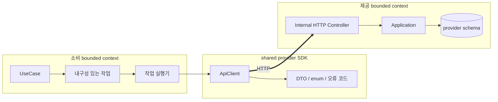
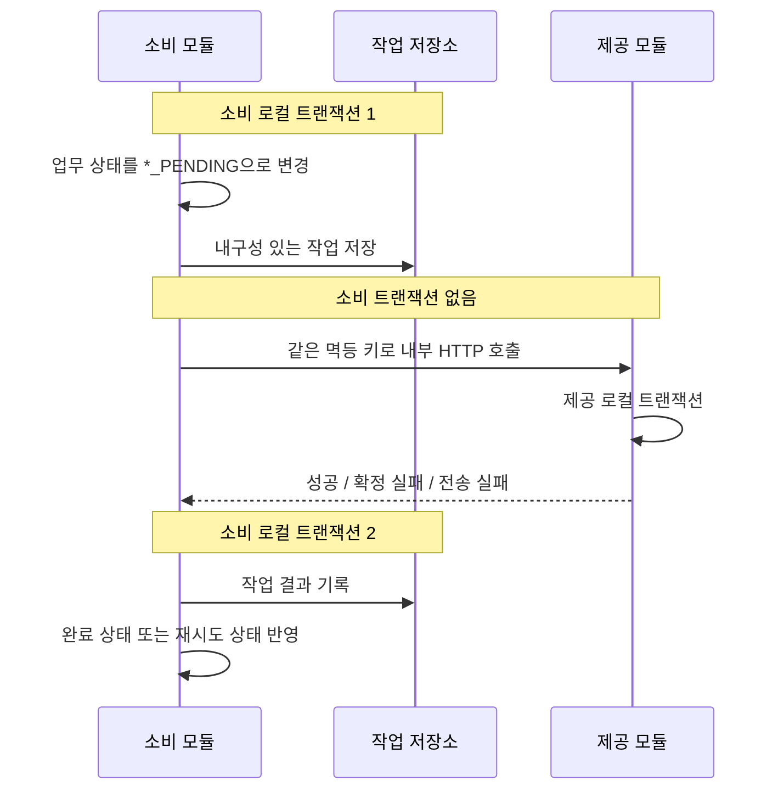
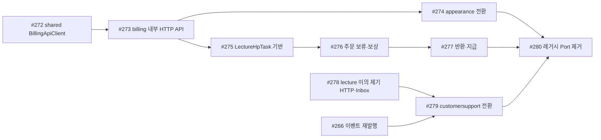

# bounded context 연동 구조 전환 회의 보고서

> 안건: shared Java Port와 같은 JVM 전파 트랜잭션에서 내부 HTTP·로컬 트랜잭션 구조로 전환  
> 작성일: 2026-10-16  
> 적용 범위: 지갑·정산(billing), 출연(appearance), 강의(lecture), 고객센터(customersupport), shared, apps  
> 관련 결정: D56(SUPERSEDED), D57~D60(AMENDED), D61(ACTIVE), D62(ACTIVE)  
> 관련 티켓: #271~#280, 후행 #266~#268

---

## 1. 회의 목적

현재 코드는 `shared`의 Java Port를 통해 bounded context를 같은 JVM 안에서 직접 연결하고, 일부 흐름은 호출자와 제공 모듈의 변경을 하나의 Spring 트랜잭션으로 묶는다. 이 구조는 단일 애플리케이션에서는 단순하고 강한 원자성을 제공하지만, 서비스를 분리하면 유지할 수 없는 트랜잭션 전파와 Java 타입 결합을 정합성의 근거로 사용한다.

이번 회의의 목적은 다음 목표 구조와 전환 원칙을 팀 합의로 확정하는 것이다.

```text
소비 모듈 로컬 트랜잭션
  → 업무 상태 + 내구성 있는 작업 저장
  → COMMIT

작업 실행기 (소비 모듈 트랜잭션 밖)
  → shared의 provider별 HTTP Client
  → 제공 모듈 내부 HTTP Controller
  → 제공 모듈 로컬 트랜잭션

소비 모듈 결과 트랜잭션
  → 작업 결과 + 최종 업무 상태 기록
```

회의에서는 제품 규칙을 다시 설계하지 않는다. 항목별 HP 보류·보상, 처리 중 상태, 재시도·`DEAD`, 접근·리뷰·고객센터 규칙은 유지한다. 이번 안건은 그 규칙을 어떤 모듈 경계와 실패 모델로 구현할지에 관한 것이다.

### 회의에서 승인할 핵심 문장

> bounded context 간 동기 연동은 제공 모듈의 내부 HTTP API와 `shared.[provider].out.*ApiClient`를 사용한다. 단일 애플리케이션도 self-HTTP로 호출하고, `apps`는 bootstrap-only로 유지한다. 소비 모듈은 외부 효과가 필요한 업무 상태와 내구성 있는 작업을 먼저 커밋한 뒤 로컬 트랜잭션 밖에서 호출한다.

---

## 2. 요약

### 현재

```text
Lecture / Appearance / CustomerSupport
  → shared Java Port
      → provider Port Adapter
          → provider Application
              → 호출자 트랜잭션 참여 가능
```

### 목표

```text
Lecture / Appearance / CustomerSupport
  → shared HTTP Client SDK
      → provider internal HTTP API
          → provider Application
              → provider local transaction
```

### 바뀌는 것

- shared Java Port와 모듈 간 공유 Java 예외를 제거한다.
- 소비 모듈이 다른 bounded context의 Application 타입을 호출하지 않는다.
- `apps`에 bounded context 연결 Adapter를 두지 않는다.
- HP 호출과 이의 제기 접수 호출을 소비 모듈 트랜잭션 밖에서 실행한다.
- 외부 효과가 끝나기 전에는 `*_PENDING` 상태를 사용한다.
- 확정 실패, 재시도 가능 실패, 결과 불명, 불변식 위반을 구분한다.
- 같은 요청 ID와 payload로 안전하게 재시도할 수 있게 한다.

### 유지되는 것

- 기존 HP 요청·응답 DTO의 업무 의미
- HP 종류와 사용 순서, 반환 원칙
- 항목 단위 보류와 다건 주문 보상
- 출연 `HpTask`와 새 `LectureHpTask`의 내구성 있는 작업 모델
- 이의 제기 판단·철회 이벤트 계약
- Spring Modulith Event Publication Registry
- 하나의 PostgreSQL과 컨텍스트별 스키마

### 이번 전환에서 하지 않는 것

- Kafka·Redis 등 새 인프라 도입
- 분산 트랜잭션 또는 2PC 도입
- 모든 모듈 간 통신을 HTTP로 일괄 변경
- 범용 Outbox 프레임워크 선도입
- 지갑·정산의 금융 규칙 변경
- 주문 원본을 billing에 복제

---

## 3. 현재 코드에서 확인한 사실

### 3.1 shared `BillingPort`가 트랜잭션 전파를 계약으로 명시한다

현재 `shared.billing.port.BillingPort`는 HP 보류·반환·지급·위약금 정산의 Java 인터페이스다.

- 위치: `shared/src/main/java/com/hapbang/shared/billing/port/BillingPort.java`
- 구현: `boundedContext/billing/src/main/java/com/hapbang/billing/in/BillingPortAdapter.java`
- 메서드: `hold`, `release`, `payout`, `settlePenalty`

Port 문서에는 다음 실행 의미가 명시돼 있다.

- 같은 애플리케이션 안의 동기 Java 호출
- 각 메서드가 호출자 트랜잭션에 참여
- billing 업무 예외가 발생하면 호출자 변경과 billing 변경을 함께 롤백
- 호출자가 예외를 잡으면 롤백 전용 트랜잭션을 이어 쓸 수 있으므로 그대로 전파

`BillingPortAdapter`도 트랜잭션을 직접 열지 않고, `HoldFacade` 아래 `@Transactional(REQUIRED)` UseCase가 호출자 트랜잭션에 참여하도록 설계돼 있다.

즉, 현재 Port는 단순한 메서드 시그니처가 아니라 **같은 JVM과 같은 트랜잭션 참여를 포함한 실행 계약**이다.

### 3.2 강의는 네 UseCase에서 `BillingPort`를 직접 호출한다

강의 main 코드에서 다음 UseCase가 shared `BillingPort`에 의존한다.

- `OrderCreateUseCase`: 주문 항목별 HP 보류
- `OrderCancelUseCase`: 구매 취소 HP 반환
- `OrderObjectionResolveUseCase`: 이의 제기 인정 HP 반환
- `OrderPayoutUseCase`: 판매자 지급

현재 구조에서는 강의 상태 변경과 billing의 지갑·보류·원장 변경이 하나의 트랜잭션으로 묶일 수 있다. 따라서 `PAID`, `CANCELED`, `RETURNED`, `PAID_OUT` 같은 완료 상태를 중간 상태 없이 기록할 수 있었다.

### 3.3 고객센터는 자기 트랜잭션 안에서 강의를 직접 호출한다

`InquiryUseCase`는 클래스 수준 `@Transactional` 안에서 `LectureObjectionPort`를 호출한다.

- 문의 생성 → 강의 이의 제기 접수
- 관리자 판단 → 강의 판단 반영과 HP 반환
- 구매자 문의 삭제 → 강의 이의 제기 철회

공유 예외 `LectureObjectionRefusedException`을 잡아 고객센터 오류 코드로 바꾼다. 코드 주석도 강의 거절 시 이미 롤백 전용이 된 트랜잭션을 전제로 한다.

이 구조에서는 고객센터 문의, 강의 주문 항목, billing HP 반환이 하나의 호출 스택에 연결된다.

### 3.4 출연은 작업 모델이 있지만 실제 연결은 아직 Port다

출연은 이미 `HpTask`를 저장하고 트랜잭션 밖에서 billing을 호출하는 흐름을 갖는다. 그러나 실제 구현인 `BillingPortClient`는 shared `BillingPort`에 위임한다.

- `appearance.billing.mode=billing-port`일 때 실제 Port 연동
- 기본값은 `fake`
- 실제 Client도 HTTP가 아니라 같은 JVM의 Java 호출

출연은 강의보다 로컬 트랜잭션 분리가 앞서 있지만, transport 경계와 실제 실패 모델은 아직 원격 호출과 다르다.

### 3.5 테스트도 현재 구조를 정상 계약으로 고정한다

현재 통합 테스트는 다음을 검증한다.

- shared `BillingPort`가 `BillingPortAdapter`로 주입됨
- 호출자 트랜잭션의 커밋·롤백에 billing 변경이 함께 참여함
- 강의가 shared `BillingPort`로 실제 billing을 호출함
- 고객센터가 `LectureObjectionPort`로 강의를 호출함

따라서 구현만 교체해서는 부족하다. 기존 테스트의 일부는 삭제가 아니라 **새 경계의 계약 테스트로 대체**해야 한다.

---

## 4. 현재 구조를 유지할 때의 문제

### 4.1 서비스 분리 순간 정합성 근거가 사라진다

같은 JVM에서는 다음을 하나의 트랜잭션으로 묶을 수 있다.

```text
lecture 주문 상태 변경
+ billing 지갑·보류·원장 변경
= 한 번에 commit 또는 rollback
```

billing이 별도 프로세스로 분리되면 이 식은 성립하지 않는다.

- Java 메서드 호출은 네트워크 호출이 된다.
- Spring 트랜잭션은 프로세스 경계를 넘지 않는다.
- 요청은 성공했지만 응답을 잃을 수 있다.
- billing은 커밋했지만 lecture의 결과 기록이 실패할 수 있다.
- timeout만으로 실제 처리 여부를 알 수 없다.

현재 완료 상태의 의미를 그대로 유지하면 lecture DB와 billing 원장이 어긋날 수 있다.

### 4.2 Java 인터페이스가 실제 원격 실패를 숨긴다

Java Port는 컴파일 의존을 줄일 수 있지만 다음을 검증하지 않는다.

- JSON 직렬화 호환성
- URI와 HTTP method
- 상태 코드와 `ProblemDetail.code`
- connect/read timeout
- 응답 유실
- 내부 API 인증
- 같은 요청의 중복 전달

현재와 서비스 분리 후의 실행 경로가 다르면, 분리 직전에 가장 위험한 실패 모델을 한꺼번에 도입하게 된다.

### 4.3 공유 Java 예외가 bounded context 오류 모델을 결합한다

`LectureObjectionRefusedException`처럼 공유 예외를 경계 밖으로 던지면 소비 모듈이 제공 모듈의 Java 예외 계층과 rollback 동작을 알아야 한다.

원격 경계에서는 예상된 업무 실패가 다음 데이터로 표현돼야 한다.

```text
HTTP status
stable code
safe detail
```

DB 오류, timeout, 역직렬화 오류 같은 기술 실패는 업무 예외와 분리해야 한다.

### 4.4 `apps` In-process Adapter도 최종 해법이 아니다

검토했던 중간안은 소비 모듈이 자기 Port를 소유하고 `apps`의 In-process Adapter가 제공 모듈 Application을 호출하는 구조였다.

```text
lecture BillingClient
  ← apps InProcessLectureBillingAdapter
      → billing Application
```

이 구조는 shared Port보다 의존 방향은 개선되지만 다음 문제가 남는다.

- `apps`가 모든 bounded context의 타입을 아는 중앙 통합 계층이 된다.
- 현재는 Java 직접 호출, 미래에는 HTTP라 실행 경로가 다르다.
- 직렬화·timeout·응답 유실을 지금 검증하지 못한다.
- 소비자별 Port와 Adapter가 동일한 provider API를 중복 표현한다.

따라서 `apps`는 연결 계층이 아니라 bootstrap-only로 유지한다.

---

## 5. 목표 아키텍처

### 5.1 의존 방향



### 5.2 모듈별 책임

| 모듈 | 책임 |
| --- | --- |
| 소비 bounded context | 호출 필요성 판단, 업무 상태, 내구성 있는 작업, 결과 반영, 사용자 처리 상태 |
| shared | 요청·응답 DTO, 안정적인 enum·오류 코드, provider별 공통 HTTP Client SDK |
| 제공 bounded context | 내부 HTTP endpoint, 자기 도메인 검증, 자기 로컬 트랜잭션, 멱등 결과 재현 |
| apps | Spring Boot 시작점, scheduling, security·HTTP 공통 설정 |

### 5.3 금지하는 의존

- 소비 모듈 → 제공 모듈 Application
- 소비 모듈 → 제공 모듈 domain·Repository
- shared → bounded context 구현 타입
- shared → 모듈 `BusinessException`
- apps → bounded context를 연결하는 업무 Adapter
- 모듈 간 전파 트랜잭션을 정합성 계약으로 사용

### 5.4 shared의 역할

shared는 순수 DTO만이 아니라 provider API를 소비하기 위한 공통 SDK까지 제공한다.

```text
com.hapbang.shared.billing
├── dto/       요청·성공 결과
├── domain/    참조 유형·안정적인 실패 코드
├── event/     비동기 이벤트 계약
└── out/       BillingApiClient, 호출 결과, 전송 예외
```

`BillingApiClient`는 다음을 감춘다.

- provider별 base URL
- URI 템플릿
- 요청·응답 직렬화
- connect/read timeout
- `ProblemDetail` 파싱
- 원격 오류 코드 변환
- correlation ID와 command ID 전달

다음은 감추지 않거나 판단하지 않는다.

- lecture·appearance의 상태 전이
- 작업별 재시도 여부
- 보상 생성
- 사용자 응답 결정

즉, Client는 transport SDK이고 소비 도메인의 서비스가 아니다.

### 5.5 self-HTTP와 서비스 분리

현재 단일 애플리케이션에서도 Client는 자기 서버의 내부 endpoint를 호출한다.

| 배포 형태 | billing base URL | 호출 코드 |
| --- | --- | --- |
| 단일 애플리케이션 | 현재 애플리케이션 내부 주소 | 동일한 `BillingApiClient` |
| billing 분리 후 | billing 서비스 주소 | 동일한 `BillingApiClient` |

서비스 분리 시 바뀌는 것은 provider 주소와 내부 인증·네트워크 정책이다. DTO, URI, 오류 코드, 멱등 계약과 소비 모듈 상태 모델은 유지한다.

---

## 6. 트랜잭션과 상태 전환 원칙

### 6.1 세 구간으로 분리한다



### 6.2 완료 상태는 외부 효과 완료를 뜻한다

| 완료 상태 | 기록 조건 |
| --- | --- |
| `PAID` / `PURCHASED` | 모든 주문 항목 HP 보류 완료 |
| `CANCELED` | 구매 취소 HP 반환 완료 |
| `RETURNED` | 이의 인정 HP 반환 완료 |
| `PAID_OUT` | 판매자 지급 완료 |

외부 효과가 끝나기 전에는 다음 처리 중 상태를 사용한다.

- `HOLD_PENDING`
- `HOLD_COMPENSATING`
- `CANCEL_PENDING`
- `RETURN_PENDING`
- `PAYOUT_PENDING`

### 6.3 HTTP 성공 뒤 결과 기록 실패도 정상 복구 경로다

```text
billing commit 성공
→ HTTP 성공 응답
→ 소비 모듈 결과 기록 transaction 실패
```

이 경우 작업은 완료되지 않은 상태로 남는다. 다음 실행은 같은 요청 ID와 같은 payload로 billing을 다시 호출하고, billing은 처음 성공 결과를 재현한다. 소비 모듈은 재현된 결과로 최종 상태에 수렴한다.

이 시나리오는 예외적인 사고가 아니라 반드시 통합 테스트할 기본 실패 경로다.

---

## 7. 호출 결과와 오류 계약

### 7.1 결과 모양

```java
public sealed interface BillingCallResult<T> {
    record Succeeded<T>(T value) implements BillingCallResult<T> {}
    record Failed<T>(BillingFailureCode code, String detail)
            implements BillingCallResult<T> {}
}
```

- `Succeeded`: 제공 모듈이 성공을 확정
- `Failed`: 제공 모듈이 안정적인 오류 코드로 실패를 확정

`Failed`가 곧 영구 거절을 뜻하지는 않는다. 같은 오류 코드도 작업 유형에 따라 재시도 여부가 다를 수 있으므로 소비 실행기가 `taskType + errorCode`로 분류한다.

### 7.2 결과를 받지 못한 실패

```java
public enum BillingCallFailureKind {
    RETRYABLE,
    UNKNOWN_RESULT
}
```

| 종류 | 의미 | 처리 |
| --- | --- | --- |
| `RETRYABLE` | 요청이 제공 모듈에 도달하지 않았다고 판단할 수 있음 | 백오프 후 같은 요청 ID 재시도 |
| `UNKNOWN_RESULT` | 제공 모듈이 처리했는지 알 수 없음 | 같은 요청 ID로 결과 재확인 |

read timeout과 응답 유실은 실패 확정이 아니라 `UNKNOWN_RESULT`다.

### 7.3 진단 정보

다음은 사용자용 결과에 넣지 않는다.

- 원인 `Throwable`
- 내부 예외 클래스 이름과 stack trace
- 처음 보는 원본 오류 문자열
- provider 내부 메시지

로그와 작업 시도 이력에는 `raw_error_code`, 예외 종류, 안전하게 제한한 진단 detail을 남긴다.

---

## 8. 멱등성 계약

### 8.1 안정적인 요청 ID

| 업무 | 요청 ID 예시 |
| --- | --- |
| 주문 항목 보류 | `HOLD:LECTURE_ORDER_ITEM:{orderItemId}` |
| 보류 실패 보상 | `LECTURE-HOLD-COMPENSATE-{orderItemId}` |
| 구매 취소 반환 | `LECTURE-CANCEL-{orderItemId}` |
| 이의 인정 반환 | `LECTURE-RETURN-{orderItemId}` |
| 판매자 지급 | `LECTURE-PAYOUT-{orderItemId}` |

### 8.2 provider 처리 규칙

| 조건 | 결과 |
| --- | --- |
| 같은 요청 ID + 같은 payload | 처음 결과 재현, `replayed = true` |
| 같은 요청 ID + 다른 payload | `IDEMPOTENCY_KEY_CONFLICT` |

provider는 요청 ID와 함께 payload fingerprint를 보존해야 한다. 같은 요청 ID에 금액이나 대상이 달라졌는데 기존 성공을 반환해서는 안 된다.

---

## 9. 흐름별 전환

### 9.1 강의 주문 보류

#### 현재

```text
주문·항목 저장
→ BillingPort.hold
→ 하나의 트랜잭션 commit 또는 rollback
```

#### 목표

```text
HOLD_PENDING 주문·항목 + 항목별 HOLD 작업 commit
→ BillingApiClient.hold를 항목 순서대로 한 번씩 즉시 시도
→ 모두 성공: PAID / PURCHASED
→ 확정 거절: 성공한 HOLD에 RELEASE 보상 작업
→ 보상 완료: HOLD_FAILED
→ 미완료: 202 + 처리 중 주문
```

다건 주문의 한 항목이 거절되면 이미 성공한 항목을 반환한다. 결과를 모르는 HOLD는 성공 여부를 확인할 때까지 추적하고, 성공이 확인되면 보상한다. 남은 보류가 없다고 확인된 뒤에만 `HOLD_FAILED`다.

### 9.2 구매 취소·이의 인정 반환·지급

| 흐름 | 선행 상태 | 작업 | 완료 상태 |
| --- | --- | --- | --- |
| 구매 취소 | `PURCHASED` | `CANCEL_PENDING` + RELEASE | `CANCELED` |
| 이의 인정 | objection `ACCEPTED` | `RETURN_PENDING` + RELEASE | `RETURNED` |
| 판매자 지급 | `CONFIRMED` | `PAYOUT_PENDING` + PAYOUT | `PAID_OUT` |

처리 중 상태부터 접근·재구매·리뷰·지급 대상 조회 조건을 함께 바꾼다. 작업이 `DEAD`가 되어도 돈의 결과가 확정되지 않았으므로 `*_PENDING` 상태를 삭제하거나 완료 상태로 가장하지 않는다.

### 9.3 출연 HP 작업

출연은 기존 `HpTask` 상태와 재시도 모델을 유지하고 transport만 바꾼다.

```text
현재: BillingPortClient → shared BillingPort
목표: BillingApiClient → billing internal HTTP
```

기본 `fake` 모드는 제거하고 실제 Client를 기본으로 한다. fake는 테스트 대역으로만 남긴다.

### 9.4 고객센터 이의 제기 접수

#### 현재

```text
CustomerSupport @Transactional
→ 문의 저장
→ LectureObjectionPort.fileObjection
→ 강의 거절 시 모두 rollback
```

#### 목표

```text
문의 + FILING commit
→ 고객센터 트랜잭션 밖에서 LectureApiClient.file(...)
→ 성공: FILED
→ 요청 안 확정 거절: FILE_REJECTED + Soft Delete commit 뒤 4xx
→ 결과 불명: 202 FILING, 같은 commandId로 재시도
```

요청 안에서 확정 거절을 받더라도 `FILE_REJECTED` 기록과 Soft Delete가 커밋된 뒤에만 4xx를 반환한다. 기록 실패 시 문의는 `FILING`에 남겨 복구한다.

### 9.5 이의 제기 판단·철회

판단·철회는 동기 HTTP로 옮기지 않고 이벤트를 유지한다.

```text
CustomerSupport
  → RESOLUTION_PENDING / WITHDRAWAL_PENDING + 명령 이벤트

Lecture
  → command Inbox로 멱등 처리
  → 도메인 변경 + 결과 이벤트

CustomerSupport
  → 결과 상태 반영
```

Spring Modulith Publication Registry와 실행 중 재발행(#266)이 명령 유실과 재처리를 담당한다.

---

## 10. Outbox와 Kafka에 대한 결정

### 10.1 범용 Outbox를 이번에 먼저 도입하지 않는다

HP 연동은 `HpTask`와 `LectureHpTask`가 다음 책임을 직접 가진다.

- 명령 유실 방지
- 현재 처리 상태
- 원자적 선점과 lease
- 재시도와 백오프
- 작업 유형별 실패 분류
- 보상 생성
- `DEAD`와 관리자 복구
- 사용자 처리 상태
- append-only 시도 이력

이 작업을 다시 범용 Outbox에 감싸면 동일한 명령의 진실이 둘이 될 수 있다. 현재 단계에서는 목적별 내구성 있는 작업을 신뢰성 경계로 사용한다.

이벤트 기반 판단·철회는 별도 `event_publication` 기록과 재발행을 사용한다.

### 10.2 Kafka 도입 시 Client 구현만 교체하지 않는다

HTTP와 Kafka는 실행 의미가 다르다. `BillingApiClient` 뒤에 Kafka request/reply 구현을 끼우지 않는다.

```text
현재
HpTaskExecutor → BillingApiClient → 즉시 결과

Kafka 전환
HpTaskDispatcher → BillingCommandV1
BillingCommandConsumer → BillingResultV1
BillingResultConsumer → 작업·업무 상태 기록
```

유지되는 것은 작업 모델, 상태 전이, 요청 ID, payload fingerprint, DTO·오류 코드 의미다. 교체되는 것은 dispatcher와 결과 consumer다.

---

## 11. 단계적 전환과 배포 안전성

### 전환 DAG



### 단계 1 — 공통 HTTP Client 계약

- `shared.billing.out.BillingApiClient`
- `BillingCallResult`
- `BillingCallException`
- `BillingFailureCode`
- provider별 base URL과 timeout 설정
- `ProblemDetail` 역직렬화와 오류 분류 테스트

기존 Port는 이 단계에서 제거하지 않는다.

### 단계 2 — billing 내부 HTTP API

- `/internal/v1/billing/holds`
- `/internal/v1/billing/releases`
- `/internal/v1/billing/payouts`
- `/internal/v1/billing/penalty-settlements`
- billing 로컬 트랜잭션
- 멱등 결과 재현
- 내부 endpoint 보호

기존 Port와 새 HTTP API가 같은 billing Application 규칙을 호출하도록 두어 전환 기간 동작을 비교한다.

### 단계 3 — 출연 전환

기존 `HpTask` 실행기에서 `BillingApiClient`를 사용한다. 작업 모델이 이미 있어 transport 전환을 먼저 검증하기 적합하다.

### 단계 4 — 강의 작업 기반

`LectureHpTask`, 시도 이력, claim token, lease, 재시도, `DEAD`, 관리자 복구를 먼저 만든다. 주문 상태 변경보다 실행 기반을 먼저 확보한다.

### 단계 5 — 강의 HP 흐름 전환

1. 주문 보류·보상
2. 구매 취소 반환
3. 이의 인정 반환
4. 판매자 지급

각 흐름은 새 상태·조회·인덱스·API 응답까지 한 티켓에서 함께 전환한다.

### 단계 6 — 이의 제기 연동 전환

- lecture 내부 HTTP 접수 API와 command Inbox
- customersupport `FILING` 상태와 HTTP Client
- 판단·철회 이벤트
- 결과 이벤트와 `hpReturnStatus`

### 단계 7 — 레거시 제거

모든 소비자가 HTTP 또는 이벤트로 전환된 뒤에만 다음을 제거한다.

- `shared.billing.port.BillingPort`
- `BillingPortAdapter`
- `shared.lecture.port.LectureObjectionPort`
- `LectureObjectionPortAdapter`
- `LectureObjectionRefusedException`
- appearance `BillingPortClient`
- 현재 Port의 전파 트랜잭션 테스트

구조 테스트로 같은 의존이 다시 생기지 않게 한다.

---

## 12. 테스트 전환

### 12.1 삭제·대체할 현재 계약 테스트

| 현재 검증 | 목표 검증 |
| --- | --- |
| `BillingPort`가 `BillingPortAdapter`로 주입 | `BillingApiClient`가 실제 내부 HTTP endpoint 호출 |
| 호출자 트랜잭션에 billing 참여 | 호출 시 소비 트랜잭션 비활성 + provider 로컬 트랜잭션 |
| Java 예외가 호출자까지 전파 | HTTP 상태·`ProblemDetail.code` → 안정적인 실패 결과 |
| 하나의 트랜잭션 rollback | 처리 중 상태 + 같은 요청 ID 재시도로 최종 수렴 |

### 12.2 반드시 추가할 실패 시나리오

- HTTP 성공 후 소비 모듈 결과 기록 실패
- read timeout이지만 provider는 commit 성공
- connection refused
- 같은 요청 ID·같은 payload 재호출
- 같은 요청 ID·다른 payload 충돌
- 일부 주문 항목 보류 성공 뒤 잔액 부족
- 보상 중 프로세스 종료
- lease 만료 뒤 재선점과 늦은 결과
- 10회 실패 후 `DEAD`
- 관리자가 원인 보정 뒤 재시도
- 처음 보는 원격 오류 코드
- 사용자 응답에 내부 예외 정보가 노출되지 않음

### 12.3 구조 테스트

- 소비 모듈 main이 다른 bounded context Application·domain·Repository를 참조하지 않는다.
- shared에 bounded context 구현 타입과 `BusinessException` 의존이 없다.
- `apps`에 bounded context 연결 Adapter가 없다.
- shared `..port..` 패키지가 없다.
- 내부 HTTP Client 외에 provider URI가 소비 모듈에 중복되지 않는다.

---

## 13. 운영과 관측성

### 13.1 로그 상관관계

다음 ID를 구조화 로그에 함께 남긴다.

- request ID 또는 command ID
- correlation ID
- 참조 유형과 참조 ID
- 소비 작업 ID
- attempt 번호
- HTTP status와 안정적인 error code

원본 오류 문자열과 stack trace는 사용자 응답이 아니라 내부 로그와 관리자용 시도 이력에만 남긴다.

### 13.2 지표

- 작업 유형별 성공·실패 수
- `RETRYABLE`·`UNKNOWN_RESULT`·`INVARIANT_VIOLATION` 수
- `DEAD` 전환 수
- lease 만료 수
- HTTP latency와 timeout 수
- 멱등 replay 수
- payload 충돌 수

### 13.3 관리자 복구

- 상태·작업 유형·참조 ID·오류 코드 조회
- attempt 이력 조회
- `DEAD` → `PENDING` 수동 재시도
- 누적 시도 횟수 유지
- 관리자·시각 감사 기록

돈이 움직이는 작업과 실패 이력은 Hard Delete하지 않는다.

---

## 14. 위험과 대응

| 위험 | 영향 | 대응 |
| --- | --- | --- |
| self-HTTP latency | 직접 호출보다 느림 | 적용 경계를 제한하고 latency 지표·timeout 설정 |
| 자기 호출 connection 고갈 | 요청 정체·timeout | Client·서버 connection/thread 설정 검증, 부하 테스트 |
| 내부 endpoint 외부 노출 | 임의 HP 이동 위험 | nginx 차단, 내부 인증, 호출 주체 로그 |
| timeout 오분류 | 중복 HP 이동 | `UNKNOWN_RESULT` 구분 + 같은 멱등 키 재호출 |
| shared Client 비대화 | shared가 업무 서비스화 | URI·직렬화·전송 오류만 담당하도록 구조 테스트·리뷰 |
| 이중 경로 장기 유지 | Port와 HTTP 결과 불일치 | 티켓별 완료 조건과 #280 제거 시점 고정 |
| 완료 상태 선기록 | lecture 상태와 원장 불일치 | `*_PENDING` 선행, 결과 트랜잭션에서만 완료 상태 |
| 운영 복구 누락 | 돈이 처리 중에 영구 정체 | `DEAD` 조회·경고·관리자 재시도 |

---

## 15. 회의에서 확정할 항목

아래 항목은 아키텍처 방향을 바꾸는 질문이 아니라 구현 전에 팀 합의가 필요한 운영 계약이다. 근거 없이 코드에서 임의 결정하지 않는다.

### A. 내부 HTTP endpoint 보호 방식

확정할 내용:

- 단일 앱 self-HTTP에서 사용할 인증 방식
- 서비스 분리 후 서비스 간 인증 방식
- nginx에서 `/internal/**` 외부 요청을 차단하는 규칙
- 내부 호출 주체와 요청 ID 로깅

권고: 사용자 Session을 그대로 전달하는 방식과 내부 서비스 인증을 분리한다.

### B. provider별 base URL 설정

확정할 내용:

- 설정 키 형식: 예) `hapbang.clients.billing.base-url`
- local/test/dev/prod의 self 주소
- random-port 통합 테스트에서 Client base URL 주입 방식
- 서비스 분리 시 환경 변수 전환 방식

권고: 전역 `internalBackUrl` 하나가 아니라 provider별 설정을 둔다.

### C. connect/read timeout과 connection 설정

확정할 내용:

- connect timeout
- read timeout
- `LectureHpTask` lease와의 관계
- connection pool·server thread 기준

원칙: read timeout은 작업 lease보다 짧아야 한다. 구체 수치는 측정과 팀 합의 후 설정한다.

### D. 내부 HTTP 성공 응답 포맷

확정할 내용:

- 내부 API도 `RsData`로 감쌀지, 성공 DTO를 직접 반환할지
- `replayed`와 correlation 정보를 body 또는 header 중 어디에 둘지
- 204가 필요한 endpoint 여부

오류는 기존 global `ProblemDetail`의 `status`·`code`·`detail` 계약을 재사용한다.

### E. 전환 기간 Port와 HTTP 동시 운영 범위

확정할 내용:

- 기능별 cutover 단위
- feature flag가 필요한지
- fallback으로 Port를 자동 호출할지

권고: HTTP 실패 시 Port로 자동 fallback하지 않는다. 한 요청이 양쪽 경로에서 처리돼 중복 HP 이동 여부가 불명확해질 수 있다. 전환은 기능별로 명시적으로 선택한다.

### F. 팀별 담당과 리뷰 승인

필요 확인:

- shared Client 계약: shared·billing 담당
- 내부 billing API와 오류 목록: billing 담당
- 출연 작업 실행기 전환: appearance 담당
- 강의 상태·작업·조회 조건: lecture 담당
- 이의 제기 상태와 화면 계약: customersupport·lecture 담당
- 내부 endpoint 보안·nginx: global·deploy 담당

---

## 16. 승인 기준

다음 항목에 모두 동의하면 목표 아키텍처를 승인한 것으로 본다.

- [ ] `apps`를 bootstrap-only로 유지한다.
- [ ] bounded context 간 Java Application 직접 호출을 제거한다.
- [ ] 동기 경계는 제공 모듈의 내부 HTTP API로 한다.
- [ ] shared에는 데이터 계약과 provider별 공통 HTTP Client SDK를 둔다.
- [ ] self-HTTP와 분리 배포 HTTP가 같은 Client·URI·DTO·오류 계약을 사용한다.
- [ ] HP 호출은 소비 모듈 로컬 트랜잭션 밖에서 실행한다.
- [ ] 업무 상태와 내구성 있는 작업을 HTTP 호출보다 먼저 커밋한다.
- [ ] 완료 상태는 실제 외부 효과가 완료된 뒤에만 기록한다.
- [ ] timeout을 결과 불명으로 취급하고 같은 멱등 키로 재확인한다.
- [ ] 범용 Outbox는 이번 전환의 선행 조건으로 두지 않는다.
- [ ] Kafka 도입 시 HTTP Client의 대체 구현이 아니라 dispatcher·result consumer로 전환한다.
- [ ] 기존 Port와 공유 Java 예외는 모든 소비자 전환 뒤 제거한다.

---

## 17. 회의 후 산출물

회의가 끝나면 다음을 기록한다.

1. 이 보고서 15장의 확정값과 담당자
2. 설계 결정 D62의 확인자와 필요한 보충 결정
3. #272~#280의 완료 조건 보정
4. 내부 HTTP 보안·환경 변수 문서 위치
5. 프론트 공유가 필요한 202·처리 중 상태 목록
6. 구현 순서와 첫 착수 티켓

제품·복구 규칙의 상세 내용은 다음 문서를 기준으로 한다.

- [강의 모듈 핵심 설계](lecture-module.md)
- [강의 모듈 연동·운영 설계](lecture-module-integration.md)
- [강의 모듈 스키마·API·구현 참고](lecture-module-reference.md)
- [강의 모듈 결정 기록](lecture-module-decisions.md)

이 보고서는 회의용 전환 요약이다. 상세 상태·API·오류 코드가 충돌하면 위 설계 문서의 최신 ACTIVE/AMENDED 결정과 해당 구현 티켓을 함께 확인한다.
