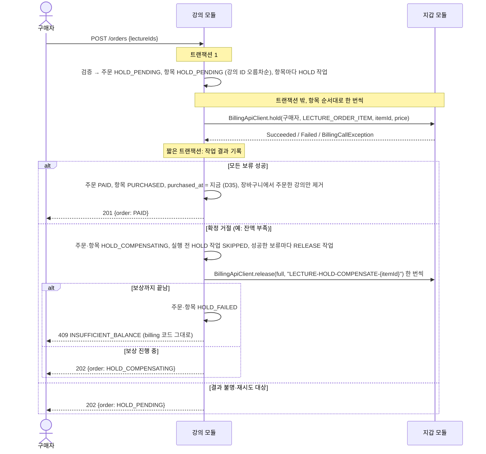
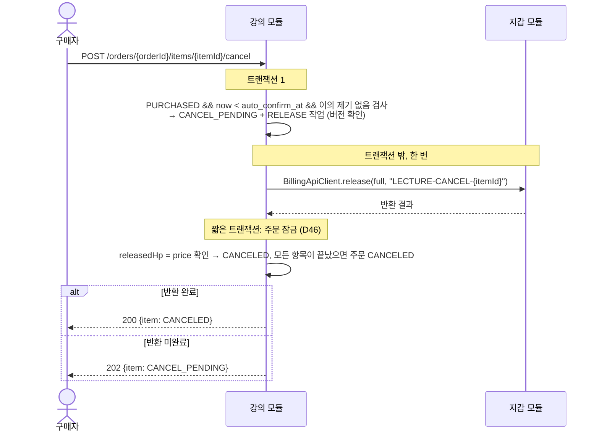
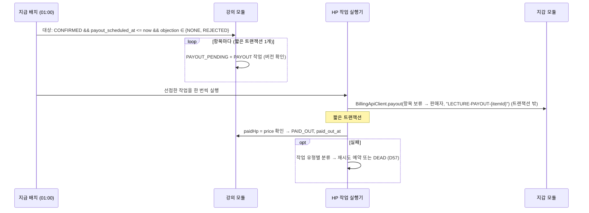
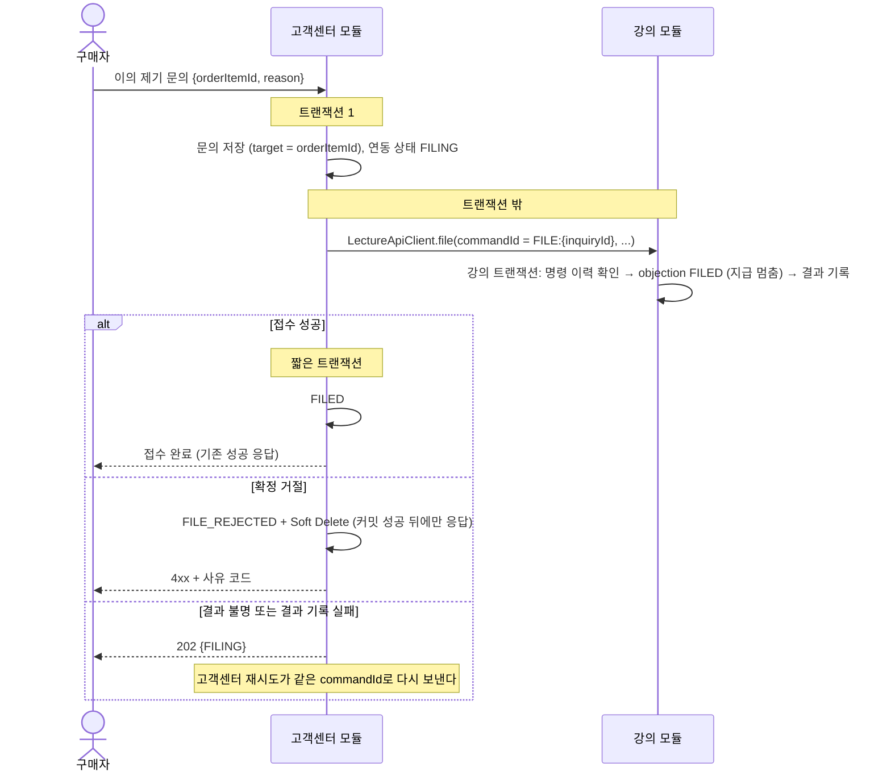
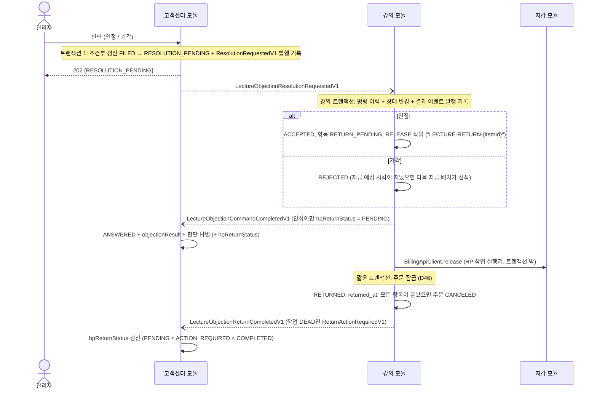

# 강의 모듈 — 연동·운영 설계

> 문서 지도: [핵심 설계](lecture-module.md) · [모듈 연동·운영](lecture-module-integration.md) · [스키마·API·구현 참고](lecture-module-reference.md) · [결정 기록](lecture-module-decisions.md)
>
> 장 번호는 기존 문서의 참조를 깨지 않도록 유지한다.

## 6. 모듈 간 연동

이 장은 **목표 구조**(D62, #271)를 적는다. D56의 Port + In-process Adapter 구조는 구현 전에 폐기했고, D57~D61의 제품·복구 결정은 HTTP 경계에 맞춰 이어 간다.

### 6.1 연동 방식

| 상대 모듈 | 내용 | 방식 |
| --- | --- | --- |
| 정산 | 주문 항목별 HP 보류, 구매 취소·이의 제기 인정 반환, 지급 | `shared.billing.out.BillingApiClient`로 정산 내부 HTTP API를 **강의 트랜잭션 밖에서** 호출한다. 호출은 HP 작업(`LectureHpTask`)으로 먼저 기록하고 실행한다 (D57, D62) |
| 고객센터 | 이의 제기 접수 | `shared.lecture.out.LectureApiClient`로 강의 내부 HTTP API를 고객센터 트랜잭션 밖에서 호출한다. 강의는 명령 이력으로 멱등하게 처리한다 (D60, D62) |
| 고객센터 | 이의 제기 판단·철회 | 명령 이벤트 → 강의 처리 → 결과 이벤트. 인정한 건의 HP 반환 완료·조치 필요는 별도 이벤트다 (D60) |
| 회원 | 가입, 회원 정보 변경 | 이벤트 |

#### 원칙 (D62)

1. **로컬 트랜잭션만 보장한다.** 다른 모듈의 저장 결과와 함께 커밋·롤백된다는 계약을 두지 않는다.
2. **동기 경계는 제공 모듈의 내부 HTTP API다.** 소비 모듈은 제공 모듈의 주소와 URI 계약만 알고, 제공 모듈 Java Application·domain·Repository 타입을 참조하지 않는다.
3. **shared는 데이터 계약과 공통 HTTP Client SDK를 제공한다.** DTO·이벤트·안정적인 enum·오류 코드와 `shared.[제공 모듈].out.*ApiClient`를 둔다. Java Port·엔티티·Repository·공유 `BusinessException`은 두지 않는다.
4. **`apps`는 bootstrap-only다.** 애플리케이션 시작과 공통 설정만 담당하며 bounded context를 연결하는 Adapter나 업무 로직을 두지 않는다. 단일 앱에서도 Client는 self-HTTP를 사용한다.
5. **동기 연동도 호출자 트랜잭션 밖에서 한다.** 로컬 상태와 작업을 먼저 커밋하고, 멱등 키로 호출한 뒤, 결과를 짧은 로컬 트랜잭션으로 기록한다.
6. **비동기 연동은 이벤트 계약을 쓴다.** 이벤트 발행은 로컬 상태 변경과 같은 트랜잭션에 기록되고(Spring Modulith 이벤트 발행 기록), `@ApplicationModuleListener`가 별도 트랜잭션에서 처리한다.
7. **완료 상태와 처리 중 상태를 나눈다.** `PAID`·`PURCHASED`·`CANCELED`·`RETURNED`·`PAID_OUT`은 보류·반환·지급이 실제로 끝난 뒤에만 쓴다.
8. **재시도는 명시적인 작업·명령 기록에 근거한다.** 같은 요청 ID + 같은 payload는 기존 결과를 재현하고, 같은 요청 ID + 다른 payload는 충돌이다.
9. **self-HTTP와 분리 배포 HTTP는 같은 계약을 쓴다.** 서비스 분리 시 provider별 base URL만 바꾼다. Kafka는 동기 Client의 대체 구현으로 가장하지 않는다 (6.2 "서비스 분리 시").
10. **작업 실행은 중복·중단을 견딘다.** 한 실행기만 원자적으로 선점하고, 실행 중 프로세스가 끝나면 lease가 지난 뒤 다시 선점한다. 시간·건수는 설정으로 둔다 (D57).

- `AGENTS.md`의 "모듈 간 통신은 Spring Event 기본"에서 동기 호출로 남는 것은 HP 이동(보류·반환·지급)과 이의 제기 접수뿐이다. 둘 다 요청자에게 결과(잔액 부족, 접수 불가 사유)를 바로 알려야 하기 때문이다. 판단·철회는 이벤트다.
- 최종 구조에는 shared Port(`shared.billing.port.BillingPort`, `shared.lecture.port.LectureObjectionPort`), 소비 모듈 Port, `apps` 연결 Adapter와 모듈 간 공유 Java 예외(`LectureObjectionRefusedException`)가 **남지 않는다** (#280).

#### 의존 방향

```
강의 HP 작업 실행기
  → shared.billing.out.BillingApiClient
      → POST /api/v1/internal/billing/{holds|releases|payouts}
          → billing Controller → billing Application (billing 로컬 트랜잭션)

고객센터 접수 실행기
  → shared.lecture.out.LectureApiClient
      → 강의 내부 HTTP Controller → 강의 Application (강의 로컬 트랜잭션)

shared (데이터 계약 + 공통 HTTP Client SDK)
  billing.dto     HoldCommand, ReleaseCommand, PayoutCommand, PenaltyCommand, *ResultDto
  billing.domain  BillingReferenceType, SettlementSourceType, BillingFailureCode
  billing.out     BillingApiClient, BillingCallResult, BillingCallException
  lecture.dto     이의 제기 접수 명령·결과
  lecture.domain  LectureObjectionFailureCode
  lecture.out     LectureApiClient
  lecture.event   이의 제기 판단·철회 명령, 명령 결과, 반환 결과 이벤트 (V1)

apps
  bootstrap, scheduling, security·HTTP 공통 설정만 담당
```

#### 전환 상태

코드는 아직 shared Port와 같은 JVM 전파 트랜잭션을 사용한다. 흐름마다 아래 티켓에서 바꾸고, **#280이 끝나면 이 표를 지운다.**

| 흐름 | 현재 구현 | 목표 구조 | 변경 티켓 | 전환 완료 조건 |
| --- | --- | --- | --- | --- |
| 공통 billing HTTP 계약 | shared `BillingPort` | `BillingApiClient` + DTO·오류 계약 | #272 | self-HTTP와 분리 배포가 같은 Client 코드를 쓴다 |
| billing 진입점 | Java `BillingPortAdapter` | `/api/v1/internal/billing/*` Controller | #273 | 요청마다 billing 로컬 트랜잭션으로 처리한다 |
| 출연 billing 연동 | 기본 `fake` 또는 shared Port | 실제 `BillingApiClient` + 기존 `HpTask` | #274 | fake 기본 모드가 없고 외부 호출이 출연 트랜잭션 밖이다 |
| HP 작업 기반 | 강의 트랜잭션 안에서 billing 호출 | `LectureHpTask` 선점·재시도·관리자 복구 | #275 | 외부 호출과 결과 기록 트랜잭션이 분리된다 |
| 주문 보류 | 주문 저장과 `hold`를 한 트랜잭션에서 | `HOLD_PENDING` + 항목별 HOLD/보상 작업 | #276 | 완료 상태가 실제 HP 이동과 일치한다 |
| 구매 취소·반환·지급 | 상태 변경과 `release`·`payout`을 한 트랜잭션에서 | `*_PENDING` + RELEASE/PAYOUT 작업 | #277, #268 | D54 이관과 접근·리뷰 규칙이 적용된다 |
| 이의 제기 접수·명령 | shared Port와 항목 상태만 사용 | 강의 내부 HTTP + 명령 Inbox | #278 | 같은 명령을 다시 보내도 같은 결과다 |
| 고객센터 연동 | 고객센터 트랜잭션 안 Java 호출 | 문의 커밋 → 내부 HTTP, 판단·철회는 이벤트 | #279, #266, #267 | 고객센터 로컬 트랜잭션과 원격 호출이 분리된다 |
| 레거시 제거 | shared/provider Port와 Port Adapter | 삭제 + 구조 테스트, `apps` bootstrap-only | #280 | 저장소에 모듈 간 Java 연결 타입이 없다 |

하위 티켓의 의존 관계 (13장 8단계)

- HTTP 기반: #272 → #273 → #274, #275.
- 강의 HP: #275 → #276 → #277. 지급 실패 레거시 정리 #268은 #277과 프론트 전환 뒤다.
- 이의 제기: #278 → #279, 이벤트 재발행 #266은 #279의 선행이며 실패 명령 운영 복구 #267은 #279 후행이다.
- 마무리: #280은 #273·#274·#276·#277·#278·#279가 끝난 뒤 진행한다.

#### 실행 중 실패한 이벤트의 재처리 (D61)

Spring Modulith 2.1.1의 재발행 기능(`IncompleteEventPublications`, `ResubmissionOptions`, `completionAttempts`)으로 실행 중에도 실패·미완료 이벤트를 다시 보낸다. global 공통 설정이라 이벤트 재발행 [Global] 티켓(#266)에서 만들고, 상세 설정과 운영 절차는 그 티켓의 문서에 둔다. 요약:

| 항목 | 결정 |
| --- | --- |
| 재발행 주기 | 1분마다 |
| 처음 재발행할 최소 나이 | 발행 후 5분 |
| 한 번에 처리 | 100건 |
| stale 판정 | `PUBLISHED`·`PROCESSING`·`RESUBMITTED` 각각 5분, 1분마다 확인 |
| 재발행 한도 | 자동으로 멈추지 않는다 |
| 경고 | 재발행 10회 도달(`completionAttempts = 11`, 처음 발행이 1) 시 ERROR 로그 + Micrometer counter |
| 재시작 재발행 | 기존 `republish-outstanding-events-on-restart: true` 유지 |

- 10회 뒤 자동으로 멈추게 하려면 dead 상태 저장, 오래된 dead 행이 배치를 막지 않는 조회, 관리자 재발행, 재시작 재발행 제외, 감사 기록이 필요하다. 이번에는 하지 않는다.
- 알림은 ERROR 로그와 counter까지다. 실제 호출·메시지 알림은 모니터링을 연동할 때 따로 설정한다.

### 6.2 동기 HTTP 인터페이스

#### 지갑: shared `BillingApiClient` (D62, #272·#273)

`BillingApiClient`는 인터페이스 Port가 아니라 shared에 있는 공통 HTTP Client SDK다. 강의와 출연은 같은 구현을 주입받고 provider별 `hapbang.clients.billing.base-url`만 설정한다. 단일 앱은 자기 주소를, 서비스 분리 뒤에는 billing 서비스 주소를 사용한다.

```java
// shared.billing.out — URI, 직렬화, timeout, ProblemDetail 변환을 감춘다.
public class BillingApiClient {
    BillingCallResult<HoldResultDto> hold(HoldCommand command);
    BillingCallResult<ReleaseResultDto> release(ReleaseCommand command);
    BillingCallResult<PayoutResultDto> payout(PayoutCommand command);
    BillingCallResult<PenaltyResultDto> settlePenalty(PenaltyCommand command);
}

public sealed interface BillingCallResult<T> {
    record Succeeded<T>(T value) implements BillingCallResult<T> {}
    record Failed<T>(BillingFailureCode code, String detail) implements BillingCallResult<T> {}
}

public class BillingCallException extends RuntimeException {
    BillingCallFailureKind kind;   // RETRYABLE 또는 UNKNOWN_RESULT
}
```

| 항목 | 내용 |
| --- | --- |
| 요청·결과 DTO | 기존 `shared.billing.dto`의 `HoldCommand`·`ReleaseCommand`·`PayoutCommand`와 `*ResultDto`를 그대로 쓴다 |
| `Failed` | billing이 응답한 확정 실패다. 업무 거절(`INSUFFICIENT_BALANCE`)만이 아니라 재시도 대상(`WALLET_NOT_FOUND`)과 불변식 위반(`HOLD_STATE_INCONSISTENT`)도 들어오므로 "거절"이라 부르지 않는다. 분류는 실행기가 작업 유형별로 한다 (D57) |
| `BillingCallException` | 연결 전 실패가 확실함 → `RETRYABLE`. read timeout·응답 유실처럼 처리 여부를 모름 → `UNKNOWN_RESULT`. `Throwable`·원인 문자열은 결과에 넣지 않고 로그와 `lecture_hp_task_attempt`에만 남긴다 |
| 응답 검증 | 예상하지 못한 응답 형식, 결과 금액이 항목 가격과 다름 → 실행기가 `INVARIANT_VIOLATION`으로 본다 |
| 트랜잭션 | 강의는 상태와 작업을 먼저 커밋한 뒤 Client를 호출한다. HTTP라 Java 트랜잭션이 전파되지 않으며, 통합 테스트에서 호출 시 강의 트랜잭션이 비활성인지 확인한다 (#275~#277) |
| billing 진입점 | `POST /api/v1/internal/billing/holds`·`releases`·`payouts`·`penalty-settlements`. 요청 하나를 billing 로컬 트랜잭션 하나로 처리한다 (#273) |
| 성공 응답 | global `RsData{statusCode, message, data}`로 감싼다. 상태가 상황마다 달라지거나 응답 헤더가 필요할 때만 `ResponseEntity<RsData<T>>`를 사용한다 |
| 멱등 키 | 보류는 참조 대상(`HOLD:LECTURE_ORDER_ITEM:{항목 ID}`, 항목당 1건). 반환·지급은 작업의 요청 ID: 구매 취소 `LECTURE-CANCEL-{항목 ID}`, 이의 제기 인정 `LECTURE-RETURN-{항목 ID}`, 보류 보상 `LECTURE-HOLD-COMPENSATE-{항목 ID}`, 지급 `LECTURE-PAYOUT-{항목 ID}` (D43) |
| `replayed` | 결과 불명 뒤 같은 작업을 다시 실행하면 billing이 처음 결과를 `replayed = true`로 돌려준다. 같은 작업·같은 payload의 재현은 정상이다. 다른 payload 충돌(`IDEMPOTENCY_KEY_CONFLICT`)과 금액 불일치는 불변식 위반이다 (D43 수정) |
| 혼합 HP | billing이 항목마다 수익 HP → 충전 HP 순서로 보류하고, 반환·지급은 그 항목에서 차감한 HP 종류 그대로다 (D42) |
| 동시성 | 같은 구매자의 동시 결제는 billing이 지갑 잠금으로 직렬화한다. 보류가 항목마다 별개라 같은 주문의 다른 항목 반환·지급은 서로 영향이 없다 |
| 테스트 | 강의 단위·통합 테스트는 `BillingApiClient`의 테스트 대역 또는 HTTP stub을 쓴다. 실제 self-HTTP, 오류 본문, timeout과 트랜잭션 경계는 전체 앱 통합 테스트로 확인한다 (12장) |

`BillingFailureCode` (`shared.billing.domain`, D62). billing 내부 `BillingErrorCode` 전체가 아니라, 보류·반환·지급·위약금 호출에서 실제로 나올 수 있는 코드만 둔다. 목록은 billing 담당이 확인한다(#272·#273).

| 묶음 | 코드 |
| --- | --- |
| 지갑·잔액 | `WALLET_NOT_FOUND`, `INSUFFICIENT_BALANCE`, `BALANCE_OVERFLOW`, `INVALID_POINT_AMOUNT` |
| 멱등 | `IDEMPOTENCY_KEY_CONFLICT` |
| 보류 | `HOLD_NOT_FOUND`, `HOLD_OWNER_MISMATCH`, `HOLD_ALREADY_CLOSED`, `HOLD_TYPE_NOT_SUPPORTED`, `HOLD_CHARGE_NOT_FOUND`, `HOLD_STATE_INCONSISTENT`, `CHARGE_PRINCIPAL_MISMATCH` |
| 반환·지급 | `RELEASE_AMOUNT_EXCEEDS_HELD`, `PAYOUT_AMOUNT_EXCEEDS_HELD`, `PAYOUT_TO_PAYER`, `PAYOUT_SOURCE_MISMATCH`, `PAYOUT_ALREADY_SETTLED` |
| 위약금 (출연) | `PENALTY_BASE_EXCEEDS_HELD`, `PENALTY_AMOUNT_ZERO` |
| 변환 불가 | `UNMAPPED` |

- billing 내부 API는 `BillingErrorCode`를 `ProblemDetail.code`로 응답하고, `BillingApiClient`가 이를 `BillingFailureCode`로 변환한다. billing 코드 전체 대조는 `default` 없는 `switch`와 테스트로 고정한다.
- `UNMAPPED`는 Client가 처음 보는 HTTP 오류 문자열을 받았을 때만 쓴다. 실행기는 `INVARIANT_VIOLATION`으로 분류한다. 원래 코드 문자열은 사용자용 `detail`에 넣지 않고 Client 로그와 `lecture_hp_task_attempt.raw_error_code`에만 남긴다.

#### 강의: 이의 제기 접수 내부 HTTP (고객센터가 호출, D60·D62, #278·#279)

고객센터는 shared의 `LectureApiClient`로 강의 내부 HTTP endpoint에 접수를 요청한다. 문의는 먼저 커밋되고, 호출은 고객센터 트랜잭션 밖에서 한다. 강의 Controller는 shared 요청 DTO를 강의 명령으로 바꾸고 강의 로컬 트랜잭션을 연다.

| 항목 | 내용 |
| --- | --- |
| 요청 (`shared.lecture.dto`) | `commandId = FILE:{inquiryId}`, `correlationId`, `inquiryId`, `orderItemId`, `buyerUserId`, `reason`. 전송 재시도에도 `commandId`는 같다 |
| 결과 | 성공 또는 `LectureObjectionFailureCode`. 예상된 거절은 예외가 아니라 결과다. 결과를 받지 못하면 연동 예외(결과 불명)다 |
| 강의 처리 | 한 강의 트랜잭션에서 명령 이력 확인 → 항목 `objection FILED` → 명령 결과 기록. 같은 `commandId` + 같은 payload면 처음 결과를 재현한다 (D60, #278) |
| 접수 가능 조건 | 구매자 본인 항목, `PURCHASED` 또는 `CONFIRMED`, `objection_status = NONE`, `now < payout_scheduled_at` |
| 거절 코드 (`LectureObjectionFailureCode`) | 접수: `NOT_BUYER`(없는 항목 포함) → `NOT_OBJECTIONABLE`(구매 완료 전·취소·반환 진행 중이거나 끝난 항목) → `ALREADY_PAID_OUT` → `ALREADY_FILED`(접수·판단된 항목) → `PERIOD_EXPIRED` 순서로 검사한다(D49). `PAYOUT_PENDING`은 지급 예정 시각이 지난 뒤에만 생기므로 `PERIOD_EXPIRED`(이미 판단됐으면 `ALREADY_FILED`)다. 판단·철회: `NOT_BUYER`·`NOT_FILED`·`INQUIRY_MISMATCH`. 명령 충돌: `IDEMPOTENCY_KEY_CONFLICT` |
| 필수 값 | null ID·빈 사유는 호출한 쪽 코드 오류라 `NullPointerException`·`IllegalArgumentException`이다 |
| 지급 배치와 경쟁 | 접수와 지급 대상 선점이 같은 항목 행을 바꾸므로 `order_item.version` 낙관적 락으로 직렬화된다. 접수가 먼저 커밋되면 지급 대상에서 빠지고, 지급 선점(`PAYOUT_PENDING`)이 먼저 커밋되면 접수는 `PERIOD_EXPIRED`다. 지급 작업이 `DEAD`가 되어도 항목은 `PAYOUT_PENDING`이고 접수 기한은 다시 열리지 않는다. 겹친 낙관적 락 충돌은 재시도할 수 있는 실패라 거절로 저장하지 않는다 (#278) |

#### 서비스 분리 시 (D62)

| 전환 | 바꾸는 것 | 유지하는 것 |
| --- | --- | --- |
| self-HTTP → 분리 배포 HTTP | `hapbang.clients.[provider].base-url`을 해당 서비스 주소로 바꾸고 내부 인증·네트워크 정책을 분리 환경에 맞춘다 | shared Client, URI·DTO·오류·멱등 계약, HP 작업, 도메인 상태 전이 |
| HTTP → Kafka | 동기 `BillingApiClient`를 Kafka request/reply로 흉내 내지 않는다. HP 작업 실행기를 **작업 발행(dispatcher) + 결과 수신(consumer)** 으로 바꾼다. 작업은 결과 이벤트를 기다리고, 같은 요청 ID·claim 정보일 때만 기록한다 | 작업 모델, 도메인 상태 전이, DTO·오류 코드 계약 |
| 이의 제기 판단·철회 | 이벤트 계약 그대로 브로커만 바꾼다 | 이벤트 V1 계약, 명령 이력 |

### 6.3 이벤트 계약

이벤트는 버전을 이름에 드러낸다(`V1`). 필드를 바꾸면 새 버전을 만든다.

| 이벤트 | 발행 | 구독 | 필드 | 받는 쪽 처리 |
| --- | --- | --- | --- | --- |
| `UserJoinedEvent` (기존) | 회원 | 강의 | `UserDto` | `LectureUser` 생성 (있으면 무시, D17) |
| `UserModifiedEvent` (#56) | 회원 | 강의 | `UserDto` | `LectureUser.syncFrom` (없으면 실패, D17) |
| `LectureObjectionResolutionRequestedV1` (#279) | 고객센터 | 강의 | 공통 필드 + `accepted`, `adminUserId` | 명령 이력 확인 → 인정이면 `ACCEPTED` + `RETURN_PENDING` + RELEASE 작업, 기각이면 `REJECTED` → 결과 이벤트 |
| `LectureObjectionWithdrawalRequestedV1` (#279) | 고객센터 | 강의 | 공통 필드 + `buyerUserId` | 명령 이력 확인 → `NONE`으로 되돌림(D52) → 결과 이벤트 |
| `LectureObjectionCommandCompletedV1` (#279) | 강의 | 고객센터 | `eventId`, `causationId`(명령 이벤트 ID), `commandId`, `occurredAt`, `inquiryId`, `correlationId`, `orderItemId`, `success`, `failureCode`, `hpReturnStatus`(인정 성공이면 `PENDING`, 그 밖에는 `null`) | 판단·철회 결과 기록 (D60) |
| `LectureObjectionReturnCompletedV1` (#277) | 강의 | 고객센터 | `eventId`, `occurredAt`, `inquiryId`, `correlationId`, `orderItemId`, `returnedHp` | `hpReturnStatus = COMPLETED` |
| `LectureObjectionReturnActionRequiredV1` (#277) | 강의 | 고객센터 | `eventId`, `occurredAt`, `inquiryId`, `correlationId`, `orderItemId`, `failureCode` | `hpReturnStatus = ACTION_REQUIRED` (이미 `COMPLETED`면 무시) |

- 명령 이벤트 공통 필드: `eventId`(이번 발행의 ID), `commandId`(논리 명령의 멱등 키, `RESOLVE:{inquiryId}`·`WITHDRAW:{inquiryId}`), `occurredAt`, `inquiryId`, `correlationId`(접수부터 반환까지 한 흐름), `orderItemId`. 네 ID는 역할이 달라 따로 저장하고 로그에 남긴다.
- 강의 리스너는 예상된 업무 거절이면 **예외를 던지지 않고** 실패 결과 이벤트를 발행한다(무한 재시도 방지). 낙관적 락 충돌처럼 다시 하면 될 수 있는 실패와 DB·타임아웃 같은 기술 실패는 예외를 던져 이벤트 발행 기록에 남기고 재발행(D61)으로 다시 처리한다.
- 도메인 변경, 명령 이력 기록, 결과 이벤트 발행은 같은 강의 트랜잭션이다.

### 6.4 주요 흐름

#### 구매 (장바구니 주문 / 바로 구매, D58)



- 요청 안에서는 보류와 보상 반환을 **각각 한 번만** 바로 시도한다. 보상이 끝날 때까지 요청을 붙잡지 않는다. 나머지는 HP 작업 재시도 배치가 이어서 한다(D57).
- 주문 행을 먼저 저장하는 이유와 항목 순서는 그대로다: 보류의 참조 ID(주문 항목 ID)가 필요하고, `(buyer_user_id, lecture_id)` 부분 유일 인덱스 위반(중복 주문)을 보류 전에 걸러 409 `ALREADY_OWNED_LECTURE`로 응답한다(D45). 항목은 강의 ID 오름차순으로 만들어 교착을 막는다(D55).
- 구매 시각(`purchased_at`)은 **모든 항목의 보류가 성공했음을 기록하는 트랜잭션에서** `Clock`으로 한 번 캡처한 시각이다(D35 재확인). 그 전에는 `purchased_at`·`auto_confirm_at`·`payout_scheduled_at`이 없다(null).
- 보상 판단: 확정 거절이 나온 순간 주문·항목을 `HOLD_COMPENSATING`으로 바꾼다. 다만 성공한 보류도, 결과를 모르는 HOLD 작업도 없으면(예: 첫 항목에서 잔액 부족) 같은 트랜잭션에서 바로 `HOLD_FAILED`다. 한 번도 실행하지 않은 HOLD 작업은 `SKIPPED`로 닫는다. 이미 시도했지만 결과를 모르는 HOLD 작업은 끝까지 실행해 결과를 확인하고, 성공이면 그 항목에 보상 RELEASE 작업을 만든다. 모든 HOLD 작업이 끝나고 모든 보상 RELEASE 작업이 `COMPLETED`일 때만 `HOLD_FAILED`가 된다. **`HOLD_FAILED`는 남은 보류 HP가 없다는 것이 확인된 상태다.**
- 409를 돌려준다면 응답 시점에 이미 성공한 보류가 모두 반환된 것이다. 보상이 남았으면 409로 가장하지 않고 202다.

#### 구매 취소 (D59)



#### 자동 구매 확정과 지급 (배치, D59)

- 자동 구매 확정은 그대로다(D41). `PURCHASED`만 대상이고 HP를 움직이지 않는다.
- 지급은 둘로 나눈다. **지급 대상 선점**은 매일 01:00 배치가 하고(D50), **지급 실행·재시도**는 HP 작업 배치(1분마다)가 한다.



- 지급 실패는 D54의 항목 컬럼이 아니라 HP 작업과 시도 기록에 남는다. D54의 분류 의미(`WALLET_NOT_FOUND`·기술 오류는 재시도, 그 밖의 billing 오류·지급액 불일치는 영구 실패)는 D57의 작업 유형별 분류로 옮긴다.
- 지급 작업이 `DEAD`가 되어도 항목은 `PAYOUT_PENDING`이고 처리 상태는 `ACTION_REQUIRED`다. 판매자에게 줄 돈이므로 관리자 목록, ERROR 로그·지표, 관리자 재시도로 반드시 복구한다.
- 기존 D54 데이터는 이관한다 (D59, 지급 실패 레거시 정리 티켓(#268)).

#### 내용 다름 이의 제기 접수 (D60)



- 구매자는 강의 모듈의 주문 조회 API에서 `orderItemId`를 받아 고객센터 문의에 담는다.
- 202 뒤에 재시도에서 거절되면 문의를 지우지 않고 `FILE_REJECTED`와 사유를 목록·상세에 보여 준다 (D60).
- API 클라이언트가 같은 문의를 다시 보내면 문의가 새로 생긴다. 요청 멱등 키를 도입하기 전까지는 막지 못한다(#279에 기록).

#### 관리자 판단과 판단 전 철회 (D60)



- 판단 전 철회: 구매자가 이의 제기 문의를 삭제하면 고객센터가 `FILED → WITHDRAWAL_PENDING`과 `LectureObjectionWithdrawalRequestedV1` 발행을 한 트랜잭션에 기록하고 202로 응답한다. 강의는 항목을 `NONE`으로 되돌리고(D52) 결과 이벤트를 발행한다. 고객센터는 성공 결과를 받은 뒤에 `WITHDRAWN` + `deleted_at`을 기록한다.
- 판단과 철회는 `FILED`에서 하나만 선점한다 (D60).
- 접수가 지급보다 먼저 확정된다는 불변식(D9)은 유지된다: 접수는 여전히 동기 호출이고 강의 항목이 `FILED`가 된 뒤에야 성공으로 응답한다. 이벤트로 바뀐 판단·철회는 `FILED` 항목에만 적용되고, `FILED` 항목은 지급 대상이 아니라 지연돼도 지급이 먼저 나가지 않는다.

---

## 10. 동시성 · 멱등성 · 배치

| 상황 | 대응 |
| --- | --- |
| 구매 취소 ↔ 자동 구매 확정 배치가 같은 항목을 동시에 변경 | `order_item.version` 낙관적 락. 늦은 쪽은 실패한다. 구매 취소가 늦으면 RELEASE 작업도 함께 롤백되어 남지 않는다 (사용자 요청이면 충돌 오류) |
| 이의 제기 접수 ↔ 지급 대상 선점 | 둘 다 항목 행을 바꾸므로 낙관적 락으로 직렬화. `FILED`가 먼저 커밋되면 지급 대상에서 빠지고, `PAYOUT_PENDING`이 먼저면 접수는 `PERIOD_EXPIRED`다 (6.2) |
| 같은 주문의 여러 항목 반환·지급이 동시에 처리 | 보류가 항목 단위라(D36) 항목마다 별도 보류다. 서로 다른 항목의 반환·지급은 경쟁하지 않는다 (6.2) |
| 같은 주문의 마지막 두 항목 반환이 동시에 끝남 | 반환 결과를 기록하는 트랜잭션이 주문 행을 잠가(`SELECT ... FOR UPDATE`) 읽는다. 뒤 기록은 앞 기록이 커밋한 항목 상태를 보고 마지막 항목이면 주문을 `CANCELED`로 바꾼다 (D46, D59). 구매자를 모르는 이의 제기 반환은 항목 ID로 주문을 찾아 잠근다(D49) |
| 승인 중 판매자가 콘텐츠 수정 | 발생하지 않음. 검수 대기 중에는 콘텐츠를 수정할 수 없다 (D11) |
| 주문 버튼 중복 클릭, 202 뒤 재주문 | 부분 유일 인덱스(처리 중 상태 포함)로 같은 강의의 두 번째 주문이 HOLD 작업 기록 전에 실패하고 409 `ALREADY_OWNED_LECTURE`로 응답 (D45, D58) |
| 같은 강의들을 다른 순서로 동시에 다건 주문 (`[A,B]`·`[B,A]`) | 항목을 강의 ID 오름차순으로 만들어 유일 인덱스 키를 같은 순서로 잡는다. 늦은 주문은 교착 없이 앞 주문을 기다렸다가 409 `ALREADY_OWNED_LECTURE`. 그래도 교착(`40P01`)이 나면 재시도하지 않고 주문 트랜잭션만 롤백 후 500이다. 보류 전이라 HP는 움직이지 않는다 (D55, D58) |
| 같은 구매자의 동시 결제 (강의 주문 + 출연 요청 등) | `hold`의 지갑 잠금으로 잔액 검사와 보류를 원자적으로 처리 (billing 구현) |
| 같은 HP 작업을 요청 안 즉시 실행과 배치가 동시에 집음 | 둘 다 같은 `claim()`(조건부 UPDATE)을 거쳐 한쪽만 선점한다 (D57) |
| 실행 중 서버 종료, 느린 billing 호출 | lease(5분)가 지나면 다른 실행기가 다시 선점한다. lease는 호출을 끊는 제한 시간이 아니라 결과 기록 권한과 재선점 시점을 정한다. 앞 호출이 그 뒤에도 실행 중일 수 있으며, billing 멱등 키가 중복 HP 이동을, `claimToken` 검사가 늦은 결과의 반영을 막는다. 보장하는 것은 "외부 호출이 하나뿐"이 아니라 "한 선점의 결과만 작업에 반영된다"이다 (D57) |
| 같은 항목에 반환·지급이 두 번 호출 | 강의 상태 머신이 먼저 막고(처리 중 상태에서는 다른 HP 전이 불가), billing도 남은 보류가 없으면 거부한다. 같은 요청 ID로 다시 보내면 처음 결과를 돌려받는다 (6.2) |
| 이벤트 중복 도착 (회원) | 가입 이벤트는 복제본이 이미 있으면 무시하고, 변경 이벤트는 있는 복제본만 갱신한다. 생성은 가입 이벤트로만 해서 가입·변경이 동시에 처리돼도 변경 정보를 덮어쓰지 않는다 (D17) |
| 이의 제기 명령 중복·재전달 | 명령 이력(`objection_command`)이 `commandId`로 처음 결과를 재현하고, payload가 다르면 `IDEMPOTENCY_KEY_CONFLICT`다. 판단·철회 이후 늦게 도착한 접수 재시도도 원래 결과를 재현한다 (D60, #278) |
| 이의 제기 판단 ↔ 철회 (같은 문의) | 고객센터가 `FILED`에서 조건부 갱신으로 하나만 선점한다. 진 쪽은 409 `OBJECTION_IN_PROGRESS`, 같은 요청 재시도는 202 (D60) |
| 이벤트 처리 실패 (서버 실행 중) | 이벤트 재발행(D61, 6.1) |
| 배치 다중 실행 | EC2 1대·애플리케이션 1개이지만, HP 작업은 선점과 lease로 다중 실행기에서도 한 실행기만 결과를 기록한다. 지급 대상 선점·자동 구매 확정은 항목마다 별도 트랜잭션과 낙관적 락으로 처리해 한 건 실패가 전체를 막지 않게 한다 |

배치 (`@Scheduled`, KST)

| 배치 | 주기 | 대상 |
| --- | --- | --- |
| 자동 구매 확정 | 10분마다 (`lecture.batch.auto-confirm-cron`, 기본 `0 */10 * * * *`, D41) | `PURCHASED` && `auto_confirm_at <= now` |
| 지급 대상 선점 | 매일 01:00 (`lecture.batch.payout-cron`, 기본 `0 0 1 * * *`, D50) | `CONFIRMED` && `payout_scheduled_at <= now` && `objection_status IN (NONE, REJECTED)` → `PAYOUT_PENDING` + PAYOUT 작업 (D59) |
| HP 작업 실행·재시도 | 1분마다 (`lecture.hp-task.retry-cron`, 기본 `0 * * * * *`, D57) | `PENDING` && `next_attempt_at <= now`, 또는 `PROCESSING` && `lease_until < now` |

- 지갑 동시성 제어 방식(`AGENTS.md` 11장 미정)은 강의 모듈이 정하지 않는다. 강의 모듈은 상태 머신·작업 선점·트랜잭션 경계를 보장하고, 지갑의 보장은 billing 연동 계약(6.2)을 따른다.
- 스케줄링은 #157에서 켰다(`apps`의 `SchedulingConfig`). 배치 빈은 global `@ConditionalOnSchedulingEnabled`(`hapbang.scheduling.enabled`)를 붙여 앱에서만 실행되고 테스트에서는 꺼진다. 테스트는 처리 빈의 메서드를 직접 호출한다. cron에는 `zone = "Asia/Seoul"`을 쓴다. 새 배치는 `SchedulingEnabledTest`에 등록 확인을 더한다.

---

