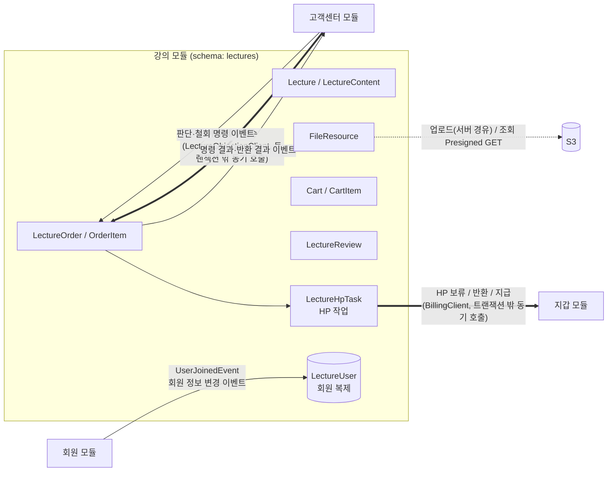
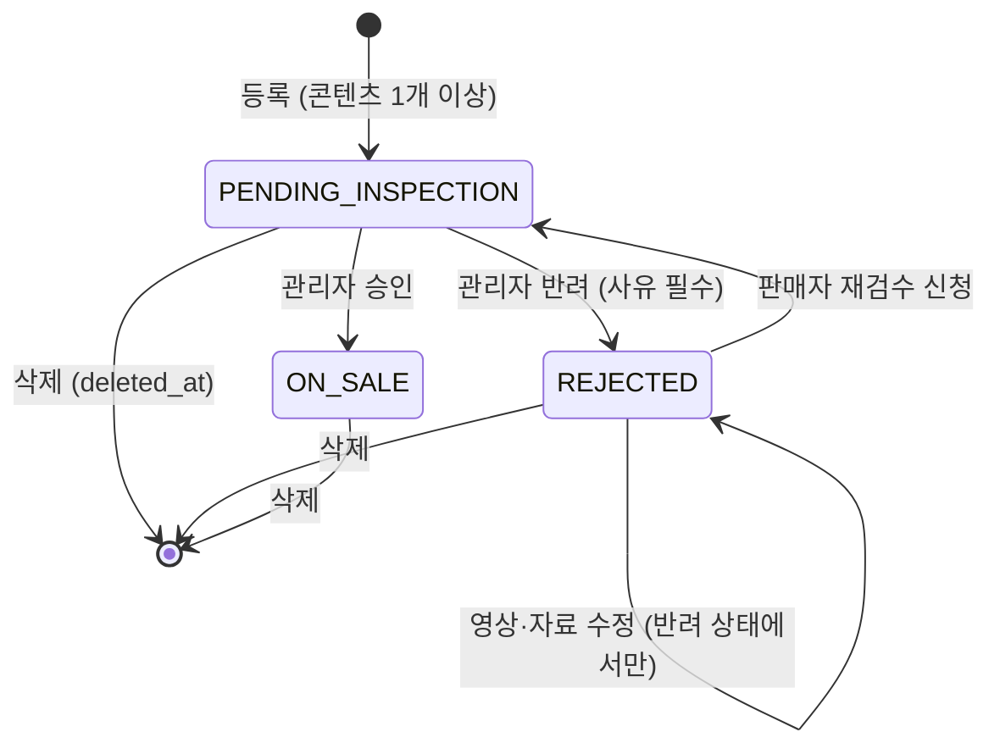
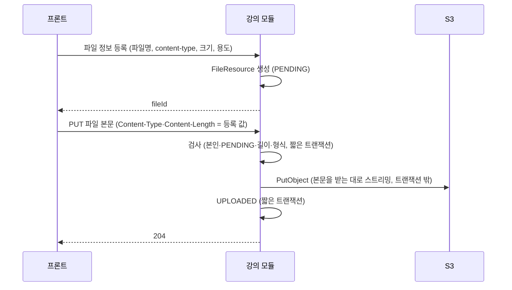
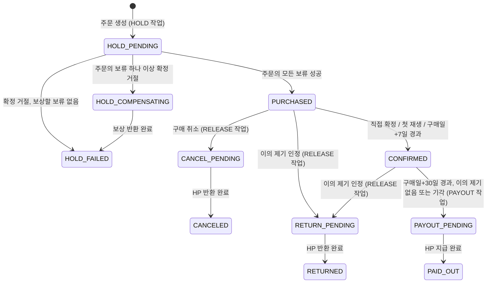
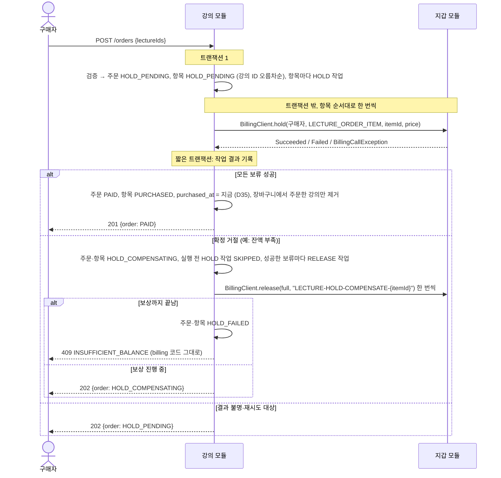
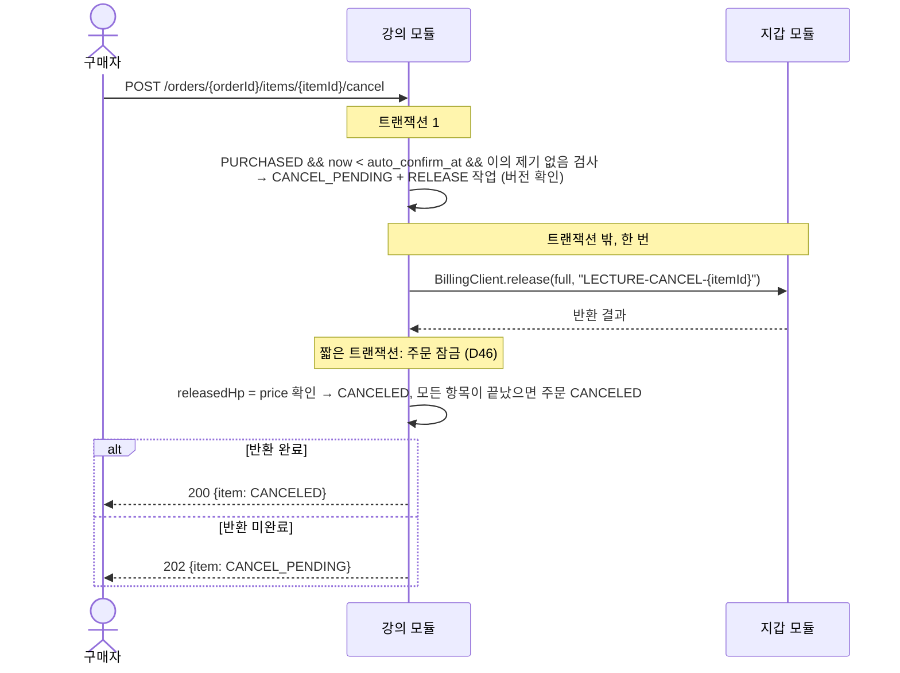
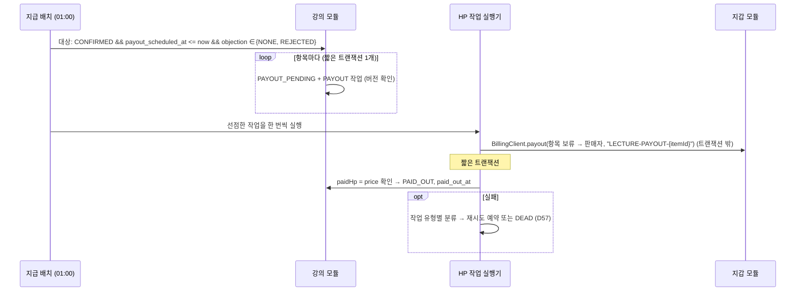
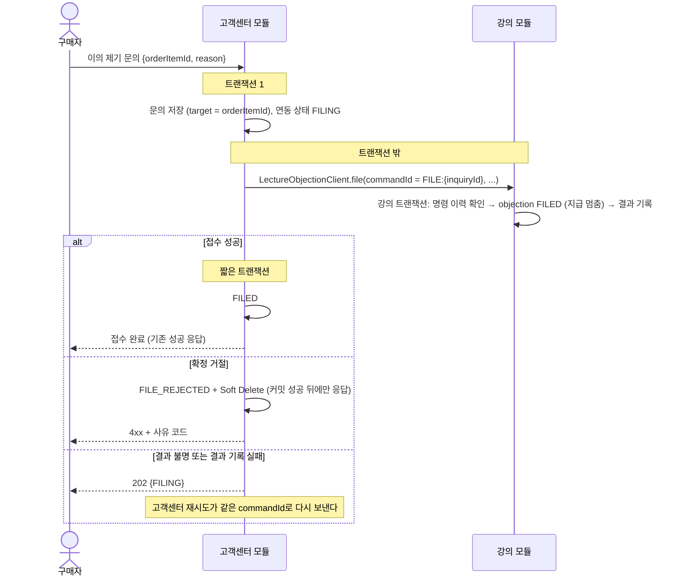
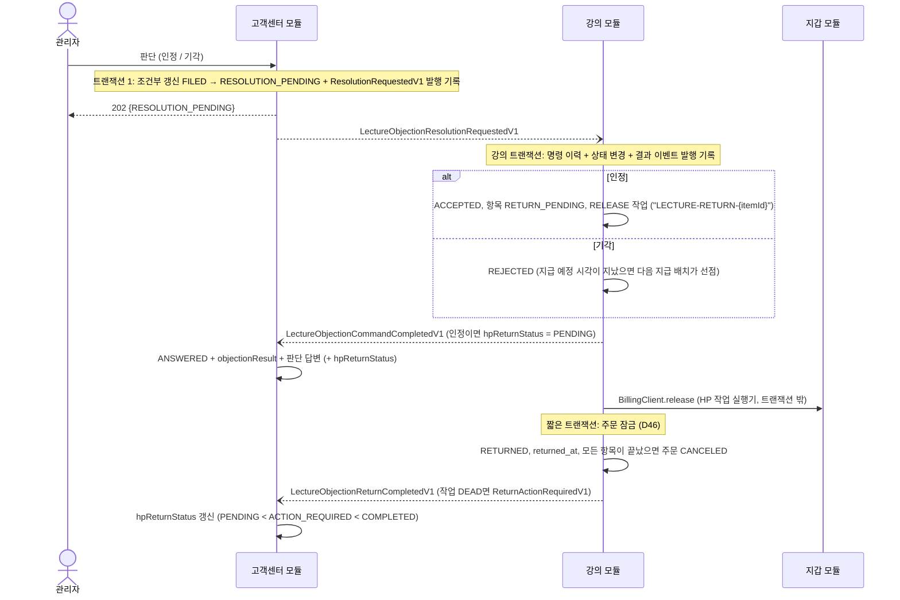

# 강의(Lecture) 모듈 설계

| 항목 | 내용 |
| --- | --- |
| 상태 | draft |
| 작성일 | 2026-10-08 |
| 관련 모듈 | 회원(member), 지갑(billing), 고객센터(customersupport) |

---

## 1. 범위

### 1.1 강의 모듈이 하는 일

기획서 MVP 표 기준: 인증된 인플루언서의 강의 등록, 구매, 구매 취소, 조회, 수정, 삭제, 검수(관리자 재량), 리뷰, 평점.

| 영역 | 기능 |
| --- | --- |
| 강의 | 등록(검수 대기로 시작), 수정, 삭제(Soft Delete), 목록·상세 조회, 판매자 본인 강의 조회 |
| 검수 | 관리자 승인·반려(사유), 반려된 강의의 영상·자료 수정 후 판매자 재검수 신청 (D11) |
| 파일 | 썸네일·강의 영상·자료의 S3 업로드(서버 경유, D22), 구매자 재생 URL 발급(Presigned GET) |
| 장바구니 | 담기, 빼기, 조회 |
| 주문 | 장바구니 주문, 바로 구매(강의 1개 주문), 주문 조회, 구매 확정(직접·첫 재생·자동), 구매 취소 |
| 지급 시점 관리 | 구매일 다음 날부터 30일 경과 시 지갑 모듈에 지급 호출 |
| 내용 다름 이의 제기 | 고객센터의 접수(동기 호출)와 판단·철회(명령 이벤트)를 처리: 검증·지급 중단, 판단 결과 반영(반환 또는 지급), 판단 전 철회(지급 중단 해제, D52). 명령 이력으로 멱등하게 처리하고 결과를 이벤트로 알린다 (D60) |
| 리뷰 | 작성·수정·삭제, 평점(1~5) 및 평균 |

### 1.2 강의 모듈이 하지 않는 일

| 하지 않는 일 | 담당 |
| --- | --- |
| HP 차감, 보류, 반환, 지급, 원장 기록. **어떤 HP 종류(충전/수익)로 얼마가 결제됐는지도 모른다** | 지갑(billing) |
| 이의 제기 문의 티켓 관리, 관리자 답변 | 고객센터(customersupport) |
| 회원 역할 변경(승급), 회원 정보의 원본 | 회원(member) |
| 강의 내용 다름 이의 제기의 자동 판정 | MVP 범위 밖 |

> 강의 모듈은 "언제, 누구에게, 얼마를" 옮겨야 하는지만 판단해 HP 작업으로 기록하고, 강의 트랜잭션 밖에서 강의가 소유한 Port `BillingClient`로 지갑 모듈에 요청한다(6.2, D56·D57). 실제 HP 이동과 정합성은 지갑 모듈 한 곳에서 처리한다(기획서 아키텍처 절). 고객센터와는 접수 동기 호출과 판단·철회 이벤트로, 회원과는 이벤트로 연동한다.

---

## 2. 강의 모듈이 지켜야 하는 정책 요약

정책 문서에서 강의 모듈 구현에 직접 영향을 주는 규칙만 모았다.

| # | 규칙 | 출처 |
| --- | --- | --- |
| P1 | 강의 등록·판매는 **인증된 인플루언서**만 가능하다 | 기획서 권한표 |
| P2 | 장바구니·강의 구매·구매 취소는 유저·인플루언서·인증된 인플루언서만 가능하다 (관리자·비회원 불가) | 기획서 권한표 |
| P3 | 비회원은 강의 **목록만** 조회한다 | 기획서 권한표 |
| P4 | 등록한 강의는 **검수 대기(비공개)**. 승인되면 공개·판매, 반려되면 사유를 남기고 판매자가 수정 후 재신청 | 정책 6 |
| P5 | ~~판매 중인 강의의 영상·자료를 수정하면 다시 검수 대기가 되어 신규 판매를 멈춘다~~ → **MVP에서는 영상·자료를 반려된 강의만 수정할 수 있다.** 검수 대기·판매 중에는 수정 불가, 판매 중 강의를 고치려면 삭제 후 재등록 (D11). 메타 정보는 언제든 수정 | 정책 6, D11 |
| P6 | 구매 확정 = 직접 확정·첫 재생·구매일 다음 날부터 7일 경과 중 먼저. 확정 후 단순 변심 취소 불가. **지급 시점이 아니다** | 정책 4, 용어 |
| P7 | 구매 취소 = 구매 확정 전 주문 항목 취소 → 보류 HP를 구매자에게 반환 (환불과 다름) | 용어 |
| P8 | 강의 지급 = 구매일 다음 날부터 30일(내용 다름 이의 제기 기간)이 끝난 뒤 판매자 수익 HP로 지급. 수수료 없음 | 정책 4 |
| P9 | 내용 다름 이의 제기는 구매일 다음 날부터 30일 이내. 접수되면 지급을 멈추고 보류 유지. 관리자 인정 → 구매자 반환, 기각 → 판매자 지급 | 정책 6 |
| P10 | ~~일부 항목 반환 시 그 주문에 남은 보류분 중 충전 HP부터 반환~~ → **보류는 주문 항목 단위이고(D36), 항목마다 그 항목을 결제할 때 차감한 HP 종류 그대로 반환·지급한다 (D42).** 주문 단위 우선순위는 두지 않는다 | 정책 1, AGENTS 5장, D42 |
| P11 | 주문은 상태값으로 관리하고 삭제하지 않는다. 강의는 Soft Delete. 그 외 모든 데이터도 Soft Delete | 기획서 데이터 모델, AGENTS 5장 |
| P12 | 모든 기간·마감·일시는 **KST** 기준 | 정책 머리말 |
| P13 | 다른 모듈과는 회원 ID와 이벤트로만 연결. 스키마 간 FK·JOIN 금지. 스키마 이름 `lectures` (회원 `members`·출연 `appearances`와 같은 복수형) | AGENTS 3장 |

---

## 3. 모듈 경계



- 다른 모듈의 엔티티·Repository를 쓰지 않는다. 판매자·구매자·리뷰 작성자는 `*_user_id`(Long)로만 참조한다.
- 닉네임 표시에 필요한 회원 정보는 `LectureUser`(회원 복제, `ReplicaUser` 상속)로 강의 스키마 안에 둔다. 같은 스키마 안의 JOIN은 허용된다.
- 다른 모듈과의 트랜잭션은 공유하지 않는다. 강의는 자기 로컬 트랜잭션만 보장하고, 다른 모듈 호출은 강의 트랜잭션 밖에서 한다 (6.1 원칙, D56).
- 모듈 간 계약(DTO·이벤트·안정적인 enum과 오류 코드)은 기존 회원 이벤트(`shared/member/event/UserJoinedEvent`)와 같은 방식으로 `shared` 모듈에 둔다(예: `com.hapbang.shared.lecture.event`). 호출 인터페이스(Port)는 소비 모듈 안에 두고, 모놀리스 연결은 `apps`의 In-process Adapter가 한다 (D56).

---

## 4. 도메인 모델

### 4.1 애그리거트 구성

| 애그리거트 루트 | 포함 | 역할 |
| --- | --- | --- |
| `Lecture` | `LectureContent` | 강의 상품, 검수 상태, 영상·자료 구성 |
| `FileResource` | - | S3 객체 메타데이터 (업로드 상태) |
| `Cart` | `CartItem` | 회원별 장바구니 (회원당 1개) |
| `LectureOrder` | `OrderItem` | 주문(결제 단위)과 항목(구매 확정·취소·지급·이의 제기 단위) |
| `LectureReview` | - | 주문 항목 1건당 리뷰 1개 |
| `LectureUser` | - | 회원 복제 (닉네임·역할·상태) |

애그리거트 사이는 ID로만 참조한다 (`OrderItem.lectureId`, `CartItem.lectureId`, `LectureContent.fileId` 등). 같은 모듈 안이어도 `@ManyToOne`은 애그리거트 내부(`Lecture`–`LectureContent`, `Cart`–`CartItem`, `LectureOrder`–`OrderItem`)에만 건다.

### 4.2 Lecture — 검수 상태

ERD의 `LECTURE.status`에 검수 상태를 담는다. 별도의 "작성 중(DRAFT)" 상태는 두지 않는다. 정책 6이 "등록한 강의는 검수 대기"라고 정하고 있으므로, **영상·자료 파일을 먼저 업로드한 뒤 등록 요청 한 번에 강의와 콘텐츠를 함께 만든다.**



| 상태 | 코드 | 목록·상세 노출 | 신규 구매 | 기존 구매자 시청 |
| --- | --- | --- | --- | --- |
| 검수 대기 | `PENDING_INSPECTION` | 판매자·관리자만 | X | - (승인 전이라 구매자 없음) |
| 반려 | `REJECTED` | 판매자·관리자만 | X | - (승인 전이라 구매자 없음) |
| 판매 중 | `ON_SALE` | 모두 | O | O |
| 삭제 | `deleted_at` 기록 | 판매자·관리자·기존 구매자 (목록 제외) | X | O (D5) |

불변식

- `ON_SALE`이 아니면 장바구니 담기·주문 생성을 거부한다.
- 판매자 본인만 수정·삭제·재검수 신청할 수 있다.
- 반려 시 `rejection_reason`은 필수다. 재검수 신청 시 이전 반려 사유는 덮어쓰지 않고 다음 반려 때 갱신한다.
- 메타 정보(제목·소개·가격·썸네일) 수정은 재검수 대상이 아니다. 정책은 "내용(영상·자료)"만 재검수 대상으로 정했다. (정책 6) 삭제 전이면 어느 상태에서든 수정할 수 있다.
- 영상·자료는 `Lecture` 애그리거트를 통해 목록 전체를 교체하는 방식으로만 바꾸고, **`REJECTED`일 때만** 허용한다 (D11). 교체된 행은 Soft Delete로 남긴다.
- 콘텐츠가 0개가 되는 수정은 거부한다.

#### 승인 후 콘텐츠 잠금 (D11)

검수 대기와 판매 중에는 영상·자료를 바꿀 수 없다. 그래서

- 관리자는 항상 판매자가 제출한 내용 그대로를 승인한다. 검수하는 동안 내용이 바뀌지 않으므로 승인 요청에 revision·version을 담을 필요가 없다.
- 구매자는 항상 승인된 내용만 본다. 승인본·검수본을 나눠 둘(revision) 필요가 없다.
- 판매 중 강의의 내용을 고치려면 삭제 후 새로 등록한다. 삭제된 강의도 기존 구매자는 계속 보고 지급도 그대로 진행된다(D5). 리뷰·평점은 새 강의로 이어지지 않는다.

> 이전 초안의 콘텐츠 revision(승인본·검수본 분리) 설계는 D11로 대체했다. MVP 이후 판매 중 수정이 필요해지면 다시 검토한다.

### 4.3 LectureContent

| 필드 | 설명 |
| --- | --- |
| `fileId` | `FileResource` ID. 업로드 완료(`UPLOADED`) 상태이고 업로더가 판매자 본인인 파일만 연결 가능 |
| `title`, `sequence` | 표시 제목, 강의 내 순서 (강의 안에서 유일) |
| `contentType` | `VIDEO`(영상), `DOCUMENT`(자료) |

> 썸네일(사진)·영상·자료 파일은 모두 S3에 저장한다 (16장 D2).

### 4.4 FileResource — S3 업로드



- 업로드는 서버 경유다 (D22). 인스턴스 역할로 서명한 Presigned PUT은 EC2 밖에서 조직 정책으로 거부된다(`docs/deploy/s3.md`).
- 본문 업로드 규칙은 D24, 트랜잭션 경계는 D25를 따른다. 저장에 실패하거나 연결이 끊기면 `PENDING`으로 남아 처음부터 다시 올린다.

- `file_type`: `LECTURE_THUMBNAIL`, `LECTURE_VIDEO`, `LECTURE_DOCUMENT`
- `status`: `PENDING` → `UPLOADED` (삭제 시 `deleted_at`)
- object key 규칙: `lecture/{fileType}/{uuid}` — 원본 파일명은 key에 넣지 않는다. 환경 prefix(`dev/` 등)는 `global/storage`가 붙인다.
- 용도별 허용 형식·최대 크기는 D19를 따른다.
- 강의 등록·정보 수정·콘텐츠 교체에서는 `UPLOADED`이고 판매자 본인이 올렸고 용도(썸네일/영상/자료)가 맞는 파일만 연결한다. 한 파일을 여러 강의에 연결할 수 있다 (D21).
- 썸네일은 목록에서 비회원도 보므로 Presigned GET URL을 응답 때마다 발급한다. 조회 URL 만료는 D23을 따른다. 강의 응답의 썸네일 URL 규칙은 D28을 따른다.
- 오래된 `PENDING` 파일 정리는 MVP에서 하지 않는다.

### 4.5 Cart

- 회원당 1개. 처음 담을 때 만든다. (`cart.user_id` 유일, 동시에 처음 담아도 하나만 생기도록 `INSERT … ON CONFLICT DO NOTHING`, D18)
- 같은 강의는 한 번만 담는다. 동시에 담으면 부분 유일 인덱스가 막고 `ALREADY_IN_CART`(409)로 응답한다 (D18).
- 담을 때 검사 순서: 본인 강의가 아님(D5, `OWN_LECTURE_NOT_PURCHASABLE` 403) → 강의가 `ON_SALE`(아니면 상세 조회처럼 `LECTURE_NOT_FOUND` 404) → 이미 담지 않음(`ALREADY_IN_CART` 409) → 이미 보유 중(유효한 주문 항목이 있음)이 아님(**주문 구현 때 추가**).
- 담은 뒤 강의가 판매 중지·삭제되면 장바구니 조회 시 "구매 불가"(`purchasable=false`)로 표시하고 합계(`purchasableTotalHp`)에서 빼며, 주문 시에는 거부한다. 조회는 최근 담은 순이다.
- 담지 않은 강의를 빼면 무시하고 204로 응답한다 (D18). 개수 제한은 없다.
- 주문의 모든 보류가 성공해 주문을 `PAID`로 기록하는 트랜잭션에서 **그 주문에 포함된 강의만** 장바구니에서 뺀다. 결과 기록을 다시 실행해도 같은 결과가 되게 멱등하게 뺀다. 보류 처리 중(`HOLD_PENDING`·`HOLD_COMPENSATING`)이거나 보류에 실패(`HOLD_FAILED`)하면 장바구니를 그대로 둔다. 처음부터 빼고 실패 시 복원하면 처리 중 사용자가 바꾼 장바구니를 덮어쓸 수 있어 그렇게 하지 않는다 (D58).
- 정책상 Soft Delete가 원칙이므로 `cart_item`에 `deleted_at`을 둔다. (ERD에 없음)

### 4.6 LectureOrder / OrderItem

#### 주문(LectureOrder)은 결제 단위

- 장바구니 주문과 바로 구매(강의 1개 주문)를 같은 모델로 처리한다.
- **HP 보류는 주문 항목 단위**다(D36). 항목마다 그 가격을 보류하고(참조 `LECTURE_ORDER_ITEM`, 주문 항목 ID), 구매 취소·지급도 그 항목의 보류만 쓴다. 혼합 HP는 항목마다 차감한 HP 종류 그대로 반환·지급한다(D42).
- **주문은 보류보다 먼저 저장된다(D58).** 주문·항목과 항목별 HOLD 작업을 한 강의 트랜잭션에 커밋한 뒤, 트랜잭션 밖에서 보류한다. 모든 보류가 성공해야 `PAID`가 되고, 하나라도 확정 거절되면 이미 성공한 보류를 반환(보상)한 뒤 `HOLD_FAILED`가 된다. 돈과 관련된 처리 이력이므로 `HOLD_FAILED` 주문도 지우지 않는다.
- 주문 상태(`status`)는 저장값이 기준이다.

| 주문 상태 | 의미 |
| --- | --- |
| `HOLD_PENDING` | 주문 생성. 보류 진행 중이거나 결과를 확인하는 중 |
| `HOLD_COMPENSATING` | 한 항목 이상의 보류가 확정 거절되어, 성공한 보류를 반환하는 중 |
| `HOLD_FAILED` | 보류 실패. 남은 보류 HP가 없음이 확인됨 (보상 완료 또는 보상 불필요) |
| `PAID` | 모든 항목의 보류 성공 (구매 완료) |
| `CANCELED` | 모든 항목이 `CANCELED`·`RETURNED`가 된 때 (반환이 실제로 끝난 뒤) |

- 항목을 `CANCELED`·`RETURNED`로 바꾸는 모든 경로(구매 취소 반환 완료, 이의 제기 인정 반환 완료)는 **반환 결과를 기록하는 트랜잭션에서** 주문 행을 잠그고(D46) 공통 메서드(예: `LectureOrder.closeIfAllItemsEnded()`)를 호출해, 끝나지 않은 항목이 없으면 주문을 `CANCELED`로 바꾸고 `canceled_at`을 기록한다. 반환 진행 중(`CANCEL_PENDING`·`RETURN_PENDING`) 항목은 끝나지 않은 항목이다.

| 응답용 진행 상태 (`status = PAID`일 때만) | 조건 |
| --- | --- |
| `IN_PROGRESS` | 아직 끝나지 않은 항목(`PURCHASED`, `CONFIRMED`, `CANCEL_PENDING`, `RETURN_PENDING`, `PAYOUT_PENDING`)이 있음 |
| `COMPLETED` | 모든 항목이 `PAID_OUT`·`CANCELED`·`RETURNED` 중 하나이며 `PAID_OUT`이 1개 이상 |

#### 주문 항목(OrderItem)은 거래 단위

구매 확정·구매 취소·지급·이의 제기는 모두 항목 단위로 일어난다.

**HP가 움직이는 전이는 처리 중 상태를 거친다(D56·D59).** 강의 트랜잭션은 항목을 처리 중 상태로 바꾸고 HP 작업을 기록하는 데까지만 한다. billing 호출은 트랜잭션 밖에서 하고, 성공한 결과를 짧은 트랜잭션으로 기록할 때 완료 상태가 된다. 그래서 완료 상태(`PURCHASED`, `CANCELED`, `RETURNED`, `PAID_OUT`)는 HP가 실제로 움직인 뒤에만 보인다.



- 항목의 `HOLD_PENDING`·`HOLD_COMPENSATING`·`HOLD_FAILED`는 **주문 전체 보류 단계를 그대로 복제한 상태**다. 모든 항목이 주문과 같은 값을 갖는다. 개별 항목의 보류 성공·거절·반환 진행은 HP 작업(`LectureHpTask`)이 나타낸다. 항목에도 상태를 두는 이유는 보유 판정 부분 유일 인덱스가 `order_item`에 있기 때문이다.
- 작업이 `DEAD`가 되어도 항목은 처리 중 상태에 남는다(`HOLD_PENDING`·`HOLD_COMPENSATING`·`CANCEL_PENDING`·`RETURN_PENDING`·`PAYOUT_PENDING`). 완료 상태는 실제 HP 이동이 끝났다는 뜻이므로 실패로 바꾸지 않는다. 관리자가 복구한다 (D57).
- `CANCEL_PENDING`·`RETURN_PENDING`이 되는 순간 시청 권한은 사라진다. `PAYOUT_PENDING`은 구매 확정 뒤의 상태라 시청·리뷰를 유지한다.
- 마지막 남은 항목의 반환이 끝나 `CANCELED`·`RETURNED`가 되면 같은 결과 기록 트랜잭션에서 주문을 `CANCELED`로 바꾼다 (구매 취소·이의 제기 인정 공통).

상태별 허용 범위 (D58, D59)

| 항목 상태 | 주문 내역 | 보유(재구매 차단, 부분 유일 인덱스) | `/purchased`·시청 | 새 리뷰 | 판매 내역 | 처리 상태(`processingStatus`) |
| --- | --- | --- | --- | --- | --- | --- |
| `HOLD_PENDING` | "결제 처리 중" | O | X | X | X | O |
| `HOLD_COMPENSATING` | "결제 취소 처리 중" | O | X | X | X | O |
| `HOLD_FAILED` | "결제 실패" | X | X | X | X | - |
| `PURCHASED` | 구매 완료 | O | O (재생 동의 후 시청) | X | O | - |
| `CONFIRMED` | 구매 확정 | O | O | O | O | - |
| `CANCEL_PENDING` | "구매 취소 처리 중" | O | X | X | O | O |
| `CANCELED` | 구매 취소 | X | X | X | O | - |
| `RETURN_PENDING` | "반환 처리 중" | O | X | X | O | O |
| `RETURNED` | 반환 | X | X | X | O | - |
| `PAYOUT_PENDING` | 구매 확정 | O | O | O | O | O |
| `PAID_OUT` | 구매 확정 | O | O | O | O | - |

- 처리 상태(`processingStatus`)는 처리 중 항목에만 내려 준다. 내부 작업 상태(`PENDING`·`PROCESSING`·`DEAD`)를 그대로 보여 주지 않고 업무 의미로 바꾼다. 한 항목에는 생애 동안 HOLD·RELEASE·PAYOUT 작업이 여러 개 생기므로, 지금 상태에 해당하는 작업으로 판정한다.
  - `PROCESSING`: 정상 처리 중
  - `DELAYED`: 실패 후 재시도 중
  - `ACTION_REQUIRED`: 자동 처리가 멈춤(작업 `DEAD`), 고객센터 확인 필요
- 관리자 응답에는 원래 작업 상태, 시도 횟수, 오류 코드를 모두 보여 준다 (8.2.1).

이의 제기는 항목 상태와 별도로 `objection_status`로 둔다.

| `objection_status` | 의미 | 지급 | 구매 취소 |
| --- | --- | --- | --- |
| `NONE` | 이의 제기 없음 (판단 전에 철회하면 이 상태로 돌아간다, D52) | 기간 경과 시 지급 대상 선점 (이미 지났으면 다음 지급 배치에서) | 확정 전이면 가능 |
| `FILED` | 접수, 관리자 판단 대기 | **멈춤** | 불가 (이중 반환 방지) |
| `ACCEPTED` | 인정 → 항목 `RETURN_PENDING` → 반환 완료 시 `RETURNED` | 없음 | - |
| `REJECTED` | 기각 | 기간 경과 시 지급 대상 선점 (이미 지났으면 다음 지급 배치에서) | 불가 |

#### 불변식

| 동작 | 허용 조건 |
| --- | --- |
| 주문 생성 | 모든 강의가 `ON_SALE`, 본인 강의 아님(D5), 같은 강의를 이미 보유 중이 아님(D5, 보유 = 위 표의 "보유" 상태), 한 주문에 같은 강의 중복 없음, 주문자 역할이 유저·인플루언서·인증된 인플루언서 |
| 직접 확정 | 본인 항목, `PURCHASED` |
| 첫 재생 확정 | 본인 항목, `PURCHASED`, 구매자가 **재생 동의**를 제출할 때 (D7). 자동 구매 확정 시각이 지났으면 직접 확정과 같이 `AUTO`(D34). 이미 `CONFIRMED`·`PAYOUT_PENDING`·`PAID_OUT`이면 그대로 둔다 (D38) |
| 구매 취소 | 본인 항목, `PURCHASED`, `now < auto_confirm_at`, `objection_status = NONE` → `CANCEL_PENDING` |
| 이의 제기 접수 (고객센터 호출) | 구매자 본인 항목, `PURCHASED` 또는 `CONFIRMED`, `now < payout_scheduled_at`, `objection_status = NONE`. `PAYOUT_PENDING`은 기한이 지난 뒤의 상태라 `PERIOD_EXPIRED`다 (6.2) |
| 이의 제기 철회 (고객센터 명령) | 구매자 본인 항목, `objection_status = FILED`, 접수한 문의 ID와 같음. 기한 없음. 철회하면 `NONE`으로 돌아가고 문의 ID·사유·접수 시각을 비운다 (D52) |
| 지급 대상 선점 | `CONFIRMED`, `now >= payout_scheduled_at`, `objection_status ∈ {NONE, REJECTED}` → `PAYOUT_PENDING` |
| 시청 | 본인 항목이 `CONFIRMED`·`PAYOUT_PENDING`·`PAID_OUT` (이의 제기 접수 중에도 시청 가능, 삭제된 강의 포함). `PURCHASED`면 재생 동의 후 (D38) |

- **기한 판정은 배치가 아니라 도메인 메서드가 시각으로 한다.** 자동 구매 확정 배치가 늦게 돌아도 `now >= auto_confirm_at`이면 구매 취소를 거부한다.
- **첫 재생 = 재생 동의 (D7).** `PURCHASED` 항목의 영상을 처음 재생하기 전에 프론트가 동의서("재생하면 구매가 확정되어 단순 변심으로 구매 취소할 수 없습니다")를 보여 주고, 구매자가 동의하면 재생 동의 API를 호출한다. 서버는 이때 `CONFIRMED`(`FIRST_PLAY`)로 바꾼다.
- **서버가 강제한다.** 항목이 `PURCHASED`이면 영상·자료(`VIDEO`·`DOCUMENT`) URL 발급(`/access`)을 모두 거부하고 "재생 동의 필요" 오류를 준다. 동의 없이 영상·자료를 받을 방법이 없으므로, 화면 진입·프리로드로 확정되는 일도, 동의 없이 보거나 자료만 받고 취소하는 일도 없다. 자료 다운로드도 같은 동의를 받는다(D8).
- 이미 `CONFIRMED`·`PAYOUT_PENDING`·`PAID_OUT`이면(직접 확정·자동 확정 포함) 동의 없이 URL을 발급한다.
- "재생 동의 필요" 오류는 403 `PLAY_CONSENT_REQUIRED`이고, 프론트가 바로 재생 동의 API를 호출할 수 있게 `orderId`·`orderItemId`를 담는다 (D38).
- 동의 기록은 `confirmation_type = FIRST_PLAY`와 `confirmed_at`으로 남긴다.
- 한 구매자는 같은 강의에 대해 **보유 상태**(`HOLD_PENDING`, `HOLD_COMPENSATING`, `PURCHASED`, `CONFIRMED`, `CANCEL_PENDING`, `RETURN_PENDING`, `PAYOUT_PENDING`, `PAID_OUT`)의 항목을 하나만 가진다. HP가 남아 있을 수 있는 처리 중 상태도 보유로 본다. 보류 실패(`HOLD_FAILED`, 남은 보류 없음 확인)·취소·반환 후에는 다시 살 수 있다. `PAID_OUT`도 보유로 본다(D5): 구매한 강의는 계속 볼 수 있으므로 다시 살 수 없다.
- 주문 시점의 강의 제목과 가격을 항목에 스냅샷으로 저장한다. 이후 강의 가격이 바뀌어도 반환·지급 금액은 스냅샷 가격이다.

### 4.7 LectureReview

- 주문 항목 1건당 살아 있는 리뷰 1개. 한 회원은 한 강의에 리뷰를 하나만 유지한다. 삭제 후 재작성은 새 행으로 만들며, 그래서 유일 제약은 모두 `WHERE deleted_at IS NULL` 부분 인덱스로 건다(7.1).
- 작성 조건: 본인 항목이 `CONFIRMED`·`PAYOUT_PENDING`·`PAID_OUT` (D5, D59). 구매 확정 전 리뷰를 허용하면 리뷰 작성 후 구매 취소가 가능해지기 때문이다. `CANCEL_PENDING`·`RETURN_PENDING`부터는 새 리뷰를 쓸 수 없다.
- 평점은 1~5 정수. 본문은 선택이며 1,000자 이하다 (D47). 평균 평점과 리뷰 수는 MVP에서 조회 시 집계한다. 목록 성능 문제가 생기면 `lecture`에 캐시 컬럼을 추가한다.
- 항목이 `RETURN_PENDING`이 되는 순간부터(반환 완료 `RETURNED` 포함) 리뷰는 남기되 리뷰 목록·평균 평점·리뷰 수에서 제외한다 (D5, D47, D59). 반환 여부는 컬럼으로 복사하지 않고 조회할 때 `order_item`과 JOIN해 판정한다.
- 리뷰 수정·Soft Delete 권한은 항목 상태와 관계없이 작성자에게 그대로 둔다(`ReviewEditUseCase`·`ReviewDeleteUseCase`). 반환 진행 중·반환된 항목의 리뷰 수정을 막을지는 별도 제품 결정이다 (D59).
- 반환 후 같은 강의를 다시 사서 새 리뷰를 쓰면, 반환된 항목에 남은 기존 리뷰를 Soft Delete하고 새 리뷰로 대체한다 (D47).

### 4.8 LectureUser (회원 복제)

- `shared`의 `ReplicaUser`를 상속한다. ID는 원본 회원 ID.
- `UserJoinedEvent`로만 생성한다(이미 있으면 무시). 회원 정보 변경 이벤트(`UserModifiedEvent`, #56)는 있는 복제본만 `syncFrom`으로 갱신하고, 없으면 `LECTURE_USER_NOT_FOUND`로 실패시켜 미완료 이벤트로 남긴다(재시작 시 재처리) (D17).
- 용도: 강의 목록·상세의 판매자 닉네임, 리뷰 작성자 닉네임. 탈퇴 회원은 "탈퇴한 회원"으로 표시한다(정책 7).
- 권한 판단(인증된 인플루언서 여부 등)은 복제본이 아니라 **요청 시점의 Spring Security 인증 정보**로 한다. 복제본은 이벤트 지연으로 늦을 수 있다.

---

## 5. 시간 규칙

모든 계산은 KST(`Asia/Seoul`)이며 `java.time.Clock`을 주입받아 계산한다(테스트에서 시각 고정).

- **구매일** = 주문 항목이 `PURCHASED`가 된 시각(`purchased_at`, 주문의 모든 보류가 성공했음을 기록한 시각, D35·D58)의 KST 날짜. 보류가 끝나기 전(`HOLD_*`)에는 `purchased_at`·`auto_confirm_at`·`payout_scheduled_at`이 없다
- **자동 구매 확정 시각** `auto_confirm_at` = (구매일 + 8일) 00:00 KST
  - "구매일 다음 날부터 7일 경과" → 구매일 다음 날부터 7일째 되는 날 23:59:59까지 취소 가능
- **지급 예정 시각** `payout_scheduled_at` = (구매일 + 31일) 00:00 KST
  - "구매일 다음 날부터 30일(내용 다름 이의 제기 기간)" → 30일째 되는 날 23:59:59까지 이의 제기 가능

정책 문서 예시와 맞춰 본 결과:

| 구매 | 구매 취소 가능 (확정 전) | `auto_confirm_at` | 이의 제기 가능 | `payout_scheduled_at` |
| --- | --- | --- | --- | --- |
| 9/30 | ~ 10/7 23:59:59 | 10/8 00:00 | ~ 10/30 23:59:59 | 10/31 00:00 |

> 정책 예시: "9/30 구매 → 10/7까지 단순 변심 취소 가능 → 10/30까지 내용 다름 이의 제기 가능 → 10/30 기간 종료 후 판매자 수익 HP 지급" — 일치한다.

---

## 6. 모듈 간 연동

이 장은 **목표 구조**(D56~D61, #246)를 적는다. 현재 코드가 아직 옛 방식인 흐름은 6.1 "전환 상태" 표에 있다.

### 6.1 연동 방식

| 상대 모듈 | 내용 | 방식 |
| --- | --- | --- |
| 지갑 | 주문 항목별 HP 보류, 구매 취소·이의 제기 인정 반환, 지급 | 강의가 소유한 Port `lecture.out.billing.BillingClient`를 **강의 트랜잭션 밖에서** 동기 호출한다. 호출은 HP 작업(`LectureHpTask`)으로 먼저 기록하고 실행한다 (D56, D57) |
| 고객센터 | 이의 제기 접수 | 고객센터가 소유한 Port `customersupport.out.lecture.LectureObjectionClient`로 고객센터 트랜잭션 밖에서 동기 호출한다. 강의는 명령 이력으로 멱등하게 처리한다 (D60) |
| 고객센터 | 이의 제기 판단·철회 | 명령 이벤트 → 강의 처리 → 결과 이벤트. 인정한 건의 HP 반환 완료·조치 필요는 별도 이벤트다 (D60) |
| 회원 | 가입, 회원 정보 변경 | 이벤트 |

#### 원칙 (D56)

1. **로컬 트랜잭션만 보장한다.** 다른 모듈의 저장 결과와 함께 커밋·롤백된다는 계약을 두지 않는다.
2. **Port는 소비 모듈이 소유한다.** 강의 → billing `lecture.out.billing.BillingClient`, 출연 → billing `appearance.out.billing.BillingClient`, 고객센터 → 강의 `customersupport.out.lecture.LectureObjectionClient`.
3. **모듈 간 연동 계약은 데이터 계약이다.** 직렬화 가능한 DTO·이벤트·안정적인 enum과 오류 코드만 둔다. `shared.billing.domain`에는 `BillingReferenceType`, `SettlementSourceType`, `BillingFailureCode` 같은 데이터 계약을 둔다. Port·엔티티·Repository·공유 Java 예외는 두지 않는다. `.contract` 같은 새 패키지는 만들지 않고 기존 `shared.billing.dto`·`domain`·`event`를 쓴다. 강의 계약도 같은 모양(`shared.lecture.dto`·`domain`·`event`)으로 둔다.
4. **모놀리스 연결은 조립 모듈 `apps`의 In-process Adapter가 한다.** Adapter는 소비 모듈의 Port를 구현하고 제공 모듈의 공개 Application 진입점을 부른다. 제공 모듈의 내부 오류는 Adapter가 공유 오류 코드 결과로 바꾼다.
5. **동기 연동도 호출자 트랜잭션 밖에서 한다.** 로컬 상태와 작업을 먼저 커밋하고, 멱등 키로 호출한 뒤, 결과를 짧은 로컬 트랜잭션으로 기록한다.
6. **비동기 연동은 이벤트 계약을 쓴다.** 이벤트 발행은 로컬 상태 변경과 같은 트랜잭션에 기록되고(Spring Modulith 이벤트 발행 기록), `@ApplicationModuleListener`가 별도 트랜잭션에서 처리한다.
7. **완료 상태와 처리 중 상태를 나눈다.** `PAID`·`PURCHASED`·`CANCELED`·`RETURNED`·`PAID_OUT`은 보류·반환·지급이 실제로 끝난 뒤에만 쓴다.
8. **재시도는 명시적인 작업·명령 기록에 근거한다.** 같은 요청 ID + 같은 payload는 기존 결과를 재현하고, 같은 요청 ID + 다른 payload는 충돌이다.
9. **HTTP와 Kafka의 호출 모양을 같다고 가정하지 않는다** (6.2 "서비스 분리 시").
10. **작업 실행은 중복·중단을 견딘다.** 한 실행기만 원자적으로 선점하고, 실행 중 프로세스가 끝나면 lease가 지난 뒤 다시 선점한다. 시간·건수는 설정으로 둔다 (D57).

- `AGENTS.md`의 "모듈 간 통신은 Spring Event 기본"에서 동기 호출로 남는 것은 HP 이동(보류·반환·지급)과 이의 제기 접수뿐이다. 둘 다 요청자에게 결과(잔액 부족, 접수 불가 사유)를 바로 알려야 하기 때문이다. 판단·철회는 이벤트다.
- 최종 구조에는 shared Port(`shared.billing.port.BillingPort`, `shared.lecture.port.LectureObjectionPort`)와 모듈 간 공유 Java 예외(`LectureObjectionRefusedException`)가 **남지 않는다** (#256, #257).

#### 의존 방향

```
강의 app (UseCase, HP 작업 실행기)
  → lecture.out.billing.BillingClient            강의 소유 Port, 결과는 BillingCallResult
      ← apps InProcessLectureBillingAdapter      @Transactional(NEVER), billing 오류 → BillingFailureCode
          → billing 공개 Application 진입점        자기 로컬 트랜잭션만 연다

고객센터 app
  → customersupport.out.lecture.LectureObjectionClient
      ← apps InProcessLectureObjectionAdapter
          → 강의 공개 Application 진입점 (이의 제기 접수)

shared (데이터 계약만)
  billing.dto     HoldCommand, ReleaseCommand, PayoutCommand, PenaltyCommand, *ResultDto
  billing.domain  BillingReferenceType, SettlementSourceType, BillingFailureCode
  lecture.dto     이의 제기 접수 명령·결과
  lecture.domain  LectureObjectionFailureCode
  lecture.event   이의 제기 판단·철회 명령, 명령 결과, 반환 결과 이벤트 (V1)
```

#### 전환 상태

코드는 아직 옛 방식이다. 흐름마다 아래 티켓에서 바꾼다. **#256·#257이 끝나면 이 표를 지우고** 위 구조만 남긴다.

| 흐름 | 현재 구현 | 목표 구조 | 변경 티켓 | 전환 완료 조건 |
| --- | --- | --- | --- | --- |
| billing 호출 seam | UseCase가 shared `BillingPort`를 직접 호출 | 강의 `BillingClient` + `apps` In-process Adapter | #247 | 강의 main·test가 `shared.billing.port`를 import하지 않는다 |
| HP 작업 기반, 구매 취소 반환 | 강의 트랜잭션 안에서 `release`, 바로 `CANCELED` | `CANCEL_PENDING` + RELEASE 작업 → `CANCELED` | #248 | 구매 취소 트랜잭션 안에서 billing을 부르지 않는다 |
| 이의 제기 인정 반환 | 고객센터 트랜잭션 안에서 `RETURNED` + `release` | `RETURN_PENDING` + RELEASE 작업 → `RETURNED`, 반환 결과 이벤트 | #249 | Adapter `release`에 `NEVER` |
| 지급 | 항목마다 한 트랜잭션에서 `PAID_OUT` + `payout`, 실패는 `order_item`의 D54 컬럼 | `PAYOUT_PENDING` + PAYOUT 작업 → `PAID_OUT` | #250, 지급 실패 레거시 정리 티켓(#268) | Adapter `payout`에 `NEVER`, D54 데이터 이관 확인 |
| 주문 보류 | 주문 저장과 `hold`를 한 트랜잭션에서 | `HOLD_PENDING` + HOLD 작업 → `PAID`, 실패 시 보상 → `HOLD_FAILED` | #251 | Adapter `hold`에 `NEVER` |
| 이의 제기 명령 멱등 | 항목 상태로만 판정 | 명령 이력(`objection_command`) | #252 | 세 명령을 다시 보내도 같은 결과 |
| 이의 제기 접수 | 고객센터 트랜잭션 안에서 `LectureObjectionPort.fileObjection` | 문의 커밋 → `LectureObjectionClient` 동기 시도 → 결과 기록 | #253 | 문의 저장 트랜잭션 안에서 강의를 부르지 않는다 |
| 이의 제기 판단·철회 | 고객센터 트랜잭션 안에서 `resolveObjection`·`withdrawObjection` | 명령 이벤트 → 강의 처리 → 결과 이벤트 | 이벤트 재발행 [Global] 티켓(#266), #254, #255 | 판단·삭제 트랜잭션 안에서 강의를 부르지 않는다 |
| shared Port 제거 | `BillingPort`·`BillingPortAdapter`, `LectureObjectionPort`·`LectureObjectionPortAdapter`·`LectureObjectionRefusedException` | 삭제, 구조 테스트 | #256, #257 | 저장소에 해당 타입이 없다 |

하위 티켓의 의존 관계 (13장 8단계)

- 하드 의존: #247 → #248 → {#249, #250, #251}. 같은 항목 상태·인덱스·조회 조건을 고치므로 병합은 #249 → #250 → #251 순서를 권한다(#249가 #254의 선행이라 고객센터 줄을 빨리 연다).
- 이의 제기: #253 ← #252 / #254 ← #249, #252, 이벤트 재발행 [Global] 티켓(#266) / #255 ← #253, #254 / 이의 제기 실패 명령 운영 복구 티켓(#267) ← #255.
- 마무리: #256 ← #247~#251, **출연 실제 billing 연동**(지금 `appearance.billing.mode` 기본값이 `fake`) / #257 ← #252~#255.

#### 실행 중 실패한 이벤트의 재처리 (D61)

Spring Modulith 2.1.1의 재발행 기능(`IncompleteEventPublications`, `ResubmissionOptions`, `completionAttempts`)으로 실행 중에도 실패·미완료 이벤트를 다시 보낸다. global 공통 설정이라 이벤트 재발행 [Global] 티켓(#266)에서 만들고, 상세 설정과 운영 절차는 그 티켓의 문서에 둔다. 요약:

| 항목 | 결정 |
| --- | --- |
| 재발행 주기 | 1분마다 |
| 처음 재발행할 최소 나이 | 발행 후 5분 |
| 한 번에 처리 | 100건 |
| stale 판정 | `PUBLISHED`·`PROCESSING`·`RESUBMITTED` 각각 5분, 1분마다 확인 |
| 재발행 한도 | 자동으로 멈추지 않는다 |
| 경고 | 재발행 10회 도달(`completionAttempts = 11`, 처음 발행이 1) 시 ERROR 로그 + Micrometer counter |
| 재시작 재발행 | 기존 `republish-outstanding-events-on-restart: true` 유지 |

- 10회 뒤 자동으로 멈추게 하려면 dead 상태 저장, 오래된 dead 행이 배치를 막지 않는 조회, 관리자 재발행, 재시작 재발행 제외, 감사 기록이 필요하다. 이번에는 하지 않는다.
- 알림은 ERROR 로그와 counter까지다. 실제 호출·메시지 알림은 모니터링을 연동할 때 따로 설정한다.

### 6.2 동기 인터페이스

#### 지갑: 강의 소유 Port `BillingClient` (D56, #247)

```java
// lecture.out.billing — 강의 모듈이 소유한다. 구현은 apps의 In-process Adapter
public interface BillingClient {
    BillingCallResult<HoldResultDto> hold(HoldCommand command);
    BillingCallResult<ReleaseResultDto> release(ReleaseCommand command);
    BillingCallResult<PayoutResultDto> payout(PayoutCommand command);
}

// billing이 응답한 결과: 성공 또는 확정 실패
public sealed interface BillingCallResult<T> {
    record Succeeded<T>(T value) implements BillingCallResult<T> {}
    record Failed<T>(BillingFailureCode code, String detail) implements BillingCallResult<T> {}
}

// 결과를 받지 못한 실패. 결과 타입이 아니라 런타임 예외다
public class BillingCallException extends RuntimeException {
    BillingCallFailureKind kind;   // RETRYABLE: 호출 전에 실패했음이 확실 / UNKNOWN_RESULT: 처리됐는지 모름
}
```

| 항목 | 내용 |
| --- | --- |
| 요청·결과 DTO | 기존 `shared.billing.dto`의 `HoldCommand`·`ReleaseCommand`·`PayoutCommand`와 `*ResultDto`를 그대로 쓴다 |
| `Failed` | billing이 응답한 확정 실패다. 업무 거절(`INSUFFICIENT_BALANCE`)만이 아니라 재시도 대상(`WALLET_NOT_FOUND`)과 불변식 위반(`HOLD_STATE_INCONSISTENT`)도 들어오므로 "거절"이라 부르지 않는다. 분류는 실행기가 작업 유형별로 한다 (D57) |
| `BillingCallException` | 연결 자체가 안 됨 → `RETRYABLE`. 응답 타임아웃·응답 유실 → `UNKNOWN_RESULT`. In-process에서 billing 트랜잭션이 롤백된 것이 확실한 기술 예외 → `RETRYABLE`. `Throwable`·원인 문자열은 결과에 넣지 않고 로그와 `lecture_hp_task_attempt`에만 남긴다 |
| 응답 검증 | 예상하지 못한 응답 형식, 결과 금액이 항목 가격과 다름 → 실행기가 `INVARIANT_VIOLATION`으로 본다 |
| 트랜잭션 | Adapter 메서드에 `@Transactional(propagation = NEVER)`를 붙인다. 활성 트랜잭션 안에서 부르면 billing에 들어가기 전에 실패한다. 흐름을 옮긴 티켓마다 붙인다(hold #251, release #249, payout #250). Port 인터페이스에는 Spring 애노테이션을 붙이지 않는다. Fake·직접 생성 테스트에서는 이 검사가 빠지므로 통합 테스트로도 확인한다 (12장) |
| billing 진입점 | 호출자 트랜잭션 참여를 계약으로 두지 않고 자기 로컬 트랜잭션만 연다 (#256) |
| 멱등 키 | 보류는 참조 대상(`HOLD:LECTURE_ORDER_ITEM:{항목 ID}`, 항목당 1건). 반환·지급은 작업의 요청 ID: 구매 취소 `LECTURE-CANCEL-{항목 ID}`, 이의 제기 인정 `LECTURE-RETURN-{항목 ID}`, 보류 보상 `LECTURE-HOLD-COMPENSATE-{항목 ID}`, 지급 `LECTURE-PAYOUT-{항목 ID}` (D43) |
| `replayed` | 결과 불명 뒤 같은 작업을 다시 실행하면 billing이 처음 결과를 `replayed = true`로 돌려준다. 같은 작업·같은 payload의 재현은 정상이다. 다른 payload 충돌(`IDEMPOTENCY_KEY_CONFLICT`)과 금액 불일치는 불변식 위반이다 (D43 수정) |
| 혼합 HP | billing이 항목마다 수익 HP → 충전 HP 순서로 보류하고, 반환·지급은 그 항목에서 차감한 HP 종류 그대로다 (D42) |
| 동시성 | 같은 구매자의 동시 결제는 billing이 지갑 잠금으로 직렬화한다. 보류가 항목마다 별개라 같은 주문의 다른 항목 반환·지급은 서로 영향이 없다 |
| 테스트 | 강의 모듈 테스트 컨텍스트에는 billing 빈이 없으므로 테스트 소스의 `BillingClient` Fake를 쓴다. 실제 연결과 트랜잭션 밖 호출은 `apps` 통합 테스트로 확인한다 (12장) |

`BillingFailureCode` (`shared.billing.domain`, D56). billing 내부 `BillingErrorCode`(HTTP 상태·메시지를 가진 billing의 오류 모델) 전체가 아니라, 보류·반환·지급·위약금 호출에서 실제로 나올 수 있는 코드만 둔다. 목록은 billing 담당이 확인한다(#256).

| 묶음 | 코드 |
| --- | --- |
| 지갑·잔액 | `WALLET_NOT_FOUND`, `INSUFFICIENT_BALANCE`, `BALANCE_OVERFLOW`, `INVALID_POINT_AMOUNT` |
| 멱등 | `IDEMPOTENCY_KEY_CONFLICT` |
| 보류 | `HOLD_NOT_FOUND`, `HOLD_OWNER_MISMATCH`, `HOLD_ALREADY_CLOSED`, `HOLD_TYPE_NOT_SUPPORTED`, `HOLD_CHARGE_NOT_FOUND`, `HOLD_STATE_INCONSISTENT`, `CHARGE_PRINCIPAL_MISMATCH` |
| 반환·지급 | `RELEASE_AMOUNT_EXCEEDS_HELD`, `PAYOUT_AMOUNT_EXCEEDS_HELD`, `PAYOUT_TO_PAYER`, `PAYOUT_SOURCE_MISMATCH`, `PAYOUT_ALREADY_SETTLED` |
| 위약금 (출연) | `PENALTY_BASE_EXCEEDS_HELD`, `PENALTY_AMOUNT_ZERO` |
| 변환 불가 | `UNMAPPED` |

- In-process Adapter는 billing `BillingErrorCode` → `BillingFailureCode` 변환을 `default` 없는 `switch`로 쓴다. billing에 새 코드가 생기면 컴파일 오류로 드러난다.
- `UNMAPPED`는 HTTP Adapter가 처음 보는 문자열을 받았을 때만 쓴다. 실행기는 `INVARIANT_VIOLATION`으로 분류한다. 원래 코드 문자열은 사용자용 `detail`에 넣지 않고 Adapter 로그와 `lecture_hp_task_attempt.raw_error_code`에만 남긴다.

#### 강의: 이의 제기 접수 진입점 (고객센터가 호출, D60, #253)

고객센터는 자기 Port `LectureObjectionClient`로 접수를 요청하고, `apps`의 `InProcessLectureObjectionAdapter`가 강의의 공개 Application 진입점을 부른다. 문의는 먼저 커밋되고, 호출은 고객센터 트랜잭션 밖에서 한다.

| 항목 | 내용 |
| --- | --- |
| 요청 (`shared.lecture.dto`) | `commandId = FILE:{inquiryId}`, `correlationId`, `inquiryId`, `orderItemId`, `buyerUserId`, `reason`. 전송 재시도에도 `commandId`는 같다 |
| 결과 | 성공 또는 `LectureObjectionFailureCode`. 예상된 거절은 예외가 아니라 결과다. 결과를 받지 못하면 연동 예외(결과 불명)다 |
| 강의 처리 | 한 강의 트랜잭션에서 명령 이력 확인 → 항목 `objection FILED` → 명령 결과 기록. 같은 `commandId` + 같은 payload면 처음 결과를 재현한다 (D60, #252) |
| 접수 가능 조건 | 구매자 본인 항목, `PURCHASED` 또는 `CONFIRMED`, `objection_status = NONE`, `now < payout_scheduled_at` |
| 거절 코드 (`LectureObjectionFailureCode`) | 접수: `NOT_BUYER`(없는 항목 포함) → `NOT_OBJECTIONABLE`(구매 완료 전·취소·반환 진행 중이거나 끝난 항목) → `ALREADY_PAID_OUT` → `ALREADY_FILED`(접수·판단된 항목) → `PERIOD_EXPIRED` 순서로 검사한다(D49). `PAYOUT_PENDING`은 지급 예정 시각이 지난 뒤에만 생기므로 `PERIOD_EXPIRED`(이미 판단됐으면 `ALREADY_FILED`)다. 판단·철회: `NOT_BUYER`·`NOT_FILED`·`INQUIRY_MISMATCH`. 명령 충돌: `IDEMPOTENCY_KEY_CONFLICT` |
| 필수 값 | null ID·빈 사유는 호출한 쪽 코드 오류라 `NullPointerException`·`IllegalArgumentException`이다 |
| 지급 배치와 경쟁 | 접수와 지급 대상 선점이 같은 항목 행을 바꾸므로 `order_item.version` 낙관적 락으로 직렬화된다. 접수가 먼저 커밋되면 지급 대상에서 빠지고, 지급 선점(`PAYOUT_PENDING`)이 먼저 커밋되면 접수는 `PERIOD_EXPIRED`다. 지급 작업이 `DEAD`가 되어도 항목은 `PAYOUT_PENDING`이고 접수 기한은 다시 열리지 않는다. 겹친 낙관적 락 충돌은 재시도할 수 있는 실패라 거절로 저장하지 않는다 (#252) |

#### 서비스 분리 시 (D56)

| 전환 | 바꾸는 것 | 유지하는 것 |
| --- | --- | --- |
| In-process → HTTP | 소비 모듈 쪽 Adapter만 HTTP 클라이언트로 바꾼다. 응답 오류 문자열을 `BillingFailureCode`·`LectureObjectionFailureCode`로 바꾸고, 타임아웃·연결 실패를 `BillingCallException(kind)`로 바꾼다. 호출 제한 시간은 lease보다 짧게 둔다(`lecture.hp-task.billing-call-timeout`, 그때 추가) | Port, 결과 타입, HP 작업, 도메인 상태 전이, DTO |
| In-process → Kafka | 동기 결과를 돌려주는 `BillingClient`를 Kafka request/reply로 흉내 내지 않는다. HP 작업 실행기를 **작업 발행(dispatcher) + 결과 수신(consumer)** 으로 바꾼다. 작업은 `PROCESSING`에서 결과 이벤트를 기다리고, 결과 이벤트가 같은 `claimToken`·요청 ID일 때만 기록한다 | 작업 모델, 도메인 상태 전이, DTO·오류 코드 계약 |
| 이의 제기 판단·철회 | 이벤트 계약 그대로 브로커만 바꾼다 | 이벤트 V1 계약, 명령 이력 |

### 6.3 이벤트 계약

이벤트는 버전을 이름에 드러낸다(`V1`). 필드를 바꾸면 새 버전을 만든다.

| 이벤트 | 발행 | 구독 | 필드 | 받는 쪽 처리 |
| --- | --- | --- | --- | --- |
| `UserJoinedEvent` (기존) | 회원 | 강의 | `UserDto` | `LectureUser` 생성 (있으면 무시, D17) |
| `UserModifiedEvent` (#56) | 회원 | 강의 | `UserDto` | `LectureUser.syncFrom` (없으면 실패, D17) |
| `LectureObjectionResolutionRequestedV1` (#254) | 고객센터 | 강의 | 공통 필드 + `accepted`, `adminUserId` | 명령 이력 확인 → 인정이면 `ACCEPTED` + `RETURN_PENDING` + RELEASE 작업, 기각이면 `REJECTED` → 결과 이벤트 |
| `LectureObjectionWithdrawalRequestedV1` (#254) | 고객센터 | 강의 | 공통 필드 + `buyerUserId` | 명령 이력 확인 → `NONE`으로 되돌림(D52) → 결과 이벤트 |
| `LectureObjectionCommandCompletedV1` (#254) | 강의 | 고객센터 | `eventId`, `causationId`(명령 이벤트 ID), `commandId`, `occurredAt`, `inquiryId`, `correlationId`, `orderItemId`, `success`, `failureCode`, `hpReturnStatus`(인정 성공이면 `PENDING`, 그 밖에는 `null`) | 판단·철회 결과 기록 (D60) |
| `LectureObjectionReturnCompletedV1` (#249) | 강의 | 고객센터 | `eventId`, `occurredAt`, `inquiryId`, `correlationId`, `orderItemId`, `returnedHp` | `hpReturnStatus = COMPLETED` |
| `LectureObjectionReturnActionRequiredV1` (#249) | 강의 | 고객센터 | `eventId`, `occurredAt`, `inquiryId`, `correlationId`, `orderItemId`, `failureCode` | `hpReturnStatus = ACTION_REQUIRED` (이미 `COMPLETED`면 무시) |

- 명령 이벤트 공통 필드: `eventId`(이번 발행의 ID), `commandId`(논리 명령의 멱등 키, `RESOLVE:{inquiryId}`·`WITHDRAW:{inquiryId}`), `occurredAt`, `inquiryId`, `correlationId`(접수부터 반환까지 한 흐름), `orderItemId`. 네 ID는 역할이 달라 따로 저장하고 로그에 남긴다.
- 강의 리스너는 예상된 업무 거절이면 **예외를 던지지 않고** 실패 결과 이벤트를 발행한다(무한 재시도 방지). 낙관적 락 충돌처럼 다시 하면 될 수 있는 실패와 DB·타임아웃 같은 기술 실패는 예외를 던져 이벤트 발행 기록에 남기고 재발행(D61)으로 다시 처리한다.
- 도메인 변경, 명령 이력 기록, 결과 이벤트 발행은 같은 강의 트랜잭션이다.

### 6.4 주요 흐름

#### 구매 (장바구니 주문 / 바로 구매, D58)



- 요청 안에서는 보류와 보상 반환을 **각각 한 번만** 바로 시도한다. 보상이 끝날 때까지 요청을 붙잡지 않는다. 나머지는 HP 작업 재시도 배치가 이어서 한다(D57).
- 주문 행을 먼저 저장하는 이유와 항목 순서는 그대로다: 보류의 참조 ID(주문 항목 ID)가 필요하고, `(buyer_user_id, lecture_id)` 부분 유일 인덱스 위반(중복 주문)을 보류 전에 걸러 409 `ALREADY_OWNED_LECTURE`로 응답한다(D45). 항목은 강의 ID 오름차순으로 만들어 교착을 막는다(D55).
- 구매 시각(`purchased_at`)은 **모든 항목의 보류가 성공했음을 기록하는 트랜잭션에서** `Clock`으로 한 번 캡처한 시각이다(D35 재확인). 그 전에는 `purchased_at`·`auto_confirm_at`·`payout_scheduled_at`이 없다(null).
- 보상 판단: 확정 거절이 나온 순간 주문·항목을 `HOLD_COMPENSATING`으로 바꾼다. 다만 성공한 보류도, 결과를 모르는 HOLD 작업도 없으면(예: 첫 항목에서 잔액 부족) 같은 트랜잭션에서 바로 `HOLD_FAILED`다. 한 번도 실행하지 않은 HOLD 작업은 `SKIPPED`로 닫는다. 이미 시도했지만 결과를 모르는 HOLD 작업은 끝까지 실행해 결과를 확인하고, 성공이면 그 항목에 보상 RELEASE 작업을 만든다. 모든 HOLD 작업이 끝나고 모든 보상 RELEASE 작업이 `COMPLETED`일 때만 `HOLD_FAILED`가 된다. **`HOLD_FAILED`는 남은 보류 HP가 없다는 것이 확인된 상태다.**
- 409를 돌려준다면 응답 시점에 이미 성공한 보류가 모두 반환된 것이다. 보상이 남았으면 409로 가장하지 않고 202다.

#### 구매 취소 (D59)



#### 자동 구매 확정과 지급 (배치, D59)

- 자동 구매 확정은 그대로다(D41). `PURCHASED`만 대상이고 HP를 움직이지 않는다.
- 지급은 둘로 나눈다. **지급 대상 선점**은 매일 01:00 배치가 하고(D50), **지급 실행·재시도**는 HP 작업 배치(1분마다)가 한다.



- 지급 실패는 D54의 항목 컬럼이 아니라 HP 작업과 시도 기록에 남는다. D54의 분류 의미(`WALLET_NOT_FOUND`·기술 오류는 재시도, 그 밖의 billing 오류·지급액 불일치는 영구 실패)는 D57의 작업 유형별 분류로 옮긴다.
- 지급 작업이 `DEAD`가 되어도 항목은 `PAYOUT_PENDING`이고 처리 상태는 `ACTION_REQUIRED`다. 판매자에게 줄 돈이므로 관리자 목록, ERROR 로그·지표, 관리자 재시도로 반드시 복구한다.
- 기존 D54 데이터는 이관한다 (D59, 지급 실패 레거시 정리 티켓(#268)).

#### 내용 다름 이의 제기 접수 (D60)



- 구매자는 강의 모듈의 주문 조회 API에서 `orderItemId`를 받아 고객센터 문의에 담는다.
- 202 뒤에 재시도에서 거절되면 문의를 지우지 않고 `FILE_REJECTED`와 사유를 목록·상세에 보여 준다 (D60).
- API 클라이언트가 같은 문의를 다시 보내면 문의가 새로 생긴다. 요청 멱등 키를 도입하기 전까지는 막지 못한다(#253에 기록).

#### 관리자 판단과 판단 전 철회 (D60)



- 판단 전 철회: 구매자가 이의 제기 문의를 삭제하면 고객센터가 `FILED → WITHDRAWAL_PENDING`과 `LectureObjectionWithdrawalRequestedV1` 발행을 한 트랜잭션에 기록하고 202로 응답한다. 강의는 항목을 `NONE`으로 되돌리고(D52) 결과 이벤트를 발행한다. 고객센터는 성공 결과를 받은 뒤에 `WITHDRAWN` + `deleted_at`을 기록한다.
- 판단과 철회는 `FILED`에서 하나만 선점한다 (D60).
- 접수가 지급보다 먼저 확정된다는 불변식(D9)은 유지된다: 접수는 여전히 동기 호출이고 강의 항목이 `FILED`가 된 뒤에야 성공으로 응답한다. 이벤트로 바뀐 판단·철회는 `FILED` 항목에만 적용되고, `FILED` 항목은 지급 대상이 아니라 지연돼도 지급이 먼저 나가지 않는다.

---

## 7. 스키마 (`lectures`)

ERD를 기준으로 하고, 이 설계에 필요한 변경을 표시했다. 모든 테이블은 `@Table(schema = "lectures")`. 공통 컬럼 `created_at`, `updated_at`은 채팅 모듈과 같이 엔티티에 직접 두고 도메인 메서드가 받은 시각으로 기록한다(`BaseEntity`·JPA Auditing 미사용. 회원 모듈의 `BaseEntity`가 병합되면 통일 여부를 팀과 정한다).

### 7.1 테이블

**lecture**

| 컬럼 | 타입 | 비고 |
| --- | --- | --- |
| id | bigint PK | |
| seller_user_id | bigint | 회원 ID (FK 없음) |
| thumbnail_file_id | bigint | `file_resource.id` |
| title | varchar | |
| description | text | |
| price_hp | bigint | 1,000 이상, 1,000 단위 (D6) |
| status | varchar | `PENDING_INSPECTION` / `REJECTED` / `ON_SALE` |
| rejection_reason | text | **추가** |
| inspection_requested_at | timestamp | **추가** |
| inspected_at | timestamp | **추가** |
| inspected_by | bigint | **추가**, 관리자 회원 ID |
| version | bigint | **추가**. 낙관적 락 (같은 강의를 동시에 바꾸는 요청 직렬화) |
| deleted_at | timestamp | Soft Delete |

**lecture_content**: ERD + `deleted_at`. `content_type` = `VIDEO` / `DOCUMENT`. 살아 있는 행끼리 `(lecture_id, sequence)`가 겹치지 않아야 하지만, **MVP에서는 DB 제약을 두지 않고** `Lecture` 애그리거트(교체 때마다 1부터 다시 매김)와 `lecture.version` 낙관적 락으로 보장한다 (D12). DB 제약이 필요해지면 지연 검사 제약 `EXCLUDE USING btree (lecture_id WITH =, sequence WITH =) WHERE (deleted_at IS NULL) DEFERRABLE INITIALLY DEFERRED`를 쓴다. 콘텐츠 교체 때 Hibernate가 새 행 INSERT를 기존 행 Soft Delete UPDATE보다 먼저 실행하므로, 즉시 검사하는 부분 유일 인덱스는 교체를 항상 실패시킨다.

**file_resource**: `id`, `uploader_user_id`(회원 ID), `file_type` = `LECTURE_THUMBNAIL` / `LECTURE_VIDEO` / `LECTURE_DOCUMENT`, `object_key`(유일, 모듈 기준 key), `original_filename`, `content_type`, `file_size`(바이트), `status` = `PENDING` / `UPLOADED`, `uploaded_at`, `created_at`, `updated_at`, `deleted_at` (#89).

**cart**: ERD와 같음. 유일 `uc_cart_user_id (user_id)`.

**cart_item**: ERD + `deleted_at` **추가**(정책 7). 부분 유일 인덱스 `uk_cart_item_cart_lecture (cart_id, lecture_id) WHERE deleted_at IS NULL`. `lecture_id`는 다른 애그리거트라 FK를 두지 않는다. 같은 트랜잭션에서 같은 강의를 빼고 다시 담으면 Hibernate가 INSERT를 UPDATE보다 먼저 실행해 이 인덱스에 걸린다(7.1 `lecture_content`와 같은 문제). 지금 API는 요청마다 한 동작이라 해당 없고, 주문 후 빼기를 넣을 때 다시 확인한다.

**lecture_order**

| 컬럼 | 타입 | 비고 |
| --- | --- | --- |
| id | bigint PK | |
| buyer_user_id | bigint | |
| total_amount_hp | bigint | 항목 가격 합 |
| status | varchar | `HOLD_PENDING` / `HOLD_COMPENSATING` / `HOLD_FAILED` / `PAID` / `CANCELED` (4.6, D58) |
| ordered_at | timestamp | 주문 시도 시각 (주문·HOLD 작업을 저장한 시각). 구매 완료 시각과 다르다 (D58) |
| paid_at | timestamp | **추가** (#251). 모든 보류가 성공해 `PAID`가 된 시각. 그 전에는 null |
| canceled_at | timestamp | 모든 항목이 `CANCELED`·`RETURNED`가 된 시각 (4.6 파생 상태 `CANCELED`) |

**order_item**

| 컬럼 | 타입 | 비고 |
| --- | --- | --- |
| id | bigint PK | |
| order_id | bigint FK | `lecture_order.id` (같은 스키마) |
| lecture_id | bigint | |
| seller_user_id | bigint | 주문 시점 판매자 |
| buyer_user_id | bigint | **추가**. 보유 여부 유일 인덱스용 비정규화 |
| lecture_title_snapshot | varchar | |
| price_hp | bigint | 주문 시점 가격 |
| status | varchar | `HOLD_PENDING` / `HOLD_COMPENSATING` / `HOLD_FAILED` / `PURCHASED` / `CONFIRMED` / `CANCEL_PENDING` / `CANCELED` / `RETURN_PENDING` / `RETURNED` / `PAYOUT_PENDING` / `PAID_OUT` (4.6, #248~#251) |
| purchased_at | timestamp | **추가**. 구매일 기준. 보류 완료 전에는 null (`auto_confirm_at`·`payout_scheduled_at`도 같음, D58) |
| confirmed_at | timestamp | |
| confirmation_type | varchar | **추가**. `DIRECT` / `FIRST_PLAY` / `AUTO` |
| auto_confirm_at | timestamp | 5장 계산식 |
| payout_scheduled_at | timestamp | 5장 계산식 |
| paid_out_at | timestamp | **추가**. 지급 시각 |
| canceled_at | timestamp | 구매 취소 시각 |
| returned_at | timestamp | ERD의 `refunded_at`을 **이름 변경**. "환불"은 충전 HP 현금화만 가리키므로 "반환"을 쓴다 |
| objection_status | varchar | `NONE` / `FILED` / `ACCEPTED` / `REJECTED` |
| objection_reason | text | **추가** |
| objection_filed_at | timestamp | |
| objection_inquiry_id | bigint | **추가** (#156). 접수한 고객센터 문의 ID. 판단할 때 대조한다. 다른 모듈 ID라 FK 없음 |
| objection_resolved_at | timestamp | **추가** |
| objection_resolved_by_user_id | bigint | **추가** (#156). 판단한 관리자 ID |
| payout_failure_count | int | **deprecated** (#218, D54 → D59). 지급 실패 횟수. #250 이관 뒤에는 쓰지 않고 이력으로만 남는다 |
| last_payout_failure_code | varchar(100) | **deprecated** (#218, D54 → D59). 마지막 지급 실패 코드 |
| last_payout_failed_at | timestamp | **deprecated** (#218, D54 → D59). 마지막 지급 실패 시각 |
| payout_quarantined_at | timestamp | **deprecated** (#218, D54 → D59). 지급 격리 시각. 격리는 PAYOUT 작업 `DEAD`로 바뀐다. 물리 제거는 지급 실패 레거시 정리 티켓(#268)에서 별도 합의 후 |
| version | bigint | **추가**. 낙관적 락 (10장) |

인덱스

- 유일 `uk_order_item_buyer_lecture_owned (buyer_user_id, lecture_id) WHERE status IN ('HOLD_PENDING','HOLD_COMPENSATING','PURCHASED','CONFIRMED','CANCEL_PENDING','RETURN_PENDING','PAYOUT_PENDING','PAID_OUT')` — 같은 강의 중복 보유 방지 (D5). HP가 남아 있을 수 있는 처리 중 상태를 포함하고 `HOLD_FAILED`·`CANCELED`·`RETURNED`는 뺀다(D58, D59). 지금은 `PURCHASED`·`CONFIRMED`·`PAID_OUT`만이고, 상태를 더하는 티켓(#248~#251)마다 인덱스를 다시 만든다
- `(status, auto_confirm_at)`, `(status, payout_scheduled_at)` — 배치 조회용
- `(seller_user_id, purchased_at desc, id desc)` — 판매 내역 조회용 (D51)

**lecture_review**: ERD와 같음. `rating` 1~5 CHECK. 유일 `(order_item_id) WHERE deleted_at IS NULL`, 유일 `(lecture_id, reviewer_user_id) WHERE deleted_at IS NULL` — 삭제 후 재작성 허용.

**lecture_user** (**신규**, 회원 복제): `id`(회원 ID), `nickname`, `role`, `status`, `created_at`, `updated_at`. 채팅 모듈의 `CHAT_USER`와 같은 패턴.

**lecture_hp_task** (**신규**, #248, D57): HP 작업. 강의의 보류·반환·지급 호출 한 건. 삭제하지 않는다.

| 컬럼 | 타입 | 비고 |
| --- | --- | --- |
| id | bigint PK | |
| task_type | varchar | `HOLD` / `RELEASE` / `PAYOUT` |
| purpose | varchar | `ORDER_HOLD` / `HOLD_COMPENSATION` / `CANCEL` / `RETURN` / `PAYOUT` |
| request_id | varchar | 유일. billing 요청 ID와 같다 (6.2 멱등 키) |
| order_id, order_item_id | bigint | 대상 주문·항목 |
| payer_user_id, receiver_user_id | bigint | 구매자, 지급받는 판매자(지급만) |
| amount_hp | bigint | 항목 가격 |
| payload_fingerprint | varchar | 요청 값의 해시. 같은 `request_id`인데 다르면 충돌 |
| status | varchar | `PENDING` / `PROCESSING` / `COMPLETED` / `DEAD` |
| outcome | varchar | `COMPLETED`일 때: `SUCCEEDED` / `REJECTED`(HOLD의 확정 거절) / `SKIPPED`(실행 전에 필요 없어진 HOLD) |
| attempt_count | int | 현재 자동 재시도 주기의 선점 횟수 |
| total_attempt_count | int | 관리자 재시도를 포함한 누적 선점 횟수 |
| manual_retry_count | int | `DEAD`에서 관리자가 복구한 횟수 |
| next_attempt_at | timestamp | 다음 선점 가능 시각 |
| claim_token | uuid | 현재 선점 표식. 결과는 이 값이 같을 때만 기록 |
| lease_until | timestamp | 선점 만료 시각 |
| last_error_code | varchar | 마지막 실패 코드 (`BillingFailureCode` 또는 실행기 결과) |
| last_failed_at | timestamp | |
| last_retried_by_user_id, last_retried_at | bigint, timestamp | 마지막 관리자 재시도 |
| completed_at | timestamp | |
| created_at, updated_at | timestamp | |

인덱스: `(status, next_attempt_at)`, `(status, lease_until)`, `(order_item_id)`, `(order_id)`.

**lecture_hp_task_attempt** (**신규**, #248, D57): 선점 한 번 = 한 행. 선점할 때 만들고 실행 결과를 한 번만 기록한 뒤 다시 바꾸지 않는다. 삭제하지 않는다. 작업의 현재 상태와 시도 이력을 나눈다.

| 컬럼 | 타입 | 비고 |
| --- | --- | --- |
| id | bigint PK | |
| task_id | bigint FK | `lecture_hp_task.id` (같은 스키마) |
| attempt_no | int | 작업의 `total_attempt_count` 값 |
| claim_token | uuid | |
| result | varchar | 실행 중이면 null. `SUCCEEDED` / `TERMINAL_REJECTION` / `RETRYABLE` / `UNKNOWN_RESULT` / `INVARIANT_VIOLATION` / `LEASE_EXPIRED` |
| error_code | varchar | `BillingFailureCode` |
| raw_error_code | varchar | 변환 전 원래 코드(진단용, 관리자만) |
| error_detail | varchar(1000) | 예외 종류·메시지 (진단용, 관리자만) |
| started_at, completed_at | timestamp | |

**objection_command** (**신규**, #252, D60): 이의 제기 명령 처리 이력(inbox). 삭제하지 않는다. 항목이 다시 `NONE`이 되거나 새 문의가 생겨도 과거 결과를 재현한다.

| 컬럼 | 타입 | 비고 |
| --- | --- | --- |
| id | bigint PK | |
| command_id | varchar | 유일. `FILE:{inquiryId}` / `RESOLVE:{inquiryId}` / `WITHDRAW:{inquiryId}` |
| command_type | varchar | `FILE` / `RESOLVE` / `WITHDRAW` |
| inquiry_id, order_item_id | bigint | 고객센터 문의 ID(FK 없음), 대상 항목 |
| correlation_id | varchar | 접수부터 반환까지 한 흐름 |
| last_event_id | varchar | 마지막으로 받은 명령 이벤트 ID (판단·철회) |
| payload_fingerprint | varchar | 같은 `command_id`인데 다르면 `IDEMPOTENCY_KEY_CONFLICT` |
| result | varchar | `SUCCEEDED` / `REJECTED` (최종 업무 거절만 저장) |
| failure_code | varchar | `LectureObjectionFailureCode` |
| processed_at | timestamp | |

- 재시도하면 성공할 수 있는 실패(순서 지연, 낙관적 락 충돌)와 기술 실패(DB·타임아웃)는 결과로 저장하지 않는다 (#252).

### 7.2 ERD 반영 필요 목록

`changelog.md`의 "보류 (ERD 수정 필요)" 중 "강의 검수 상태 반영 필요" 항목을 이 설계로 해소한다.

- [ ] `LECTURE`: 검수 컬럼 4개, `version` 추가, `status` 값 정의
- [ ] `LECTURE_CONTENT`: `deleted_at` 추가
- [ ] `CART_ITEM`: `deleted_at` 추가 (정책 7)
- [ ] `LECTURE_ORDER`: `status` 값 정의(`PAID`/`CANCELED`), `canceled_at` 의미 정의
- [ ] `ORDER_ITEM`: `buyer_user_id`, `purchased_at`, `confirmation_type`, `paid_out_at`, `objection_reason`, `objection_resolved_at`, `version` 추가, `refunded_at` → `returned_at`, `status` 값 정의
- [ ] `LECTURE_USER` 추가
- [ ] `LECTURE_ORDER`·`ORDER_ITEM` 처리 중 상태와 `paid_at`, `LECTURE_HP_TASK`·`LECTURE_HP_TASK_ATTEMPT`·`OBJECTION_COMMAND` 추가 (#248~#252, D57~D60)

---

## 8. API 초안

모든 경로는 `/api/v1/lectures` 아래. 성공 응답은 `RsData{statusCode, message, data}`(본문 없는 응답은 204), 오류는 공통 핸들러의 ProblemDetail이다(D29, AGENTS 7장). Swagger로 Controller 명세를 먼저 만들어 프론트와 맞춘다.

### 8.1 강의

| 메서드 | 경로 | 권한 | 설명 |
| --- | --- | --- | --- |
| GET | `/api/v1/lectures` | 모두(비회원 포함) | `ON_SALE` 목록. 검색어(제목), 정렬(최신·가격·평점), 페이징. 판매자 닉네임·평균 평점·리뷰 수 포함 |
| GET | `/api/v1/lectures/{lectureId}` | 회원 | 상세 + 콘텐츠 목록(제목·순서·종류, 파일 URL 없음). 판매자 본인은 비공개·삭제 상태도 조회하고, 수정에 다시 쓸 `thumbnailFileId`·`contents[].fileId`를 받는다(그 밖의 회원은 `null`, D53). 관리자는 8.2의 `/admin/{lectureId}`로 조회한다(D30). 보유 항목이 있는 구매자는 삭제된 강의도 조회한다(D38) |
| POST | `/api/v1/lectures` | 인증된 인플루언서 | 등록 (메타 + 콘텐츠 목록) → `PENDING_INSPECTION` |
| PATCH | `/api/v1/lectures/{lectureId}` | 판매자 본인 | 메타 수정 (재검수 없음). 썸네일을 유지하려면 상세의 `thumbnailFileId`를 다시 보낸다(`null`은 삭제, D53) |
| DELETE | `/api/v1/lectures/{lectureId}` | 판매자 본인 | Soft Delete |
| PUT | `/api/v1/lectures/{lectureId}/contents` | 판매자 본인 | 콘텐츠 목록 전체 교체 (추가·수정·삭제·순서 변경 포함). `REJECTED`일 때만 허용 (D11). 바꾸지 않는 강은 상세의 `fileId`를 다시 보낸다 (D21, D53) |
| POST | `/api/v1/lectures/{lectureId}/inspection-requests` | 판매자 본인 | `REJECTED` → `PENDING_INSPECTION` |
| GET | `/api/v1/lectures/me` | 인증된 인플루언서 | 내가 등록한 강의 (모든 상태) |
| GET | `/api/v1/lectures/{lectureId}/contents/{contentId}/access` | 구매자·판매자·관리자 | Presigned GET URL 발급 `{url, expiresAt}`, 만료 1시간(D23). 자료는 원본 파일명으로 내려받는다(D27). 구매자 항목이 `PURCHASED`면 영상·자료 모두 403 `PLAY_CONSENT_REQUIRED`(재생 동의 필요). 구매자는 현재 콘텐츠만 받는다 (#91·D26, 구매자 #158·D38) |

- 시청 URL(#91·D26, #158·D38): 없는 강의 `LECTURE_NOT_FOUND`(404) → 판매자·관리자는 통과 → 보유 항목이 `PURCHASED`면 `PLAY_CONSENT_REQUIRED`(403, `orderId`·`orderItemId` 포함), `CONFIRMED`·`PAYOUT_PENDING`·`PAID_OUT`이면 통과(삭제된 강의 포함, D59). 결제·반환 처리 중 항목은 시청 항목이 아니다 → 그 밖의 회원에게 판매 중이 아닌 강의는 `LECTURE_NOT_FOUND`(404), 판매 중인 강의는 `CONTENT_ACCESS_DENIED`(403) → 이 강의에 없거나 교체된 콘텐츠 `LECTURE_CONTENT_NOT_FOUND`(404). 이 순서로 검사한다.

### 8.2 검수 (관리자)

| 메서드 | 경로 | 설명 |
| --- | --- | --- |
| GET | `/api/v1/lectures/admin/inspections?status=PENDING_INSPECTION` | 검수 대기 목록 |
| GET | `/api/v1/lectures/admin/{lectureId}` | 강의 상세 + 콘텐츠 목록. 상태·삭제 여부와 관계없이 조회하고 반려 사유와 파일 ID를 포함한다. 응답은 8.1 상세와 같다 (#103, D30, D53) |
| POST | `/api/v1/lectures/admin/{lectureId}/inspection/approve` | 승인 → `ON_SALE`. 검수 대기 중에는 내용이 바뀌지 않으므로 추가 검사 없음 (D11) |
| POST | `/api/v1/lectures/admin/{lectureId}/inspection/reject` | 반려 `{reason}` → `REJECTED` |

### 8.2.1 HP 작업 (관리자, D57, #248)

| 메서드 | 경로 | 설명 |
| --- | --- | --- |
| GET | `/api/v1/lectures/admin/hp-tasks` | HP 작업 목록(페이지). 필터: `status`, `taskType`, `referenceType`, `orderId`·`orderItemId`, `errorCode`. 응답: 작업 상태·결과, 유형·목적, 요청 ID, 주문·항목 ID, 금액, 시도 횟수(`attemptCount`·`totalAttemptCount`·`manualRetryCount`), 다음 시도 시각, 마지막 오류 코드·시각, 마지막 관리자 재시도 |
| GET | `/api/v1/lectures/admin/hp-tasks/{taskId}` | 작업 상세 + 시도 이력(`lecture_hp_task_attempt`, 원래 오류 코드·진단 정보 포함) |
| POST | `/api/v1/lectures/admin/hp-tasks/{taskId}/retry` | `DEAD` → `PENDING`(204). `attemptCount`만 0으로 하고 누적 횟수는 유지, `manualRetryCount` +1, 관리자·시각 기록. 같은 요청 ID로 다시 보내므로 HP가 두 번 움직이지 않는다. 없는 작업 404, `DEAD`가 아니면 409 |

- 원인은 billing 데이터에서 먼저 확인한다. 예: `PAYOUT_ALREADY_SETTLED`는 지급 예정 건(`billing.settlement`)이 남은 경우, `HOLD_ALREADY_CLOSED`는 보류가 이미 닫힌 경우라 강의 항목 상태와 billing 보류를 대조해 어느 쪽이 맞는지 판단한다 (D54의 운영 절차를 그대로 옮김).

### 8.2.2 지급 실패 (관리자, D54 → D59 호환)

| 메서드 | 경로 | 설명 |
| --- | --- | --- |
| GET | `/api/v1/lectures/admin/payout-failures` | #250부터 HP 작업 조회(`taskType = PAYOUT`)에 위임한다. 응답 형태는 프론트 전환 기간 동안 유지한다 |
| POST | `/api/v1/lectures/admin/payout-failures/{orderItemId}/retry` | #250부터 그 항목 PAYOUT 작업의 관리자 재시도에 위임한다 |

- 프론트가 8.2.1로 옮긴 뒤 지급 실패 레거시 정리 티켓(#268)에서 이 경로를 없앤다. 기존 데이터의 이관 건수 검증과 일정 기간의 대조가 먼저다 (D59).

### 8.3 파일

| 메서드 | 경로 | 권한 | 설명 |
| --- | --- | --- | --- |
| POST | `/api/v1/lectures/files` | 인증된 인플루언서 | `{fileType, originalFilename, contentType, fileSize}` → `{fileId}` (D22) |
| PUT | `/api/v1/lectures/files/{fileId}/content` | 업로더 본인 | 요청 본문이 파일(multipart·form 아님). S3에 저장하고 `UPLOADED` → 204 (D24) |

- 등록: 허용하지 않는 형식 `UNSUPPORTED_FILE_CONTENT_TYPE`(400), 최대 크기 초과 `FILE_TOO_LARGE`(400).
- 본문 업로드: 없는 파일 `FILE_NOT_FOUND`(404), 업로더가 아님 `NOT_FILE_UPLOADER`(403), 이미 올림 `FILE_ALREADY_UPLOADED`(409), `Content-Length` 없음 `FILE_LENGTH_REQUIRED`(411), 크기가 등록과 다름 `FILE_SIZE_MISMATCH`(400), 형식이 등록과 다름 `FILE_CONTENT_TYPE_MISMATCH`(400). 이 순서로 검사한다 (D24).
- 업로드 경로는 nginx가 PUT만 받고 form·multipart 본문은 415로 끊는다(`docs/deploy/s3.md`).
- 강의 등록·정보 수정·콘텐츠 교체에 맞지 않는 파일을 보내면 `INVALID_LECTURE_FILE`(400) (D21).

### 8.4 장바구니

| 메서드 | 경로 | 설명 |
| --- | --- | --- |
| GET | `/api/v1/lectures/cart` | 장바구니 조회 (구매 가능 여부 표시) |
| POST | `/api/v1/lectures/cart/items` | `{lectureId}` 담기 |
| DELETE | `/api/v1/lectures/cart/items/{lectureId}` | 빼기 |

### 8.5 주문

| 메서드 | 경로 | 설명 |
| --- | --- | --- |
| POST | `/api/v1/lectures/orders` | `{lectureIds}` 주문 (바로 구매는 1개). 응답의 `items`는 강의 ID 오름차순 (D55). 응답 상태는 아래 표 (D58) |
| GET | `/api/v1/lectures/orders` | 내 주문 목록 |
| GET | `/api/v1/lectures/orders/{orderId}` | 주문 상세 (항목 상태 + 4.6 파생 상태) |
| POST | `/api/v1/lectures/orders/{orderId}/items/{orderItemId}/confirm` | 직접 구매 확정 |
| POST | `/api/v1/lectures/orders/{orderId}/items/{orderItemId}/play-consent` | 재생 동의 → 구매 확정(`FIRST_PLAY`). 이후 영상·자료 URL 발급 가능. 이미 확정·지급이면 그대로 200 (D38) |
| POST | `/api/v1/lectures/orders/{orderId}/items/{orderItemId}/cancel` | 구매 취소. 반환이 끝나면 200 + `CANCELED`, 끝나지 않으면 202 + `CANCEL_PENDING` 항목 (D59) |
| GET | `/api/v1/lectures/purchased` | 내가 시청 가능한 강의 목록. `PURCHASED`·`CONFIRMED`·`PAYOUT_PENDING`·`PAID_OUT` 항목 기준 최근 구매순, 삭제된 강의 포함 (D39, D59) |
| GET | `/api/v1/lectures/sales` | 인증된 인플루언서: 판매 내역. 본인 강의가 팔린 주문 항목을 최근 구매순으로 (항목 상태·지급 예정 시각·지급 시각, D51). 보류가 끝나지 않았거나 실패한 항목(`HOLD_*`)은 팔린 것이 아니라 뺀다 (D58) |

주문 생성 응답 (D58). 상태가 달라지므로 컨트롤러는 `ResponseEntity<RsData<OrderResponse>>`로 같은 상태를 본문과 HTTP 응답에 쓴다.

| 결과 | 응답 |
| --- | --- |
| 모든 보류 성공 | 201 + `PAID` 주문 |
| billing 확정 거절 + 성공했던 보류의 반환까지 완료 (`HOLD_FAILED`) | 409 + 원래 billing 오류 코드(예: `INSUFFICIENT_BALANCE`). 강의 오류 코드가 같은 `code` 문자열을 써서 프론트 분기가 바뀌지 않는다 |
| 보류 결과 불명, 재시도 대상, 또는 보상 반환 진행 중 | 202 + `HOLD_PENDING`·`HOLD_COMPENSATING` 주문. `RsData.data`에 `orderId`·`status`를 담는다 |

```json
{ "statusCode": 202, "message": "주문 결제를 처리 중입니다.", "data": { "orderId": 123, "status": "HOLD_PENDING", "items": [ ... ] } }
```

- 202를 받은 프론트는 POST를 다시 보내지 않고 주문 상세를 조회한다. 같은 강의의 재주문은 부분 유일 인덱스가 409 `ALREADY_OWNED_LECTURE`로 막는다.
- 주문 목록·상세는 처리 중·실패 주문도 보여 준다. 처리 중 주문·항목에는 `processingStatus`(`PROCESSING`·`DELAYED`·`ACTION_REQUIRED`)를 담는다 (4.6).

### 8.6 리뷰

| 메서드 | 경로 | 설명 |
| --- | --- | --- |
| GET | `/api/v1/lectures/{lectureId}/reviews` | 리뷰 목록 (최신순, 페이징). 평균 평점·리뷰 수는 강의 목록·상세에서 준다 |
| POST | `/api/v1/lectures/{lectureId}/reviews` | `{orderItemId, rating, content}` 작성 (201, `{id}`) |
| PATCH | `/api/v1/lectures/reviews/{reviewId}` | 작성자 본인 수정 (204) |
| DELETE | `/api/v1/lectures/reviews/{reviewId}` | 작성자 본인 Soft Delete (204) |

오류 코드는 D47을 따른다.

> 비회원 목록 조회(`GET /api/v1/lectures`)는 global `SecurityConfig`가 허용한다(#58). 그 밖의 강의 API는 로그인이 필요하고, 역할 인가는 Facade의 `@PreAuthorize`로 한다(D16, 9장).

### 8.6.1 판매 수익 내부 API (D63, #300)

billing #295가 회원의 받을 지급을 모아 보여 줄 때 호출한다. 회원 세션이 아니라 내부 API 키(`X-Internal-Api-Key`)로 인증하고, 서버 밖에서는 nginx가 404로 막는다. 계약 전체(상태 대응, 필드, 오류, Client)는 `docs/api/internal-earnings.md`.

| 메서드 | 경로 | 설명 |
| --- | --- | --- |
| GET | `/api/v1/internal/lectures/earnings/summary?userId=` | 판매자의 아직 지급하지 않은 수익을 상태별 `{amountHp, count}`로 합한다(`confirmationPending`·`scheduled`·`onHold`·`processing`·`failed`) + `asOf` |
| GET | `/api/v1/internal/lectures/earnings?userId=&status=` | 주문 항목 단위 수익 목록. `status` 생략 시 미지급 5개 상태. `statusUpdatedAt desc, sourceId desc` 고정 |

- 다른 모듈은 `shared.lecture.out.LectureApiClient`로 부른다(D62). `apps`에 Adapter를 두지 않는다.

### 8.7 용어 ↔ 코드 이름 (제안)

`glossary.md`의 "코드 레벨" 열이 비어 있어 강의 영역만 제안한다. 검수와 리뷰가 영어로 둘 다 review가 되지 않도록 **검수 = inspection, 리뷰 = review**로 나눈다.

| 용어 | 코드 |
| --- | --- |
| 강의 / 강의 콘텐츠 | `Lecture` / `LectureContent` |
| 검수, 검수 대기, 반려 | `Inspection`, `PENDING_INSPECTION`, `REJECTED` |
| 판매 중 | `ON_SALE` |
| 장바구니 / 주문 / 주문 항목 | `Cart` / `LectureOrder` / `OrderItem` |
| 구매 확정 / 구매 취소 | `confirm` (`CONFIRMED`) / `cancel` (`CANCELED`) |
| 첫 재생 | `FIRST_PLAY` |
| 내용 다름 이의 제기 | `Objection` |
| 반환 / 지급 | `return` (`RETURNED`) / `payout` (`PAID_OUT`) |
| 결제 처리 중 / 결제 취소 처리 중 / 결제 실패 | `HOLD_PENDING` / `HOLD_COMPENSATING` / `HOLD_FAILED` |
| 구매 취소 처리 중 / 반환 처리 중 / 지급 처리 중 | `CANCEL_PENDING` / `RETURN_PENDING` / `PAYOUT_PENDING` |
| HP 작업 (보류·반환·지급 호출 한 건) | `LectureHpTask` (`HOLD`·`RELEASE`·`PAYOUT`) |
| 이의 제기 인정 뒤 HP 반환 상태 (고객센터) | `hpReturnStatus` ("환불"이 아니다, 4장 용어) |
| 리뷰 / 평점 | `LectureReview` / `rating` |

---

## 9. 권한 정리

| 기능 | 비회원 | 유저 | 인플루언서 | 인증된 인플루언서 | 관리자 |
| --- | --- | --- | --- | --- | --- |
| 강의 목록 | O | O | O | O | O |
| 강의 상세 | X | O | O | O | O |
| 강의 등록·수정·삭제·재검수 신청 | X | X | X | O (본인) | X |
| 검수 승인·반려 | X | X | X | X | O |
| HP 작업 조회·재시도, 지급 실패 조회·재시도 | X | X | X | X | O |
| 장바구니·주문·구매 확정·구매 취소·이의 제기 | X | O | O | O | X |
| 판매 내역 | X | X | X | O (본인 판매분) | X |
| 판매 수익 내부 조회 (D63) | X | X | X | X | X |
| 콘텐츠 시청 | X | 구매자 | 구매자 | 구매자·판매자 | O (검수용) |
| 리뷰 작성·수정·삭제 | X | 구매자 | 구매자 | 구매자 | X |
| 리뷰 목록 | X | O | O | O | O |

- 판매 수익 내부 조회는 회원이 아니라 내부 API 키로 인증한 모듈(billing)만 부른다. `/api/v1/internal/**` 전용 보안 체인과 `LectureEarningInternalFacade`의 `@PreAuthorize("hasRole('INTERNAL')")`가 막는다 (D63).
- 역할 검사는 Facade(`LectureFacade`, `LectureInspectionFacade`, `LectureOrderFacade`, `LecturePayoutAdminFacade`)의 `@PreAuthorize`로 한다. 관리자 API(`/admin` 경로)는 `SecurityConfig`도 함께 막는다 (D16).
- 관리자의 강의 상세는 `/admin/{lectureId}`(`LectureInspectionFacade`)로 따로 두고, 일반 상세 API에는 역할 분기를 두지 않는다 (D30).
- 콘텐츠 시청은 "판매자 본인 또는 관리자 또는 구매자"라는 OR 조건이라 `@PreAuthorize`를 두지 않고 `LectureContentAccessSupport`가 판정한다. 관리자 여부는 회원 복제본(`LectureUser`)으로, 구매자 여부는 보유 항목으로 본다 (D26, D38).

---

## 10. 동시성 · 멱등성 · 배치

| 상황 | 대응 |
| --- | --- |
| 구매 취소 ↔ 자동 구매 확정 배치가 같은 항목을 동시에 변경 | `order_item.version` 낙관적 락. 늦은 쪽은 실패한다. 구매 취소가 늦으면 RELEASE 작업도 함께 롤백되어 남지 않는다 (사용자 요청이면 충돌 오류) |
| 이의 제기 접수 ↔ 지급 대상 선점 | 둘 다 항목 행을 바꾸므로 낙관적 락으로 직렬화. `FILED`가 먼저 커밋되면 지급 대상에서 빠지고, `PAYOUT_PENDING`이 먼저면 접수는 `PERIOD_EXPIRED`다 (6.2) |
| 같은 주문의 여러 항목 반환·지급이 동시에 처리 | 보류가 항목 단위라(D36) 항목마다 별도 보류다. 서로 다른 항목의 반환·지급은 경쟁하지 않는다 (6.2) |
| 같은 주문의 마지막 두 항목 반환이 동시에 끝남 | 반환 결과를 기록하는 트랜잭션이 주문 행을 잠가(`SELECT ... FOR UPDATE`) 읽는다. 뒤 기록은 앞 기록이 커밋한 항목 상태를 보고 마지막 항목이면 주문을 `CANCELED`로 바꾼다 (D46, D59). 구매자를 모르는 이의 제기 반환은 항목 ID로 주문을 찾아 잠근다(D49) |
| 승인 중 판매자가 콘텐츠 수정 | 발생하지 않음. 검수 대기 중에는 콘텐츠를 수정할 수 없다 (D11) |
| 주문 버튼 중복 클릭, 202 뒤 재주문 | 부분 유일 인덱스(처리 중 상태 포함)로 같은 강의의 두 번째 주문이 HOLD 작업 기록 전에 실패하고 409 `ALREADY_OWNED_LECTURE`로 응답 (D45, D58) |
| 같은 강의들을 다른 순서로 동시에 다건 주문 (`[A,B]`·`[B,A]`) | 항목을 강의 ID 오름차순으로 만들어 유일 인덱스 키를 같은 순서로 잡는다. 늦은 주문은 교착 없이 앞 주문을 기다렸다가 409 `ALREADY_OWNED_LECTURE`. 그래도 교착(`40P01`)이 나면 재시도하지 않고 주문 트랜잭션만 롤백 후 500이다. 보류 전이라 HP는 움직이지 않는다 (D55, D58) |
| 같은 구매자의 동시 결제 (강의 주문 + 출연 요청 등) | `hold`의 지갑 잠금으로 잔액 검사와 보류를 원자적으로 처리 (billing 구현) |
| 같은 HP 작업을 요청 안 즉시 실행과 배치가 동시에 집음 | 둘 다 같은 `claim()`(조건부 UPDATE)을 거쳐 한쪽만 선점한다 (D57) |
| 실행 중 서버 종료, 느린 billing 호출 | lease(5분)가 지나면 다른 실행기가 다시 선점한다. lease는 호출을 끊는 제한 시간이 아니라 결과 기록 권한과 재선점 시점을 정한다. 앞 호출이 그 뒤에도 실행 중일 수 있으며, billing 멱등 키가 중복 HP 이동을, `claimToken` 검사가 늦은 결과의 반영을 막는다. 보장하는 것은 "외부 호출이 하나뿐"이 아니라 "한 선점의 결과만 작업에 반영된다"이다 (D57) |
| 같은 항목에 반환·지급이 두 번 호출 | 강의 상태 머신이 먼저 막고(처리 중 상태에서는 다른 HP 전이 불가), billing도 남은 보류가 없으면 거부한다. 같은 요청 ID로 다시 보내면 처음 결과를 돌려받는다 (6.2) |
| 이벤트 중복 도착 (회원) | 가입 이벤트는 복제본이 이미 있으면 무시하고, 변경 이벤트는 있는 복제본만 갱신한다. 생성은 가입 이벤트로만 해서 가입·변경이 동시에 처리돼도 변경 정보를 덮어쓰지 않는다 (D17) |
| 이의 제기 명령 중복·재전달 | 명령 이력(`objection_command`)이 `commandId`로 처음 결과를 재현하고, payload가 다르면 `IDEMPOTENCY_KEY_CONFLICT`다. 판단·철회 이후 늦게 도착한 접수 재시도도 원래 결과를 재현한다 (D60, #252) |
| 이의 제기 판단 ↔ 철회 (같은 문의) | 고객센터가 `FILED`에서 조건부 갱신으로 하나만 선점한다. 진 쪽은 409 `OBJECTION_IN_PROGRESS`, 같은 요청 재시도는 202 (D60) |
| 이벤트 처리 실패 (서버 실행 중) | 이벤트 재발행(D61, 6.1) |
| 배치 다중 실행 | EC2 1대·애플리케이션 1개이지만, HP 작업은 선점과 lease로 다중 실행기에서도 한 실행기만 결과를 기록한다. 지급 대상 선점·자동 구매 확정은 항목마다 별도 트랜잭션과 낙관적 락으로 처리해 한 건 실패가 전체를 막지 않게 한다 |

배치 (`@Scheduled`, KST)

| 배치 | 주기 | 대상 |
| --- | --- | --- |
| 자동 구매 확정 | 10분마다 (`lecture.batch.auto-confirm-cron`, 기본 `0 */10 * * * *`, D41) | `PURCHASED` && `auto_confirm_at <= now` |
| 지급 대상 선점 | 매일 01:00 (`lecture.batch.payout-cron`, 기본 `0 0 1 * * *`, D50) | `CONFIRMED` && `payout_scheduled_at <= now` && `objection_status IN (NONE, REJECTED)` → `PAYOUT_PENDING` + PAYOUT 작업 (D59) |
| HP 작업 실행·재시도 | 1분마다 (`lecture.hp-task.retry-cron`, 기본 `0 * * * * *`, D57) | `PENDING` && `next_attempt_at <= now`, 또는 `PROCESSING` && `lease_until < now` |

- 지갑 동시성 제어 방식(`AGENTS.md` 11장 미정)은 강의 모듈이 정하지 않는다. 강의 모듈은 상태 머신·작업 선점·트랜잭션 경계를 보장하고, 지갑의 보장은 billing 연동 계약(6.2)을 따른다.
- 스케줄링은 #157에서 켰다(`apps`의 `SchedulingConfig`). 배치 빈은 global `@ConditionalOnSchedulingEnabled`(`hapbang.scheduling.enabled`)를 붙여 앱에서만 실행되고 테스트에서는 꺼진다. 테스트는 처리 빈의 메서드를 직접 호출한다. cron에는 `zone = "Asia/Seoul"`을 쓴다. 새 배치는 `SchedulingEnabledTest`에 등록 확인을 더한다.

---

## 11. 패키지 구조 (D11 — 채팅 모듈과 같은 구조)

계층별로 나눈다. Spring Modulith 기준으로 `com.hapbang.lecture` 하위 패키지는 모두 모듈 내부다.

```
com.hapbang.lecture
├── package-info.java   (@ApplicationModule)
├── in/                 Controller, Swagger 명세 인터페이스(`ApiV1Lecture*Spec`, D15), 회원·이의 제기 명령 이벤트 리스너, 요청 DTO (구현 전 스텁의 응답 DTO 포함)
├── app/                Facade(진입점·역할 검사), UseCase(쓰기 동작 하나당 하나), Support(공통 조회), 응답 DTO(트랜잭션 안에서 변환), 배치, HP 작업 실행기. 다른 모듈이 `apps` Adapter로 부르는 공개 Application 진입점(이의 제기 접수, D60)
├── domain/             엔티티·상태, LectureErrorCode(BaseErrorCode 구현)·LectureException(BusinessException 상속) (package-info.java: 테이블·제약 목록, TODO(db))
├── out/                Repository, 강의가 소유한 Outbound Port(`out.billing.BillingClient`, `BillingCallResult`, `BillingCallException`, D56)
└── config/             LectureConfig (강의 Clock `lectureClock`, D37), HP 작업 설정(`lecture.hp-task.*`, D57)

com.hapbang.shared.lecture                         다른 모듈과 주고받는 데이터 계약: dto(이의 제기 접수 명령·결과), domain(LectureObjectionFailureCode), event(V1 이벤트) (D56)
com.hapbang.apps (조립 모듈)                         In-process Adapter: InProcessLectureBillingAdapter, InProcessLectureObjectionAdapter (D56)
```

- 지금은 `in/LectureObjectionPortAdapter`(shared `LectureObjectionPort` 구현, #156)가 있다. #257에서 지운다 (6.1 전환 상태).
- `app`은 회원 모듈(`MemberFacade`)과 같은 Facade/UseCase/Support 구조다. 컨트롤러·이벤트 리스너는 Facade만 호출하고, `@Transactional`은 Facade 메서드에 건다 (D16). 예외: 파일 본문 업로드(D25)와 billing을 부르는 흐름(주문 생성·구매 취소·HP 작업 실행, D57)은 트랜잭션 없는 Facade가 짧은 트랜잭션들을 나눠 부르고, billing 호출은 그 사이 트랜잭션 밖에서 한다.
- 예외 응답은 global `GlobalExceptionHandler`가 `ProblemDetail` + `code`로 만든다(#71). 강의 모듈은 예외 처리기를 두지 않고 `new LectureException(LectureErrorCode.X)`로 던진다.
- S3는 global `S3FileStorage`를 `app`에서 쓴다. 강의 모듈에 S3 클라이언트를 두지 않는다 (D40).

---

## 12. 테스트 (제안 — 팀 테스트 방식 합의 전)

| 대상 | 방식 |
| --- | --- |
| 상태 전이·불변식 (`Lecture`, `OrderItem`), 5장 시간 계산 | 순수 단위 테스트, `Clock` 고정 |
| Repository, 부분 유일 인덱스 | `@RepositoryTest` (PostgreSQL Testcontainers) |
| 주문·취소·지급의 상태 전이와 HP 작업 기록, `Succeeded`·`Failed`·`BillingCallException` 결과별 처리 | `@IntegrationTest` + 테스트 소스의 `BillingClient` Fake |
| HP 작업 선점·lease·`claimToken`·재시도·`DEAD`, 겹친 실행기, 결과 기록 실패 뒤 재실행 | `@IntegrationTest` (`Clock` 고정, 두 실행기를 동시에) |
| **트랜잭션 밖 호출** — 활성 강의 트랜잭션 안에서 `BillingClient`를 부르면 바로 실패하는지, 트랜잭션 없이 부르면 billing 로컬 트랜잭션으로 실행되는지, 실행기의 외부 호출 구간에는 강의 트랜잭션이 없고 결과 기록 구간에는 있는지 | 전체 앱 컨텍스트 + 실제 billing으로 `apps` 통합 테스트 (`LectureOrderBillingIntegrationTest` 등). `@Transactional(NEVER)`는 Fake에서는 검사되지 않으므로 이 테스트가 필요하다 |
| 이의 제기 접수(동기)·판단·철회(이벤트), 명령 이력 멱등, 접수 ↔ 지급 대상 선점 경쟁 | `@IntegrationTest` (이벤트는 `TransactionTemplate` 안에서 발행하고 `await()`) |
| 모듈 경계 | 기존 `ModularityTests`. #256·#257에서 shared `..port..` 패키지와 다른 모듈 Repository·엔티티·예외 의존을 막는 구조 테스트를 더한다. 구조 테스트는 의존 방향만 검사하고, 트랜잭션 밖 호출은 위 통합 테스트로 확인한다 |

> **스키마 생성**: 모든 환경과 테스트가 Flyway 마이그레이션으로 스키마를 만들고 Hibernate는 `validate`만 한다 (D13, `docs/db-migration.md`). 강의 마이그레이션은 `boundedContext/lecture/src/main/resources/db/migration/`에 둔다.

---

## 13. 구현 순서 (개발 기간 10/8 ~ 10/21)

MVP 완료 기준인 "충전 → 강의 구매 → 구매 확정 → 지급 → 환전"을 먼저 관통시킨다.

| 단계 | 내용 | 의존 | 티켓 (✅ 병합) |
| --- | --- | --- | --- |
| 1 | `LectureHpPort` 합의(6.2, Q15 → D36: `shared` billing 연동 계약 #145), `LectureObjectionPort` 합의(고객센터), 회원 이벤트 합의(Q9, Q17), `shared`에 인터페이스·이벤트 record 추가, Swagger Controller 명세 (**명세 완료**: 8장 전체 스텁, 본문 501, D14) | 지갑·고객센터·회원 담당 | 명세 #48 ✅ #74 ✅ #94 ✅ |
| 2 | `Lecture`·`LectureContent` 등록·조회·검수, 반려 후 콘텐츠 수정 (파일은 ID만, S3 연동 전) | - | #55 ✅ #73 ✅, 관리자 상세 #103 ✅ |
| 3 | 장바구니, 주문 생성(`BillingPort` 항목별 보류, 테스트는 Fake), 직접 구매 확정, 구매 취소 | 지갑의 보류 구현·반환 (#145 ✅) | 장바구니 #92 ✅, 주문 조회·직접 확정 #146 1차(#152) ✅, 주문 생성·구매 취소 #146 2차 ✅ |
| 4 | 자동 구매 확정·지급 배치 → **강의 쪽 돈 한 바퀴 완료** | 지갑의 지급 (#145 ✅) | 스케줄링 #157 ✅, 자동 구매 확정 #149 ✅, 지급·판매 내역 #150 ✅, 지급 실패 격리·다건 주문 순서 #218 |
| 5 | S3 업로드·재생 URL, 재생 동의 구매 확정 | 인프라(S3 버킷 권한) | S3 #88 ✅ #89 ✅ #90 ✅ #91 ✅, 서버 경유 업로드 #106 ✅ #107 ✅, 내려받기 파일명 #125 ✅, 재생 동의·구매자 시청·`/purchased` #158 ✅ |
| 6 | 리뷰·평점, `LectureUser` 복제 | 회원 이벤트 | 회원 복제 #46 ✅ #87 ✅, 리뷰·평점 #155 ✅ |
| 7 | 내용 다름 이의 제기 (`LectureObjectionPort` 구현) | 고객센터 호출부, `INQUIRY` 대상 컬럼 | 강의 구현 #156 ✅, 고객센터 호출부 #189 ✅, 철회 #203 |
| 8 | 모듈 간 트랜잭션 제거와 계약 경계 재설계 (D56~D61, 6.1 전환 상태). 의존 관계는 6.1 "하위 티켓의 의존 관계" | 고객센터·billing 담당, 출연 실제 billing 연동(#256) | 설계 #246, HP 작업 줄 #247 → #248 → #249 → #250 → #251, 이의 제기 줄 #252 → #253·#254 → #255, 이벤트 재발행 [Global] 티켓(#266), 이의 제기 실패 명령 운영 복구 티켓(#267), 지급 실패 레거시 정리 티켓(#268), 마무리 #256·#257 |
| 9 | billing 연동용 판매 수익 내부 조회 API, 내부 API 키 인증·nginx 차단, shared `LectureApiClient` (D62 구조 먼저 적용) | billing #295, 출연 #301 | #300 |
| 공통 | 단계와 무관한 팀 공통 적용 | - | 공통 예외 #71 ✅, 관리자 권한·페이지 응답 #58 ✅, 성공 응답 RsData #126 ✅, enum 설명 #112 ✅ |

---

## 14. 결정 필요 사항

`AGENTS.md` 10장에 따라 추측으로 구현하지 않고 아래를 먼저 확인한다. 결정되면 이 문서와 `changelog.md`에 남긴다.

| # | 질문 | 이 문서의 제안 | 확인 대상 |
| --- | --- | --- | --- |
| ~~Q1~~ | ~~강의 결제(보류)를 이벤트로 할지 동기 호출로 할지~~ | **결정됨 → 16장 D1** | - |
| ~~Q2~~ | ~~판매자가 자기 강의를 장바구니에 담거나 살 수 있는가~~ | **결정됨 → 16장 D5** | - |
| ~~Q3~~ | ~~삭제된 강의를 기존 구매자가 계속 볼 수 있는가~~ | **결정됨 → 16장 D5** | - |
| ~~Q4~~ | ~~판매 중 강의의 메타 수정도 재검수 대상인가~~ | **정책으로 확정**: 정책 6은 "내용(영상·자료)" 수정만 재검수 대상으로 정함 → 메타 수정은 재검수 없음 | - |
| ~~Q5~~ | ~~강의 가격의 최소·최대·단위, 무료 강의 허용 여부~~ | **결정됨 → 16장 D6** | - |
| ~~Q6~~ | ~~장바구니 항목 삭제도 Soft Delete인가~~ | **정책으로 확정**: 정책 7 "모든 데이터는 Soft Delete" → `cart_item.deleted_at` 추가 | - |
| ~~Q7~~ | ~~리뷰 작성 시점(구매 확정 후만?), 반환된 항목의 리뷰 처리~~ | **결정됨 → 16장 D5** | - |
| ~~Q8~~ | ~~내용 다름 이의 제기 접수 창구~~ | **결정됨 → 16장 D4** | - |
| ~~Q9~~ | ~~회원 정보 변경 이벤트(닉네임·역할·상태) 계약~~ | **결정됨**: `shared`의 `UserModifiedEvent(UserDto)` 1종 (#56). 처리 방식은 16장 D17 | - |
| ~~Q10~~ | ~~S3 클라이언트·Presigned URL 공통 코드를 `global`에 둘지~~ | **결정됨 → 16장 D40** | - |
| ~~Q11~~ | ~~재검수 중 기존 구매자가 보는 콘텐츠~~ | **해당 없음 → 16장 D11** (판매 중 강의는 재검수되지 않음) | - |
| ~~Q12~~ | ~~"첫 재생" 판정 기준~~ | **결정됨 → 16장 D7** | - |
| ~~Q13~~ | ~~판매자가 탈퇴하거나 역할을 잃으면 판매 중 강의를 어떻게 하나~~ | **결정됨 → 16장 D8** | - |
| ~~Q14~~ | ~~같은 강의를 다시 살 수 있는가 (지급 완료 후 포함)~~ | **결정됨 → 16장 D5** | - |
| ~~Q15~~ | ~~`LectureHpPort` 3개 메서드와 지갑에 요구하는 보장 6가지 (6.2)~~ | **D36으로 대체**: `shared` billing 연동 계약(#145), 주문 항목 단위 보류 | - |
| ~~Q16~~ | ~~강의 자료 파일을 S3에 저장해도 되는가~~ | **결정됨 → 16장 D2** | - |
| ~~Q17~~ | ~~실행 중 실패한 이벤트(회원 복제 등)의 재처리를 공통으로 둘지~~ | **결정됨 → 16장 D61** (global 공통 재발행, 이벤트 재발행 [Global] 티켓(#266)) | - |
| ~~Q19~~ | ~~일부 항목 반환·지급 시 주문 보류분 중 어느 HP 종류부터 쓰는가 (주문 단위 우선순위 P10·D10과 항목 단위 보류 D36의 충돌)~~ | **결정됨 → 16장 D42** (항목별로 차감한 HP 종류 그대로) | - |
| ~~Q18~~ | ~~컨텍스트별 스키마 생성 방식 (운영·테스트)~~ | **결정됨 → 16장 D13** (Flyway) | - |

---

## 15. 검수 기록

| 일자 | 검수자 | 결과 |
| --- | --- | --- |
| 2026-10-08 | Codex | 11건 지적 (High 4, Medium 6, Low 1), 전부 반영. 아래 표 참고 |

| # | 등급 | 지적 | 반영 |
| --- | --- | --- | --- |
| 1 | High | 지갑 처리 전에 항목을 `CANCELED`·`RETURNED`·`PAID_OUT`으로 확정 | 처음에는 `*_PENDING` 상태와 지갑 완료 이벤트로 반영. 이후 D3(동기 호출, 한 트랜잭션)으로 문제 자체가 없어져 처리 중 상태는 제거 |
| 2 | High | 주문 단위 보류의 항목별 동시 해제 원자성 미정의 | 지갑에 요구하는 보장 5가지 명시, Q15 (6.2) |
| 3 | High | Presigned URL 발급을 첫 재생으로 간주 | D7에서 재생 동의서로 결정. 동의 전에는 서버가 영상 URL 발급을 거부 (4.6, 8.1) |
| 4 | High | 실행 중 실패한 이벤트 재처리 경로 없음 | 주기적 재제출·최대 시도·경보, Q17 (6.1, 10) |
| 5 | Medium | 승인본·수정본 미분리로 미검수 콘텐츠 노출 | 콘텐츠 revision 도입, 승인 시 revision 비교 (4.2, 7.1, 8.2). **이후 D11로 폐기**: 승인 후 콘텐츠 수정 금지로 문제 자체가 없어짐 |
| 6 | Medium | 이의 제기 접수 소유권이 기준 문서와 충돌 | 안 A(고객센터)/안 B(강의) 비교 후 D4에서 고객센터 접수로 결정, D9에서 고객센터 → 강의 동기 호출로 보완 (1.1, 6.2, 6.4) |
| 7 | Medium | 같은 강의 재구매 금지를 근거 없이 확정 | Q14로 올린 뒤 D5에서 결정 (4.6) |
| 8 | Medium | 리뷰 삭제 후 재작성이 유일 제약과 충돌 | `order_item_id` 유일 제약을 부분 인덱스로 변경 (4.7, 7.1) |
| 9 | Medium | 주문 전체 취소 상태 미표현 | 항목 기반 파생 상태 정의, `canceled_at` 유지 (4.6, 7.1) |
| 10 | Medium | 테스트에서 `lecture` 스키마 생성 미보장 | 12장 주의 사항, Q18 |
| 11 | Low | 자료 파일 S3 저장이 `AGENTS.md` S3 용도와 충돌 | Q16 (4.3) |

**2차 검수 (2026-10-08, Codex)** — 13건 (High 3, Medium 9, Low 1). 전부 반영.

| # | 등급 | 지적 | 반영 |
| --- | --- | --- | --- |
| 1 | High | 이벤트로 받은 이의 제기가 지급보다 늦게 반영되면 지급을 막지 못함 | D9: 고객센터 → 강의 동기 호출(`LectureObjectionPort`)로 접수와 지급 중단을 한 트랜잭션에 (6.2, 6.4) |
| 2 | High | 판단 결과 이벤트가 접수 이벤트보다 먼저 처리되면 유실 | D9로 이벤트 자체가 없어짐. 판단은 `FILED` + `inquiryId` 일치 시에만 처리 (6.2) |
| 3 | High | 돈 관련 이벤트 재처리가 미확정 | D9로 돈 관련 이벤트가 없어짐. Q17은 회원 복제만 남음 (6.1) |
| 4 | Medium | `purchased_at`을 보류 전에 계산 | 보류 정상 반환 직후 `Clock` 캡처 (6.4) |
| 5 | Medium | 일부 지급 시 어느 HP 보류분부터 쓰는지 없음 | D10: 지급은 수익 HP 보류분부터 (6.2) |
| 6 | Medium | 배치 항목별 트랜잭션의 프록시 경계·예외 처리 미정 | 별도 빈/`TransactionTemplate`, 루프 밖에서 예외 처리, 포트 예외는 런타임 예외 (6.4) |
| 7 | Medium | Fake 테스트로는 실제 원자성 검증 불가 | 지갑 구현 후 전체 컨텍스트 통합 테스트 추가 (12) |
| 8 | Medium | 저장 상태와 파생 상태 모순, 이의 제기 반환 시 주문 종료 누락 | 저장 상태 기준으로 정리, 취소·반환 공통 `closeIfAllItemsEnded()` (4.6) |
| 9 | Medium | revision이 실제로 불변이 아님, 승인 경쟁 | 제출·승인된 revision 불변, `lecture.version` 추가 (4.2, 7.1). **이후 D11로 revision 폐기**, `lecture.version`은 유지 |
| 10 | Medium | 기존 구매자의 비공개·삭제 강의 상세 조회가 API에 없음 | 상세·`/access`에 구매자 조회와 `approved_revision` 제한 명시 (8.1). **이후 D11로** 삭제 강의 조회만 남김 |
| 11 | Medium | `INQUIRY`에 이의 제기 대상 컬럼 없음 | 고객센터 쪽 필요 사항으로 명시 (6.2, 13) |
| 12 | Medium | 동기 호출 예외가 `AGENTS.md`에 미반영 | 착수 조건으로 명시 (6.2) |
| 13 | Low | 1.2에 이벤트 방식 문장이 남음 | 동기 호출로 수정 (1.2) |


**3차 검수 (2026-10-12, Codex, 첫 구현 코드 대상)** — 5건 (Medium 2, Low 3).

| # | 등급 | 지적 | 반영 |
| --- | --- | --- | --- |
| 1 | Medium | 콘텐츠 교체가 예정된 부분 유일 인덱스와 충돌 (INSERT가 Soft Delete UPDATE보다 먼저 실행) | 실제로 재현됨. 지연 검사 제약으로 해결됨을 확인했으나, MVP에서는 DB 제약을 두지 않기로 함 (D12, 7.1) |
| 2 | Medium | Repository·`CascadeType.ALL`로 Hard Delete 경로 노출 | cascade를 `PERSIST`로 축소. `JpaRepository`의 delete 노출은 모든 모듈 공통이라 팀 컨벤션으로 남김 |
| 3 | Low | `now == null`이면 불변식이 깨짐 | 반영 안 함. `now`는 서비스가 `Clock`으로 넘기는 값이라 null은 호출부 오류 |
| 4 | Low | `@Version` 경쟁 테스트 없음 | 서비스 PR의 `@IntegrationTest`에서 실제 흐름으로 확인 |
| 5 | Low | `BaseEntity` 문구, revision 검수 기록, `replaceContents` 주석이 D11과 어긋남 | 수정 (7, 15장, `Lecture.replaceContents`) |

---

## 16. 결정 기록

| # | 일자 | 상태 | 결정 | 이유 | 남은 일 |
| --- | --- | --- | --- | --- | --- |
| D1 | 2026-10-08 | AMENDED → D36·D56·D58: 보류 요청 하나(잔액 조회 없이 보류)는 유지. 같은 트랜잭션의 동기 호출은 트랜잭션 밖 HOLD 작업으로 대체 | 강의 주문 시 HP 보류는 이벤트가 아니라 **지갑 모듈 인터페이스 동기 호출**(`LectureHpPort.holdForLectureOrder`)로 한다. 호출은 Java 인터페이스(같은 JVM)이며, 잔액 조회와 보류를 따로 두지 않고 **보류 요청 하나**로 한다 | 주문 응답에서 바로 성공·잔액 부족을 알 수 있고, 결제 대기·결제 실패 상태와 결과 이벤트가 필요 없어진다. 잔액 조회만 따로 하면 조회와 보류 사이에 잔액이 바뀔 수 있어 실패 처리를 그대로 남겨야 한다 | 지갑 담당과 인터페이스 합의, `AGENTS.md` "Spring Event 기본" 규칙의 예외로 팀 공유. → `LectureHpPort`(주문 단위 보류)는 D36으로 대체 |
| D2 | 2026-10-08 | ACTIVE | 강의 썸네일(사진)·영상·자료 등 강의 파일은 모두 S3에 저장한다 (`FileResource` + Presigned URL, 4.4) | 사진·영상 등 파일 저장소로 S3를 쓰기로 함 | `AGENTS.md` 8장의 "S3 용도는 사진 및 영상 업로드" 문구에 자료 파일 포함 여부를 팀과 맞춤 |
| D3 | 2026-10-08 | SUPERSEDED → D36·D56·D57·D59: 한 트랜잭션으로 묶는 방식은 처리 중 상태 + HP 작업으로 대체 | 구매 취소·이의 제기 인정 시 HP 반환과 D+30 지급도 **동기 호출**(`LectureHpPort.returnLectureOrderItem`, `payoutLectureOrderItem`)로 하고, 강의 항목 상태 변경과 한 트랜잭션으로 묶는다 | HP 이동과 강의 상태가 함께 커밋·롤백되어 처리 중 상태(`*_PENDING`), 지갑 완료 이벤트, 지갑 이벤트 재처리가 필요 없어진다 | 지갑 담당과 인터페이스 합의 (Q15). → 호출 대상은 D36으로 대체, 한 트랜잭션 원칙은 유지 |
| D4 | 2026-10-08 | AMENDED → D9·D60: 고객센터 접수는 유지. 이벤트 통보·`filedAt` 검증은 대체 | MVP에서 내용 다름 이의 제기는 **고객센터가 접수**하고 이벤트로 강의 모듈에 알린다(안 A). 강의 모듈은 `filedAt` 기준으로 검증해 지급을 멈추거나 접수 불가를 통보한다 | `AGENTS.md`·정책과 일치하고 문서 변경이 없다 | **D9로 보완**: 이벤트 대신 동기 호출 |
| D5 | 2026-10-08 | AMENDED → D58·D59: 보유 판정에 처리 중 상태 추가, 반환 진행 중부터 리뷰 집계 제외 | (1) 판매자는 자기 강의를 담거나 살 수 없다. (2) 같은 강의는 보유 중(`PURCHASED`·`CONFIRMED`·`PAID_OUT`)이면 다시 살 수 없고, 취소·반환 후에만 재구매할 수 있다. (3) 삭제된 강의도 기존 구매자는 계속 볼 수 있다(목록·신규 판매만 중단, 지급도 그대로). (4) 리뷰는 구매 확정 후에만 쓰고, 반환된 항목의 리뷰는 남기되 평균에서 뺀다 | 자기 거래로 리뷰·실적 조작 방지, 구매한 강의는 계속 시청하는 상품, 돈을 낸 구매자 보호, 리뷰 후 구매 취소 방지 | 기획 문서(정책 6)에 반영할지 팀과 맞춤 |
| D6 | 2026-10-08 | ACTIVE | (1) 강의 가격은 1,000 HP 이상, 1,000 HP 단위. 무료 강의 없음. (2) ~~재검수 중 기존 구매자는 승인본(`approved_revision`)을 본다~~ → D11로 해당 없음 | (1) 충전·환전의 1,000원 단위와 맞춤 (2) 검수받지 않은 수정본 노출 방지 | 정책 6에 반영할지 팀과 맞춤 |
| D7 | 2026-10-08 | ACTIVE | "첫 재생"은 **재생 동의**로 판정한다. 첫 재생 전 동의서를 받고, 동의 API 호출 시 구매 확정(`FIRST_PLAY`). 동의 전에는 서버가 영상 URL 발급을 거부한다 | 구매자가 확정 시점을 알고 동의하며, 서버가 강제하므로 프리로드 오확정·동의 없는 시청 후 취소가 없다 | 동의 문구는 프론트·기획과 맞춤. 정책 6에 정의 반영 |
| D8 | 2026-10-08 | ACTIVE | (1) 강의 자료 다운로드도 영상과 같은 재생 동의를 받은 뒤 제공한다(동의 시 구매 확정). (2) 판매자가 탈퇴하거나 인증된 인플루언서 자격을 잃어도 MVP에서는 판매 중 강의를 따로 처리하지 않는다 | (1) 자료만 받고 구매 취소하는 것 방지 (2) MVP 범위 축소 | (2)는 MVP 이후 다시 검토 |
| D9 | 2026-10-08 | AMENDED → D56·D60: 접수가 지급보다 먼저 확정된다는 불변식은 유지. shared 동기 Port·한 트랜잭션은 소비 모듈 Port + 판단·철회 이벤트로 대체 | 이의 제기는 고객센터가 접수·판단하되, 이벤트가 아니라 **강의 모듈 인터페이스 `LectureObjectionPort`를 동기 호출**해 같은 트랜잭션에서 지급 중단(`FILED`)과 판단 결과(인정 시 HP 반환)를 반영한다 (D4 보완) | 이벤트 방식은 (1) 기한 직전 접수가 지급보다 늦게 반영되면 이미 나간 지급을 되돌릴 수 없고 (2) 판단 결과가 접수보다 먼저 처리되면 유실되며 (3) 실행 중 재처리 장치가 필수였다. 접수 시각을 이벤트에 담아도 "기한 내 접수인가"는 판단되지만 지급 차단은 못 한다 | 고객센터 담당과 인터페이스 합의, `INQUIRY` 대상 컬럼 추가 |
| D10 | 2026-10-08 | SUPERSEDED → D42 | 한 주문의 일부 항목을 판매자에게 지급할 때는 그 주문에 남은 보류분 중 **수익 HP부터** 소진한다 | 반환(충전 HP부터)과 짝을 이뤄, 나중에 반환되는 항목에서 구매자가 현금 환불 가능한 충전 HP를 최대한 돌려받는다 | 지갑 담당과 포트 계약(Q15)에 포함. → D36으로 항목 단위 보류가 되어 Q19로 다시 열렸고, **D42로 폐기** |
| D11 | 2026-10-12 | ACTIVE | (1) MVP에서 강의의 영상·자료는 **반려된 강의만** 수정할 수 있다. 검수 대기·판매 중에는 수정 불가이며, 판매 중 강의를 고치려면 삭제 후 재등록한다. 메타 정보(제목·소개·가격·썸네일)는 삭제 전이면 언제든 수정할 수 있다. 이에 따라 콘텐츠 revision(이전 4.2)과 승인 요청의 revision 비교를 두지 않는다. (2) 패키지는 채팅 모듈과 같은 `in / app / domain / out` 구조를 쓴다(11장) | (1) 관리자는 제출된 그대로를 승인하고 구매자는 승인된 내용만 보므로, 승인본·검수본 분리와 승인 경쟁 처리가 필요 없어진다. 메타 정보는 검수 대상이 아니고, 가격은 주문 항목에 스냅샷으로 남아 기존 주문에 영향이 없다 (2) 기존 모듈과 일관성 | 정책 6의 "판매 중 영상·자료 수정 시 재검수"(P5)를 바꾸므로 기획에 반영 |
| D12 | 2026-10-12 | ACTIVE | MVP에서 `lecture_content`의 순서 유일성에 DB 제약을 두지 않는다. `Lecture` 애그리거트가 교체 때마다 순서를 1부터 다시 매기고, 동시 교체는 `lecture.version` 낙관적 락으로 막는다 | DB 제약이 추가로 막는 것은 애그리거트를 우회한 직접 SQL뿐인데, 엔티티로 표현할 수 없어 별도 SQL(테스트 `import.sql`, 운영 마이그레이션)과 환경별 스키마 차이를 관리해야 한다 | 스키마 관리 방식(Q18)을 정할 때 지연 검사 제약(7.1) 도입 여부를 다시 본다 |
| D13 | 2026-10-12 | ACTIVE | 모든 환경(local·dev·prod·테스트)의 스키마를 Flyway 마이그레이션으로 관리하고 Hibernate는 `ddl-auto: validate`로 검사만 한다. Flyway 하나가 각 모듈의 `src/main/resources/db/migration/` SQL을 모두 실행하며, 버전은 작성 시각(`V{yyyyMMddHHmm}__`), 설명에는 모듈 이름을 넣는다. SQL은 엔티티에서 IntelliJ(JPA Buddy)로 생성한 뒤 검토한다 | 엔티티로 표현할 수 없는 스키마(인덱스·제약)와 운영 변경 이력을 SQL로 관리하고, 엔티티와 테이블의 불일치를 테스트에서 잡는다. 모듈 테스트는 자기 모듈 SQL만 실행되어 모듈 경계와도 맞다 | 회원 모듈 초기 마이그레이션은 Flyway 도입 PR에서 함께 추가. 채팅(#23) 등 이후 병합되는 모듈도 마이그레이션 필요. `docs/db-migration.md` |
| D14 | 2026-10-12 | ACTIVE | (1) 8장 API 전체를 Swagger 스텁 컨트롤러(`in/ApiV1Lecture*Controller`, 본문은 501)로 먼저 공개해 프론트와 명세를 맞춘다. 구현은 13장 단계별로 채운다. (2) 역할별 인가(9장)는 이번에 넣지 않고 `TODO(security)`로 남긴다. 그동안 모든 강의 API는 로그인만 요구한다(비회원 목록 조회도 401). (3) 페이지 응답은 모듈 안의 `PageResponse`로 두고 팀 공통 포맷이 정해지면 교체한다 | AGENTS.md 7장 "명세(Controller)를 먼저 만들어 동시에 작업". 인가는 global `SecurityConfig` 변경이라 회원·global 담당과 함께 정한다 | 2단계 구현 PR에서 강의·검수부터 실제 구현, 인가 규칙은 global 담당과 합의. → 후속: (2) 비회원 목록 조회는 #58에서 허용, 역할 인가는 Facade `@PreAuthorize`(D16) (3) 모듈 `PageResponse` 대신 global `PageConfig`의 PagedModel(#58, D29) |
| D15 | 2026-10-12 | ACTIVE | 컨트롤러의 Swagger 어노테이션(`@Tag`·`@Operation`, 이후 추가할 `@ApiResponse`·`@Parameter`도)은 같은 `in` 패키지의 명세 인터페이스 `ApiV1Lecture{X}Spec`(예: `ApiV1LectureSpec`, `ApiV1LectureCartSpec`)에 두고, 컨트롤러가 이를 `implements`하며 메서드에 `@Override`를 붙인다. 매핑·`@ResponseStatus`·바인딩(`@PathVariable`·`@RequestParam`·`@RequestBody`·`@Valid`·`@LoginUserId`)·`@PreAuthorize`는 컨트롤러에 남긴다. DTO 필드의 `@Schema`는 DTO에 그대로 둔다 (#74, 2026-10-13 `Docs`→`Spec` 이름 변경 #94) | 컨트롤러에서 경로·권한·호출 흐름이 잘 보이게 한다(2026-10-12 회의). 이름은 2026-10-13 회의에서 `Spec`으로 맞췄다(채팅 `ApiV1ChatSpec`과 같다). `~Api`는 매핑까지 담은 OpenAPI Generator 인터페이스와 헷갈리므로 쓰지 않는다. `in`의 `*Spec`은 Swagger 명세이고, `domain`의 `LectureContentSpec`은 콘텐츠 입력 값이다. springdoc은 구현한 인터페이스의 어노테이션을 읽고, Boot 기본 CGLIB 프록시(`spring.aop.proxy-target-class=true`)라 `@PreAuthorize` 컨트롤러도 그대로 매핑된다. 작업 전후 `/v3/api-docs`가 같음을 확인했다 | 다른 모듈 적용은 각 담당자 판단(AGENTS.md 11장 네이밍은 팀 합의 전) |
| D16 | 2026-10-12 | AMENDED → D57: billing을 부르는 흐름은 트랜잭션 없는 Facade가 짧은 트랜잭션을 나눠 부른다(D25와 같은 예외) | 강의 모듈 `app`은 Facade/UseCase/Support로 구성한다. 컨트롤러·이벤트 리스너는 Facade만 호출하고 `@Transactional`은 Facade에 건다. 역할 검사는 Facade 메서드의 `@PreAuthorize`로 하고(판매자 기능 `VERIFIED_INFLUENCER`, 검수 `ADMIN`) 컨트롤러에는 두지 않는다. 관리자 API의 `/admin` 경로 검사(`SecurityConfig`)는 유지한다. D15의 "`@PreAuthorize`는 컨트롤러에 남긴다"를 대체한다 (#73) | 2026-10-12 회의의 "서비스단에서 검증"은 서비스 레이어(Facade/UseCase)를 뜻한다. 모듈을 서비스로 떼어내도 진입점에서 권한이 유지되고, 구조가 회원·지갑 모듈과 같아진다 | 역할 검사가 `@Valid` 검증 뒤에 실행되어, 권한 없는 사용자가 잘못된 요청을 보내면 403이 아니라 400을 받는다(PR #66) |
| D17 | 2026-10-13 | ACTIVE | `LectureUser`는 **가입 이벤트로만 생성**한다(이미 있으면 무시). 회원 정보 변경 이벤트는 **있는 복제본만** `syncFrom`으로 갱신하고, 없으면 `LECTURE_USER_NOT_FOUND`로 실패시켜 미완료 이벤트로 남긴다(재시작 시 재처리) (#87) | `LectureUser`는 ID를 직접 넣어 `save()`가 `merge`로 동작한다. 가입·변경 리스너가 동시에 "없음"을 보고 생성하면 늦은 가입 처리가 먼저 커밋된 변경 정보를 PK 충돌 없이 UPDATE로 덮어쓴다. 생성 경로를 하나로 두면 동시 생성이 없어진다. 채팅 모듈(#79)과 같은 방식 | 변경 이벤트끼리 순서가 바뀌는 경우(재처리 등)는 `UserDto` 버전(또는 수정 시각) 도입을 회원 담당과 논의. 변경 이벤트가 가입보다 먼저 처리되면 재시작 전까지 복제본이 없어 판매자 닉네임이 `null`로 보인다(복제 도착 전과 같음) |
| D18 | 2026-10-13 | AMENDED → D58: 주문 후 장바구니 빼기는 `PAID` 결과 기록 트랜잭션에서 | 장바구니 (#92): (1) 담지 않은 강의를 빼면 무시하고 204. (2) 담기 거부는 본인 강의 `OWN_LECTURE_NOT_PURCHASABLE`(403, 주문에서도 재사용) → 판매 중이 아닌 강의(검수 대기·반려·삭제) `LECTURE_NOT_FOUND`(404) → 이미 담음 `ALREADY_IN_CART`(409) 순으로 검사. (3) 조회는 최근 담은 순. (4) 같은 회원의 동시 담기는 장바구니를 `INSERT … ON CONFLICT (user_id) DO NOTHING`으로 만들고, 같은 강의 중복은 부분 유일 인덱스 위반을 `ALREADY_IN_CART`로 바꾼다. (5) 개수 제한 없음 | (1) DELETE를 멱등하게 해 재시도·더블 클릭에도 오류가 없다 (2) 판매 중이 아닌 강의가 있다는 사실을 다른 회원에게 숨겨 상세 조회와 맞춘다 (3) 강의 목록 기본 정렬(최신순)과 같은 방향 (4) 더블 클릭 시 500 대신 409 (5) 기획서에 없음 | "이미 보유 중인 강의 거부"와 "주문 성공 시 빼기"는 주문 PR에서 추가 |
| D19 | 2026-10-13 | ACTIVE | 강의 파일 정책 (#89): 썸네일 `image/jpeg`·`image/png`·`image/webp` 5MB, 영상 `video/mp4` 2GB, 자료 `application/pdf` 50MB(`FileType`). ~~업로드 URL 만료는 공통 설정 10분(#88)을 그대로 쓴다~~ → D22로 업로드 URL 없음 | 기획서에 값이 없어 브라우저 재생·열람이 되는 형식만 받는다. Presigned PUT은 Content-Type만 서명하고 크기는 서명하지 않으므로, 발급할 때 신청한 크기와 완료할 때 HEAD로 받은 실제 크기를 모두 검사한다. S3는 요청 시작 시점에 서명을 검사하므로 큰 영상도 만료 전에 업로드를 시작하면 된다 | 형식 추가(webm·mov, zip 등)는 프론트·기획과 다시 맞춤 |
| D20 | 2026-10-13 | SUPERSEDED → D24 | ~~업로드 완료(#89)~~ → **D24로 대체** (`complete` API 삭제, #107). 이전 내용: S3에 객체가 없으면 409 `FILE_NOT_UPLOADED`, 크기가 신청과 다르거나 최대를 넘으면 400 `FILE_SIZE_MISMATCH`/`FILE_TOO_LARGE`. 두 경우 모두 `PENDING`으로 남겨 다시 올린 뒤 재요청할 수 있다. 이미 `UPLOADED`면 S3를 다시 확인하지 않고 204. 업로더가 아니면 403 `NOT_FILE_UPLOADER`, 없으면 404 `FILE_NOT_FOUND` | 재시도·더블 클릭에도 오류가 없게 멱등하게 한다(D18과 같음). 서버 역할에 삭제 권한이 없어 거부된 객체는 S3에 남지만 강의에 연결할 수 없다 | 오래된 `PENDING` 파일과 고아 객체 정리는 MVP 범위 밖 (4.4) |
| D21 | 2026-10-13 | ACTIVE | 강의 등록·정보 수정·콘텐츠 교체에 연결할 파일(#89): 없거나, 남의 것이거나, 업로드가 끝나지 않았거나, 용도(썸네일/영상/자료)가 맞지 않으면 모두 400 `INVALID_LECTURE_FILE`이고 detail 메시지만 다르다. 남의 파일과 없는 파일은 같은 메시지다. 강의 검사(없음 → 판매자 → 상태)를 먼저 하고 파일은 나중에 검사한다. 썸네일은 선택이며 값이 있을 때만 검사한다. 본인 파일은 여러 강의(같은 강의의 여러 콘텐츠 포함)에 다시 연결할 수 있다 | 프론트는 코드 하나로 분기하고, 다른 회원의 파일 ID가 있는지 드러내지 않는다. 남의 강의에 요청하면 파일과 관계없이 판매자 오류를 받는다. 판매 중 강의를 고치려면 삭제 후 재등록하므로(D11) 이미 올린 파일을 다시 쓸 수 있어야 한다 | - |
| D22 | 2026-10-13 | ACTIVE | 강의 파일 업로드는 서버 경유다(#106). 파일 정보 등록 응답은 `{fileId}`이고, 브라우저가 본문을 `PUT /api/v1/lectures/files/{fileId}/content`(#107)로 백엔드에 보내면 백엔드가 S3로 스트리밍한다. 영상 상한은 2GB(D19)를 유지하고, 이어 올리기는 없어 끊기면 처음부터 다시 올린다. 파일 본문 업로드 URL은 모든 모듈이 `PUT /api/v1/{모듈}/files/{id}/content`를 따른다(nginx가 이 경로에만 큰 본문을 허용) | 인스턴스 역할로 서명한 Presigned PUT은 EC2 밖에서 조직 정책으로 `403`이 난다(조회 GET은 동작). 다른 역할로 서명해 우회하지 않는다. 스트리밍 업로드는 2GB를 올려도 앱 힙 사용이 늘지 않는다(256MB 힙에서 최대 75MB 실측) | 프론트에 바뀐 업로드 흐름 공유 (#107) |
| D23 | 2026-10-13 | ACTIVE | 조회 URL(Presigned GET) 만료는 용도별로 호출하는 쪽이 정한다(`S3FileStorage.presignDownload(key, expiry)`, #106). 썸네일 1시간, 콘텐츠 시청 1시간(#90·#91에서 적용). 시청 중 URL이 만료되어 403이 나면 프론트가 시청 URL을 다시 발급받아 `currentTime`부터 이어 재생한다 | `<video>`는 구간 요청을 반복하므로 만료 뒤 탐색·재연결이 실패한다. 인스턴스 역할 임시 자격 증명이 먼저 만료되면 URL도 일찍 끝날 수 있어 아주 길게 잡아도 보장되지 않는다 | 재발급 후 이어 재생 방식은 프론트와 맞춤 |
| D24 | 2026-10-13 | ACTIVE | 파일 본문 업로드(#107): `PUT /api/v1/lectures/files/{fileId}/content`, 요청 본문이 파일 그대로다. 업로더 본인만, `PENDING`만 받는다. 검사 순서는 없음 404 `FILE_NOT_FOUND` → 본인 아님 403 `NOT_FILE_UPLOADER` → 이미 올림 409 `FILE_ALREADY_UPLOADED` → `Content-Length` 없음 411 `FILE_LENGTH_REQUIRED` → 크기 다름 400 `FILE_SIZE_MISMATCH` → 형식 다름 400 `FILE_CONTENT_TYPE_MISMATCH`(대소문자·파라미터 무시). 저장에 성공하면 `UPLOADED`이고 204. 실패·끊김은 `PENDING`으로 남아 처음부터 다시 올린다. `complete` API는 삭제하고 D20을 대체한다 | 서버가 `Content-Length`만큼만 S3로 보내므로 크기는 업로드 전에 확정되고, 저장 후 다시 확인(HEAD)할 필요가 없다. 길이를 모르는 chunked 요청은 S3에 보낼 수 없어 거부한다. 올린 뒤에는 내용을 바꾸지 못하게 해 연결된 강의의 파일이 바뀌지 않게 한다(다른 파일은 새로 등록) | 프론트에 바뀐 업로드 흐름 공유 |
| D25 | 2026-10-13 | ACTIVE | 파일 본문 업로드는 DB 트랜잭션 밖에서 S3로 스트리밍한다(#107). `FileContentUploadUseCase`가 검사(읽기 전용)와 `UPLOADED` 변경을 각각 짧은 트랜잭션(`TransactionTemplate`, billing `WalletCreateUseCase`와 같은 방식)으로 나누고, Facade의 이 메서드에는 `@Transactional`을 걸지 않는다. D16의 예외다. 같은 파일을 동시에 올리면 나중에 끝난 쪽이 S3를 덮어쓰고 상태는 한 번만 바뀐다 | 영상 업로드는 수십 분이 걸릴 수 있어, 트랜잭션 안에서 받으면 업로드 수만큼 DB 연결을 잡아 연결 풀(기본 10개)이 바닥난다. 동시 덮어쓰기는 같은 판매자·같은 크기의 파일이고 `UPLOADED` 이후에는 다시 올릴 수 없어 MVP에서 감수한다(S3 조건부 쓰기는 범위 밖) | - |
| D26 | 2026-10-13 | ACTIVE | 콘텐츠 시청 URL(#91): (1) 판매자 본인과 관리자는 강의 상태와 관계없이(삭제된 강의 포함) 현재 콘텐츠의 URL을 받는다. 교체되어 지워진 콘텐츠는 `LECTURE_CONTENT_NOT_FOUND`(404). (2) 그 밖의 회원에게 판매 중이 아닌 강의는 `LECTURE_NOT_FOUND`(404), 판매 중인 강의는 `CONTENT_ACCESS_DENIED`(403). 검사 순서는 강의 → 권한 → 콘텐츠. (3) 관리자 여부는 판매자가 아닐 때만 회원 복제본 `LectureUser`(정상 상태 + `ADMIN`)로 판정하고, 복제본이 아직 없으면 관리자로 보지 않는다. (4) 역할 OR 조건이라 Facade에 `@PreAuthorize`를 두지 않는다(D16의 예외) | (1) 판매자는 삭제 후 재등록(D11) 전에도 자기 콘텐츠를 확인할 수 있어야 하고, 관리자는 검수용이다. 구매자는 현재(승인된) 콘텐츠만 본다(D11) (2) 상세 조회와 같이 비공개 강의가 있다는 사실을 숨긴다. 권한 검사를 콘텐츠 검사보다 먼저 해서 콘텐츠 ID도 드러내지 않는다 (3) 채팅(`ChatUser.isAdmin`)과 같은 방식 | ~~주문 구현 후 구매자 조건(4.6 "시청")을 403 자리에 넣는다~~ → #158·D38에서 구현 |
| D27 | 2026-10-13 | ACTIVE | 자료(`DOCUMENT`) 시청 URL은 원본 파일명으로 내려받는다(`Content-Disposition: attachment; filename*=UTF-8''…`, 서명에 포함). 영상은 지정하지 않아 브라우저에서 재생한다. 이를 위해 global `S3FileStorage.presignDownload(key, expiry, attachmentFilename)`을 추가했다(#125) | 자료는 받아 두고 보는 파일이고, 브라우저 뷰어에서 저장하면 파일명이 UUID(object key)가 된다 | dev에서 실제 S3 응답 헤더 확인 |
| D28 | 2026-10-13 | ACTIVE | 강의 응답의 썸네일 URL (#90): (1) 목록·상세·내 강의·장바구니의 `thumbnailUrl`은 응답 때마다 Presigned GET(1시간, D23)을 발급한다. 강의 상태와 관계없이 썸네일 파일이 `UPLOADED`이고 삭제되지 않았으면 URL, 아니면 `null`이다. (2) 목록은 페이지의 썸네일 파일을 한 번에 읽는다(`LectureThumbnailSupport`). (3) 서명 중 AWS SDK 예외(`SdkException`)가 나면 그 항목과 남은 항목은 서명하지 않고 `null`로 응답하고, ERROR 로그를 요청당 1번 남긴다(URL은 기록하지 않음). 그 밖의 예외는 500이다. 이를 위해 강의 모듈이 `sdk-core`에 직접 의존한다. (4) 만료 시각은 응답에 넣지 않는다 | 장바구니에서 담은 강의를 알아보고 판매자가 비공개 강의를 확인하려면 상태와 관계없이 보여야 한다. 서명은 S3를 호출하지 않으므로 SDK 예외는 서버가 자격 증명(인스턴스 역할)을 가져오지 못한 경우이고, 이때는 모든 항목이 함께 실패하므로 썸네일 때문에 목록 전체가 500이 되지 않게 하면서 반복 서명과 로그 폭주를 막는다. 그 밖의 예외(key·만료 값 오류)는 버그라 감추지 않는다. 응답마다 URL이 달라 브라우저 캐시가 안 되는 것은 MVP에서 감수한다 | 구매한 강의 목록은 `LectureThumbnailSupport`를 재사용했다(#158, D39). 검수 목록에 썸네일이 필요하면 같이 재사용한다 |
| D29 | 2026-10-13 | ACTIVE | 강의 API 성공 응답은 global `RsData{statusCode, message, data}`로 감싼다(#126). 201은 `@ResponseStatus(CREATED)` + `RsData.created`, 본문 없는 응답은 채팅·고객센터와 같이 `ResponseEntity<Void>`(204)다. 페이지 응답은 `data` 안에 PagedModel(`{content, page}`)로 들어간다. 오류는 그대로 ProblemDetail이다. message: 목록 "강의 목록을 조회했습니다.", 상세·관리자 상세 "강의를 조회했습니다.", 등록 "강의를 등록했습니다.", 내 강의 "내 강의 목록을 조회했습니다.", 시청 URL "시청 URL을 발급했습니다.", 검수 목록 "검수 목록을 조회했습니다.", 파일 등록 "파일 정보를 등록했습니다.", 장바구니 "장바구니를 조회했습니다." | 팀 규칙(AGENTS.md 7장, 2026-10-13). 테스트는 채팅과 같이 `statusCode`·`data`만 확인하고 문구는 확인하지 않는다. 204를 `ResponseEntity<Void>`로 두면 Swagger에는 200(본문 없음)으로 표시되므로 `@Operation` 설명에 204를 적는다 | 프론트에 응답 형식 변경 공유(성공 본문이 모두 `data` 아래로 이동). 주문·리뷰(501 스텁)는 반환 타입만 바꿨고 message는 구현할 때 정한다 |
| D30 | 2026-10-13 | ACTIVE | 관리자 강의 상세는 `GET /api/v1/lectures/admin/{lectureId}`(`LectureInspectionFacade.getLecture`)로 분리한다(#103). 상태·삭제 여부와 관계없이 조회하고 반려 사유도 보여 주며, 응답은 일반 상세(`LectureDetailResponse`)와 같다. 일반 상세 API는 그대로 판매자 본인만 판매 중이 아닌 강의를 보고, 관리자도 일반 상세로는 404다 | 관리자 API는 `/admin` 아래에 두고(D16, 2026-10-12 회의) `SecurityConfig`와 `@PreAuthorize`로 함께 막는다. 고객센터 `GET /inquiries/admin/{inquiryId}`와 같은 방식이다. 일반 상세에 역할 분기를 넣지 않아 기존 동작과 관리자 판별 방식(로그인 권한 vs 회원 복제본) 문제가 생기지 않는다 | 프론트에 검수 화면용 경로 공유 |
| D31 | 2026-10-14 | ACTIVE | 주문 생성 검증(#146): (1) 요청의 `lectureIds`가 비었거나 같은 강의가 중복되면 400 `INVALID_REQUEST`(중복을 조용히 없애지 않음). (2) 강의 검사는 장바구니(D18)와 같은 순서로 본인 강의 `OWN_LECTURE_NOT_PURCHASABLE`(403) → 판매 중이 아님 `LECTURE_NOT_FOUND`(404) → 이미 보유 `ALREADY_OWNED_LECTURE`(409). (3) 강의 하나라도 주문할 수 없으면 주문 전체를 거부한다(일부만 주문하지 않음). (4) 주문에 성공하면 주문한 강의를 장바구니에서 뺀다(바로 구매 포함) | 프론트가 실패 원인을 한 번에 알 수 있고, 보유한 강의는 다시 살 수 없으므로 장바구니에 남길 이유가 없다 | 주문 생성 API는 billing 계약(#145) 이후 구현 |
| D32 | 2026-10-14 | ACTIVE | 남의 주문·주문 항목은 없는 주문과 같게 404 `ORDER_NOT_FOUND`로 응답한다. 주문에 없는 항목은 404 `ORDER_ITEM_NOT_FOUND` | 다른 회원의 주문이 있는지 드러내지 않는다 | - |
| D33 | 2026-10-14 | ACTIVE | 구매 확정·구매 취소 거부 코드를 나눈다: 이미 확정·취소·반환된 항목 409 `ORDER_ITEM_NOT_PURCHASED`, 자동 구매 확정 시각이 지난 뒤의 취소 409 `CANCEL_PERIOD_EXPIRED`. 이의 제기 접수 중 취소 거부 코드는 이의 제기(7단계)에서 추가한다(→ D44에서 #146 2차에 추가). 같은 항목을 동시에 바꿔 생기는 낙관적 락 충돌(`order_item.version`)은 지금처럼 500 `INTERNAL_ERROR`로 둔다 | 프론트가 "기간 지남"과 "이미 확정됨"을 다른 문구로 보여 줄 수 있다. 낙관적 락 충돌의 409 처리는 global 공통 핸들러 변경이라 범위 밖이다 | 낙관적 락 충돌 응답(위험 요소로 기록) |
| D34 | 2026-10-14 | ACTIVE | 자동 구매 확정 시각이 지났는데 아직 `PURCHASED`인 항목(배치가 처리하기 전)에 직접 확정 요청이 오면 `CONFIRMED`·`AUTO`, `confirmedAt = autoConfirmAt`으로 기록하고 200으로 응답한다 | 구매 확정은 직접 확정·첫 재생·D+7 중 먼저 오는 것이고, 이 경우 먼저 온 것은 D+7이다. 자동 구매 확정 배치(#149)도 같은 규칙으로 기록한다 | #149 배치에서 같은 규칙 사용 (→ D41) |
| D35 | 2026-10-14 | ACTIVE (D58에서 재확인) | 구매 시각(`purchasedAt`)과 그로부터 계산하는 기한은 모든 주문 항목의 HP 보류가 성공한 뒤의 시각으로 정한다(6.4). 보류에 주문 항목 ID가 필요해 주문을 먼저 저장(flush)하므로, 저장할 때의 시각을 보류 후 시각으로 한 번 더 바꾼다 | 자정 직전에 시작해 지갑 잠금을 기다리다 자정을 넘긴 주문이 전날 구매로 기록되어 구매 취소·이의 제기 기한이 하루 짧아지는 것을 막는다 | 주문 생성(#145 이후)에서 구현 |
| D36 | 2026-10-14 | AMENDED → D56: 항목 단위 보류와 요청·결과 DTO는 유지. shared `BillingPort`는 강의 소유 `BillingClient`로 대체 | HP 보류는 주문 단위가 아니라 **주문 항목 단위**다(참조 유형 `LECTURE_ORDER_ITEM`, 참조 ID = 주문 항목 ID, 2026-10-13 billing 담당과 합의). 강의는 billing을 직접 의존하지 않고 `shared`의 billing 연동 계약(포트·요청·응답)으로 호출한다(#145, 모듈 간 API 연동·이벤트는 `shared`에 두는 팀 결정). D1·D3의 `LectureHpPort`(주문 단위 보류)를 대체한다 | billing이 참조 대상당 보류 1건으로 구현했고, 모듈은 `shared`에만 의존해 서비스로 떼어낼 수 있게 한다 | 6.2·4.6·6.4 본문을 다시 쓰고 P10·D10은 D41로 정리했다(#146 2차) |
| D37 | 2026-10-14 | ACTIVE | 강의 모듈의 현재 시각은 `LectureConfig.CLOCK`(`lectureClock`, Asia/Seoul) 빈으로 얻는다. 기한 판정 도메인 메서드는 `now`를 인자로 받고, 기한 경계는 단위 테스트에서 고정 시각으로 확인한다. 기존 코드의 `LocalDateTime.now()`는 이번에 바꾸지 않는다 | 출연 모듈(`AppearanceConfig.CLOCK`)과 같은 방식. 서버 기본 시간대와 관계없이 KST로 계산한다(설계 5장) | - |
| D38 | 2026-10-14 | AMENDED → D59: `PAYOUT_PENDING`도 시청, 처리 중(`HOLD_*`·`CANCEL_PENDING`·`RETURN_PENDING`) 항목은 시청 불가 | 재생 동의와 구매자 시청(#158): (1) 재생 동의는 본인 `PURCHASED` 항목을 `CONFIRMED`·`FIRST_PLAY`, `confirmedAt` = 동의 시각으로 바꾼다. 자동 구매 확정 시각이 이미 지났으면(배치 처리 전) 직접 확정(D34)과 같이 `AUTO`, `confirmedAt = autoConfirmAt`이다. 별도 동의 시각 필드는 두지 않는다. (2) 이미 `CONFIRMED`·`PAID_OUT`이면 바꾸지 않고 200으로 항목을 응답하고, `CANCELED`·`RETURNED`는 409 `ORDER_ITEM_NOT_PURCHASED`. (3) 시청 URL은 없는 강의 404 → 판매자·관리자 허용 → 보유 항목이 `PURCHASED`면 403 `PLAY_CONSENT_REQUIRED`(ProblemDetail에 `orderId`·`orderItemId`), `CONFIRMED`·`PAID_OUT`이면 강의 상태와 관계없이 허용 → 그 밖에는 D26 → 콘텐츠 404 순으로 검사한다. 보유 항목은 요청에 `orderItemId`를 받지 않고 구매자 ID + 강의 ID로 찾는다. (4) 강의 상세는 보유 항목이 있는 구매자에게 삭제된 강의도 보여 준다(판매 중이 아닐 때만 보유 항목을 조회). (5) 구매 취소·반환한 회원은 구매하지 않은 회원과 같다 | (1) 구매 확정은 직접 확정·첫 재생·D+7 중 먼저 온 것이고, D+7이 지나면 확정 효력은 이미 `autoConfirmAt`에 생겼다. 처음에는 `FIRST_PLAY`·동의 시각으로 정했으나(2026-10-14), 그러면 배치가 먼저 돌았는지에 따라 같은 행동이 `AUTO`/`FIRST_PLAY`로 갈리고 `confirmedAt`이 실제로 취소가 막힌 시각보다 늦어진다는 PR #165 리뷰(Codex)를 받아 `AUTO`로 바꿨다. 재생 동의가 취소 권리를 포기시키는 경우는 `FIRST_PLAY`·`confirmedAt`으로 이미 남으므로, 아무것도 바꾸지 않는 기한 후·확정 후 동의를 위한 `playConsentedAt` 필드는 MVP에서 두지 않는다 (2) 두 탭·더블 클릭에도 오류가 없다 (3) `/access` 요청에는 주문 정보가 없으므로 오류 응답만으로 동의 API를 호출할 수 있게 한다. 보유 항목은 부분 유일 인덱스(`uk_order_item_buyer_lecture_owned`)로 구매자·강의당 하나뿐이다 (4)·(5) D5 | 재생 동의와 구매 취소·직접 확정, 재생 동의끼리 동시에 오면 낙관적 락 충돌로 한쪽이 500이다(D33과 같음). #149 배치는 `PURCHASED`만 대상이라 영향 없음 |
| D39 | 2026-10-14 | AMENDED → D59: 목록 대상에 `PAYOUT_PENDING` 추가 | 시청 가능한 강의 `GET /purchased`(#158): 보유 항목(`PURCHASED`·`CONFIRMED`·`PAID_OUT`)마다 한 줄이고 `purchasedAt`·`id` 내림차순으로 고정한다. 판매자가 삭제한 강의도 포함하고(`lectureDeleted`), 제목·썸네일은 현재 강의 기준이다(썸네일은 D28). 취소 후 다시 산 강의는 현재 보유 항목 하나만 나온다. 페이지의 강의와 썸네일은 한 번에 읽는다. 유저·인플루언서·인증된 인플루언서만 쓴다(관리자 불가) | 구매한 강의는 계속 시청하는 상품이라 보관함처럼 보여 준다. 판매자가 메타 정보를 고쳐도(D11) 구매자가 같은 강의로 알아볼 수 있다. `itemStatus`가 `PURCHASED`면 프론트가 재생 동의서를 먼저 보여 준다 | - |
| D40 | 2026-10-13 | ACTIVE | S3 접근 공통 코드는 global `global/storage`의 `S3FileStorage`에 둔다(#88, Q10 종결). 강의는 모듈 key(`lecture/{fileType}/{uuid}`)만 넘기고 환경 prefix(`local/`·`dev/`·`prod/`)는 storage가 붙인다. DB에는 모듈 key를 저장한다. 강의 모듈에는 S3 클라이언트를 두지 않는다(11장) | 출연 등 다른 모듈도 같은 버킷과 인스턴스 역할을 쓰므로 설정과 서명 로직을 한 곳에 둔다. 환경 prefix를 DB에 넣지 않아 환경 간 데이터 이동에도 key가 그대로다 | - |
| D41 | 2026-10-14 | ACTIVE | 자동 구매 확정 배치(#149): 10분마다 실행한다(cron `lecture.batch.auto-confirm-cron`, 기본 `0 */10 * * * *`, KST). 실행마다 `now`를 한 번 구하고 `PURCHASED && autoConfirmAt <= now`인 항목 ID를 모두 `autoConfirmAt, id` 순으로 읽는다. 항목마다 새 트랜잭션(`TransactionTemplate`)에서 주문 애그리거트(`LectureOrder.autoConfirmItem`)를 거쳐 `CONFIRMED`·`AUTO`, `confirmedAt = autoConfirmAt`으로 바꾼다(D34와 같은 규칙). 처리할 때 이미 `PURCHASED`가 아니거나 기한 전이면 바꾸지 않는다. 예외는 트랜잭션 밖에서 항목별로 잡아 warn 로그를 남기고 다음 항목으로 넘어간다. 이의 제기 접수 여부는 보지 않는다 | 실패한 항목은 대상 조건에 그대로 맞으므로 실패 기록 없이 다음 실행에서 다시 처리된다. 조회 뒤 직접 확정·재생 동의·구매 취소가 먼저 되어도 오류가 아니다(D38과 같은 멱등). 정각 기준 cron이라 00:00 기한 직후 바로 처리된다. 직접 확정에도 이의 제기 조건이 없고, 지급은 `FILED`에서 멈춘다 | 같은 항목을 사용자 요청과 동시에 바꾸면 낙관적 락 충돌로 한쪽이 실패한다. 배치 쪽은 다음 실행에서 다시 보고, 사용자 쪽은 500이다(D33) |
| D42 | 2026-10-14 | ACTIVE | 혼합 HP(수익 + 충전)로 여러 강의를 산 주문에서 일부 항목을 반환·지급할 때, 주문 단위 우선순위(P10 반환은 충전 HP부터, D10 지급은 수익 HP부터)를 두지 않고 **항목마다 그 항목을 결제할 때 차감한 HP 종류 그대로** 반환·지급한다(Q19 종결, #146). billing이 항목마다 수익 HP → 충전 HP 순서로 보류하고, 강의는 요청한 강의 순서(항목 ID 순)로 보류를 건다. 예: 수익 3,000 + 충전 7,000으로 5,000 HP 강의 A·B를 사면 A = 수익 3,000 + 충전 2,000, B = 충전 5,000이다 | `AGENTS.md` 5장 "반환 시에는 차감했던 HP 종류와 금액 그대로 되돌린다"를 항목 단위로 지킨다. 보류가 항목 단위(D36)라 billing 변경 없이 성립하고, 주문 단위 배분을 다시 계산하는 구조가 필요 없다 | 팀·billing 담당에 공유 (주문 단위 우선순위가 사라진 정책 변경) |
| D43 | 2026-10-14 | AMENDED → D57·D58·D59: 요청 ID·금액 일치 검증은 유지. 같은 작업·같은 payload의 `replayed` 결과는 정상 재현. 다른 payload 충돌과 결과 금액 불일치는 불변식 위반. 검증은 결과 기록 트랜잭션에서 | 강의의 billing 호출 형식(#146). 보류는 `HoldCommand(구매자, LECTURE_ORDER_ITEM, 주문 항목 ID, 항목 가격)`, 구매 취소 반환은 `ReleaseCommand.full(구매자, LECTURE_ORDER_ITEM, 주문 항목 ID, "LECTURE-CANCEL-{주문 항목 ID}")`, 이의 제기 인정 반환(#156)은 반환 요청 ID `LECTURE-RETURN-{주문 항목 ID}`. 보류 결과가 `heldHp ≠ 가격`이거나 `replayed = true`(새 항목 ID에 기존 보류가 있음), 반환 결과가 `releasedHp ≠ 가격`이면 `IllegalStateException`(500)으로 강의 변경까지 롤백한다 | 항목은 한 번만 구매 취소·반환되므로 항목 ID로 요청 ID가 정해져 재전송에도 같은 값이다. 항목 보류는 가격 그대로 걸었으므로 금액이 다르면 돈이 맞지 않는 버그라 업무 오류로 감싸지 않는다(AGENTS 7장) | - |
| D44 | 2026-10-14 | ACTIVE | 구매 취소는 `objection_status = NONE`일 때만 된다. `FILED`·`REJECTED`이면 409 `OBJECTION_FILED`다(#146 2차, D33 갱신). 이의 제기 접수 경로(#156)가 생기기 전이라 지금은 항상 `NONE`이고, 도메인 단위 테스트로만 확인한다 | 4.6 불변식(이의 제기 중 구매 취소 불가, 이중 반환 방지)을 접수 경로보다 먼저 도메인에 둔다. 기각(`REJECTED`)된 항목도 접수된 적이 있으므로 같은 코드로 거부한다 | #156에서 통합 테스트 보강 |
| D45 | 2026-10-14 | AMENDED → D58: 부분 유일 인덱스에 처리 중 상태 포함, HOLD 작업 기록 전에 걸러냄 | 같은 강의를 동시에 주문해 보유 검사를 둘 다 통과하면, 주문 저장(`saveAndFlush`)의 부분 유일 인덱스 `uk_order_item_buyer_lecture_owned` 위반을 409 `ALREADY_OWNED_LECTURE`로 바꾼다. 다른 제약 위반은 그대로 전파한다(500) | 중복 클릭은 사용자에게 예상된 실패이고, 순차 요청의 보유 검사와 같은 응답이 된다. 보류 호출 전에 걸리므로 HP는 움직이지 않는다 | - |
| D46 | 2026-10-14 | AMENDED → D59: 주문 잠금은 반환 결과를 기록하는 트랜잭션에서 | 주문을 닫을 수 있는 변경(구매 취소, 이후 이의 제기 인정)은 주문 행을 비관적 잠금(`PESSIMISTIC_WRITE`)으로 읽는다(`LectureOrderRepository.findForUpdate`). 항목은 잠근 뒤에 읽는다 | 낙관적 락은 항목에만 있어, 서로 다른 마지막 두 항목을 동시에 취소하면 둘 다 상대 항목을 `PURCHASED`로 보고 주문이 `PAID`로 남았다(PR #172 Codex 리뷰). 주문 `@Version`으로 막으면 정상 요청 하나가 500으로 실패하므로 기다리게 한다. 잠금 순서는 주문 → 항목 → billing 지갑이고, 직접 확정·재생 동의·자동 구매 확정은 주문을 닫지 않아 잠그지 않는다 | #156에서 같은 조회 사용 |
| D47 | 2026-10-14 | AMENDED → D59: 작성 조건에 `PAYOUT_PENDING` 추가, `RETURN_PENDING`부터 목록·평균·리뷰 수 제외. 수정·Soft Delete는 그대로 | 리뷰·평점(#155): (1) 본인 주문 항목이 `CONFIRMED`·`PAID_OUT`일 때만 쓴다. 강의 상태(삭제 포함)는 보지 않는다. 검사 순서는 없는 강의 404 `LECTURE_NOT_FOUND` → 남의 항목·없는 항목·경로와 다른 강의의 항목 404 `ORDER_ITEM_NOT_FOUND` → 구매 확정 전·취소·반환 409 `ORDER_ITEM_NOT_REVIEWABLE`(detail만 다름) → 이미 쓴 강의 409 `ALREADY_REVIEWED`. 동시 작성은 리뷰 부분 유일 인덱스 2개의 UNIQUE 위반(SQLState `23505` + 서버가 보낸 제약 이름)만 `ALREADY_REVIEWED`로 바꾸고, 그 밖의 무결성 위반은 그대로 던져 500 `INTERNAL_ERROR`가 된다(AGENTS.md 7장, billing `WalletCreateUseCase`와 같은 판별). (2) 평점은 1~5, 본문은 선택이고 1,000자 이하다. 비었거나 공백만 있으면 `null`로 저장한다. 수정은 평점·본문을 모두 바꾼다. (3) 수정·삭제는 작성자 본인만 하며 항목 상태와 관계없다. 남의 리뷰는 403 `NOT_REVIEW_WRITER`, 없거나 삭제된 리뷰는 404 `REVIEW_NOT_FOUND`다. 작성·수정·삭제는 관리자 불가(Facade `@PreAuthorize`), 목록은 로그인한 회원 모두 본다. (4) 반환된 항목의 리뷰는 행을 남기되 리뷰 목록·평균 평점·리뷰 수에서 뺀다. 같은 강의를 다시 산 회원이 새 리뷰를 쓰면 반환된 항목의 기존 리뷰를 같은 트랜잭션에서 Soft Delete하고 대체한다. (5) 평균 평점은 조회할 때 `order_item`과 JOIN해 집계하고 소수 첫째 자리까지 반올림(HALF_UP)한다. 리뷰가 없으면 `null`이다. 평점순(`RATING`)은 반올림 전 평균 내림차순 → 리뷰 수 내림차순 → 최신순이고, 리뷰가 없는 강의는 맨 뒤다. (6) 리뷰 목록은 최신순으로 고정하고 판매 중이 아닌 강의는 강의 상세와 같이 판매자·보유 구매자만 본다(그 밖에는 404 `LECTURE_NOT_FOUND`). message: 목록 "리뷰 목록을 조회했습니다.", 작성 "리뷰를 작성했습니다." | (1) 리뷰 후 구매 취소 방지(D5). 삭제된 강의도 구매자는 계속 보는 상품이다. 남의 주문은 드러내지 않는다(D32) (2) 기획서에 값이 없어 평점만 남기는 리뷰를 허용하고 길이만 제한한다 (3) 리뷰는 공개 목록에 있어 존재를 숨길 이유가 없다(`NOT_LECTURE_SELLER`와 같음) (4) 목록에 보이는 개수와 `reviewCount`를 맞춘다. 반환 리뷰는 목록에 없어 작성자가 찾아 지울 수 없으므로, 그대로 두면 다시 산 강의에 리뷰를 쓸 수 없다 (5) 반환 여부를 컬럼으로 복사하지 않으면 이의 제기(7단계)에서 고칠 곳이 없다. 같은 스키마라 모듈 경계 위반이 아니다(4.7). 리뷰 1개짜리 5.0과 100개짜리 5.0을 리뷰 수로 나눈다 | 평점순은 강의마다 상관 서브쿼리로 집계하므로 강의가 많아지면 4.7의 캐시 컬럼을 검토한다. 리뷰 동시 수정은 낙관적 락 없이 나중 요청이 이긴다 |
| D48 | 2026-10-14 | ACTIVE | 동시 요청의 유일 인덱스 위반 판별을 강의 모듈 `UniqueIndexViolation` 하나로 통일한다(#184). 원인 체인의 `PSQLException`에서 SQLState `23505`와 서버가 보낸 제약 이름이 지정한 인덱스일 때만 업무 오류(409)로 바꾸고, 그 밖의 무결성 위반은 그대로 던져 500 `INTERNAL_ERROR`가 된다. 대상: 장바구니 담기 `uk_cart_item_cart_lecture` → `ALREADY_IN_CART`(D18), 주문 `uk_order_item_buyer_lecture_owned` → `ALREADY_OWNED_LECTURE`(D45), 리뷰 `uk_lecture_review_order_item`·`uk_lecture_review_lecture_reviewer` → `ALREADY_REVIEWED`(D47) | 장바구니는 모든 무결성 위반을 409로 바꿔 예상하지 못한 결함을 가렸다(AGENTS.md 7장 위반). 주문이 쓰던 Hibernate `getConstraintName()`은 Hibernate 7.4.5 `PostgreSQLDialect`가 오류 메시지의 영어 문구(`constraint "…"`)에서 뽑으므로 DB 메시지 언어(`lc_messages`)가 한국어면 `null`이 되어 409가 500이 된다. billing `WalletCreateUseCase`와 같은 방식이다 | 모듈 공통(global)으로 올릴지는 범위 밖 |
| D49 | 2026-10-14 | AMENDED → D56·D60: 사유와 검사 순서는 유지. 공유 예외·동기 Port는 결과 코드(`LectureObjectionFailureCode`)·이벤트로 대체, 인정은 `RETURN_PENDING` | 내용 다름 이의 제기 포트(#156): (1) `shared`의 `LectureObjectionRefusedException`은 `BusinessException`이 아닌 런타임 예외이고 사유를 담는다. 고객센터가 잡아서 자기 업무 예외로 바꿔 던진다. (2) 사유는 접수 5개 `NOT_BUYER`(없는 항목 포함) → `NOT_OBJECTIONABLE` → `ALREADY_PAID_OUT` → `ALREADY_FILED` → `PERIOD_EXPIRED` 순서로 검사하고, 판단 2개는 `NOT_FILED`(없는 항목·이미 판단한 항목 포함)·`INQUIRY_MISMATCH`다. 필수 값 누락은 NPE·IAE다. (3) 접수한 문의 ID(`objection_inquiry_id`)와 판단한 관리자(`objection_resolved_by_user_id`)를 저장한다. (4) 인정은 D46처럼 주문을 잠그고(항목 ID로 주문 ID만 읽은 뒤 잠금), 항목을 `RETURNED`로 바꿔 flush한 뒤 `release(full, "LECTURE-RETURN-{항목 ID}")`를 부르고 반환액이 가격과 같은지 확인한다(D43). 접수·기각은 항목 낙관적 락만 쓴다. 지급 중단·재개는 지급 배치가 `objection_status`로 거른다(D50). 처음에는 인정 시 `LectureSettlementPort.cancel`로 판매자 지급 예정 건도 취소했으나(#182), #188(#196)에서 지급 예정 건 연동이 제거되어 지금은 반환만 한다 | `shared`는 `global`에 의존하지 않아 `BusinessException`을 상속할 수 없고, 의존을 추가하면 모듈 구조가 바뀐다. 상태가 더 구체적인 사유라 기한보다 먼저 알린다(기각된 항목이 기한도 지났으면 `ALREADY_FILED`). 관리자 중복 클릭에도 고객센터가 409로 응답할 수 있게 판단 거부도 같은 예외로 알린다. 판단자는 HP 반환을 일으킨 근거라 강의 항목에도 남긴다 | 고객센터 호출부·HTTP 응답 형태는 #189. 접수와 지급 배치의 경쟁 테스트는 #150과 나중에 병합하는 PR이 추가 |
| D50 | 2026-10-14 | AMENDED → D59: 01:00 배치는 지급 대상 선점(`PAYOUT_PENDING` + PAYOUT 작업)만, 실행은 HP 작업 배치 | 지급 배치(#150): 매일 01:00에 실행한다(cron `lecture.batch.payout-cron`, 기본 `0 0 1 * * *`, KST). 실행마다 `now`를 한 번 구하고 `CONFIRMED && payoutScheduledAt <= now && objectionStatus IN (NONE, REJECTED)`인 항목 ID를 모두 `payoutScheduledAt, id` 순으로 읽는다. 항목마다 새 트랜잭션(`TransactionTemplate`)에서 주문 애그리거트(`LectureOrder.payOutItem`)를 거쳐 `PAID_OUT`, `paidOutAt = 실제 지급 시각`으로 바꾸고 flush(낙관적 락 확인)한 뒤 같은 트랜잭션에서 `BillingPort.payout(PayoutCommand.full(구매자, LECTURE_ORDER_ITEM, 주문 항목 ID, "LECTURE-PAYOUT-{주문 항목 ID}", 판매자, LECTURE_ORDER_ITEM, 주문 항목 ID))`을 부른다. `paidHp ≠ 가격`이면 `IllegalStateException`(D43과 같음)으로 롤백하고, `replayed = true`는 같은 항목의 재시도 응답이라 정상으로 본다. 처리할 때 대상이 아니면(조회 뒤 이의 제기 접수가 먼저 커밋 등) 그대로 둔다. 예외는 루프에서 항목별로 잡고, 실패한 항목은 `CONFIRMED`로 남아 다음 실행에서 다시 처리한다. 지급은 주문을 닫지 않으므로 주문을 잠그지 않는다(D46) | 강의가 지급 시점·이의 제기를 판단하고 `payout`을 직접 부르는 방식(#150 (b)안)이다. 출연 모듈도 같은 구조이고, 지급 원천 추가·정책 변경(보류 기간, 이의 제기)이 원천 모듈 한 곳에서 끝나며, 서비스 분리 때 경계를 넘는 호출이 멱등한 `payout` 하나다. #142의 billing 지급 예정 건(`Settlement` SCHEDULED)은 쓰지 않는다(정리는 #188). 지급 시각은 HP가 실제로 옮겨진 때라 예정 시각(`payoutScheduledAt`)과 따로 남긴다 | #182가 넣은 강의 → billing 지급 예정 연동(`LectureSettlementPort`의 주문 시 등록, 구매 취소·이의 제기 인정 시 취소)은 #188(#196)에서 제거되어, 주문 항목에 지급 예정 건이 생기지 않고 `payout` 직접 호출이 동작한다. 판매자 탈퇴·지갑 없음으로 실패하는 항목은 매일 경고 로그로 다시 시도되며 별도 알림은 없다(탈퇴 처리는 #188). → 실패 처리는 D54(#218)로 바꿨다: 영구 실패는 격리, 일시 실패는 기록 후 재시도(3회 이상 ERROR) |
| D51 | 2026-10-14 | AMENDED → D58: 보류가 끝나지 않았거나 실패한 항목(`HOLD_*`) 제외 | 판매 내역 `GET /sales`(#150): 인증된 인플루언서만 본다(`LectureOrderFacade.getSales`의 메서드 `@PreAuthorize("hasRole('VERIFIED_INFLUENCER')")`가 클래스 권한보다 우선). 본인이 판매자인 주문 항목을 상태와 관계없이(구매 취소·반환 포함) `purchasedAt desc, id desc`로 고정 정렬해 페이지로 준다. 응답은 항목 ID·강의 ID·주문 시점 제목·가격·상태·구매 시각·지급 예정 시각·지급 시각·이의 제기 상태이고 구매자 정보와 금액 합계는 주지 않는다. message: "판매 내역을 조회했습니다." 조회용 인덱스 `(seller_user_id, purchased_at desc, id desc)`를 둔다 | 판매자가 구매 취소·반환까지 포함해 판매 흐름과 지급 예정을 한 목록에서 본다. 금액 합계는 운영 집계 필요가 정해지지 않아 두지 않는다(#188) | - |
| D52 | 2026-10-14 | AMENDED → D60: 철회 후 상태 의미는 유지. 전달 방식은 명령 이벤트 | 이의 제기 철회(#203): 고객센터가 이의 제기 문의를 삭제할 때 같은 트랜잭션에서 `LectureObjectionPort.withdrawObjection(주문 항목 ID, 구매자 ID, 문의 ID)`을 동기 호출한다. 구매자 본인 항목이고 `objection_status = FILED`이며 문의 ID가 접수 때와 같을 때만 철회하고, 아니면 `NOT_BUYER`(없는 항목 포함) → `NOT_FILED`(이미 판단한 항목 포함) → `INQUIRY_MISMATCH` 순서로 검사한 사유로 거부한다(새 사유 없음). 철회하면 `objection_status`를 `NONE`으로 되돌리고 `objection_inquiry_id`·`objection_reason`·`objection_filed_at`을 비운다(새 상태 `WITHDRAWN`을 두지 않는다). 그래서 지급(지급 예정 시각이 지났으면 다음 지급 배치), 구매 취소(기한은 원래 `auto_confirm_at`), 재접수(기한은 원래 `payout_scheduled_at`)가 접수 전 규칙 그대로 된다. 기한은 검사하지 않고, 주문을 닫지 않으므로 항목 낙관적 락만 쓴다 | 이벤트 대신 동기 호출하는 근거는 D9와 같다(거절을 문의 삭제에 되돌릴 수 없고, 지연·유실되면 지급이 멈춘 채로 남는다). `NONE`으로 되돌리면 마이그레이션·새 enum 값이 없고 판매 내역의 `objectionStatus` 값도 늘지 않는다. 접수 중에는 HP가 움직이지 않아 필드를 비워도 돈 이력을 잃지 않고, 접수 기록은 고객센터 문의(Soft Delete)에 남는다. 접수·철회를 반복해도 이의 제기 기한이 상한이라 지급을 무한정 늦출 수 없다 | 강의 쪽에는 철회 이력이 남지 않는다. D44의 구매 취소 조건은 `objection_status = NONE`이므로 철회한 항목은 다시 구매 취소할 수 있다. 고객센터 호출부와 문의 삭제 차단(`OBJECTION_INQUIRY_NOT_DELETABLE`) 해제는 고객센터 담당 |
| D53 | 2026-10-15 | ACTIVE | 판매자 수정용 파일 ID(#219): 강의 상세(`LectureDetailResponse`)에 `thumbnailFileId`, 콘텐츠(`LectureContentResponse`)에 `fileId`를 더한다. 일반 상세 `GET /{lectureId}`는 판매자 본인에게만 값을 주고 그 밖의 회원(구매자 포함)은 `null`이다. 관리자 상세(`/admin/{lectureId}`, D30)는 값을 준다. 반려 사유와 같은 기준(판매자 본인·관리자)이다. 정보 수정의 `thumbnailFileId`는 지금 의미(`null` = 썸네일 없음, 전체 덮어쓰기)를 유지하고, 썸네일을 유지하려면 상세에서 받은 값을 다시 보낸다. 콘텐츠 교체도 `fileId`만 받으며, 바꾸지 않은 강은 받은 `fileId`를 다시 보낸다(D21 재연결). 원본 파일명·크기는 내려주지 않는다 | 수정 API가 요구하는 값을 조회로 알 수 있어야 같은 파일(영상 최대 2GB)을 다시 올리지 않는다. 다른 회원에게는 내려주지 않아 D21의 "다른 회원의 파일 ID를 드러내지 않는다"를 지킨다. 같은 DTO에서 역할별로 필드를 비우는 방식은 `rejectionReason`이 이미 쓰고 있어 FE 분기가 늘지 않는다. PATCH 의미를 바꾸지 않아 기존 FE 요청이 깨지지 않는다 | 판매자는 삭제한 강의도 상세로 조회하므로, 그 파일 ID로 새 강의를 등록할 수 있다(D11 재등록). 원본 파일명 표시는 필요해지면 따로 정한다 |
| D54 | 2026-10-15 | SUPERSEDED → D57·D59: 항목 컬럼 실패 기록·격리는 HP 작업으로 대체. 실패 분류 근거는 D57로 이전, 컬럼은 레거시 정리 티켓에서 정리 | 지급 실패 분류와 격리(#218, D50 변경): (1) 지급 배치는 실패를 `BusinessException.getErrorCode().getCode()` 문자열로 나눈다. `WALLET_NOT_FOUND`가 아닌 업무 예외(`HOLD_ALREADY_CLOSED`, `PAYOUT_ALREADY_SETTLED`, `HOLD_STATE_INCONSISTENT`, `IDEMPOTENCY_KEY_CONFLICT`, `HOLD_NOT_FOUND` 등)와 지급액 불일치(`PayoutAmountMismatchException`, 코드 `PAYOUT_AMOUNT_MISMATCH`)는 영구 실패, `WALLET_NOT_FOUND`와 업무 예외가 아닌 예외(낙관적 락 충돌, `40P01` 등 DB 오류, 모르는 예외, 코드는 예외 클래스 이름)는 일시 실패다. (2) `order_item`에 `payout_failure_count`·`last_payout_failure_code`(100자)·`last_payout_failed_at`·`payout_quarantined_at`을 더한다. 실패는 지급 트랜잭션이 롤백된 뒤 루프에서 새 트랜잭션으로 기록하고, 아직 지급 대상(`isPayable`)인 항목에만 남긴다. 영구 실패는 처음 실패할 때 격리하고 ERROR, 일시 실패는 횟수 제한 없이 매일 다시 시도하며 3회 이상이면 ERROR, 그 전에는 WARN이다. (3) 지급 대상 조건(`isPayable`·`findPayoutDueItemIds`)에 "격리되지 않음"을 더한다. (4) 관리자 API: `GET /admin/payout-failures`(실패 기록이 있는 `CONFIRMED` 항목, 최근 실패순 고정, 필터 없음), `POST /admin/payout-failures/{orderItemId}/retry`(격리 해제만, 204, 없는 항목 404 `ORDER_ITEM_NOT_FOUND`, 격리되지 않은 항목 409 `PAYOUT_NOT_QUARANTINED`). (5) 지급에 성공해도, 격리를 해제해도 실패 기록은 남긴다. (6) 영구 실패도 지급 완료(`PAID_OUT`)로 보지 않는다 | 재시도해도 풀리지 않는 실패가 매일 반복되며 경고 로그만 남았다(#211 검증). 결정 표에 없는 billing 코드도 재시도로 풀리지 않으므로 업무 예외는 지갑 없음만 빼고 영구로 본다(2026-10-15 질문). 잘못 격리돼도 관리자가 해제할 수 있어 비용이 작고, 반대로 영구 실패를 일시로 보면 무한 재시도가 다시 생긴다. 실패 기록을 지급 대상인 항목으로 좁혀, 실패 원인이 된 다른 트랜잭션(이의 제기 인정 등)이 커밋 전이어도 그 행 락을 기다리지 않는다. 별도 테이블 대신 컬럼을 두어 배치 조회 조건 하나로 격리를 반영한다. billing·shared 계약은 바꾸지 않는다 | 알림은 ERROR 로그뿐이다. 격리 해제한 관리자는 로그로만 남긴다. dev DB에 남은 강의 지급 예정 건(`billing.settlement`)이 있는 항목은 배포 후 첫 지급 배치에서 격리된다(보정은 범위 밖) |
| D55 | 2026-10-15 | AMENDED → D58: 교착 시 롤백되는 것은 주문 트랜잭션뿐(보류 전) | 다건 주문의 항목 순서(#218, D45 보충): 주문할 때 `lectureIds`를 강의 ID 오름차순으로 정렬한 뒤 강의를 읽고 항목을 만든다. 저장(IDENTITY INSERT)도 이 순서다. `40P01` 재시도는 넣지 않고, 그래도 교착이 나면 주문·보류·원장 전체가 롤백되고 500 `INTERNAL_ERROR`다. 주문 응답의 `items`는 요청 순서가 아니라 강의 ID 오름차순이다. 정렬해도 같은 강의가 두 번 있으면 그대로 남아 D31대로 거부되고, 장바구니 정리는 요청 값을 그대로 쓴다 | 같은 구매자가 `[A,B]`·`[B,A]`를 동시에 주문하면 `uk_order_item_buyer_lecture_owned`에서 교차 대기로 교착(`40P01`)이 나 한쪽이 500이었다(#211 재현). INSERT 순서가 같으면 늦은 주문은 교착 없이 앞 주문을 기다렸다가 D45 경로로 409 `ALREADY_OWNED_LECTURE`를 받는다. 순서를 맞추면 교착이 생기지 않으므로 재시도 로직은 두지 않는다 | 응답 항목 순서 변경은 PR 프론트 참고로 알린다 |
| D56 | 2026-10-16 | ACTIVE | 모듈 간 연동 원칙과 seam(#246): (1) 로컬 트랜잭션만 보장하고 다른 모듈과 함께 커밋·롤백되는 계약을 두지 않는다. (2) Port는 소비 모듈이 소유한다(강의 `lecture.out.billing.BillingClient`, 출연 `appearance.out.billing.BillingClient`, 고객센터 `customersupport.out.lecture.LectureObjectionClient`). (3) 모듈 간 연동 계약에는 직렬화 가능한 DTO·이벤트·안정적인 enum 및 오류 코드만 둔다. `shared.billing.domain`에는 `BillingReferenceType`, `SettlementSourceType`, `BillingFailureCode` 같은 데이터 계약을 둔다. Port·엔티티·Repository·공유 Java 예외는 두지 않는다. `.contract` 패키지는 만들지 않고 기존 DTO도 옮기지 않으며, #256은 `shared.billing.port`만 지운다. 강의 계약도 `shared.lecture.dto`·`domain`·`event`로 둔다. (4) 모놀리스 연결은 `apps`의 In-process Adapter가 소비 모듈 Port를 구현해 제공 모듈의 공개 Application 진입점을 부른다. (5) 동기 연동도 호출자 트랜잭션 밖에서 하고, 로컬 상태·작업 커밋 → 멱등 키 호출 → 짧은 트랜잭션으로 결과 기록 순서다. (6) 비동기 연동은 이벤트 계약(발행은 로컬 변경과 같은 트랜잭션, `@ApplicationModuleListener`). (7) `PAID`·`PURCHASED`·`CANCELED`·`RETURNED`·`PAID_OUT`은 HP 이동이 실제로 끝난 뒤에만 쓴다. (8) 재시도는 작업·명령 기록에 근거하고, 같은 요청 ID + 다른 payload는 충돌이다. (9) 강의 `BillingClient`의 결과는 `BillingCallResult` = `Succeeded(T)` / `Failed(BillingFailureCode, detail)` 두 가지다. 결과를 받지 못한 실패는 결과가 아니라 `BillingCallException(kind = RETRYABLE / UNKNOWN_RESULT)`이고, 원인은 로그와 시도 기록에만 남긴다. (10) `BillingFailureCode`는 보류·반환·지급·위약금 호출에서 나올 수 있는 billing 코드 19개 + `UNMAPPED`다(6.2). In-process 변환은 `default` 없는 `switch`, `UNMAPPED`는 HTTP에서 처음 보는 문자열에만 쓰고 불변식 위반으로 분류한다. (11) Adapter 메서드에 `@Transactional(NEVER)`를 흐름을 옮긴 즉시 붙인다(hold #251, release #249, payout #250). #256은 구조 테스트와 통합 테스트로 고정한다. (12) In-process → HTTP는 소비 쪽 Adapter만 바꾼다. Kafka는 `BillingClient`를 request/reply로 흉내 내지 않고 HP 작업 dispatcher + 결과 consumer로 바꾼다 | 모듈 간 전파 트랜잭션은 한 모듈의 예외가 다른 모듈의 커밋을 롤백 전용으로 만들고(D49), 서비스로 떼어낼 때 그대로 깨진다. 계약을 데이터로만 두면 transport(In-process·HTTP·Kafka)를 바꿔도 도메인 상태 전이와 작업 모델이 남는다. `Failed`를 "거절"이라 부르지 않는 이유는 재시도 대상·불변식 위반도 같은 모양으로 오기 때문이다. billing 내부 `BillingErrorCode`는 HTTP 상태·메시지를 가진 billing의 오류 모델이라 공유하지 않는다 | 하위 티켓 #247~#257과 6.1 전환 상태 표. `BillingFailureCode` 목록은 billing 담당 확인. 강의·고객센터·billing 담당 확인 |
| D57 | 2026-10-16 | ACTIVE | 강의 HP 작업 `LectureHpTask`(#248): (1) 유형 `HOLD`·`RELEASE`·`PAYOUT`, 상태 `PENDING`·`PROCESSING`·`COMPLETED`·`DEAD`. `COMPLETED`는 결과(`SUCCEEDED`, HOLD의 확정 거절 `REJECTED`, 실행 전에 필요 없어진 HOLD `SKIPPED`)를 갖는다. (2) 선점은 조건부 UPDATE로 `PENDING` 또는 lease가 지난 `PROCESSING`만 `PROCESSING`으로 바꾸고 `claimToken`·`leaseUntil`을 쓴다. 요청 안 즉시 실행과 배치가 같은 `claim()`을 쓴다. (3) 선점에 성공할 때만 `attemptCount`·`totalAttemptCount`를 1 올리고 `lecture_hp_task_attempt` 행을 만든다. lease가 지나 다시 선점하면 앞 시도를 `LEASE_EXPIRED`(분류는 결과 불명)로 닫되 횟수는 새 선점에서만 오른다. 10번째 시도의 lease가 지나면 새로 선점하지 않고 `DEAD`다. (4) billing 호출은 트랜잭션 밖, 결과 기록은 짧은 트랜잭션이고 `claimToken`이 같을 때만 기록한다. 늦게 돌아온 앞 실행의 결과는 작업도 시도 행도 덮지 않고 `late result ignored` 경고 로그만 남긴다. (5) 실패는 `classify(taskType, code)`로 `TERMINAL_REJECTION`·`RETRYABLE`·`UNKNOWN_RESULT`·`INVARIANT_VIOLATION`으로 나눈다. HOLD: `INSUFFICIENT_BALANCE` 확정 거절(작업 `COMPLETED`·`REJECTED` → 주문 보상), `WALLET_NOT_FOUND` 재시도, 그 밖의 코드는 불변식 위반. RELEASE: `WALLET_NOT_FOUND` 재시도, 그 밖은 불변식 위반. PAYOUT: `WALLET_NOT_FOUND` 재시도, `PAYOUT_ALREADY_SETTLED` 확정 거절(`DEAD`), 그 밖은 불변식 위반. `UNMAPPED`·결과 금액 불일치·예상 못 한 응답은 불변식 위반이다. `BillingCallException`은 `kind`대로, 그 밖의 예외는 결과 불명이다. (6) 재시도 대상·결과 불명은 지수 백오프 + 지터로 다시 시도하고 `retry-max-attempts`를 넘으면 `DEAD`, 불변식 위반과 RELEASE·PAYOUT의 확정 거절은 바로 `DEAD`다. (7) 설정 `lecture.hp-task.*`: `lease` 5m, `retry-cron` `0 * * * * *`, `batch-size` 100, `retry-base-delay` 1m, `retry-max-delay` 1h, `retry-jitter-ratio` 0.2, `retry-max-attempts` 10. (8) `DEAD`가 되면 ERROR 로그 `[LECTURE_HP_TASK_DEAD]`와 Micrometer counter를 남긴다. 실제 호출·메시지 알림은 모니터링을 연동할 때 따로 설정한다. (9) 관리자 API(8.2.1): 목록(필터 `status`·`taskType`·`referenceType`·`orderId`/`orderItemId`·`errorCode`), 상세(시도 이력), 재시도 204(`DEAD` → `PENDING`, `attemptCount`만 0, `totalAttemptCount` 유지, `manualRetryCount` +1, 관리자·시각 기록). (10) 사용자에게는 원래 작업 상태가 아니라 `processingStatus`(`PROCESSING`·`DELAYED`·`ACTION_REQUIRED`)를 보여 준다 | 출연의 HP 작업(#137, #187)은 billing 멱등 키로 HP 중복 이동은 막지만 같은 작업의 외부 호출이 동시에 두 번 나갈 수 있고, 다중 인스턴스·Kafka 전환에 대비해 공통 기반은 선점을 갖는다. 선점은 불필요한 중복 실행을, billing 멱등 키는 선점이 깨져도 HP 중복 이동을, `claimToken`은 늦은 결과가 최신 상태를 덮는 것을 막는다. 5분 lease는 호출을 끊는 제한 시간이 아니라 결과 기록 권한과 재선점 시점을 정한다(앞 호출이 그 뒤에도 실행 중일 수 있다). 오류 분류를 코드 하나에 붙이지 않고 작업 유형별로 하는 이유는 같은 코드라도 작업에 따라 의미가 달라서다(예: HOLD의 `INSUFFICIENT_BALANCE`는 정상 거절, RELEASE에서는 나올 수 없음). 관리자 재시도가 누적 횟수를 지우면 감사 이력이 사라진다 | #248 구현. `SchedulingEnabledTest`에 HP 작업 배치 cron 추가 |
| D58 | 2026-10-16 | ACTIVE | 주문 보류(#251): 다건 강의 주문은 항목별로 HP를 보류한다. 일부 보류가 실패하면 이미 성공한 항목 보류를 RELEASE 작업(`LECTURE-HOLD-COMPENSATE-{항목 ID}`)으로 보상한다. 모든 보류가 성공한 경우에만 주문을 `PAID`, 항목을 `PURCHASED`로 전이하고 해당 강의를 장바구니에서 제거한다. 확정적 거절과 보상이 모두 완료되면 409를 응답한다. 보류 결과가 불명확하거나 보상이 진행 중이면 202와 처리 중 주문 DTO를 응답한다. 처리 중·실패 주문은 주문 내역과 관리자 화면에는 표시하되, 구매한 강의와 콘텐츠 접근 대상에서는 제외한다. 세부: (1) 주문 상태 `HOLD_PENDING` → `PAID` / `HOLD_COMPENSATING` → `HOLD_FAILED`, 항목은 주문 전체 단계를 복제한 같은 값을 갖고 개별 보류 결과는 HOLD 작업이 나타낸다. (2) 요청 안에서는 커밋 → 항목 순서대로 보류 1회 시도 → 실패하면 RELEASE 작업 기록 → 보상 1회 시도 → 안 끝났으면 202이고, 요청을 붙잡지 않는다. (3) 확정 거절이 나오면 실행 전 HOLD 작업은 `SKIPPED`로 닫고, 결과를 모르는 HOLD 작업은 끝까지 확인해 성공이면 보상한다. 모든 HOLD 작업이 끝나고 보상이 모두 `COMPLETED`일 때만 `HOLD_FAILED`다(남은 보류 HP 없음 확인). (4) 응답은 201 `PAID` / 409 원래 billing 코드(강의 오류 코드가 같은 `code` 문자열) / 202 + `RsData.data`의 `orderId`·`status`, 컨트롤러는 `ResponseEntity<RsData<OrderResponse>>`. (5) `ordered_at`은 주문 시도 시각, `paid_at`·`purchased_at`은 모든 보류 성공을 기록한 시각이고 그 전에는 `purchased_at`·`auto_confirm_at`·`payout_scheduled_at`이 null이다(D35). (6) 장바구니는 `PAID` 결과 기록 트랜잭션에서 주문한 강의 ID만 멱등하게 빼고, 처리 중·실패면 그대로 둔다. (7) 부분 유일 인덱스는 `HOLD_PENDING`·`HOLD_COMPENSATING`을 포함하고 `HOLD_FAILED`는 뺀다. 작업이 `DEAD`라 처리 중에 남아도 재구매는 막힌다. (8) 판매 내역에서 `HOLD_*` 항목은 뺀다 | 보류를 강의 트랜잭션 밖으로 빼면 "주문은 보류가 성공한 경우에만 존재한다"를 지킬 수 없어 처리 중 상태가 필요하다. 503은 "처리되지 않았으니 다시 보내도 된다"는 뜻이라, 이미 주문이 저장되고 일부 HP가 보류됐을 수 있으며 백그라운드에서 계속 처리되는 상황에 맞지 않고 프론트의 POST 재시도로 중복 주문 위험이 생긴다. 출연은 503 `BILLING_UNAVAILABLE`을 쓰지만 강의가 따를 근거는 아니다. 장바구니를 먼저 비우고 실패 시 복원하면 처리 중 사용자가 바꾼 장바구니를 덮을 수 있다. 주문 단위 1회 보류는 billing 계약과 D36·D42를 다시 바꿔야 한다 | 프론트에 202 응답·처리 중 주문 표시 공유. 출연의 503 응답은 202 모델 검토 대상(출연 담당) |
| D59 | 2026-10-16 | ACTIVE | 반환·지급 진행 상태(#248~#250): (1) 구매 취소는 `CANCEL_PENDING` + RELEASE 작업을 커밋하고 트랜잭션 밖에서 반환을 1회 시도해, 끝나면 200 + `CANCELED`, 아니면 202 + `CANCEL_PENDING`이다. 이의 제기 인정은 `ACCEPTED` + `RETURN_PENDING` + RELEASE 작업이다. (2) `CANCEL_PENDING`·`RETURN_PENDING`은 주문 내역에 보이고, 보유 강의·재생·자료·재구매·구매 확정·지급·새 리뷰에서 막히며 부분 유일 인덱스에 들어간다. 작업이 `DEAD`여도 이 상태에 남는다. (3) `RETURN_PENDING`부터 기존 리뷰를 공개 목록·평균·리뷰 수에서 빼고 행은 남긴다. 리뷰 수정·Soft Delete 권한은 그대로이고, 수정을 막을지는 별도 제품 결정이다. (4) 반환 완료를 기록하는 트랜잭션이 주문 행을 잠그고(D46) 마지막 항목이면 주문을 `CANCELED`로 닫는다. 결과 금액이 가격과 다르면 불변식 위반이다(D43). (5) 지급은 01:00 배치가 `CONFIRMED` → `PAYOUT_PENDING` + PAYOUT 작업(`LECTURE-PAYOUT-{항목 ID}`)을 짧은 트랜잭션으로 선점하고, 실행·재시도는 HP 작업 배치가 한다. `PAYOUT_PENDING`은 보유·시청·리뷰를 유지하고 구매 취소·이의 제기를 막는다. 작업이 `DEAD`여도 `PAYOUT_PENDING` + `ACTION_REQUIRED`다. (6) `PAYOUT_PENDING`에 이의 제기를 접수하면 `PERIOD_EXPIRED`(이미 판단된 건은 `ALREADY_FILED`)이고, 지급 작업이 `DEAD`가 되어도 기한은 다시 열리지 않는다. `CANCEL_PENDING`·`RETURN_PENDING`은 `NOT_OBJECTIONABLE`이다. (7) D54 이관: ① 기존 격리·지급 실패 데이터를 PAYOUT 작업으로 옮긴다(`CONFIRMED`이고 실패 기록이 있는 항목 → `PAYOUT_PENDING` + 작업, 격리됐으면 `DEAD`, 아니면 `PENDING`, 실패 횟수·마지막 코드·시각을 옮김) ② 공통 조회가 기존 데이터까지 돌려주는지 확인 ③ `/admin/payout-failures`를 공통 조회·재시도에 위임해 프론트 전환 기간 동안 호환 ④ 전환 뒤 기존 컬럼 쓰기 중단 ⑤ 컬럼은 deprecated 이력으로 문서화 ⑥ 물리 제거는 별도 합의·마이그레이션 | 완료 상태는 실제 HP 이동이 끝났다는 뜻이어야 사용자 화면·판매 내역·지급 판단이 billing 원장과 어긋나지 않는다. 취소를 요청한 순간부터 콘텐츠를 막아야 반환이 끝난 뒤의 상태와 어긋나지 않는다. `PAYOUT_PENDING`은 지급 예정 시각이 지나야 생기므로 접수 기한도 지났고, 지급 장애는 운영 복구 대상이지 만료된 이의 제기를 다시 여는 사유가 아니다. 지급만 무제한 재시도·별도 실패 모델을 둘 이유가 없고, 기존 컬럼과 작업을 함께 쓰면 진실이 둘이 된다 | #248~#250 구현, 지급 실패 레거시 정리 티켓(#268). 프론트에 202·처리 중 상태·`/admin/payout-failures` 전환 공유 |
| D60 | 2026-10-16 | ACTIVE | 이의 제기 접수·판단·철회(#252~#255): (1) 접수: 고객센터가 문의 + 연동 상태 `FILING`을 커밋하고 트랜잭션 밖에서 `LectureObjectionClient`로 동기 시도한다(`commandId = FILE:{inquiryId}`, `correlationId`). 성공 → `FILED`. 요청 안에서 확정 거절 → `FILE_REJECTED` + Soft Delete를 커밋한 뒤에만 4xx + 사유 코드(사용자는 문의가 생기지 않은 것으로 봄, 명령 ID·사유는 보존). 결과 불명이나 결과 기록 실패 → 202 `FILING`, 같은 `commandId`로 재시도. 202 뒤 거절 → `FILE_REJECTED`를 지우지 않고 "접수 불가 · 사유"로 보여 준다(사용자용 메시지만). (2) 판단·철회: 고객센터가 조건부 갱신(`FILED`이고 버전이 같을 때)으로 `RESOLUTION_PENDING` 또는 `WITHDRAWAL_PENDING` 하나만 선점하고, 같은 트랜잭션에 명령 이벤트 V1을 기록한다. 갱신 0건이면 다시 읽어 같은 종류·같은 payload의 처리 중이면 202, 반대 명령이나 다른 payload면 409 `OBJECTION_IN_PROGRESS`(고객센터 코드), 이미 끝났으면 그 결과(판단 200, 삭제 204)를 돌려준다. 비교를 위해 `commandId`와 payload hash(판단: 인정 여부·답변·관리자, 철회: 구매자)를 저장한다. (3) 강의는 명령 이력(`objection_command`)으로 멱등하게 처리하고, 도메인 변경·명령 결과·결과 이벤트를 한 트랜잭션에 기록한다. 업무 거절은 실패 결과 이벤트, 재시도 가능한 충돌·기술 실패는 예외(이벤트 재발행 대상)다. (4) 결과: 인정 성공 → `ANSWERED` + `objectionResult = ACCEPTED` + 판단 답변 + `hpReturnStatus = PENDING`(한 트랜잭션), 기각 성공 → `ANSWERED` + `REJECTED` + 답변 + `hpReturnStatus = null`, 철회 성공 → `WITHDRAWN` + `deleted_at`. 강의 쪽 최종 거절(`NOT_FILED`·`INQUIRY_MISMATCH` 등 상태 불일치)은 `RESOLUTION_FAILED`·`WITHDRAWAL_FAILED`이고, 사용자에게는 "처리 지연 · 확인 중", 관리자에게만 실패 코드·`commandId`를 보여 준다. (5) `hpReturnStatus`는 `PENDING < ACTION_REQUIRED < COMPLETED` 순서로만 바뀐다. `COMPLETED`는 되돌리지 않고, 반환 완료가 판단 결과보다 먼저 와도 뒤늦은 판단 결과가 `PENDING`으로 되돌리지 않는다. 관리자 재시도로 `ACTION_REQUIRED`를 `PENDING`으로 돌리지 않는다. 이벤트는 `LectureObjectionReturnCompletedV1`·`LectureObjectionReturnActionRequiredV1`. (6) `*_FAILED`는 같은 `commandId`로 다시 보내면 실패가 재현되므로 원인 보정 뒤 새 복구 명령 ID를 발급하는 운영 복구가 필요하다(이의 제기 실패 명령 운영 복구 티켓(#267)) | 접수는 거절 사유를 요청자에게 바로 돌려줘야 하므로 동기 시도를 유지하고, 판단·철회는 결과를 기다릴 필요가 없어 이벤트로 한다. 요청 안의 즉시 거절과 202 뒤의 지연 거절은 사용자가 처리 중을 본 적이 있는지가 다르다. 낙관적 락 예외에만 기대면 공통 처리에서 500이 된다. "환불"은 충전 HP의 PG 현금화(4장 용어)라 `refundStatus`가 아니라 `hpReturnStatus`다. `RESOLUTION_REJECTED`는 "관리자가 기각함"과 헷갈린다 | #252~#255 구현, 이의 제기 실패 명령 운영 복구 티켓(#267). 고객센터 담당 확인, 프론트에 202·처리 중 표시 공유 |
| D61 | 2026-10-16 | ACTIVE | 실행 중 이벤트 재발행(Q17 종결): Spring Modulith 2.1.1의 재발행 기능으로 1분마다, 발행 후 5분이 지난 실패·미완료 이벤트를 100건씩 다시 보낸다. `PUBLISHED`·`PROCESSING`·`RESUBMITTED`에 5분 stale 판정을 두고 1분마다 확인한다. 자동 중단은 없고, 재발행 10회 도달(`completionAttempts = 11`) 시 ERROR 로그 + Micrometer counter를 남긴다. 재시작 재발행(`republish-outstanding-events-on-restart: true`)은 유지한다. global 공통 설정이라 이벤트 재발행 [Global] 티켓(#266)에서 만들고 상세는 그 티켓 문서에 둔다 | 지금은 재시작 때만 미완료 이벤트를 다시 보내 서버가 떠 있는 동안 실패한 이벤트가 남는다(Q17). 2.1.1은 `getCompletionAttempts()`·`getLastResubmissionDate()`·`ResubmissionOptions`(`withBatchSize`·`withMinAge`·`withMaxInFlight`·`withFilter`)를 지원한다. 10회 뒤 자동 중단은 `FAILED`만 재발행되는 점, DB에서 100건을 먼저 읽고 Java filter를 적용해 오래된 건이 뒤 이벤트를 굶길 수 있는 점, 재시작 재발행이 다시 보내는 점 때문에 설정만으로 보장되지 않는다 | 이벤트 재발행 [Global] 티켓(#266) (#254 선행). 자동 중단이 필요해지면 dead 상태·조회·관리자 재발행·재시작 제외·감사 기록을 따로 설계 |
| D63 | 2026-10-16 | ACTIVE | 판매 수익 내부 조회(#300, billing #295 연동): (1) 보류 중인 D62 구조를 이 조회부터 먼저 적용한다. 강의가 내부 HTTP API `GET /api/v1/internal/lectures/earnings{,/summary}`와 `shared.lecture`의 계약(`dto`·`domain`)·`out.LectureApiClient`를 제공하고 `apps`에 Adapter를 두지 않는다. 계약 타입은 제공 모듈인 강의가 소유하고, 출연(#301)과는 상태·필드 이름을 맞춘다. (2) 내부 인증: 요청 헤더 `X-Internal-Api-Key` = `hapbang.internal-api.key`(환경 변수 `HAPBANG_INTERNAL_API_KEY`, 비어 있으면 앱이 시작하지 않음, 로컬 프로필만 기본값). global `InternalApiSecurityConfig`가 `/api/v1/internal/**` 전용 체인(`@Order(1)`)으로 회원 세션을 읽지 않고 키를 상수 시간 비교해 `ROLE_INTERNAL`을 준다. 없거나 틀리면 401(본문 없음). Facade도 `@PreAuthorize("hasRole('INTERNAL')")`. nginx는 `^~ /api/v1/internal/`을 404로 끊는다. 이후 모든 내부 API가 같이 쓴다. (3) 상태 7개(`CONFIRMATION_PENDING`·`SCHEDULED`·`ON_HOLD`·`PROCESSING`·`FAILED`·`COMPLETED`·`CANCELED`)는 먼저 맞는 조건 순서로 이의 제기 접수 중 → 구매 → 실패 기록(격리 포함) → 지급 예정 시각 지남 → 구매 확정 → 지급 → 그 밖(구매 취소·반환)이다. 분류는 `LectureOrderRepository.EARNING_STATUS` 하나로만 정의하고 요약·목록·필터가 같이 쓴다. `PROCESSING`은 `isPayable`·`findPayoutDueItemIds`에서 실패 기록이 있는 항목을 뺀 것과 같다. (4) 요약은 미지급 5개 상태의 `{amountHp, count}` + `asOf`, 목록은 주문 항목 단위이고 `status` 생략 시 미지급 5개, `statusUpdatedAt desc, sourceId desc` 고정. `payoutScheduledAt`은 `ON_HOLD`·`FAILED`·`CANCELED`면 null. 시각은 `+09:00` offset. 성공 `RsData`, 오류 `ProblemDetail`. (5) Client는 `hapbang.clients.lecture.base-url`(+ timeout 2s/5s)이 있을 때만 빈이 생기고, 실패는 `LectureApiCallException(REJECTED·UNAVAILABLE)`이다 | billing이 강의 테이블을 읽거나 강의 Java 타입을 부르지 않고, 서비스를 나눠도 base URL만 바꾸면 되게 한다(D62). 세미 발표 뒤 보류를 풀 예정이라 새 연동은 처음부터 목표 구조로 만든다(2026-10-16 사용자 결정). 내부 인증 방식은 D62 문서에서 정하지 않았다. 회원 세션을 넘기지 않고(#295 계약) 같은 앱 자기 호출에도 쓸 수 있는 공유 키를 고르고, nginx 차단과 겹쳐 둔다. 분류를 쿼리 식 하나에 두면 요약과 목록이 어긋나지 않는다. Hibernate가 매핑하지 않은 enum은 식 결과·파라미터로 쓸 수 없어 상수 이름 문자열로 분류하고, 요약은 식을 `group by`에 다시 쓰면 `:now`가 다른 바인드 변수가 되어 PostgreSQL이 거부하므로 파생 테이블로 한 번만 쓴다. "보류"는 HP 보류와 헷갈려 `ON_HOLD`를 "지급 중단(이의 제기)"이라 한다 | D56의 예외(Port + In-process Adapter 대신 D62). #281 병합 때 이 기록을 `lecture-module-decisions.md`로 옮긴다. 분류가 deprecated 컬럼(D54)에 기대므로 #277·#268 재개 시 `PAYOUT_PENDING`→`PROCESSING`, 작업 `DEAD`→`FAILED`로 다시 대응시킨다. 한계(구매 취소·반환 구분 없음, 철회·격리 해제 시각 없음, offset 페이지 중복·누락, 요약·목록 시점 차이)는 `docs/api/internal-earnings.md` 5장 |
