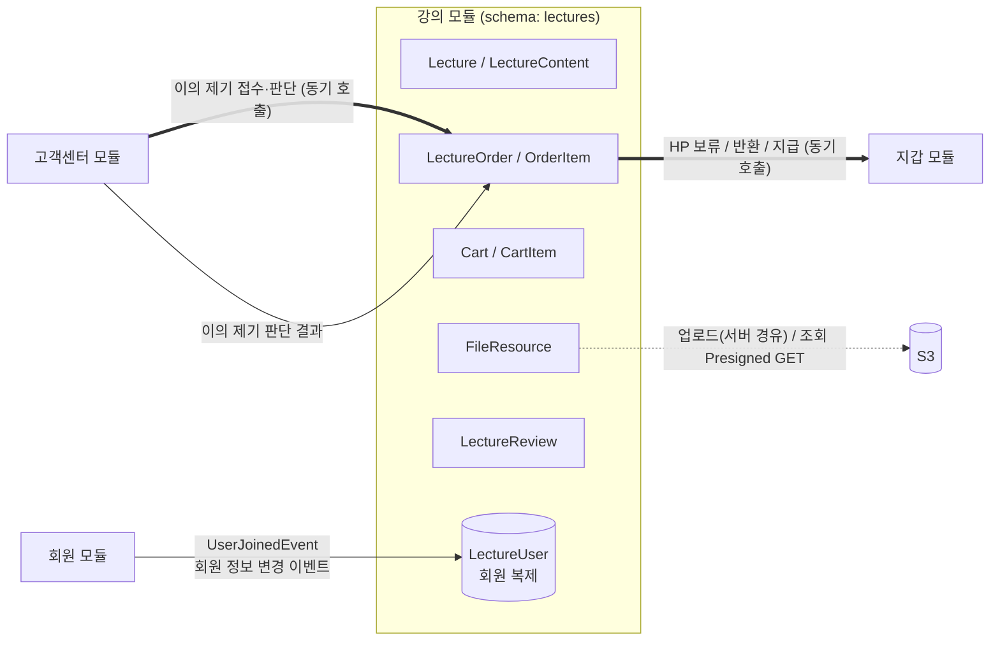
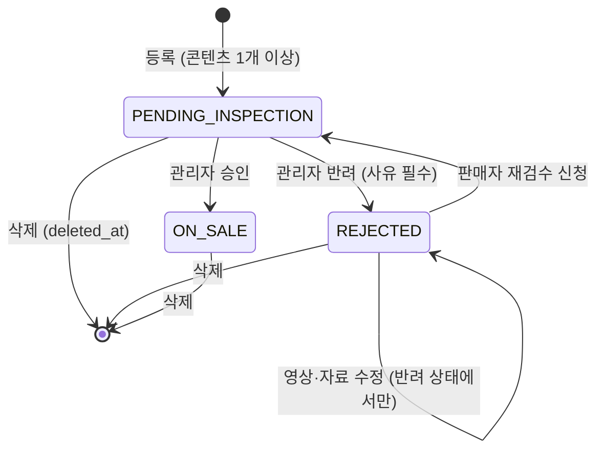
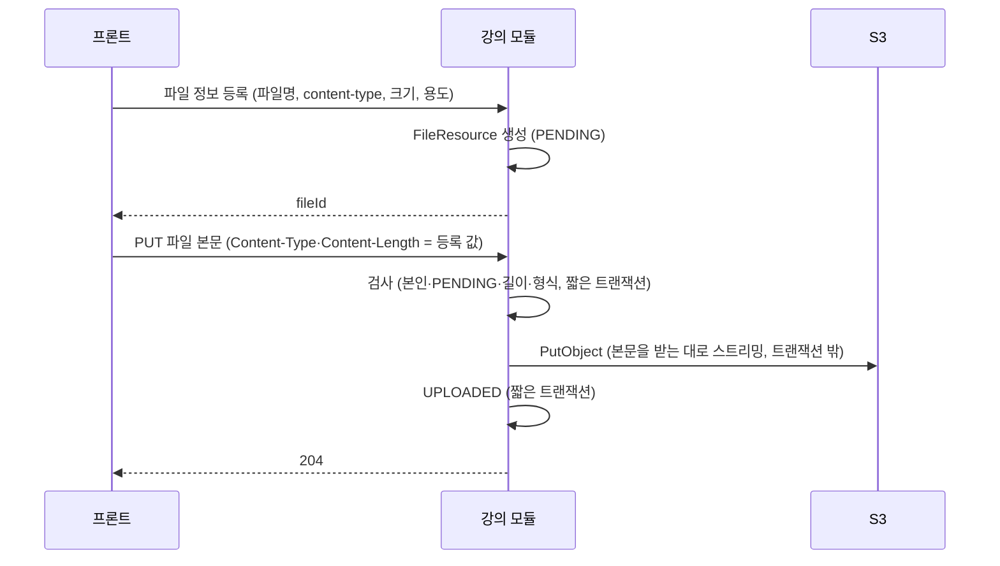
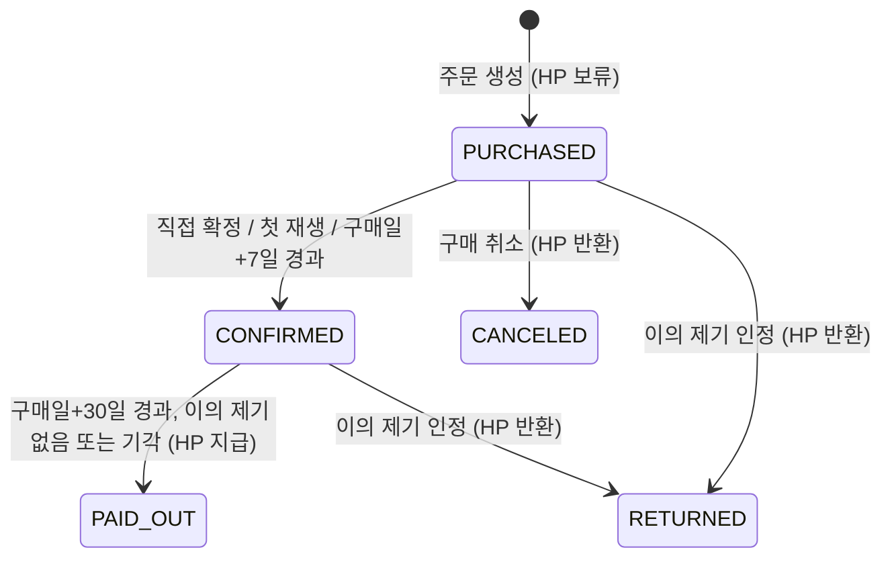
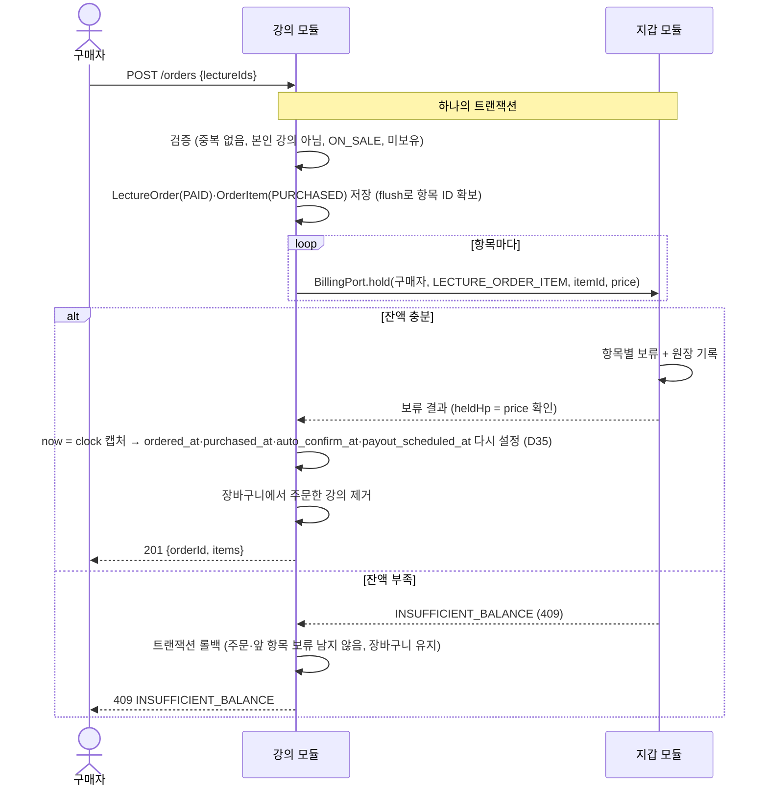
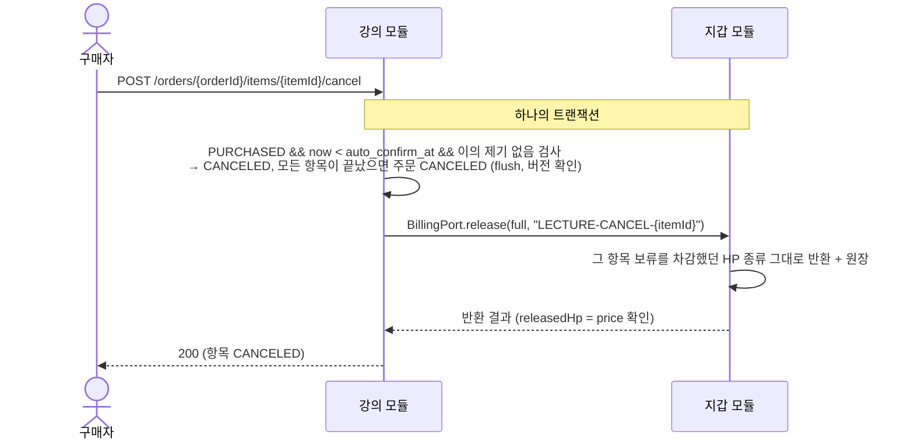
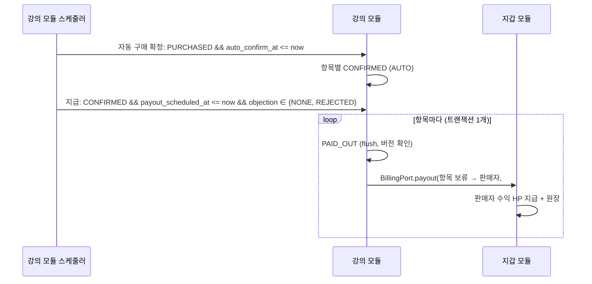
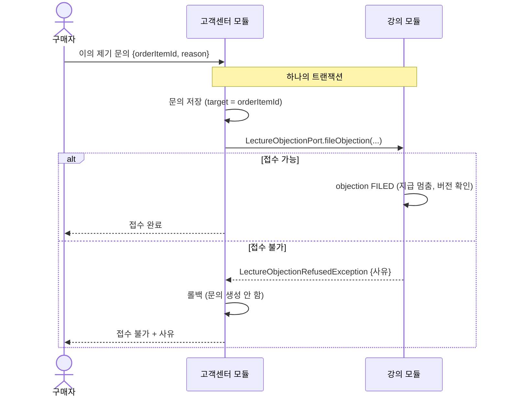
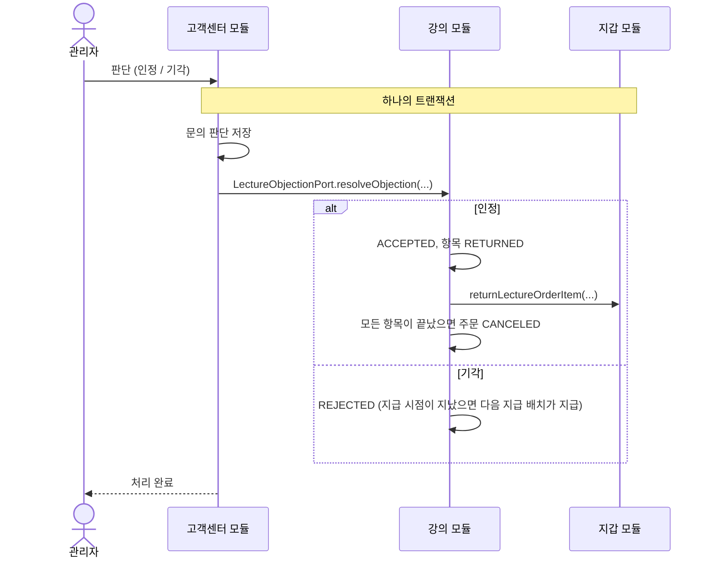

# 강의(Lecture) 모듈 설계

| 항목 | 내용 |
| --- | --- |
| 상태 | draft |
| 작성일 | 2026-10-08 |
| 관련 모듈 | 회원(member), 지갑(billing), 고객센터(customersupport) |

---

## 1. 범위

### 1.1 강의 모듈이 하는 일

기획서 MVP 표 기준: 인증된 인플루언서의 강의 등록, 구매, 구매 취소, 조회, 수정, 삭제, 검수(관리자 재량), 리뷰, 평점.

| 영역 | 기능 |
| --- | --- |
| 강의 | 등록(검수 대기로 시작), 수정, 삭제(Soft Delete), 목록·상세 조회, 판매자 본인 강의 조회 |
| 검수 | 관리자 승인·반려(사유), 반려된 강의의 영상·자료 수정 후 판매자 재검수 신청 (D11) |
| 파일 | 썸네일·강의 영상·자료의 S3 업로드(서버 경유, D22), 구매자 재생 URL 발급(Presigned GET) |
| 장바구니 | 담기, 빼기, 조회 |
| 주문 | 장바구니 주문, 바로 구매(강의 1개 주문), 주문 조회, 구매 확정(직접·첫 재생·자동), 구매 취소 |
| 지급 시점 관리 | 구매일 다음 날부터 30일 경과 시 지갑 모듈에 지급 호출 |
| 내용 다름 이의 제기 | 고객센터가 접수·판단할 때 호출하는 `LectureObjectionPort` 구현: 검증·지급 중단, 판단 결과 반영(반환 또는 지급) |
| 리뷰 | 작성·수정·삭제, 평점(1~5) 및 평균 |

### 1.2 강의 모듈이 하지 않는 일

| 하지 않는 일 | 담당 |
| --- | --- |
| HP 차감, 보류, 반환, 지급, 원장 기록. **어떤 HP 종류(충전/수익)로 얼마가 결제됐는지도 모른다** | 지갑(billing) |
| 이의 제기 문의 티켓 관리, 관리자 답변 | 고객센터(customersupport) |
| 회원 역할 변경(승급), 회원 정보의 원본 | 회원(member) |
| 강의 내용 다름 이의 제기의 자동 판정 | MVP 범위 밖 |

> 강의 모듈은 "언제, 누구에게, 얼마를" 옮겨야 하는지만 판단해 지갑 모듈에 `shared`의 billing 연동 계약 `BillingPort`로 동기 요청한다(6.2, D36). 실제 HP 이동과 정합성은 지갑 모듈 한 곳에서 처리한다(기획서 아키텍처 절). 고객센터·회원과의 연동만 이벤트다.

---

## 2. 강의 모듈이 지켜야 하는 정책 요약

정책 문서에서 강의 모듈 구현에 직접 영향을 주는 규칙만 모았다.

| # | 규칙 | 출처 |
| --- | --- | --- |
| P1 | 강의 등록·판매는 **인증된 인플루언서**만 가능하다 | 기획서 권한표 |
| P2 | 장바구니·강의 구매·구매 취소는 유저·인플루언서·인증된 인플루언서만 가능하다 (관리자·비회원 불가) | 기획서 권한표 |
| P3 | 비회원은 강의 **목록만** 조회한다 | 기획서 권한표 |
| P4 | 등록한 강의는 **검수 대기(비공개)**. 승인되면 공개·판매, 반려되면 사유를 남기고 판매자가 수정 후 재신청 | 정책 6 |
| P5 | ~~판매 중인 강의의 영상·자료를 수정하면 다시 검수 대기가 되어 신규 판매를 멈춘다~~ → **MVP에서는 영상·자료를 반려된 강의만 수정할 수 있다.** 검수 대기·판매 중에는 수정 불가, 판매 중 강의를 고치려면 삭제 후 재등록 (D11). 메타 정보는 언제든 수정 | 정책 6, D11 |
| P6 | 구매 확정 = 직접 확정·첫 재생·구매일 다음 날부터 7일 경과 중 먼저. 확정 후 단순 변심 취소 불가. **지급 시점이 아니다** | 정책 4, 용어 |
| P7 | 구매 취소 = 구매 확정 전 주문 항목 취소 → 보류 HP를 구매자에게 반환 (환불과 다름) | 용어 |
| P8 | 강의 지급 = 구매일 다음 날부터 30일(내용 다름 이의 제기 기간)이 끝난 뒤 판매자 수익 HP로 지급. 수수료 없음 | 정책 4 |
| P9 | 내용 다름 이의 제기는 구매일 다음 날부터 30일 이내. 접수되면 지급을 멈추고 보류 유지. 관리자 인정 → 구매자 반환, 기각 → 판매자 지급 | 정책 6 |
| P10 | ~~일부 항목 반환 시 그 주문에 남은 보류분 중 충전 HP부터 반환~~ → **보류는 주문 항목 단위이고(D36), 항목마다 그 항목을 결제할 때 차감한 HP 종류 그대로 반환·지급한다 (D41).** 주문 단위 우선순위는 두지 않는다 | 정책 1, AGENTS 5장, D41 |
| P11 | 주문은 상태값으로 관리하고 삭제하지 않는다. 강의는 Soft Delete. 그 외 모든 데이터도 Soft Delete | 기획서 데이터 모델, AGENTS 5장 |
| P12 | 모든 기간·마감·일시는 **KST** 기준 | 정책 머리말 |
| P13 | 다른 모듈과는 회원 ID와 이벤트로만 연결. 스키마 간 FK·JOIN 금지. 스키마 이름 `lectures` (회원 `members`·출연 `appearances`와 같은 복수형) | AGENTS 3장 |

---

## 3. 모듈 경계



- 다른 모듈의 엔티티·Repository를 쓰지 않는다. 판매자·구매자·리뷰 작성자는 `*_user_id`(Long)로만 참조한다.
- 닉네임 표시에 필요한 회원 정보는 `LectureUser`(회원 복제, `ReplicaUser` 상속)로 강의 스키마 안에 둔다. 같은 스키마 안의 JOIN은 허용된다.
- 모듈 간 이벤트 클래스는 기존 회원 이벤트(`shared/member/event/UserJoinedEvent`)와 같은 방식으로 `shared` 모듈에 둔다. (예: `com.hapbang.shared.lecture.event`)

---

## 4. 도메인 모델

### 4.1 애그리거트 구성

| 애그리거트 루트 | 포함 | 역할 |
| --- | --- | --- |
| `Lecture` | `LectureContent` | 강의 상품, 검수 상태, 영상·자료 구성 |
| `FileResource` | - | S3 객체 메타데이터 (업로드 상태) |
| `Cart` | `CartItem` | 회원별 장바구니 (회원당 1개) |
| `LectureOrder` | `OrderItem` | 주문(결제 단위)과 항목(구매 확정·취소·지급·이의 제기 단위) |
| `LectureReview` | - | 주문 항목 1건당 리뷰 1개 |
| `LectureUser` | - | 회원 복제 (닉네임·역할·상태) |

애그리거트 사이는 ID로만 참조한다 (`OrderItem.lectureId`, `CartItem.lectureId`, `LectureContent.fileId` 등). 같은 모듈 안이어도 `@ManyToOne`은 애그리거트 내부(`Lecture`–`LectureContent`, `Cart`–`CartItem`, `LectureOrder`–`OrderItem`)에만 건다.

### 4.2 Lecture — 검수 상태

ERD의 `LECTURE.status`에 검수 상태를 담는다. 별도의 "작성 중(DRAFT)" 상태는 두지 않는다. 정책 6이 "등록한 강의는 검수 대기"라고 정하고 있으므로, **영상·자료 파일을 먼저 업로드한 뒤 등록 요청 한 번에 강의와 콘텐츠를 함께 만든다.**



| 상태 | 코드 | 목록·상세 노출 | 신규 구매 | 기존 구매자 시청 |
| --- | --- | --- | --- | --- |
| 검수 대기 | `PENDING_INSPECTION` | 판매자·관리자만 | X | - (승인 전이라 구매자 없음) |
| 반려 | `REJECTED` | 판매자·관리자만 | X | - (승인 전이라 구매자 없음) |
| 판매 중 | `ON_SALE` | 모두 | O | O |
| 삭제 | `deleted_at` 기록 | 판매자·관리자·기존 구매자 (목록 제외) | X | O (D5) |

불변식

- `ON_SALE`이 아니면 장바구니 담기·주문 생성을 거부한다.
- 판매자 본인만 수정·삭제·재검수 신청할 수 있다.
- 반려 시 `rejection_reason`은 필수다. 재검수 신청 시 이전 반려 사유는 덮어쓰지 않고 다음 반려 때 갱신한다.
- 메타 정보(제목·소개·가격·썸네일) 수정은 재검수 대상이 아니다. 정책은 "내용(영상·자료)"만 재검수 대상으로 정했다. (정책 6) 삭제 전이면 어느 상태에서든 수정할 수 있다.
- 영상·자료는 `Lecture` 애그리거트를 통해 목록 전체를 교체하는 방식으로만 바꾸고, **`REJECTED`일 때만** 허용한다 (D11). 교체된 행은 Soft Delete로 남긴다.
- 콘텐츠가 0개가 되는 수정은 거부한다.

#### 승인 후 콘텐츠 잠금 (D11)

검수 대기와 판매 중에는 영상·자료를 바꿀 수 없다. 그래서

- 관리자는 항상 판매자가 제출한 내용 그대로를 승인한다. 검수하는 동안 내용이 바뀌지 않으므로 승인 요청에 revision·version을 담을 필요가 없다.
- 구매자는 항상 승인된 내용만 본다. 승인본·검수본을 나눠 둘(revision) 필요가 없다.
- 판매 중 강의의 내용을 고치려면 삭제 후 새로 등록한다. 삭제된 강의도 기존 구매자는 계속 보고 지급도 그대로 진행된다(D5). 리뷰·평점은 새 강의로 이어지지 않는다.

> 이전 초안의 콘텐츠 revision(승인본·검수본 분리) 설계는 D11로 대체했다. MVP 이후 판매 중 수정이 필요해지면 다시 검토한다.

### 4.3 LectureContent

| 필드 | 설명 |
| --- | --- |
| `fileId` | `FileResource` ID. 업로드 완료(`UPLOADED`) 상태이고 업로더가 판매자 본인인 파일만 연결 가능 |
| `title`, `sequence` | 표시 제목, 강의 내 순서 (강의 안에서 유일) |
| `contentType` | `VIDEO`(영상), `DOCUMENT`(자료) |

> 썸네일(사진)·영상·자료 파일은 모두 S3에 저장한다 (16장 D2).

### 4.4 FileResource — S3 업로드



- 업로드는 서버 경유다 (D22). 인스턴스 역할로 서명한 Presigned PUT은 EC2 밖에서 조직 정책으로 거부된다(`docs/deploy/s3.md`).
- 본문 업로드 규칙은 D24, 트랜잭션 경계는 D25를 따른다. 저장에 실패하거나 연결이 끊기면 `PENDING`으로 남아 처음부터 다시 올린다.

- `file_type`: `LECTURE_THUMBNAIL`, `LECTURE_VIDEO`, `LECTURE_DOCUMENT`
- `status`: `PENDING` → `UPLOADED` (삭제 시 `deleted_at`)
- object key 규칙: `lecture/{fileType}/{uuid}` — 원본 파일명은 key에 넣지 않는다. 환경 prefix(`dev/` 등)는 `global/storage`가 붙인다.
- 용도별 허용 형식·최대 크기는 D19를 따른다.
- 강의 등록·정보 수정·콘텐츠 교체에서는 `UPLOADED`이고 판매자 본인이 올렸고 용도(썸네일/영상/자료)가 맞는 파일만 연결한다. 한 파일을 여러 강의에 연결할 수 있다 (D21).
- 썸네일은 목록에서 비회원도 보므로 Presigned GET URL을 응답 때마다 발급한다. 조회 URL 만료는 D23을 따른다. 강의 응답의 썸네일 URL 규칙은 D28을 따른다.
- 오래된 `PENDING` 파일 정리는 MVP에서 하지 않는다.

### 4.5 Cart

- 회원당 1개. 처음 담을 때 만든다. (`cart.user_id` 유일, 동시에 처음 담아도 하나만 생기도록 `INSERT … ON CONFLICT DO NOTHING`, D18)
- 같은 강의는 한 번만 담는다. 동시에 담으면 부분 유일 인덱스가 막고 `ALREADY_IN_CART`(409)로 응답한다 (D18).
- 담을 때 검사 순서: 본인 강의가 아님(D5, `OWN_LECTURE_NOT_PURCHASABLE` 403) → 강의가 `ON_SALE`(아니면 상세 조회처럼 `LECTURE_NOT_FOUND` 404) → 이미 담지 않음(`ALREADY_IN_CART` 409) → 이미 보유 중(유효한 주문 항목이 있음)이 아님(**주문 구현 때 추가**).
- 담은 뒤 강의가 판매 중지·삭제되면 장바구니 조회 시 "구매 불가"(`purchasable=false`)로 표시하고 합계(`purchasableTotalHp`)에서 빼며, 주문 시에는 거부한다. 조회는 최근 담은 순이다.
- 담지 않은 강의를 빼면 무시하고 204로 응답한다 (D18). 개수 제한은 없다.
- 결제(보류)가 성공하면 해당 강의들을 장바구니에서 뺀다. (**주문 구현 때 추가**)
- 정책상 Soft Delete가 원칙이므로 `cart_item`에 `deleted_at`을 둔다. (ERD에 없음)

### 4.6 LectureOrder / OrderItem

#### 주문(LectureOrder)은 결제 단위

- 장바구니 주문과 바로 구매(강의 1개 주문)를 같은 모델로 처리한다.
- **HP 보류는 주문 항목 단위**다(D36). 항목마다 그 가격을 보류하고(참조 `LECTURE_ORDER_ITEM`, 주문 항목 ID), 구매 취소·지급도 그 항목의 보류만 쓴다. 혼합 HP는 항목마다 차감한 HP 종류 그대로 반환·지급한다(D41).
- **주문은 HP 보류가 성공한 경우에만 존재한다.** 주문 생성과 지갑 보류를 한 트랜잭션에서 처리하므로(6.4), 잔액 부족이면 주문 행 자체가 롤백되어 남지 않는다. 그래서 결제 대기·결제 실패 상태가 없다.
- 주문 상태(`status`)는 저장값이 기준이다: `PAID`(생성 시), `CANCELED`(모든 항목이 `CANCELED`·`RETURNED`가 된 때). `PAID`인 주문의 진행 상황만 항목에서 파생해 응답에 담는다.
- 항목을 `CANCELED`·`RETURNED`로 바꾸는 모든 경로(구매 취소, 이의 제기 인정)는 같은 트랜잭션에서 공통 메서드(예: `LectureOrder.closeIfAllItemsEnded()`)를 호출해, 끝나지 않은 항목이 없으면 주문을 `CANCELED`로 바꾸고 `canceled_at`을 기록한다.

| 응답용 진행 상태 (`status = PAID`일 때만) | 조건 |
| --- | --- |
| `IN_PROGRESS` | 아직 끝나지 않은 항목(`PURCHASED`, `CONFIRMED`)이 있음 |
| `COMPLETED` | 모든 항목이 `PAID_OUT`·`CANCELED`·`RETURNED` 중 하나이며 `PAID_OUT`이 1개 이상 |

#### 주문 항목(OrderItem)은 거래 단위

구매 확정·구매 취소·지급·이의 제기는 모두 항목 단위로 일어난다.

**HP가 움직이는 전이는 지갑 호출과 같은 트랜잭션에서 일어난다(16장 D3).** 구매 취소·이의 제기 인정·지급은 항목 상태 변경과 `BillingPort` 호출을 한 트랜잭션으로 묶는다. 지갑 호출이 실패하면 항목 상태도 롤백되므로, "화면에는 반환·지급 완료인데 HP는 안 움직인" 상태가 생기지 않는다. 그래서 처리 중 상태(`*_PENDING`)를 두지 않는다.



- `CANCELED`·`RETURNED`가 되는 순간 시청 권한은 사라진다.
- 마지막 남은 항목이 `CANCELED`·`RETURNED`가 되면 같은 트랜잭션에서 주문을 `CANCELED`로 바꾼다 (구매 취소·이의 제기 인정 공통).

이의 제기는 항목 상태와 별도로 `objection_status`로 둔다.

| `objection_status` | 의미 | 지급 | 구매 취소 |
| --- | --- | --- | --- |
| `NONE` | 이의 제기 없음 | 기간 경과 시 지급 | 확정 전이면 가능 |
| `FILED` | 접수, 관리자 판단 대기 | **멈춤** | 불가 (이중 반환 방지) |
| `ACCEPTED` | 인정 → 항목 `RETURNED` | 없음 | - |
| `REJECTED` | 기각 | 기간 경과 시 지급 (이미 지났으면 다음 지급 배치에서) | 불가 |

#### 불변식

| 동작 | 허용 조건 |
| --- | --- |
| 주문 생성 | 모든 강의가 `ON_SALE`, 본인 강의 아님(D5), 같은 강의를 이미 보유 중이 아님(D5), 한 주문에 같은 강의 중복 없음, 주문자 역할이 유저·인플루언서·인증된 인플루언서 |
| 직접 확정 | 본인 항목, `PURCHASED` |
| 첫 재생 확정 | 본인 항목, `PURCHASED`, 구매자가 **재생 동의**를 제출할 때 (D7). 자동 구매 확정 시각이 지났으면 직접 확정과 같이 `AUTO`(D34). 이미 `CONFIRMED`·`PAID_OUT`이면 그대로 둔다 (D38) |
| 구매 취소 | 본인 항목, `PURCHASED`, `now < auto_confirm_at`, `objection_status = NONE` |
| 이의 제기 접수 (고객센터 호출) | 구매자 본인 항목, `PURCHASED` 또는 `CONFIRMED`, `now < payout_scheduled_at`, `objection_status = NONE` |
| 지급 | `CONFIRMED`, `now >= payout_scheduled_at`, `objection_status ∈ {NONE, REJECTED}` |
| 시청 | 본인 항목이 `CONFIRMED`·`PAID_OUT` (이의 제기 접수 중에도 시청 가능, 삭제된 강의 포함). `PURCHASED`면 재생 동의 후 (D38) |

- **기한 판정은 배치가 아니라 도메인 메서드가 시각으로 한다.** 자동 구매 확정 배치가 늦게 돌아도 `now >= auto_confirm_at`이면 구매 취소를 거부한다.
- **첫 재생 = 재생 동의 (D7).** `PURCHASED` 항목의 영상을 처음 재생하기 전에 프론트가 동의서("재생하면 구매가 확정되어 단순 변심으로 구매 취소할 수 없습니다")를 보여 주고, 구매자가 동의하면 재생 동의 API를 호출한다. 서버는 이때 `CONFIRMED`(`FIRST_PLAY`)로 바꾼다.
- **서버가 강제한다.** 항목이 `PURCHASED`이면 영상·자료(`VIDEO`·`DOCUMENT`) URL 발급(`/access`)을 모두 거부하고 "재생 동의 필요" 오류를 준다. 동의 없이 영상·자료를 받을 방법이 없으므로, 화면 진입·프리로드로 확정되는 일도, 동의 없이 보거나 자료만 받고 취소하는 일도 없다. 자료 다운로드도 같은 동의를 받는다(D8).
- 이미 `CONFIRMED`·`PAID_OUT`이면(직접 확정·자동 확정 포함) 동의 없이 URL을 발급한다.
- "재생 동의 필요" 오류는 403 `PLAY_CONSENT_REQUIRED`이고, 프론트가 바로 재생 동의 API를 호출할 수 있게 `orderId`·`orderItemId`를 담는다 (D38).
- 동의 기록은 `confirmation_type = FIRST_PLAY`와 `confirmed_at`으로 남긴다.
- 한 구매자는 같은 강의에 대해 유효한 항목(`PURCHASED`, `CONFIRMED`, `PAID_OUT`)을 하나만 가진다. 취소·반환 후에는 다시 살 수 있다. `PAID_OUT`도 보유로 본다(D5): 구매한 강의는 계속 볼 수 있으므로 다시 살 수 없다.
- 주문 시점의 강의 제목과 가격을 항목에 스냅샷으로 저장한다. 이후 강의 가격이 바뀌어도 반환·지급 금액은 스냅샷 가격이다.

### 4.7 LectureReview

- 주문 항목 1건당 살아 있는 리뷰 1개. 한 회원은 한 강의에 리뷰를 하나만 유지한다. 삭제 후 재작성은 새 행으로 만들며, 그래서 유일 제약은 모두 `WHERE deleted_at IS NULL` 부분 인덱스로 건다(7.1).
- 작성 조건: 본인 항목이 `CONFIRMED`·`PAID_OUT` (D5). 구매 확정 전 리뷰를 허용하면 리뷰 작성 후 구매 취소가 가능해지기 때문이다.
- 평점은 1~5 정수. 평균 평점과 리뷰 수는 MVP에서 조회 시 집계한다. 목록 성능 문제가 생기면 `lecture`에 캐시 컬럼을 추가한다.
- 항목이 `RETURNED`가 되면 리뷰는 남기되 평균 평점·리뷰 수에서 제외한다 (D5).

### 4.8 LectureUser (회원 복제)

- `shared`의 `ReplicaUser`를 상속한다. ID는 원본 회원 ID.
- `UserJoinedEvent`로만 생성한다(이미 있으면 무시). 회원 정보 변경 이벤트(`UserModifiedEvent`, #56)는 있는 복제본만 `syncFrom`으로 갱신하고, 없으면 `LECTURE_USER_NOT_FOUND`로 실패시켜 미완료 이벤트로 남긴다(재시작 시 재처리) (D17).
- 용도: 강의 목록·상세의 판매자 닉네임, 리뷰 작성자 닉네임. 탈퇴 회원은 "탈퇴한 회원"으로 표시한다(정책 7).
- 권한 판단(인증된 인플루언서 여부 등)은 복제본이 아니라 **요청 시점의 Spring Security 인증 정보**로 한다. 복제본은 이벤트 지연으로 늦을 수 있다.

---

## 5. 시간 규칙

모든 계산은 KST(`Asia/Seoul`)이며 `java.time.Clock`을 주입받아 계산한다(테스트에서 시각 고정).

- **구매일** = 주문 항목이 `PURCHASED`가 된 시각(`purchased_at`, 지갑 보류 성공 시각)의 KST 날짜
- **자동 구매 확정 시각** `auto_confirm_at` = (구매일 + 8일) 00:00 KST
  - "구매일 다음 날부터 7일 경과" → 구매일 다음 날부터 7일째 되는 날 23:59:59까지 취소 가능
- **지급 예정 시각** `payout_scheduled_at` = (구매일 + 31일) 00:00 KST
  - "구매일 다음 날부터 30일(내용 다름 이의 제기 기간)" → 30일째 되는 날 23:59:59까지 이의 제기 가능

정책 문서 예시와 맞춰 본 결과:

| 구매 | 구매 취소 가능 (확정 전) | `auto_confirm_at` | 이의 제기 가능 | `payout_scheduled_at` |
| --- | --- | --- | --- | --- |
| 9/30 | ~ 10/7 23:59:59 | 10/8 00:00 | ~ 10/30 23:59:59 | 10/31 00:00 |

> 정책 예시: "9/30 구매 → 10/7까지 단순 변심 취소 가능 → 10/30까지 내용 다름 이의 제기 가능 → 10/30 기간 종료 후 판매자 수익 HP 지급" — 일치한다.

---

## 6. 모듈 간 연동

### 6.1 연동 방식

| 상대 모듈 | 내용 | 방식 |
| --- | --- | --- |
| 지갑 | 주문 항목별 HP 보류, 구매 취소·이의 제기 인정 시 HP 반환, D+30 지급 | **동기 호출** `shared` `BillingPort` (16장 D1, D3, D36). 강의 트랜잭션에 참여 |
| 고객센터 | 이의 제기 접수, 관리자 판단 결과 | **동기 호출** `LectureObjectionPort` (16장 D9). 고객센터가 호출하고 강의 모듈이 구현, 고객센터 트랜잭션에 참여 |
| 회원 | 가입, 회원 정보 변경 | 이벤트 |

- `AGENTS.md`의 "모듈 간 통신은 Spring Event를 기본"에서 **HP 이동과, 지급을 멈추거나 HP를 되돌리는 이의 제기 처리만 예외**로 동기 호출한다. 돈과 관련된 상태 변경을 한 트랜잭션으로 묶어 한쪽만 반영되는 경우를 없애기 위해서다. 회원 복제만 이벤트로 남는다.
- 지갑 호출이 예외를 던지면 강의 상태 변경도 함께 롤백된다. 사용자 요청이면 오류로 응답하고, 배치면 그 항목을 건너뛰고 다음 실행에서 다시 시도한다.
- 이벤트는 이미 설정된 Spring Modulith 이벤트 발행 기록(JDBC, `republish-outstanding-events-on-restart: true`)을 쓴다. 이벤트는 발행한 트랜잭션과 함께 기록되므로 커밋된 상태 변경의 이벤트는 유실되지 않는다(최소 1회 전달).
- 받는 쪽은 `@ApplicationModuleListener`(커밋 후, 비동기, 새 트랜잭션)로 받고 **멱등하게** 처리한다(상태 전이 검사로 중복 무시).

#### 실행 중 실패한 이벤트의 재처리

현재 설정은 **재시작할 때만** 미완료 이벤트를 다시 보낸다. 서버가 계속 떠 있으면 리스너에서 실패한 이벤트는 다시 처리되지 않는다. 강의 모듈에서는 회원 복제만 해당한다(돈과 관련된 연동은 모두 동기 호출이라 해당 없음).

| 항목 | 내용 (제안) |
| --- | --- |
| 주기적 재제출 | Spring Modulith `IncompleteEventPublications.resubmitIncompletePublicationsOlderThan(...)`을 스케줄러로 5분마다 호출. 대상: 발행 후 5분 넘게 완료되지 않은 이벤트 |
| 최대 시도 | 재제출 횟수를 넘으면(예: 10회) 자동 재제출을 멈추고 경보(로그 ERROR)를 남긴다 |
| 운영자 재처리 | 원인을 고친 뒤 다시 보내는 운영 절차를 문서로 둔다 |
| 소유 | 다른 모듈에도 해당하므로 `global` 공통 설정을 제안한다 (Q17) |

### 6.2 동기 인터페이스 (제안)

#### 지갑 모듈: `BillingPort` (D36, #145)

강의는 `shared`의 billing 연동 계약 `com.hapbang.shared.billing.port.BillingPort`를 호출하고, billing 모듈이 구현 빈(`BillingPortAdapter`)을 제공한다. 강의 모듈은 `shared`에만 의존한다(billing에 Gradle 의존 없음). 처음 제안한 `LectureHpPort`(주문 단위 보류, D1·D3)는 D36으로 대체했다.

| 동작 | 호출 | 결과 검증 (D42) |
| --- | --- | --- |
| 주문 생성 | 항목마다 `hold(new HoldCommand(구매자, LECTURE_ORDER_ITEM, 주문 항목 ID, 항목 가격))`. 요청한 강의 순서(항목 ID 순)로 건다 | `heldHp = 가격`, `replayed = false`가 아니면 `IllegalStateException`으로 주문 전체 롤백 |
| 구매 취소 | `release(ReleaseCommand.full(구매자, LECTURE_ORDER_ITEM, 주문 항목 ID, "LECTURE-CANCEL-{주문 항목 ID}"))` | `releasedHp = 가격`이 아니면 `IllegalStateException`으로 롤백 |
| 이의 제기 인정 (#156) | `release(ReleaseCommand.full(..., "LECTURE-RETURN-{주문 항목 ID}"))` | 구매 취소와 같음 |
| 지급 (#150) | `payout(...)`, 지급 원천 `LECTURE_ORDER_ITEM` | #150에서 정한다 |

| 항목 | 내용 |
| --- | --- |
| 트랜잭션 | 각 메서드는 강의 트랜잭션에 참여한다(`REQUIRED`). 강의 상태와 보류·원장이 함께 커밋되거나 함께 롤백된다 |
| 예외 | 잔액 부족(409 `INSUFFICIENT_BALANCE`)·지갑 없음(404 `WALLET_NOT_FOUND`) 같은 billing 예외는 잡지 않고 그대로 전파한다. 잡으면 롤백 전용이 된 트랜잭션을 계속 쓰게 된다 |
| 호출 순서 | 주문은 저장(flush)해 항목 ID를 얻고 부분 유일 인덱스로 중복 주문을 거른 뒤 보류한다. 구매 취소는 항목 상태를 바꾸고 flush해 낙관적 락 충돌을 billing 호출 전에 확인한 뒤 반환한다 |
| 멱등 키 | 보류는 billing이 참조 대상으로 만든다(`HOLD:LECTURE_ORDER_ITEM:{id}`, 항목당 1건). 반환은 업무 요청마다 정해진 반환 요청 ID(위 표)를 쓴다 |
| 혼합 HP | billing이 항목마다 수익 HP → 충전 HP 순서로 보류하고, 반환·지급은 그 항목에서 차감한 HP 종류 그대로다(D41). 주문 단위로 "충전 HP부터 반환"·"수익 HP부터 지급"을 보장하지 않는다 |
| 동시성 | 보류는 항목마다 별개라 같은 주문의 다른 항목 반환·지급이 서로 영향을 주지 않는다. 같은 구매자의 동시 결제는 billing이 지갑 잠금으로 직렬화한다 |
| 테스트 | 강의 모듈 테스트 컨텍스트에는 billing 빈이 없으므로 테스트 소스의 `FakeBillingPort`로 채운다. 실제 연결은 `apps`의 `LectureOrderBillingIntegrationTest`가 확인한다 |
| 서비스 분리 시 | 구현체를 HTTP 클라이언트로 바꾸면 한 트랜잭션이 깨진다. 그때 처리 중 상태와 보상 처리를 다시 설계한다 (최종 프로젝트 범위) |

#### 강의 모듈: `LectureObjectionPort` (고객센터가 호출)

고객센터가 접수 창구를 유지하면서, 접수·판단을 **고객센터 트랜잭션 안에서** 강의 모듈에 바로 반영한다(16장 D9). 접수가 저장되는 순간 항목도 `FILED`가 되어 지급이 멈춘다.

```java
// shared 모듈 (예: com.hapbang.shared.lecture) — 강의 모듈이 구현, 고객센터 모듈이 호출
// 모든 메서드는 호출한 쪽(고객센터)의 트랜잭션에 참여한다. 예외가 나면 고객센터 쪽 변경도 함께 롤백된다.
public interface LectureObjectionPort {

    /**
     * 내용 다름 이의 제기를 접수해 해당 항목의 지급을 멈춘다 (objection FILED).
     * @throws LectureObjectionRefusedException 접수할 수 없을 때. 사유 코드를 담는다.
     */
    void fileObjection(Long orderItemId, Long buyerUserId, Long inquiryId, String reason);

    /**
     * 관리자 판단을 반영한다.
     * 인정: 항목 RETURNED + BillingPort.release (같은 트랜잭션)
     * 기각: REJECTED. 지급 시점이 지났으면 다음 지급 배치가 지급한다.
     */
    void resolveObjection(Long orderItemId, Long inquiryId, boolean accepted, Long adminUserId);
}
```

| 항목 | 내용 |
| --- | --- |
| 위치 | `shared`에 인터페이스와 `LectureObjectionRefusedException`을 두고 강의 모듈이 구현한다. 고객센터는 강의 모듈에 Gradle 의존을 걸지 않는다 |
| 트랜잭션 | 고객센터의 문의 저장과 강의 항목 변경(인정 시 지갑 반환까지)이 함께 커밋·롤백된다. 접수 불가 예외가 나면 고객센터는 문의를 만들지 않고 구매자에게 사유를 응답한다 |
| 접수 가능 조건 | 구매자 본인 항목, `PURCHASED` 또는 `CONFIRMED`, `objection_status = NONE`, `now < payout_scheduled_at` |
| 접수 불가 사유 | `NOT_BUYER`, `PERIOD_EXPIRED`, `ALREADY_FILED`, `NOT_OBJECTIONABLE`(취소·반환된 항목), `ALREADY_PAID_OUT` |
| 판단 조건 | `objection_status = FILED`이고 `inquiryId`가 접수 때 저장한 값과 같을 때만 처리. 아니면 예외 |
| 지급 배치와 경쟁 | 접수와 지급 배치가 같은 항목 행을 바꾸므로 `order_item.version` 낙관적 락으로 직렬화된다. 접수가 먼저면 지급 대상에서 빠지고, 지급이 먼저면 접수가 `ALREADY_PAID_OUT`으로 거부된다(기한이 지난 뒤이므로 정책상 맞음) |
| 고객센터 쪽 필요 사항 | `INQUIRY`에 대상(`target_type = LECTURE_ORDER_ITEM`, `target_id`) 컬럼 추가 (`changelog.md` 보류 항목) |

### 6.3 이벤트 계약 (제안)

이름과 필드는 회원 담당과 합의해 확정한다.

| 이벤트 | 발행 | 구독 | 필드 | 받는 쪽 처리 |
| --- | --- | --- | --- | --- |
| `UserJoinedEvent` (기존) | 회원 | 강의 | `UserDto` | `LectureUser` 생성 (있으면 무시, D17) |
| `UserModifiedEvent` (#56) | 회원 | 강의 | `UserDto` | `LectureUser.syncFrom` (없으면 실패, D17) |

### 6.4 주요 흐름

#### 구매 (장바구니 주문 / 바로 구매)



- 주문 행을 먼저 저장하는 이유: 보류의 참조 ID(주문 항목 ID)가 필요하고, `(buyer_user_id, lecture_id)` 부분 유일 인덱스 위반(중복 주문)을 보류 전에 걸러내기 위해서다. 보유 검사를 동시에 통과한 같은 강의 주문은 이 인덱스에 걸리고 409 `ALREADY_OWNED_LECTURE`로 응답한다(D44).
- 구매 시각(`purchased_at`)은 **모든 항목의 보류가 정상 반환된 직후** `Clock`으로 한 번 캡처한 시각이다(D35). 보류 전에 계산하면, 23:59에 시작한 주문이 지갑 잠금 대기 후 00:01에 보류될 때 전날 구매로 기록되어 취소·이의 제기 기한이 하루 빨라진다.

#### 구매 취소



#### 자동 구매 확정과 지급 (배치)

항목마다 별도 트랜잭션으로 처리한다. 한 항목의 지갑 호출이 실패하면 그 항목만 롤백되어 `CONFIRMED`로 남고, 다음 배치에서 다시 시도한다.

- 스케줄러는 대상 항목 ID만 조회하고, 항목 처리는 **별도 빈의 `@Transactional` 메서드** 또는 `TransactionTemplate`으로 항목마다 새 트랜잭션을 연다(같은 클래스 안에서 호출하면 프록시를 거치지 않아 트랜잭션이 생기지 않는다).
- 예외는 **트랜잭션 밖(스케줄러 루프)에서** 항목별로 잡아 로그를 남기고 다음 항목으로 넘어간다. 트랜잭션 안에서 잡으면 rollback-only 상태로 커밋이 실패하거나 앞선 처리까지 롤백될 수 있다.
- `BillingPort`의 예외는 모두 런타임 예외라 기본 `@Transactional` 설정에서 롤백된다.



#### 내용 다름 이의 제기 (고객센터 접수 + 동기 호출, 16장 D4·D9)



- 구매자는 강의 모듈의 주문 조회 API에서 `orderItemId`를 받아 고객센터 문의에 담는다.
- 검증은 강의 모듈이 호출 시점에 한다. 접수 시각과 판단 시각이 같으므로 `filedAt`을 따로 비교할 필요가 없다.

관리자 판단:



---

## 7. 스키마 (`lectures`)

ERD를 기준으로 하고, 이 설계에 필요한 변경을 표시했다. 모든 테이블은 `@Table(schema = "lectures")`. 공통 컬럼 `created_at`, `updated_at`은 채팅 모듈과 같이 엔티티에 직접 두고 도메인 메서드가 받은 시각으로 기록한다(`BaseEntity`·JPA Auditing 미사용. 회원 모듈의 `BaseEntity`가 병합되면 통일 여부를 팀과 정한다).

### 7.1 테이블

**lecture**

| 컬럼 | 타입 | 비고 |
| --- | --- | --- |
| id | bigint PK | |
| seller_user_id | bigint | 회원 ID (FK 없음) |
| thumbnail_file_id | bigint | `file_resource.id` |
| title | varchar | |
| description | text | |
| price_hp | bigint | 1,000 이상, 1,000 단위 (D6) |
| status | varchar | `PENDING_INSPECTION` / `REJECTED` / `ON_SALE` |
| rejection_reason | text | **추가** |
| inspection_requested_at | timestamp | **추가** |
| inspected_at | timestamp | **추가** |
| inspected_by | bigint | **추가**, 관리자 회원 ID |
| version | bigint | **추가**. 낙관적 락 (같은 강의를 동시에 바꾸는 요청 직렬화) |
| deleted_at | timestamp | Soft Delete |

**lecture_content**: ERD + `deleted_at`. `content_type` = `VIDEO` / `DOCUMENT`. 살아 있는 행끼리 `(lecture_id, sequence)`가 겹치지 않아야 하지만, **MVP에서는 DB 제약을 두지 않고** `Lecture` 애그리거트(교체 때마다 1부터 다시 매김)와 `lecture.version` 낙관적 락으로 보장한다 (D12). DB 제약이 필요해지면 지연 검사 제약 `EXCLUDE USING btree (lecture_id WITH =, sequence WITH =) WHERE (deleted_at IS NULL) DEFERRABLE INITIALLY DEFERRED`를 쓴다. 콘텐츠 교체 때 Hibernate가 새 행 INSERT를 기존 행 Soft Delete UPDATE보다 먼저 실행하므로, 즉시 검사하는 부분 유일 인덱스는 교체를 항상 실패시킨다.

**file_resource**: `id`, `uploader_user_id`(회원 ID), `file_type` = `LECTURE_THUMBNAIL` / `LECTURE_VIDEO` / `LECTURE_DOCUMENT`, `object_key`(유일, 모듈 기준 key), `original_filename`, `content_type`, `file_size`(바이트), `status` = `PENDING` / `UPLOADED`, `uploaded_at`, `created_at`, `updated_at`, `deleted_at` (#89).

**cart**: ERD와 같음. 유일 `uc_cart_user_id (user_id)`.

**cart_item**: ERD + `deleted_at` **추가**(정책 7). 부분 유일 인덱스 `uk_cart_item_cart_lecture (cart_id, lecture_id) WHERE deleted_at IS NULL`. `lecture_id`는 다른 애그리거트라 FK를 두지 않는다. 같은 트랜잭션에서 같은 강의를 빼고 다시 담으면 Hibernate가 INSERT를 UPDATE보다 먼저 실행해 이 인덱스에 걸린다(7.1 `lecture_content`와 같은 문제). 지금 API는 요청마다 한 동작이라 해당 없고, 주문 후 빼기를 넣을 때 다시 확인한다.

**lecture_order**

| 컬럼 | 타입 | 비고 |
| --- | --- | --- |
| id | bigint PK | |
| buyer_user_id | bigint | |
| total_amount_hp | bigint | 항목 가격 합 |
| status | varchar | `PAID` / `CANCELED` |
| ordered_at | timestamp | 주문 생성 시각 = 보류 성공 시각 |
| canceled_at | timestamp | 모든 항목이 `CANCELED`·`RETURNED`가 된 시각 (4.6 파생 상태 `CANCELED`) |

**order_item**

| 컬럼 | 타입 | 비고 |
| --- | --- | --- |
| id | bigint PK | |
| order_id | bigint FK | `lecture_order.id` (같은 스키마) |
| lecture_id | bigint | |
| seller_user_id | bigint | 주문 시점 판매자 |
| buyer_user_id | bigint | **추가**. 보유 여부 유일 인덱스용 비정규화 |
| lecture_title_snapshot | varchar | |
| price_hp | bigint | 주문 시점 가격 |
| status | varchar | `PURCHASED` / `CONFIRMED` / `CANCELED` / `RETURNED` / `PAID_OUT` |
| purchased_at | timestamp | **추가**. 구매일 기준 |
| confirmed_at | timestamp | |
| confirmation_type | varchar | **추가**. `DIRECT` / `FIRST_PLAY` / `AUTO` |
| auto_confirm_at | timestamp | 5장 계산식 |
| payout_scheduled_at | timestamp | 5장 계산식 |
| paid_out_at | timestamp | **추가**. 지급 시각 |
| canceled_at | timestamp | 구매 취소 시각 |
| returned_at | timestamp | ERD의 `refunded_at`을 **이름 변경**. "환불"은 충전 HP 현금화만 가리키므로 "반환"을 쓴다 |
| objection_status | varchar | `NONE` / `FILED` / `ACCEPTED` / `REJECTED` |
| objection_reason | text | **추가** |
| objection_filed_at | timestamp | |
| objection_resolved_at | timestamp | **추가** |
| version | bigint | **추가**. 낙관적 락 (10장) |

인덱스

- 유일 `(buyer_user_id, lecture_id) WHERE status IN ('PURCHASED','CONFIRMED','PAID_OUT')` — 같은 강의 중복 보유 방지 (D5)
- `(status, auto_confirm_at)`, `(status, payout_scheduled_at)` — 배치 조회용

**lecture_review**: ERD와 같음. `rating` 1~5 CHECK. 유일 `(order_item_id) WHERE deleted_at IS NULL`, 유일 `(lecture_id, reviewer_user_id) WHERE deleted_at IS NULL` — 삭제 후 재작성 허용.

**lecture_user** (**신규**, 회원 복제): `id`(회원 ID), `nickname`, `role`, `status`, `created_at`, `updated_at`. 채팅 모듈의 `CHAT_USER`와 같은 패턴.

### 7.2 ERD 반영 필요 목록

`changelog.md`의 "보류 (ERD 수정 필요)" 중 "강의 검수 상태 반영 필요" 항목을 이 설계로 해소한다.

- [ ] `LECTURE`: 검수 컬럼 4개, `version` 추가, `status` 값 정의
- [ ] `LECTURE_CONTENT`: `deleted_at` 추가
- [ ] `CART_ITEM`: `deleted_at` 추가 (정책 7)
- [ ] `LECTURE_ORDER`: `status` 값 정의(`PAID`/`CANCELED`), `canceled_at` 의미 정의
- [ ] `ORDER_ITEM`: `buyer_user_id`, `purchased_at`, `confirmation_type`, `paid_out_at`, `objection_reason`, `objection_resolved_at`, `version` 추가, `refunded_at` → `returned_at`, `status` 값 정의
- [ ] `LECTURE_USER` 추가

---

## 8. API 초안

모든 경로는 `/api/v1/lectures` 아래. 성공 응답은 `RsData{statusCode, message, data}`(본문 없는 응답은 204), 오류는 공통 핸들러의 ProblemDetail이다(D29, AGENTS 7장). Swagger로 Controller 명세를 먼저 만들어 프론트와 맞춘다.

### 8.1 강의

| 메서드 | 경로 | 권한 | 설명 |
| --- | --- | --- | --- |
| GET | `/api/v1/lectures` | 모두(비회원 포함) | `ON_SALE` 목록. 검색어(제목), 정렬(최신·가격·평점), 페이징. 판매자 닉네임·평균 평점·리뷰 수 포함 |
| GET | `/api/v1/lectures/{lectureId}` | 회원 | 상세 + 콘텐츠 목록(제목·순서·종류, 파일 URL 없음). 판매자 본인은 비공개·삭제 상태도 조회. 관리자는 8.2의 `/admin/{lectureId}`로 조회한다(D30). 보유 항목이 있는 구매자는 삭제된 강의도 조회한다(D38) |
| POST | `/api/v1/lectures` | 인증된 인플루언서 | 등록 (메타 + 콘텐츠 목록) → `PENDING_INSPECTION` |
| PATCH | `/api/v1/lectures/{lectureId}` | 판매자 본인 | 메타 수정 (재검수 없음) |
| DELETE | `/api/v1/lectures/{lectureId}` | 판매자 본인 | Soft Delete |
| PUT | `/api/v1/lectures/{lectureId}/contents` | 판매자 본인 | 콘텐츠 목록 전체 교체 (추가·수정·삭제·순서 변경 포함). `REJECTED`일 때만 허용 (D11) |
| POST | `/api/v1/lectures/{lectureId}/inspection-requests` | 판매자 본인 | `REJECTED` → `PENDING_INSPECTION` |
| GET | `/api/v1/lectures/me` | 인증된 인플루언서 | 내가 등록한 강의 (모든 상태) |
| GET | `/api/v1/lectures/{lectureId}/contents/{contentId}/access` | 구매자·판매자·관리자 | Presigned GET URL 발급 `{url, expiresAt}`, 만료 1시간(D23). 자료는 원본 파일명으로 내려받는다(D27). 구매자 항목이 `PURCHASED`면 영상·자료 모두 403 `PLAY_CONSENT_REQUIRED`(재생 동의 필요). 구매자는 현재 콘텐츠만 받는다 (#91·D26, 구매자 #158·D38) |

- 시청 URL(#91·D26, #158·D38): 없는 강의 `LECTURE_NOT_FOUND`(404) → 판매자·관리자는 통과 → 보유 항목이 `PURCHASED`면 `PLAY_CONSENT_REQUIRED`(403, `orderId`·`orderItemId` 포함), `CONFIRMED`·`PAID_OUT`이면 통과(삭제된 강의 포함) → 그 밖의 회원에게 판매 중이 아닌 강의는 `LECTURE_NOT_FOUND`(404), 판매 중인 강의는 `CONTENT_ACCESS_DENIED`(403) → 이 강의에 없거나 교체된 콘텐츠 `LECTURE_CONTENT_NOT_FOUND`(404). 이 순서로 검사한다.

### 8.2 검수 (관리자)

| 메서드 | 경로 | 설명 |
| --- | --- | --- |
| GET | `/api/v1/lectures/admin/inspections?status=PENDING_INSPECTION` | 검수 대기 목록 |
| GET | `/api/v1/lectures/admin/{lectureId}` | 강의 상세 + 콘텐츠 목록. 상태·삭제 여부와 관계없이 조회하고 반려 사유를 포함한다. 응답은 8.1 상세와 같다 (#103, D30) |
| POST | `/api/v1/lectures/admin/{lectureId}/inspection/approve` | 승인 → `ON_SALE`. 검수 대기 중에는 내용이 바뀌지 않으므로 추가 검사 없음 (D11) |
| POST | `/api/v1/lectures/admin/{lectureId}/inspection/reject` | 반려 `{reason}` → `REJECTED` |

### 8.3 파일

| 메서드 | 경로 | 권한 | 설명 |
| --- | --- | --- | --- |
| POST | `/api/v1/lectures/files` | 인증된 인플루언서 | `{fileType, originalFilename, contentType, fileSize}` → `{fileId}` (D22) |
| PUT | `/api/v1/lectures/files/{fileId}/content` | 업로더 본인 | 요청 본문이 파일(multipart·form 아님). S3에 저장하고 `UPLOADED` → 204 (D24) |

- 등록: 허용하지 않는 형식 `UNSUPPORTED_FILE_CONTENT_TYPE`(400), 최대 크기 초과 `FILE_TOO_LARGE`(400).
- 본문 업로드: 없는 파일 `FILE_NOT_FOUND`(404), 업로더가 아님 `NOT_FILE_UPLOADER`(403), 이미 올림 `FILE_ALREADY_UPLOADED`(409), `Content-Length` 없음 `FILE_LENGTH_REQUIRED`(411), 크기가 등록과 다름 `FILE_SIZE_MISMATCH`(400), 형식이 등록과 다름 `FILE_CONTENT_TYPE_MISMATCH`(400). 이 순서로 검사한다 (D24).
- 업로드 경로는 nginx가 PUT만 받고 form·multipart 본문은 415로 끊는다(`docs/deploy/s3.md`).
- 강의 등록·정보 수정·콘텐츠 교체에 맞지 않는 파일을 보내면 `INVALID_LECTURE_FILE`(400) (D21).

### 8.4 장바구니

| 메서드 | 경로 | 설명 |
| --- | --- | --- |
| GET | `/api/v1/lectures/cart` | 장바구니 조회 (구매 가능 여부 표시) |
| POST | `/api/v1/lectures/cart/items` | `{lectureId}` 담기 |
| DELETE | `/api/v1/lectures/cart/items/{lectureId}` | 빼기 |

### 8.5 주문

| 메서드 | 경로 | 설명 |
| --- | --- | --- |
| POST | `/api/v1/lectures/orders` | `{lectureIds}` 주문 (바로 구매는 1개). HP 보류까지 끝난 뒤 응답. 잔액 부족이면 오류 |
| GET | `/api/v1/lectures/orders` | 내 주문 목록 |
| GET | `/api/v1/lectures/orders/{orderId}` | 주문 상세 (항목 상태 + 4.6 파생 상태) |
| POST | `/api/v1/lectures/orders/{orderId}/items/{orderItemId}/confirm` | 직접 구매 확정 |
| POST | `/api/v1/lectures/orders/{orderId}/items/{orderItemId}/play-consent` | 재생 동의 → 구매 확정(`FIRST_PLAY`). 이후 영상·자료 URL 발급 가능. 이미 확정·지급이면 그대로 200 (D38) |
| POST | `/api/v1/lectures/orders/{orderId}/items/{orderItemId}/cancel` | 구매 취소 → HP 반환까지 끝난 뒤 응답 |
| GET | `/api/v1/lectures/purchased` | 내가 시청 가능한 강의 목록. 보유 항목 기준 최근 구매순, 삭제된 강의 포함 (D39) |
| GET | `/api/v1/lectures/sales` | 판매자: 판매 내역 (항목 상태·지급 예정일) |

### 8.6 리뷰

| 메서드 | 경로 | 설명 |
| --- | --- | --- |
| GET | `/api/v1/lectures/{lectureId}/reviews` | 리뷰 목록 + 평균 평점 |
| POST | `/api/v1/lectures/{lectureId}/reviews` | `{orderItemId, rating, content}` 작성 |
| PATCH | `/api/v1/lectures/reviews/{reviewId}` | 작성자 본인 수정 |
| DELETE | `/api/v1/lectures/reviews/{reviewId}` | 작성자 본인 Soft Delete |

> 비회원 목록 조회(`GET /api/v1/lectures`)는 global `SecurityConfig`가 허용한다(#58). 그 밖의 강의 API는 로그인이 필요하고, 역할 인가는 Facade의 `@PreAuthorize`로 한다(D16, 9장). 아직 남은 역할 인가는 `/sales`(#150)·리뷰(#155)이며 코드에 `TODO(security)`로 표시되어 있다.

### 8.7 용어 ↔ 코드 이름 (제안)

`glossary.md`의 "코드 레벨" 열이 비어 있어 강의 영역만 제안한다. 검수와 리뷰가 영어로 둘 다 review가 되지 않도록 **검수 = inspection, 리뷰 = review**로 나눈다.

| 용어 | 코드 |
| --- | --- |
| 강의 / 강의 콘텐츠 | `Lecture` / `LectureContent` |
| 검수, 검수 대기, 반려 | `Inspection`, `PENDING_INSPECTION`, `REJECTED` |
| 판매 중 | `ON_SALE` |
| 장바구니 / 주문 / 주문 항목 | `Cart` / `LectureOrder` / `OrderItem` |
| 구매 확정 / 구매 취소 | `confirm` (`CONFIRMED`) / `cancel` (`CANCELED`) |
| 첫 재생 | `FIRST_PLAY` |
| 내용 다름 이의 제기 | `Objection` |
| 반환 / 지급 | `return` (`RETURNED`) / `payout` (`PAID_OUT`) |
| 리뷰 / 평점 | `LectureReview` / `rating` |

---

## 9. 권한 정리

| 기능 | 비회원 | 유저 | 인플루언서 | 인증된 인플루언서 | 관리자 |
| --- | --- | --- | --- | --- | --- |
| 강의 목록 | O | O | O | O | O |
| 강의 상세 | X | O | O | O | O |
| 강의 등록·수정·삭제·재검수 신청 | X | X | X | O (본인) | X |
| 검수 승인·반려 | X | X | X | X | O |
| 장바구니·주문·구매 확정·구매 취소·이의 제기 | X | O | O | O | X |
| 콘텐츠 시청 | X | 구매자 | 구매자 | 구매자·판매자 | O (검수용) |
| 리뷰 작성 | X | 구매자 | 구매자 | 구매자 | X |

- 역할 검사는 Facade(`LectureFacade`, `LectureInspectionFacade`)의 `@PreAuthorize`로 한다. 관리자 API(`/admin` 경로)는 `SecurityConfig`도 함께 막는다 (D16).
- 관리자의 강의 상세는 `/admin/{lectureId}`(`LectureInspectionFacade`)로 따로 두고, 일반 상세 API에는 역할 분기를 두지 않는다 (D30).
- 콘텐츠 시청은 "판매자 본인 또는 관리자 또는 구매자"라는 OR 조건이라 `@PreAuthorize`를 두지 않고 `LectureContentAccessSupport`가 판정한다. 관리자 여부는 회원 복제본(`LectureUser`)으로, 구매자 여부는 보유 항목으로 본다 (D26, D38).

---

## 10. 동시성 · 멱등성 · 배치

| 상황 | 대응 |
| --- | --- |
| 구매 취소 ↔ 자동 구매 확정 배치가 같은 항목을 동시에 변경 | `order_item.version` 낙관적 락. 늦은 쪽은 실패하고, 같은 트랜잭션의 지갑 반환도 함께 롤백된다 (사용자 요청이면 충돌 오류) |
| 이의 제기 접수 ↔ 지급 배치 | 둘 다 항목 행을 바꾸므로 낙관적 락으로 직렬화. `FILED`가 먼저 커밋되면 지급 대상에서 빠지고, 지급이 먼저면 접수가 `ALREADY_PAID_OUT`으로 거부된다 (6.2 `LectureObjectionPort`) |
| 같은 주문의 여러 항목 반환·지급이 동시에 처리 | 보류가 항목 단위라(D36) 항목마다 별도 보류다. 서로 다른 항목의 반환·지급은 경쟁하지 않는다 (6.2) |
| 같은 주문의 마지막 두 항목을 동시에 구매 취소 | 구매 취소는 주문 행을 잠가(`SELECT ... FOR UPDATE`) 읽는다. 뒤 요청은 앞 요청이 커밋한 항목 상태를 보고 마지막 항목이면 주문을 `CANCELED`로 바꾼다 (D45). 이의 제기 인정(#156)도 같은 조회를 쓴다 |
| 승인 중 판매자가 콘텐츠 수정 | 발생하지 않음. 검수 대기 중에는 콘텐츠를 수정할 수 없다 (D11) |
| 주문 버튼 중복 클릭 | `(buyer_user_id, lecture_id)` 부분 유일 인덱스로 같은 강의의 두 번째 주문이 보류 호출 전에 실패하고 409 `ALREADY_OWNED_LECTURE`로 응답 (D44) |
| 같은 구매자의 동시 결제 (강의 주문 + 출연 요청 등) | `BillingPort.hold`의 지갑 잠금으로 잔액 검사와 보류를 원자적으로 처리 (billing 구현) |
| 지갑 호출 실패 | 강의 상태 변경도 롤백. 사용자 요청은 오류 응답, 지급 배치는 다음 실행에서 다시 시도 |
| 같은 항목에 반환·지급이 두 번 호출 | 강의 상태 머신이 먼저 막고, billing도 남은 보류가 없으면 거부한다. 같은 반환 요청 ID로 다시 보내면 처음 결과를 돌려받는다 (6.2) |
| 이벤트 중복 도착 (회원) | 가입 이벤트는 복제본이 이미 있으면 무시하고, 변경 이벤트는 있는 복제본만 갱신한다. 생성은 가입 이벤트로만 해서 가입·변경이 동시에 처리돼도 변경 정보를 덮어쓰지 않는다 (D17) |
| 같은 이의 제기 판단이 두 번 호출 | `objection_status = FILED`가 아니면 예외로 거부 |
| 이벤트 처리 실패 (서버 실행 중) | 6.1의 주기적 재제출 + 최대 시도 + 경보 |
| 배치 다중 실행 | EC2 1대·애플리케이션 1개이므로 분산 락은 두지 않는다. 항목마다 별도 트랜잭션으로 처리해 한 건 실패가 전체를 막지 않게 한다 |

배치 (제안, `@Scheduled`, KST)

| 배치 | 주기 | 대상 |
| --- | --- | --- |
| 자동 구매 확정 | 10분마다 | `PURCHASED` && `auto_confirm_at <= now` |
| 지급 | 매일 01:00 | `CONFIRMED` && `payout_scheduled_at <= now` && `objection_status IN (NONE, REJECTED)` |

- 지갑 동시성 제어 방식(`AGENTS.md` 11장 미정)은 강의 모듈이 정하지 않는다. 강의 모듈은 상태 머신과 트랜잭션 경계를 보장하고, 지갑의 보장은 `shared` billing 연동 계약(#145)을 따른다(Q15는 D36으로 대체).
- 스케줄링은 #157에서 켰다(`apps`의 `SchedulingConfig`). 배치 빈은 global `@ConditionalOnSchedulingEnabled`(`hapbang.scheduling.enabled`)를 붙여 앱에서만 실행되고 테스트에서는 꺼진다. 테스트는 처리 빈의 메서드를 직접 호출한다. cron에는 `zone = "Asia/Seoul"`을 쓴다.

---

## 11. 패키지 구조 (D11 — 채팅 모듈과 같은 구조)

계층별로 나눈다. Spring Modulith 기준으로 `com.hapbang.lecture` 하위 패키지는 모두 모듈 내부다.

```
com.hapbang.lecture
├── package-info.java   (@ApplicationModule)
├── in/                 Controller, Swagger 명세 인터페이스(`ApiV1Lecture*Spec`, D15), 회원 이벤트 리스너, 요청 DTO (구현 전 스텁의 응답 DTO 포함)
├── app/                Facade(진입점·역할 검사), UseCase(쓰기 동작 하나당 하나), Support(공통 조회), 응답 DTO(트랜잭션 안에서 변환), 배치, LectureObjectionPort 구현
├── domain/             엔티티·상태, LectureErrorCode(BaseErrorCode 구현)·LectureException(BusinessException 상속) (package-info.java: 테이블·제약 목록, TODO(db))
├── out/                Repository
└── config/             LectureConfig (강의 Clock `lectureClock`, D37)

com.hapbang.shared.lecture                         다른 모듈과 주고받는 포트·이벤트 (예정, 이의 제기 #156의 LectureObjectionPort)
```

- `app`은 회원 모듈(`MemberFacade`)과 같은 Facade/UseCase/Support 구조다. 컨트롤러·이벤트 리스너는 Facade만 호출하고, `@Transactional`은 Facade 메서드에 건다 (D16). 예외: 파일 본문 업로드는 UseCase가 짧은 트랜잭션을 직접 나눈다 (D25).
- 예외 응답은 global `GlobalExceptionHandler`가 `ProblemDetail` + `code`로 만든다(#71). 강의 모듈은 예외 처리기를 두지 않고 `new LectureException(LectureErrorCode.X)`로 던진다.
- S3는 global `S3FileStorage`를 `app`에서 쓴다. 강의 모듈에 S3 클라이언트를 두지 않는다 (D40).

---

## 12. 테스트 (제안 — 팀 테스트 방식 합의 전)

| 대상 | 방식 |
| --- | --- |
| 상태 전이·불변식 (`Lecture`, `OrderItem`), 5장 시간 계산 | 순수 단위 테스트, `Clock` 고정 |
| Repository, 부분 유일 인덱스 | `@RepositoryTest` (PostgreSQL Testcontainers) |
| 주문·취소·지급과 `BillingPort` 호출, 지갑 예외 시 강의 상태 롤백 | `@IntegrationTest` + 테스트 소스의 `FakeBillingPort` (트랜잭션을 따라 커밋·롤백) |
| **강의·지갑 실제 원자성** — 보류·반환·지급 직후 강의 쪽 예외(제약 위반, 낙관적 락 충돌)와 지갑 예외에서 두 스키마가 함께 롤백되는지 | 전체 앱 컨텍스트 + 실제 지갑 구현으로 통합 테스트 (지갑 구현 후, `apps` 모듈) |
| 이의 제기 접수·판단 (`LectureObjectionPort`), 접수 ↔ 지급 배치 경쟁 | `@IntegrationTest` |
| 모듈 경계 | 기존 `ModularityTests` |

> **스키마 생성**: 모든 환경과 테스트가 Flyway 마이그레이션으로 스키마를 만들고 Hibernate는 `validate`만 한다 (D13, `docs/db-migration.md`). 강의 마이그레이션은 `boundedContext/lecture/src/main/resources/db/migration/`에 둔다.

---

## 13. 구현 순서 (개발 기간 10/8 ~ 10/21)

MVP 완료 기준인 "충전 → 강의 구매 → 구매 확정 → 지급 → 환전"을 먼저 관통시킨다.

| 단계 | 내용 | 의존 | 티켓 (✅ 병합) |
| --- | --- | --- | --- |
| 1 | `LectureHpPort` 합의(6.2, Q15 → D36: `shared` billing 연동 계약 #145), `LectureObjectionPort` 합의(고객센터), 회원 이벤트 합의(Q9, Q17), `shared`에 인터페이스·이벤트 record 추가, Swagger Controller 명세 (**명세 완료**: 8장 전체 스텁, 본문 501, D14) | 지갑·고객센터·회원 담당 | 명세 #48 ✅ #74 ✅ #94 ✅ |
| 2 | `Lecture`·`LectureContent` 등록·조회·검수, 반려 후 콘텐츠 수정 (파일은 ID만, S3 연동 전) | - | #55 ✅ #73 ✅, 관리자 상세 #103 ✅ |
| 3 | 장바구니, 주문 생성(`BillingPort` 항목별 보류, 테스트는 Fake), 직접 구매 확정, 구매 취소 | 지갑의 보류 구현·반환 (#145 ✅) | 장바구니 #92 ✅, 주문 조회·직접 확정 #146 1차(#152) ✅, 주문 생성·구매 취소 #146 2차 |
| 4 | 자동 구매 확정·지급 배치 → **강의 쪽 돈 한 바퀴 완료** | 지갑의 지급 (#145 ✅) | 스케줄링 #157 ✅, 자동 구매 확정 #149, 지급·판매 내역 #150 |
| 5 | S3 업로드·재생 URL, 재생 동의 구매 확정 | 인프라(S3 버킷 권한) | S3 #88 ✅ #89 ✅ #90 ✅ #91 ✅, 서버 경유 업로드 #106 ✅ #107 ✅, 내려받기 파일명 #125 ✅, 재생 동의·구매자 시청·`/purchased` #158 ✅ |
| 6 | 리뷰·평점, `LectureUser` 복제 | 회원 이벤트 | 회원 복제 #46 ✅ #87 ✅, 리뷰·평점 #155 |
| 7 | 내용 다름 이의 제기 (`LectureObjectionPort` 구현) | 고객센터 호출부, `INQUIRY` 대상 컬럼 | #156 |
| 공통 | 단계와 무관한 팀 공통 적용 | - | 공통 예외 #71 ✅, 관리자 권한·페이지 응답 #58 ✅, 성공 응답 RsData #126 ✅, enum 설명 #112 ✅ |

---

## 14. 결정 필요 사항

`AGENTS.md` 10장에 따라 추측으로 구현하지 않고 아래를 먼저 확인한다. 결정되면 이 문서와 `changelog.md`에 남긴다.

| # | 질문 | 이 문서의 제안 | 확인 대상 |
| --- | --- | --- | --- |
| ~~Q1~~ | ~~강의 결제(보류)를 이벤트로 할지 동기 호출로 할지~~ | **결정됨 → 16장 D1** | - |
| ~~Q2~~ | ~~판매자가 자기 강의를 장바구니에 담거나 살 수 있는가~~ | **결정됨 → 16장 D5** | - |
| ~~Q3~~ | ~~삭제된 강의를 기존 구매자가 계속 볼 수 있는가~~ | **결정됨 → 16장 D5** | - |
| ~~Q4~~ | ~~판매 중 강의의 메타 수정도 재검수 대상인가~~ | **정책으로 확정**: 정책 6은 "내용(영상·자료)" 수정만 재검수 대상으로 정함 → 메타 수정은 재검수 없음 | - |
| ~~Q5~~ | ~~강의 가격의 최소·최대·단위, 무료 강의 허용 여부~~ | **결정됨 → 16장 D6** | - |
| ~~Q6~~ | ~~장바구니 항목 삭제도 Soft Delete인가~~ | **정책으로 확정**: 정책 7 "모든 데이터는 Soft Delete" → `cart_item.deleted_at` 추가 | - |
| ~~Q7~~ | ~~리뷰 작성 시점(구매 확정 후만?), 반환된 항목의 리뷰 처리~~ | **결정됨 → 16장 D5** | - |
| ~~Q8~~ | ~~내용 다름 이의 제기 접수 창구~~ | **결정됨 → 16장 D4** | - |
| ~~Q9~~ | ~~회원 정보 변경 이벤트(닉네임·역할·상태) 계약~~ | **결정됨**: `shared`의 `UserModifiedEvent(UserDto)` 1종 (#56). 처리 방식은 16장 D17 | - |
| ~~Q10~~ | ~~S3 클라이언트·Presigned URL 공통 코드를 `global`에 둘지~~ | **결정됨 → 16장 D40** | - |
| ~~Q11~~ | ~~재검수 중 기존 구매자가 보는 콘텐츠~~ | **해당 없음 → 16장 D11** (판매 중 강의는 재검수되지 않음) | - |
| ~~Q12~~ | ~~"첫 재생" 판정 기준~~ | **결정됨 → 16장 D7** | - |
| ~~Q13~~ | ~~판매자가 탈퇴하거나 역할을 잃으면 판매 중 강의를 어떻게 하나~~ | **결정됨 → 16장 D8** | - |
| ~~Q14~~ | ~~같은 강의를 다시 살 수 있는가 (지급 완료 후 포함)~~ | **결정됨 → 16장 D5** | - |
| ~~Q15~~ | ~~`LectureHpPort` 3개 메서드와 지갑에 요구하는 보장 6가지 (6.2)~~ | **D36으로 대체**: `shared` billing 연동 계약(#145), 주문 항목 단위 보류 | - |
| ~~Q16~~ | ~~강의 자료 파일을 S3에 저장해도 되는가~~ | **결정됨 → 16장 D2** | - |
| Q17 | 실행 중 실패한 이벤트(회원 복제 등)의 재처리를 공통으로 둘지 | `global` 공통 설정 (6.1) | 팀 |
| ~~Q19~~ | ~~일부 항목 반환·지급 시 주문 보류분 중 어느 HP 종류부터 쓰는가 (주문 단위 우선순위 P10·D10과 항목 단위 보류 D36의 충돌)~~ | **결정됨 → 16장 D41** (항목별로 차감한 HP 종류 그대로) | - |
| ~~Q18~~ | ~~컨텍스트별 스키마 생성 방식 (운영·테스트)~~ | **결정됨 → 16장 D13** (Flyway) | - |

---

## 15. 검수 기록

| 일자 | 검수자 | 결과 |
| --- | --- | --- |
| 2026-10-08 | Codex | 11건 지적 (High 4, Medium 6, Low 1), 전부 반영. 아래 표 참고 |

| # | 등급 | 지적 | 반영 |
| --- | --- | --- | --- |
| 1 | High | 지갑 처리 전에 항목을 `CANCELED`·`RETURNED`·`PAID_OUT`으로 확정 | 처음에는 `*_PENDING` 상태와 지갑 완료 이벤트로 반영. 이후 D3(동기 호출, 한 트랜잭션)으로 문제 자체가 없어져 처리 중 상태는 제거 |
| 2 | High | 주문 단위 보류의 항목별 동시 해제 원자성 미정의 | 지갑에 요구하는 보장 5가지 명시, Q15 (6.2) |
| 3 | High | Presigned URL 발급을 첫 재생으로 간주 | D7에서 재생 동의서로 결정. 동의 전에는 서버가 영상 URL 발급을 거부 (4.6, 8.1) |
| 4 | High | 실행 중 실패한 이벤트 재처리 경로 없음 | 주기적 재제출·최대 시도·경보, Q17 (6.1, 10) |
| 5 | Medium | 승인본·수정본 미분리로 미검수 콘텐츠 노출 | 콘텐츠 revision 도입, 승인 시 revision 비교 (4.2, 7.1, 8.2). **이후 D11로 폐기**: 승인 후 콘텐츠 수정 금지로 문제 자체가 없어짐 |
| 6 | Medium | 이의 제기 접수 소유권이 기준 문서와 충돌 | 안 A(고객센터)/안 B(강의) 비교 후 D4에서 고객센터 접수로 결정, D9에서 고객센터 → 강의 동기 호출로 보완 (1.1, 6.2, 6.4) |
| 7 | Medium | 같은 강의 재구매 금지를 근거 없이 확정 | Q14로 올린 뒤 D5에서 결정 (4.6) |
| 8 | Medium | 리뷰 삭제 후 재작성이 유일 제약과 충돌 | `order_item_id` 유일 제약을 부분 인덱스로 변경 (4.7, 7.1) |
| 9 | Medium | 주문 전체 취소 상태 미표현 | 항목 기반 파생 상태 정의, `canceled_at` 유지 (4.6, 7.1) |
| 10 | Medium | 테스트에서 `lecture` 스키마 생성 미보장 | 12장 주의 사항, Q18 |
| 11 | Low | 자료 파일 S3 저장이 `AGENTS.md` S3 용도와 충돌 | Q16 (4.3) |

**2차 검수 (2026-10-08, Codex)** — 13건 (High 3, Medium 9, Low 1). 전부 반영.

| # | 등급 | 지적 | 반영 |
| --- | --- | --- | --- |
| 1 | High | 이벤트로 받은 이의 제기가 지급보다 늦게 반영되면 지급을 막지 못함 | D9: 고객센터 → 강의 동기 호출(`LectureObjectionPort`)로 접수와 지급 중단을 한 트랜잭션에 (6.2, 6.4) |
| 2 | High | 판단 결과 이벤트가 접수 이벤트보다 먼저 처리되면 유실 | D9로 이벤트 자체가 없어짐. 판단은 `FILED` + `inquiryId` 일치 시에만 처리 (6.2) |
| 3 | High | 돈 관련 이벤트 재처리가 미확정 | D9로 돈 관련 이벤트가 없어짐. Q17은 회원 복제만 남음 (6.1) |
| 4 | Medium | `purchased_at`을 보류 전에 계산 | 보류 정상 반환 직후 `Clock` 캡처 (6.4) |
| 5 | Medium | 일부 지급 시 어느 HP 보류분부터 쓰는지 없음 | D10: 지급은 수익 HP 보류분부터 (6.2) |
| 6 | Medium | 배치 항목별 트랜잭션의 프록시 경계·예외 처리 미정 | 별도 빈/`TransactionTemplate`, 루프 밖에서 예외 처리, 포트 예외는 런타임 예외 (6.4) |
| 7 | Medium | Fake 테스트로는 실제 원자성 검증 불가 | 지갑 구현 후 전체 컨텍스트 통합 테스트 추가 (12) |
| 8 | Medium | 저장 상태와 파생 상태 모순, 이의 제기 반환 시 주문 종료 누락 | 저장 상태 기준으로 정리, 취소·반환 공통 `closeIfAllItemsEnded()` (4.6) |
| 9 | Medium | revision이 실제로 불변이 아님, 승인 경쟁 | 제출·승인된 revision 불변, `lecture.version` 추가 (4.2, 7.1). **이후 D11로 revision 폐기**, `lecture.version`은 유지 |
| 10 | Medium | 기존 구매자의 비공개·삭제 강의 상세 조회가 API에 없음 | 상세·`/access`에 구매자 조회와 `approved_revision` 제한 명시 (8.1). **이후 D11로** 삭제 강의 조회만 남김 |
| 11 | Medium | `INQUIRY`에 이의 제기 대상 컬럼 없음 | 고객센터 쪽 필요 사항으로 명시 (6.2, 13) |
| 12 | Medium | 동기 호출 예외가 `AGENTS.md`에 미반영 | 착수 조건으로 명시 (6.2) |
| 13 | Low | 1.2에 이벤트 방식 문장이 남음 | 동기 호출로 수정 (1.2) |


**3차 검수 (2026-10-12, Codex, 첫 구현 코드 대상)** — 5건 (Medium 2, Low 3).

| # | 등급 | 지적 | 반영 |
| --- | --- | --- | --- |
| 1 | Medium | 콘텐츠 교체가 예정된 부분 유일 인덱스와 충돌 (INSERT가 Soft Delete UPDATE보다 먼저 실행) | 실제로 재현됨. 지연 검사 제약으로 해결됨을 확인했으나, MVP에서는 DB 제약을 두지 않기로 함 (D12, 7.1) |
| 2 | Medium | Repository·`CascadeType.ALL`로 Hard Delete 경로 노출 | cascade를 `PERSIST`로 축소. `JpaRepository`의 delete 노출은 모든 모듈 공통이라 팀 컨벤션으로 남김 |
| 3 | Low | `now == null`이면 불변식이 깨짐 | 반영 안 함. `now`는 서비스가 `Clock`으로 넘기는 값이라 null은 호출부 오류 |
| 4 | Low | `@Version` 경쟁 테스트 없음 | 서비스 PR의 `@IntegrationTest`에서 실제 흐름으로 확인 |
| 5 | Low | `BaseEntity` 문구, revision 검수 기록, `replaceContents` 주석이 D11과 어긋남 | 수정 (7, 15장, `Lecture.replaceContents`) |

---

## 16. 결정 기록

| # | 일자 | 결정 | 이유 | 남은 일 |
| --- | --- | --- | --- | --- |
| D1 | 2026-10-08 | 강의 주문 시 HP 보류는 이벤트가 아니라 **지갑 모듈 인터페이스 동기 호출**(`LectureHpPort.holdForLectureOrder`)로 한다. 호출은 Java 인터페이스(같은 JVM)이며, 잔액 조회와 보류를 따로 두지 않고 **보류 요청 하나**로 한다 | 주문 응답에서 바로 성공·잔액 부족을 알 수 있고, 결제 대기·결제 실패 상태와 결과 이벤트가 필요 없어진다. 잔액 조회만 따로 하면 조회와 보류 사이에 잔액이 바뀔 수 있어 실패 처리를 그대로 남겨야 한다 | 지갑 담당과 인터페이스 합의, `AGENTS.md` "Spring Event 기본" 규칙의 예외로 팀 공유. → `LectureHpPort`(주문 단위 보류)는 D36으로 대체 |
| D2 | 2026-10-08 | 강의 썸네일(사진)·영상·자료 등 강의 파일은 모두 S3에 저장한다 (`FileResource` + Presigned URL, 4.4) | 사진·영상 등 파일 저장소로 S3를 쓰기로 함 | `AGENTS.md` 8장의 "S3 용도는 사진 및 영상 업로드" 문구에 자료 파일 포함 여부를 팀과 맞춤 |
| D3 | 2026-10-08 | 구매 취소·이의 제기 인정 시 HP 반환과 D+30 지급도 **동기 호출**(`LectureHpPort.returnLectureOrderItem`, `payoutLectureOrderItem`)로 하고, 강의 항목 상태 변경과 한 트랜잭션으로 묶는다 | HP 이동과 강의 상태가 함께 커밋·롤백되어 처리 중 상태(`*_PENDING`), 지갑 완료 이벤트, 지갑 이벤트 재처리가 필요 없어진다 | 지갑 담당과 인터페이스 합의 (Q15). → 호출 대상은 D36으로 대체, 한 트랜잭션 원칙은 유지 |
| D4 | 2026-10-08 | MVP에서 내용 다름 이의 제기는 **고객센터가 접수**하고 이벤트로 강의 모듈에 알린다(안 A). 강의 모듈은 `filedAt` 기준으로 검증해 지급을 멈추거나 접수 불가를 통보한다 | `AGENTS.md`·정책과 일치하고 문서 변경이 없다 | **D9로 보완**: 이벤트 대신 동기 호출 |
| D5 | 2026-10-08 | (1) 판매자는 자기 강의를 담거나 살 수 없다. (2) 같은 강의는 보유 중(`PURCHASED`·`CONFIRMED`·`PAID_OUT`)이면 다시 살 수 없고, 취소·반환 후에만 재구매할 수 있다. (3) 삭제된 강의도 기존 구매자는 계속 볼 수 있다(목록·신규 판매만 중단, 지급도 그대로). (4) 리뷰는 구매 확정 후에만 쓰고, 반환된 항목의 리뷰는 남기되 평균에서 뺀다 | 자기 거래로 리뷰·실적 조작 방지, 구매한 강의는 계속 시청하는 상품, 돈을 낸 구매자 보호, 리뷰 후 구매 취소 방지 | 기획 문서(정책 6)에 반영할지 팀과 맞춤 |
| D6 | 2026-10-08 | (1) 강의 가격은 1,000 HP 이상, 1,000 HP 단위. 무료 강의 없음. (2) ~~재검수 중 기존 구매자는 승인본(`approved_revision`)을 본다~~ → D11로 해당 없음 | (1) 충전·환전의 1,000원 단위와 맞춤 (2) 검수받지 않은 수정본 노출 방지 | 정책 6에 반영할지 팀과 맞춤 |
| D7 | 2026-10-08 | "첫 재생"은 **재생 동의**로 판정한다. 첫 재생 전 동의서를 받고, 동의 API 호출 시 구매 확정(`FIRST_PLAY`). 동의 전에는 서버가 영상 URL 발급을 거부한다 | 구매자가 확정 시점을 알고 동의하며, 서버가 강제하므로 프리로드 오확정·동의 없는 시청 후 취소가 없다 | 동의 문구는 프론트·기획과 맞춤. 정책 6에 정의 반영 |
| D8 | 2026-10-08 | (1) 강의 자료 다운로드도 영상과 같은 재생 동의를 받은 뒤 제공한다(동의 시 구매 확정). (2) 판매자가 탈퇴하거나 인증된 인플루언서 자격을 잃어도 MVP에서는 판매 중 강의를 따로 처리하지 않는다 | (1) 자료만 받고 구매 취소하는 것 방지 (2) MVP 범위 축소 | (2)는 MVP 이후 다시 검토 |
| D9 | 2026-10-08 | 이의 제기는 고객센터가 접수·판단하되, 이벤트가 아니라 **강의 모듈 인터페이스 `LectureObjectionPort`를 동기 호출**해 같은 트랜잭션에서 지급 중단(`FILED`)과 판단 결과(인정 시 HP 반환)를 반영한다 (D4 보완) | 이벤트 방식은 (1) 기한 직전 접수가 지급보다 늦게 반영되면 이미 나간 지급을 되돌릴 수 없고 (2) 판단 결과가 접수보다 먼저 처리되면 유실되며 (3) 실행 중 재처리 장치가 필수였다. 접수 시각을 이벤트에 담아도 "기한 내 접수인가"는 판단되지만 지급 차단은 못 한다 | 고객센터 담당과 인터페이스 합의, `INQUIRY` 대상 컬럼 추가 |
| D10 | 2026-10-08 | 한 주문의 일부 항목을 판매자에게 지급할 때는 그 주문에 남은 보류분 중 **수익 HP부터** 소진한다 | 반환(충전 HP부터)과 짝을 이뤄, 나중에 반환되는 항목에서 구매자가 현금 환불 가능한 충전 HP를 최대한 돌려받는다 | 지갑 담당과 포트 계약(Q15)에 포함. → D36으로 항목 단위 보류가 되어 Q19로 다시 열렸고, **D41로 폐기** |
| D11 | 2026-10-12 | (1) MVP에서 강의의 영상·자료는 **반려된 강의만** 수정할 수 있다. 검수 대기·판매 중에는 수정 불가이며, 판매 중 강의를 고치려면 삭제 후 재등록한다. 메타 정보(제목·소개·가격·썸네일)는 삭제 전이면 언제든 수정할 수 있다. 이에 따라 콘텐츠 revision(이전 4.2)과 승인 요청의 revision 비교를 두지 않는다. (2) 패키지는 채팅 모듈과 같은 `in / app / domain / out` 구조를 쓴다(11장) | (1) 관리자는 제출된 그대로를 승인하고 구매자는 승인된 내용만 보므로, 승인본·검수본 분리와 승인 경쟁 처리가 필요 없어진다. 메타 정보는 검수 대상이 아니고, 가격은 주문 항목에 스냅샷으로 남아 기존 주문에 영향이 없다 (2) 기존 모듈과 일관성 | 정책 6의 "판매 중 영상·자료 수정 시 재검수"(P5)를 바꾸므로 기획에 반영 |
| D12 | 2026-10-12 | MVP에서 `lecture_content`의 순서 유일성에 DB 제약을 두지 않는다. `Lecture` 애그리거트가 교체 때마다 순서를 1부터 다시 매기고, 동시 교체는 `lecture.version` 낙관적 락으로 막는다 | DB 제약이 추가로 막는 것은 애그리거트를 우회한 직접 SQL뿐인데, 엔티티로 표현할 수 없어 별도 SQL(테스트 `import.sql`, 운영 마이그레이션)과 환경별 스키마 차이를 관리해야 한다 | 스키마 관리 방식(Q18)을 정할 때 지연 검사 제약(7.1) 도입 여부를 다시 본다 |
| D13 | 2026-10-12 | 모든 환경(local·dev·prod·테스트)의 스키마를 Flyway 마이그레이션으로 관리하고 Hibernate는 `ddl-auto: validate`로 검사만 한다. Flyway 하나가 각 모듈의 `src/main/resources/db/migration/` SQL을 모두 실행하며, 버전은 작성 시각(`V{yyyyMMddHHmm}__`), 설명에는 모듈 이름을 넣는다. SQL은 엔티티에서 IntelliJ(JPA Buddy)로 생성한 뒤 검토한다 | 엔티티로 표현할 수 없는 스키마(인덱스·제약)와 운영 변경 이력을 SQL로 관리하고, 엔티티와 테이블의 불일치를 테스트에서 잡는다. 모듈 테스트는 자기 모듈 SQL만 실행되어 모듈 경계와도 맞다 | 회원 모듈 초기 마이그레이션은 Flyway 도입 PR에서 함께 추가. 채팅(#23) 등 이후 병합되는 모듈도 마이그레이션 필요. `docs/db-migration.md` |
| D14 | 2026-10-12 | (1) 8장 API 전체를 Swagger 스텁 컨트롤러(`in/ApiV1Lecture*Controller`, 본문은 501)로 먼저 공개해 프론트와 명세를 맞춘다. 구현은 13장 단계별로 채운다. (2) 역할별 인가(9장)는 이번에 넣지 않고 `TODO(security)`로 남긴다. 그동안 모든 강의 API는 로그인만 요구한다(비회원 목록 조회도 401). (3) 페이지 응답은 모듈 안의 `PageResponse`로 두고 팀 공통 포맷이 정해지면 교체한다 | AGENTS.md 7장 "명세(Controller)를 먼저 만들어 동시에 작업". 인가는 global `SecurityConfig` 변경이라 회원·global 담당과 함께 정한다 | 2단계 구현 PR에서 강의·검수부터 실제 구현, 인가 규칙은 global 담당과 합의. → 후속: (2) 비회원 목록 조회는 #58에서 허용, 역할 인가는 Facade `@PreAuthorize`(D16) (3) 모듈 `PageResponse` 대신 global `PageConfig`의 PagedModel(#58, D29) |
| D15 | 2026-10-12 | 컨트롤러의 Swagger 어노테이션(`@Tag`·`@Operation`, 이후 추가할 `@ApiResponse`·`@Parameter`도)은 같은 `in` 패키지의 명세 인터페이스 `ApiV1Lecture{X}Spec`(예: `ApiV1LectureSpec`, `ApiV1LectureCartSpec`)에 두고, 컨트롤러가 이를 `implements`하며 메서드에 `@Override`를 붙인다. 매핑·`@ResponseStatus`·바인딩(`@PathVariable`·`@RequestParam`·`@RequestBody`·`@Valid`·`@LoginUserId`)·`@PreAuthorize`는 컨트롤러에 남긴다. DTO 필드의 `@Schema`는 DTO에 그대로 둔다 (#74, 2026-10-13 `Docs`→`Spec` 이름 변경 #94) | 컨트롤러에서 경로·권한·호출 흐름이 잘 보이게 한다(2026-10-12 회의). 이름은 2026-10-13 회의에서 `Spec`으로 맞췄다(채팅 `ApiV1ChatSpec`과 같다). `~Api`는 매핑까지 담은 OpenAPI Generator 인터페이스와 헷갈리므로 쓰지 않는다. `in`의 `*Spec`은 Swagger 명세이고, `domain`의 `LectureContentSpec`은 콘텐츠 입력 값이다. springdoc은 구현한 인터페이스의 어노테이션을 읽고, Boot 기본 CGLIB 프록시(`spring.aop.proxy-target-class=true`)라 `@PreAuthorize` 컨트롤러도 그대로 매핑된다. 작업 전후 `/v3/api-docs`가 같음을 확인했다 | 다른 모듈 적용은 각 담당자 판단(AGENTS.md 11장 네이밍은 팀 합의 전) |
| D16 | 2026-10-12 | 강의 모듈 `app`은 Facade/UseCase/Support로 구성한다. 컨트롤러·이벤트 리스너는 Facade만 호출하고 `@Transactional`은 Facade에 건다. 역할 검사는 Facade 메서드의 `@PreAuthorize`로 하고(판매자 기능 `VERIFIED_INFLUENCER`, 검수 `ADMIN`) 컨트롤러에는 두지 않는다. 관리자 API의 `/admin` 경로 검사(`SecurityConfig`)는 유지한다. D15의 "`@PreAuthorize`는 컨트롤러에 남긴다"를 대체한다 (#73) | 2026-10-12 회의의 "서비스단에서 검증"은 서비스 레이어(Facade/UseCase)를 뜻한다. 모듈을 서비스로 떼어내도 진입점에서 권한이 유지되고, 구조가 회원·지갑 모듈과 같아진다 | 역할 검사가 `@Valid` 검증 뒤에 실행되어, 권한 없는 사용자가 잘못된 요청을 보내면 403이 아니라 400을 받는다(PR #66) |
| D17 | 2026-10-13 | `LectureUser`는 **가입 이벤트로만 생성**한다(이미 있으면 무시). 회원 정보 변경 이벤트는 **있는 복제본만** `syncFrom`으로 갱신하고, 없으면 `LECTURE_USER_NOT_FOUND`로 실패시켜 미완료 이벤트로 남긴다(재시작 시 재처리) (#87) | `LectureUser`는 ID를 직접 넣어 `save()`가 `merge`로 동작한다. 가입·변경 리스너가 동시에 "없음"을 보고 생성하면 늦은 가입 처리가 먼저 커밋된 변경 정보를 PK 충돌 없이 UPDATE로 덮어쓴다. 생성 경로를 하나로 두면 동시 생성이 없어진다. 채팅 모듈(#79)과 같은 방식 | 변경 이벤트끼리 순서가 바뀌는 경우(재처리 등)는 `UserDto` 버전(또는 수정 시각) 도입을 회원 담당과 논의. 변경 이벤트가 가입보다 먼저 처리되면 재시작 전까지 복제본이 없어 판매자 닉네임이 `null`로 보인다(복제 도착 전과 같음) |
| D18 | 2026-10-13 | 장바구니 (#92): (1) 담지 않은 강의를 빼면 무시하고 204. (2) 담기 거부는 본인 강의 `OWN_LECTURE_NOT_PURCHASABLE`(403, 주문에서도 재사용) → 판매 중이 아닌 강의(검수 대기·반려·삭제) `LECTURE_NOT_FOUND`(404) → 이미 담음 `ALREADY_IN_CART`(409) 순으로 검사. (3) 조회는 최근 담은 순. (4) 같은 회원의 동시 담기는 장바구니를 `INSERT … ON CONFLICT (user_id) DO NOTHING`으로 만들고, 같은 강의 중복은 부분 유일 인덱스 위반을 `ALREADY_IN_CART`로 바꾼다. (5) 개수 제한 없음 | (1) DELETE를 멱등하게 해 재시도·더블 클릭에도 오류가 없다 (2) 판매 중이 아닌 강의가 있다는 사실을 다른 회원에게 숨겨 상세 조회와 맞춘다 (3) 강의 목록 기본 정렬(최신순)과 같은 방향 (4) 더블 클릭 시 500 대신 409 (5) 기획서에 없음 | "이미 보유 중인 강의 거부"와 "주문 성공 시 빼기"는 주문 PR에서 추가 |
| D19 | 2026-10-13 | 강의 파일 정책 (#89): 썸네일 `image/jpeg`·`image/png`·`image/webp` 5MB, 영상 `video/mp4` 2GB, 자료 `application/pdf` 50MB(`FileType`). ~~업로드 URL 만료는 공통 설정 10분(#88)을 그대로 쓴다~~ → D22로 업로드 URL 없음 | 기획서에 값이 없어 브라우저 재생·열람이 되는 형식만 받는다. Presigned PUT은 Content-Type만 서명하고 크기는 서명하지 않으므로, 발급할 때 신청한 크기와 완료할 때 HEAD로 받은 실제 크기를 모두 검사한다. S3는 요청 시작 시점에 서명을 검사하므로 큰 영상도 만료 전에 업로드를 시작하면 된다 | 형식 추가(webm·mov, zip 등)는 프론트·기획과 다시 맞춤 |
| D20 | 2026-10-13 | ~~업로드 완료(#89)~~ → **D24로 대체** (`complete` API 삭제, #107). 이전 내용: S3에 객체가 없으면 409 `FILE_NOT_UPLOADED`, 크기가 신청과 다르거나 최대를 넘으면 400 `FILE_SIZE_MISMATCH`/`FILE_TOO_LARGE`. 두 경우 모두 `PENDING`으로 남겨 다시 올린 뒤 재요청할 수 있다. 이미 `UPLOADED`면 S3를 다시 확인하지 않고 204. 업로더가 아니면 403 `NOT_FILE_UPLOADER`, 없으면 404 `FILE_NOT_FOUND` | 재시도·더블 클릭에도 오류가 없게 멱등하게 한다(D18과 같음). 서버 역할에 삭제 권한이 없어 거부된 객체는 S3에 남지만 강의에 연결할 수 없다 | 오래된 `PENDING` 파일과 고아 객체 정리는 MVP 범위 밖 (4.4) |
| D21 | 2026-10-13 | 강의 등록·정보 수정·콘텐츠 교체에 연결할 파일(#89): 없거나, 남의 것이거나, 업로드가 끝나지 않았거나, 용도(썸네일/영상/자료)가 맞지 않으면 모두 400 `INVALID_LECTURE_FILE`이고 detail 메시지만 다르다. 남의 파일과 없는 파일은 같은 메시지다. 강의 검사(없음 → 판매자 → 상태)를 먼저 하고 파일은 나중에 검사한다. 썸네일은 선택이며 값이 있을 때만 검사한다. 본인 파일은 여러 강의(같은 강의의 여러 콘텐츠 포함)에 다시 연결할 수 있다 | 프론트는 코드 하나로 분기하고, 다른 회원의 파일 ID가 있는지 드러내지 않는다. 남의 강의에 요청하면 파일과 관계없이 판매자 오류를 받는다. 판매 중 강의를 고치려면 삭제 후 재등록하므로(D11) 이미 올린 파일을 다시 쓸 수 있어야 한다 | - |
| D22 | 2026-10-13 | 강의 파일 업로드는 서버 경유다(#106). 파일 정보 등록 응답은 `{fileId}`이고, 브라우저가 본문을 `PUT /api/v1/lectures/files/{fileId}/content`(#107)로 백엔드에 보내면 백엔드가 S3로 스트리밍한다. 영상 상한은 2GB(D19)를 유지하고, 이어 올리기는 없어 끊기면 처음부터 다시 올린다. 파일 본문 업로드 URL은 모든 모듈이 `PUT /api/v1/{모듈}/files/{id}/content`를 따른다(nginx가 이 경로에만 큰 본문을 허용) | 인스턴스 역할로 서명한 Presigned PUT은 EC2 밖에서 조직 정책으로 `403`이 난다(조회 GET은 동작). 다른 역할로 서명해 우회하지 않는다. 스트리밍 업로드는 2GB를 올려도 앱 힙 사용이 늘지 않는다(256MB 힙에서 최대 75MB 실측) | 프론트에 바뀐 업로드 흐름 공유 (#107) |
| D23 | 2026-10-13 | 조회 URL(Presigned GET) 만료는 용도별로 호출하는 쪽이 정한다(`S3FileStorage.presignDownload(key, expiry)`, #106). 썸네일 1시간, 콘텐츠 시청 1시간(#90·#91에서 적용). 시청 중 URL이 만료되어 403이 나면 프론트가 시청 URL을 다시 발급받아 `currentTime`부터 이어 재생한다 | `<video>`는 구간 요청을 반복하므로 만료 뒤 탐색·재연결이 실패한다. 인스턴스 역할 임시 자격 증명이 먼저 만료되면 URL도 일찍 끝날 수 있어 아주 길게 잡아도 보장되지 않는다 | 재발급 후 이어 재생 방식은 프론트와 맞춤 |
| D24 | 2026-10-13 | 파일 본문 업로드(#107): `PUT /api/v1/lectures/files/{fileId}/content`, 요청 본문이 파일 그대로다. 업로더 본인만, `PENDING`만 받는다. 검사 순서는 없음 404 `FILE_NOT_FOUND` → 본인 아님 403 `NOT_FILE_UPLOADER` → 이미 올림 409 `FILE_ALREADY_UPLOADED` → `Content-Length` 없음 411 `FILE_LENGTH_REQUIRED` → 크기 다름 400 `FILE_SIZE_MISMATCH` → 형식 다름 400 `FILE_CONTENT_TYPE_MISMATCH`(대소문자·파라미터 무시). 저장에 성공하면 `UPLOADED`이고 204. 실패·끊김은 `PENDING`으로 남아 처음부터 다시 올린다. `complete` API는 삭제하고 D20을 대체한다 | 서버가 `Content-Length`만큼만 S3로 보내므로 크기는 업로드 전에 확정되고, 저장 후 다시 확인(HEAD)할 필요가 없다. 길이를 모르는 chunked 요청은 S3에 보낼 수 없어 거부한다. 올린 뒤에는 내용을 바꾸지 못하게 해 연결된 강의의 파일이 바뀌지 않게 한다(다른 파일은 새로 등록) | 프론트에 바뀐 업로드 흐름 공유 |
| D25 | 2026-10-13 | 파일 본문 업로드는 DB 트랜잭션 밖에서 S3로 스트리밍한다(#107). `FileContentUploadUseCase`가 검사(읽기 전용)와 `UPLOADED` 변경을 각각 짧은 트랜잭션(`TransactionTemplate`, billing `WalletCreateUseCase`와 같은 방식)으로 나누고, Facade의 이 메서드에는 `@Transactional`을 걸지 않는다. D16의 예외다. 같은 파일을 동시에 올리면 나중에 끝난 쪽이 S3를 덮어쓰고 상태는 한 번만 바뀐다 | 영상 업로드는 수십 분이 걸릴 수 있어, 트랜잭션 안에서 받으면 업로드 수만큼 DB 연결을 잡아 연결 풀(기본 10개)이 바닥난다. 동시 덮어쓰기는 같은 판매자·같은 크기의 파일이고 `UPLOADED` 이후에는 다시 올릴 수 없어 MVP에서 감수한다(S3 조건부 쓰기는 범위 밖) | - |
| D26 | 2026-10-13 | 콘텐츠 시청 URL(#91): (1) 판매자 본인과 관리자는 강의 상태와 관계없이(삭제된 강의 포함) 현재 콘텐츠의 URL을 받는다. 교체되어 지워진 콘텐츠는 `LECTURE_CONTENT_NOT_FOUND`(404). (2) 그 밖의 회원에게 판매 중이 아닌 강의는 `LECTURE_NOT_FOUND`(404), 판매 중인 강의는 `CONTENT_ACCESS_DENIED`(403). 검사 순서는 강의 → 권한 → 콘텐츠. (3) 관리자 여부는 판매자가 아닐 때만 회원 복제본 `LectureUser`(정상 상태 + `ADMIN`)로 판정하고, 복제본이 아직 없으면 관리자로 보지 않는다. (4) 역할 OR 조건이라 Facade에 `@PreAuthorize`를 두지 않는다(D16의 예외) | (1) 판매자는 삭제 후 재등록(D11) 전에도 자기 콘텐츠를 확인할 수 있어야 하고, 관리자는 검수용이다. 구매자는 현재(승인된) 콘텐츠만 본다(D11) (2) 상세 조회와 같이 비공개 강의가 있다는 사실을 숨긴다. 권한 검사를 콘텐츠 검사보다 먼저 해서 콘텐츠 ID도 드러내지 않는다 (3) 채팅(`ChatUser.isAdmin`)과 같은 방식 | ~~주문 구현 후 구매자 조건(4.6 "시청")을 403 자리에 넣는다~~ → #158·D38에서 구현 |
| D27 | 2026-10-13 | 자료(`DOCUMENT`) 시청 URL은 원본 파일명으로 내려받는다(`Content-Disposition: attachment; filename*=UTF-8''…`, 서명에 포함). 영상은 지정하지 않아 브라우저에서 재생한다. 이를 위해 global `S3FileStorage.presignDownload(key, expiry, attachmentFilename)`을 추가했다(#125) | 자료는 받아 두고 보는 파일이고, 브라우저 뷰어에서 저장하면 파일명이 UUID(object key)가 된다 | dev에서 실제 S3 응답 헤더 확인 |
| D28 | 2026-10-13 | 강의 응답의 썸네일 URL (#90): (1) 목록·상세·내 강의·장바구니의 `thumbnailUrl`은 응답 때마다 Presigned GET(1시간, D23)을 발급한다. 강의 상태와 관계없이 썸네일 파일이 `UPLOADED`이고 삭제되지 않았으면 URL, 아니면 `null`이다. (2) 목록은 페이지의 썸네일 파일을 한 번에 읽는다(`LectureThumbnailSupport`). (3) 서명 중 AWS SDK 예외(`SdkException`)가 나면 그 항목과 남은 항목은 서명하지 않고 `null`로 응답하고, ERROR 로그를 요청당 1번 남긴다(URL은 기록하지 않음). 그 밖의 예외는 500이다. 이를 위해 강의 모듈이 `sdk-core`에 직접 의존한다. (4) 만료 시각은 응답에 넣지 않는다 | 장바구니에서 담은 강의를 알아보고 판매자가 비공개 강의를 확인하려면 상태와 관계없이 보여야 한다. 서명은 S3를 호출하지 않으므로 SDK 예외는 서버가 자격 증명(인스턴스 역할)을 가져오지 못한 경우이고, 이때는 모든 항목이 함께 실패하므로 썸네일 때문에 목록 전체가 500이 되지 않게 하면서 반복 서명과 로그 폭주를 막는다. 그 밖의 예외(key·만료 값 오류)는 버그라 감추지 않는다. 응답마다 URL이 달라 브라우저 캐시가 안 되는 것은 MVP에서 감수한다 | 구매한 강의 목록은 `LectureThumbnailSupport`를 재사용했다(#158, D39). 검수 목록에 썸네일이 필요하면 같이 재사용한다 |
| D29 | 2026-10-13 | 강의 API 성공 응답은 global `RsData{statusCode, message, data}`로 감싼다(#126). 201은 `@ResponseStatus(CREATED)` + `RsData.created`, 본문 없는 응답은 채팅·고객센터와 같이 `ResponseEntity<Void>`(204)다. 페이지 응답은 `data` 안에 PagedModel(`{content, page}`)로 들어간다. 오류는 그대로 ProblemDetail이다. message: 목록 "강의 목록을 조회했습니다.", 상세·관리자 상세 "강의를 조회했습니다.", 등록 "강의를 등록했습니다.", 내 강의 "내 강의 목록을 조회했습니다.", 시청 URL "시청 URL을 발급했습니다.", 검수 목록 "검수 목록을 조회했습니다.", 파일 등록 "파일 정보를 등록했습니다.", 장바구니 "장바구니를 조회했습니다." | 팀 규칙(AGENTS.md 7장, 2026-10-13). 테스트는 채팅과 같이 `statusCode`·`data`만 확인하고 문구는 확인하지 않는다. 204를 `ResponseEntity<Void>`로 두면 Swagger에는 200(본문 없음)으로 표시되므로 `@Operation` 설명에 204를 적는다 | 프론트에 응답 형식 변경 공유(성공 본문이 모두 `data` 아래로 이동). 주문·리뷰(501 스텁)는 반환 타입만 바꿨고 message는 구현할 때 정한다 |
| D30 | 2026-10-13 | 관리자 강의 상세는 `GET /api/v1/lectures/admin/{lectureId}`(`LectureInspectionFacade.getLecture`)로 분리한다(#103). 상태·삭제 여부와 관계없이 조회하고 반려 사유도 보여 주며, 응답은 일반 상세(`LectureDetailResponse`)와 같다. 일반 상세 API는 그대로 판매자 본인만 판매 중이 아닌 강의를 보고, 관리자도 일반 상세로는 404다 | 관리자 API는 `/admin` 아래에 두고(D16, 2026-10-12 회의) `SecurityConfig`와 `@PreAuthorize`로 함께 막는다. 고객센터 `GET /inquiries/admin/{inquiryId}`와 같은 방식이다. 일반 상세에 역할 분기를 넣지 않아 기존 동작과 관리자 판별 방식(로그인 권한 vs 회원 복제본) 문제가 생기지 않는다 | 프론트에 검수 화면용 경로 공유 |
| D31 | 2026-10-14 | 주문 생성 검증(#146): (1) 요청의 `lectureIds`가 비었거나 같은 강의가 중복되면 400 `INVALID_REQUEST`(중복을 조용히 없애지 않음). (2) 강의 검사는 장바구니(D18)와 같은 순서로 본인 강의 `OWN_LECTURE_NOT_PURCHASABLE`(403) → 판매 중이 아님 `LECTURE_NOT_FOUND`(404) → 이미 보유 `ALREADY_OWNED_LECTURE`(409). (3) 강의 하나라도 주문할 수 없으면 주문 전체를 거부한다(일부만 주문하지 않음). (4) 주문에 성공하면 주문한 강의를 장바구니에서 뺀다(바로 구매 포함) | 프론트가 실패 원인을 한 번에 알 수 있고, 보유한 강의는 다시 살 수 없으므로 장바구니에 남길 이유가 없다 | 주문 생성 API는 billing 계약(#145) 이후 구현 |
| D32 | 2026-10-14 | 남의 주문·주문 항목은 없는 주문과 같게 404 `ORDER_NOT_FOUND`로 응답한다. 주문에 없는 항목은 404 `ORDER_ITEM_NOT_FOUND` | 다른 회원의 주문이 있는지 드러내지 않는다 | - |
| D33 | 2026-10-14 | 구매 확정·구매 취소 거부 코드를 나눈다: 이미 확정·취소·반환된 항목 409 `ORDER_ITEM_NOT_PURCHASED`, 자동 구매 확정 시각이 지난 뒤의 취소 409 `CANCEL_PERIOD_EXPIRED`. 이의 제기 접수 중 취소 거부 코드는 이의 제기(7단계)에서 추가한다(→ D43에서 #146 2차에 추가). 같은 항목을 동시에 바꿔 생기는 낙관적 락 충돌(`order_item.version`)은 지금처럼 500 `INTERNAL_ERROR`로 둔다 | 프론트가 "기간 지남"과 "이미 확정됨"을 다른 문구로 보여 줄 수 있다. 낙관적 락 충돌의 409 처리는 global 공통 핸들러 변경이라 범위 밖이다 | 낙관적 락 충돌 응답(위험 요소로 기록) |
| D34 | 2026-10-14 | 자동 구매 확정 시각이 지났는데 아직 `PURCHASED`인 항목(배치가 처리하기 전)에 직접 확정 요청이 오면 `CONFIRMED`·`AUTO`, `confirmedAt = autoConfirmAt`으로 기록하고 200으로 응답한다 | 구매 확정은 직접 확정·첫 재생·D+7 중 먼저 오는 것이고, 이 경우 먼저 온 것은 D+7이다. 자동 구매 확정 배치(#149)도 같은 규칙으로 기록한다 | #149 배치에서 같은 규칙 사용 |
| D35 | 2026-10-14 | 구매 시각(`purchasedAt`)과 그로부터 계산하는 기한은 모든 주문 항목의 HP 보류가 성공한 뒤의 시각으로 정한다(6.4). 보류에 주문 항목 ID가 필요해 주문을 먼저 저장(flush)하므로, 저장할 때의 시각을 보류 후 시각으로 한 번 더 바꾼다 | 자정 직전에 시작해 지갑 잠금을 기다리다 자정을 넘긴 주문이 전날 구매로 기록되어 구매 취소·이의 제기 기한이 하루 짧아지는 것을 막는다 | 주문 생성(#145 이후)에서 구현 |
| D36 | 2026-10-14 | HP 보류는 주문 단위가 아니라 **주문 항목 단위**다(참조 유형 `LECTURE_ORDER_ITEM`, 참조 ID = 주문 항목 ID, 2026-10-13 billing 담당과 합의). 강의는 billing을 직접 의존하지 않고 `shared`의 billing 연동 계약(포트·요청·응답)으로 호출한다(#145, 모듈 간 API 연동·이벤트는 `shared`에 두는 팀 결정). D1·D3의 `LectureHpPort`(주문 단위 보류)를 대체한다 | billing이 참조 대상당 보류 1건으로 구현했고, 모듈은 `shared`에만 의존해 서비스로 떼어낼 수 있게 한다 | 6.2·4.6·6.4 본문을 다시 쓰고 P10·D10은 D41로 정리했다(#146 2차) |
| D37 | 2026-10-14 | 강의 모듈의 현재 시각은 `LectureConfig.CLOCK`(`lectureClock`, Asia/Seoul) 빈으로 얻는다. 기한 판정 도메인 메서드는 `now`를 인자로 받고, 기한 경계는 단위 테스트에서 고정 시각으로 확인한다. 기존 코드의 `LocalDateTime.now()`는 이번에 바꾸지 않는다 | 출연 모듈(`AppearanceConfig.CLOCK`)과 같은 방식. 서버 기본 시간대와 관계없이 KST로 계산한다(설계 5장) | - |
| D38 | 2026-10-14 | 재생 동의와 구매자 시청(#158): (1) 재생 동의는 본인 `PURCHASED` 항목을 `CONFIRMED`·`FIRST_PLAY`, `confirmedAt` = 동의 시각으로 바꾼다. 자동 구매 확정 시각이 이미 지났으면(배치 처리 전) 직접 확정(D34)과 같이 `AUTO`, `confirmedAt = autoConfirmAt`이다. 별도 동의 시각 필드는 두지 않는다. (2) 이미 `CONFIRMED`·`PAID_OUT`이면 바꾸지 않고 200으로 항목을 응답하고, `CANCELED`·`RETURNED`는 409 `ORDER_ITEM_NOT_PURCHASED`. (3) 시청 URL은 없는 강의 404 → 판매자·관리자 허용 → 보유 항목이 `PURCHASED`면 403 `PLAY_CONSENT_REQUIRED`(ProblemDetail에 `orderId`·`orderItemId`), `CONFIRMED`·`PAID_OUT`이면 강의 상태와 관계없이 허용 → 그 밖에는 D26 → 콘텐츠 404 순으로 검사한다. 보유 항목은 요청에 `orderItemId`를 받지 않고 구매자 ID + 강의 ID로 찾는다. (4) 강의 상세는 보유 항목이 있는 구매자에게 삭제된 강의도 보여 준다(판매 중이 아닐 때만 보유 항목을 조회). (5) 구매 취소·반환한 회원은 구매하지 않은 회원과 같다 | (1) 구매 확정은 직접 확정·첫 재생·D+7 중 먼저 온 것이고, D+7이 지나면 확정 효력은 이미 `autoConfirmAt`에 생겼다. 처음에는 `FIRST_PLAY`·동의 시각으로 정했으나(2026-10-14), 그러면 배치가 먼저 돌았는지에 따라 같은 행동이 `AUTO`/`FIRST_PLAY`로 갈리고 `confirmedAt`이 실제로 취소가 막힌 시각보다 늦어진다는 PR #165 리뷰(Codex)를 받아 `AUTO`로 바꿨다. 재생 동의가 취소 권리를 포기시키는 경우는 `FIRST_PLAY`·`confirmedAt`으로 이미 남으므로, 아무것도 바꾸지 않는 기한 후·확정 후 동의를 위한 `playConsentedAt` 필드는 MVP에서 두지 않는다 (2) 두 탭·더블 클릭에도 오류가 없다 (3) `/access` 요청에는 주문 정보가 없으므로 오류 응답만으로 동의 API를 호출할 수 있게 한다. 보유 항목은 부분 유일 인덱스(`uk_order_item_buyer_lecture_owned`)로 구매자·강의당 하나뿐이다 (4)·(5) D5 | 재생 동의와 구매 취소·직접 확정, 재생 동의끼리 동시에 오면 낙관적 락 충돌로 한쪽이 500이다(D33과 같음). #149 배치는 `PURCHASED`만 대상이라 영향 없음 |
| D39 | 2026-10-14 | 시청 가능한 강의 `GET /purchased`(#158): 보유 항목(`PURCHASED`·`CONFIRMED`·`PAID_OUT`)마다 한 줄이고 `purchasedAt`·`id` 내림차순으로 고정한다. 판매자가 삭제한 강의도 포함하고(`lectureDeleted`), 제목·썸네일은 현재 강의 기준이다(썸네일은 D28). 취소 후 다시 산 강의는 현재 보유 항목 하나만 나온다. 페이지의 강의와 썸네일은 한 번에 읽는다. 유저·인플루언서·인증된 인플루언서만 쓴다(관리자 불가) | 구매한 강의는 계속 시청하는 상품이라 보관함처럼 보여 준다. 판매자가 메타 정보를 고쳐도(D11) 구매자가 같은 강의로 알아볼 수 있다. `itemStatus`가 `PURCHASED`면 프론트가 재생 동의서를 먼저 보여 준다 | - |
| D40 | 2026-10-13 | S3 접근 공통 코드는 global `global/storage`의 `S3FileStorage`에 둔다(#88, Q10 종결). 강의는 모듈 key(`lecture/{fileType}/{uuid}`)만 넘기고 환경 prefix(`local/`·`dev/`·`prod/`)는 storage가 붙인다. DB에는 모듈 key를 저장한다. 강의 모듈에는 S3 클라이언트를 두지 않는다(11장) | 출연 등 다른 모듈도 같은 버킷과 인스턴스 역할을 쓰므로 설정과 서명 로직을 한 곳에 둔다. 환경 prefix를 DB에 넣지 않아 환경 간 데이터 이동에도 key가 그대로다 | - |
| D41 | 2026-10-14 | 혼합 HP(수익 + 충전)로 여러 강의를 산 주문에서 일부 항목을 반환·지급할 때, 주문 단위 우선순위(P10 반환은 충전 HP부터, D10 지급은 수익 HP부터)를 두지 않고 **항목마다 그 항목을 결제할 때 차감한 HP 종류 그대로** 반환·지급한다(Q19 종결, #146). billing이 항목마다 수익 HP → 충전 HP 순서로 보류하고, 강의는 요청한 강의 순서(항목 ID 순)로 보류를 건다. 예: 수익 3,000 + 충전 7,000으로 5,000 HP 강의 A·B를 사면 A = 수익 3,000 + 충전 2,000, B = 충전 5,000이다 | `AGENTS.md` 5장 "반환 시에는 차감했던 HP 종류와 금액 그대로 되돌린다"를 항목 단위로 지킨다. 보류가 항목 단위(D36)라 billing 변경 없이 성립하고, 주문 단위 배분을 다시 계산하는 구조가 필요 없다 | 팀·billing 담당에 공유 (주문 단위 우선순위가 사라진 정책 변경) |
| D42 | 2026-10-14 | 강의의 billing 호출 형식(#146). 보류는 `HoldCommand(구매자, LECTURE_ORDER_ITEM, 주문 항목 ID, 항목 가격)`, 구매 취소 반환은 `ReleaseCommand.full(구매자, LECTURE_ORDER_ITEM, 주문 항목 ID, "LECTURE-CANCEL-{주문 항목 ID}")`, 이의 제기 인정 반환(#156)은 반환 요청 ID `LECTURE-RETURN-{주문 항목 ID}`. 보류 결과가 `heldHp ≠ 가격`이거나 `replayed = true`(새 항목 ID에 기존 보류가 있음), 반환 결과가 `releasedHp ≠ 가격`이면 `IllegalStateException`(500)으로 강의 변경까지 롤백한다 | 항목은 한 번만 구매 취소·반환되므로 항목 ID로 요청 ID가 정해져 재전송에도 같은 값이다. 항목 보류는 가격 그대로 걸었으므로 금액이 다르면 돈이 맞지 않는 버그라 업무 오류로 감싸지 않는다(AGENTS 7장) | - |
| D43 | 2026-10-14 | 구매 취소는 `objection_status = NONE`일 때만 된다. `FILED`·`REJECTED`이면 409 `OBJECTION_FILED`다(#146 2차, D33 갱신). 이의 제기 접수 경로(#156)가 생기기 전이라 지금은 항상 `NONE`이고, 도메인 단위 테스트로만 확인한다 | 4.6 불변식(이의 제기 중 구매 취소 불가, 이중 반환 방지)을 접수 경로보다 먼저 도메인에 둔다. 기각(`REJECTED`)된 항목도 접수된 적이 있으므로 같은 코드로 거부한다 | #156에서 통합 테스트 보강 |
| D44 | 2026-10-14 | 같은 강의를 동시에 주문해 보유 검사를 둘 다 통과하면, 주문 저장(`saveAndFlush`)의 부분 유일 인덱스 `uk_order_item_buyer_lecture_owned` 위반을 409 `ALREADY_OWNED_LECTURE`로 바꾼다. 다른 제약 위반은 그대로 전파한다(500) | 중복 클릭은 사용자에게 예상된 실패이고, 순차 요청의 보유 검사와 같은 응답이 된다. 보류 호출 전에 걸리므로 HP는 움직이지 않는다 | - |
| D45 | 2026-10-14 | 주문을 닫을 수 있는 변경(구매 취소, 이후 이의 제기 인정)은 주문 행을 비관적 잠금(`PESSIMISTIC_WRITE`)으로 읽는다(`LectureOrderRepository.findForUpdate`). 항목은 잠근 뒤에 읽는다 | 낙관적 락은 항목에만 있어, 서로 다른 마지막 두 항목을 동시에 취소하면 둘 다 상대 항목을 `PURCHASED`로 보고 주문이 `PAID`로 남았다(PR #172 Codex 리뷰). 주문 `@Version`으로 막으면 정상 요청 하나가 500으로 실패하므로 기다리게 한다. 잠금 순서는 주문 → 항목 → billing 지갑이고, 직접 확정·재생 동의·자동 구매 확정은 주문을 닫지 않아 잠그지 않는다 | #156에서 같은 조회 사용 |
