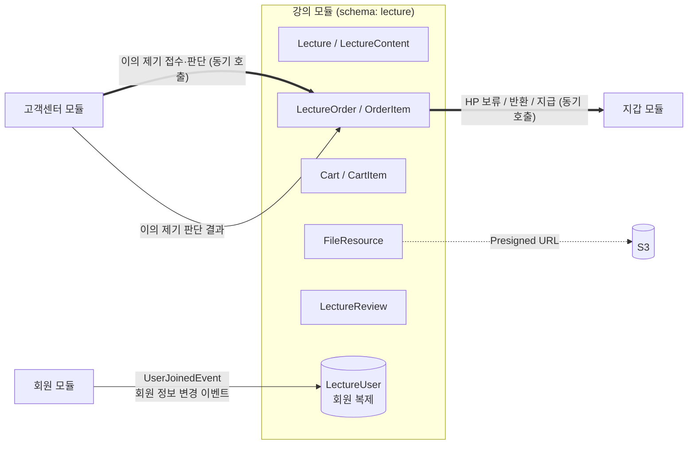
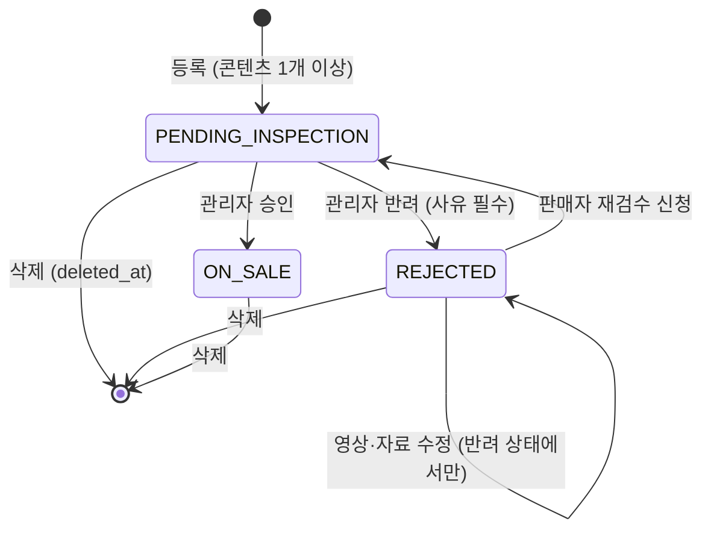
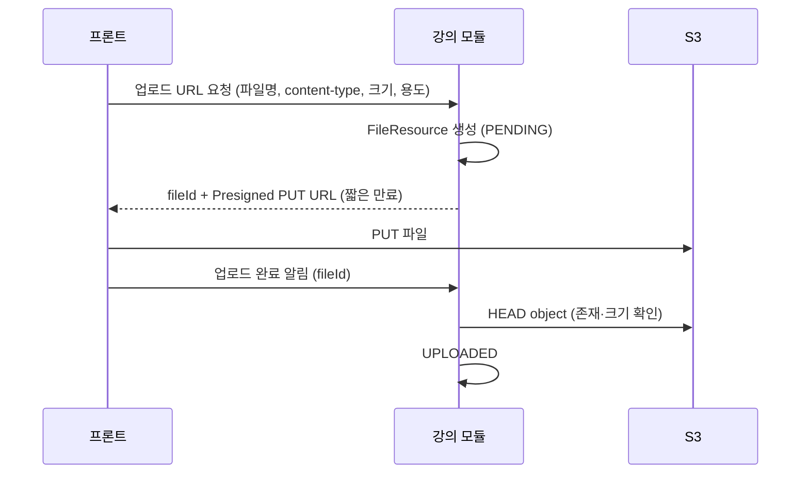
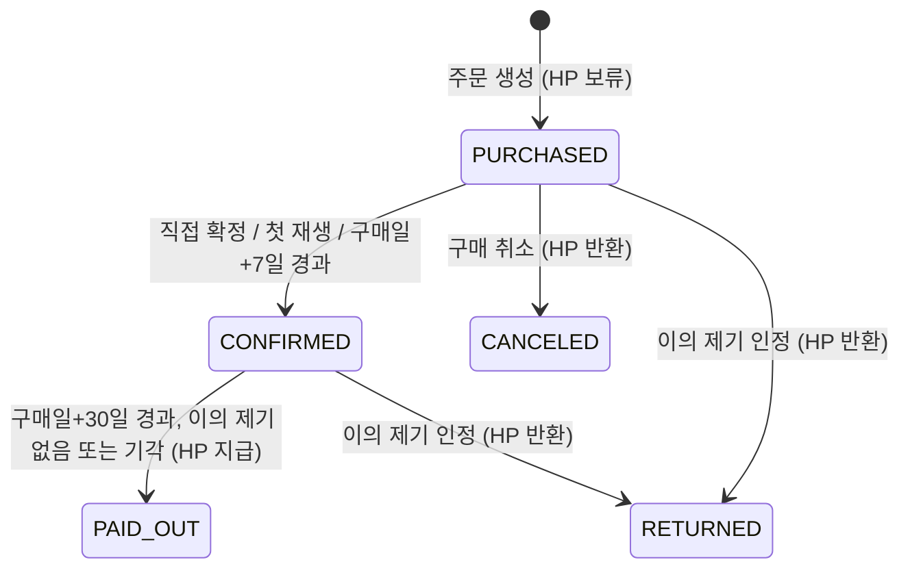
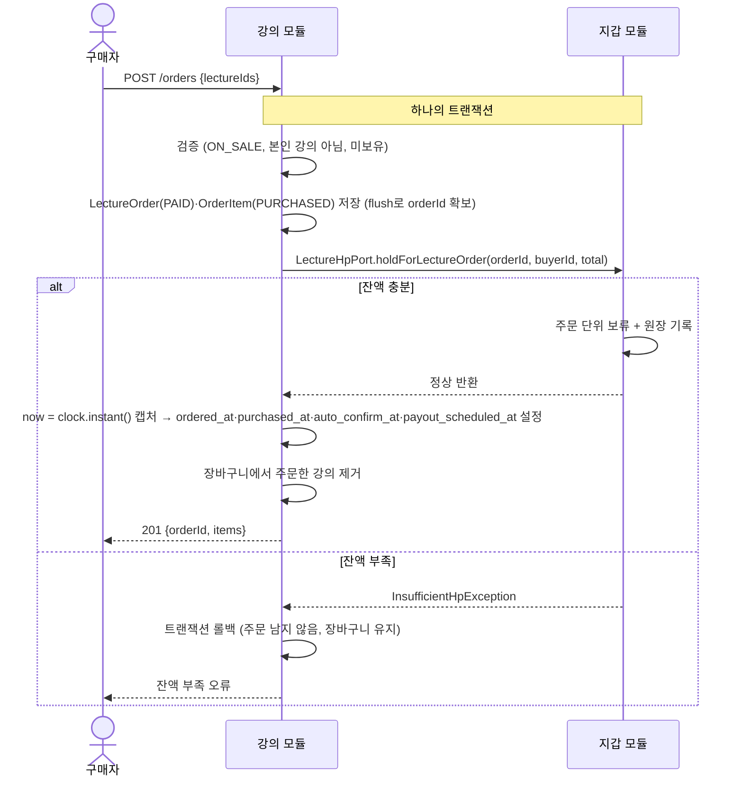
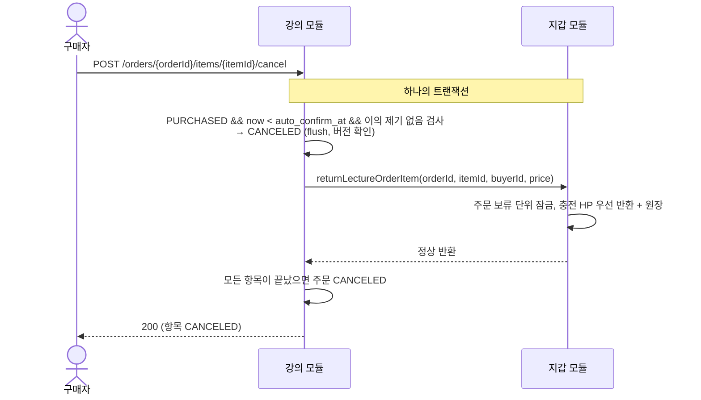
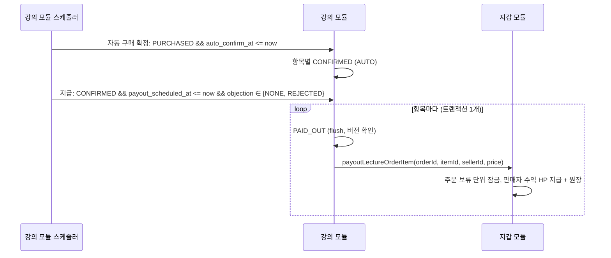
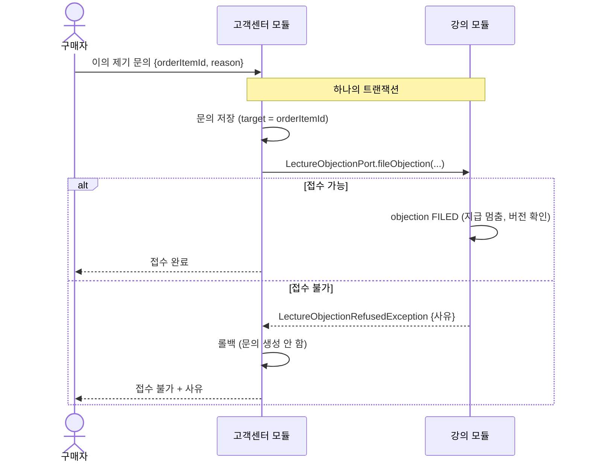
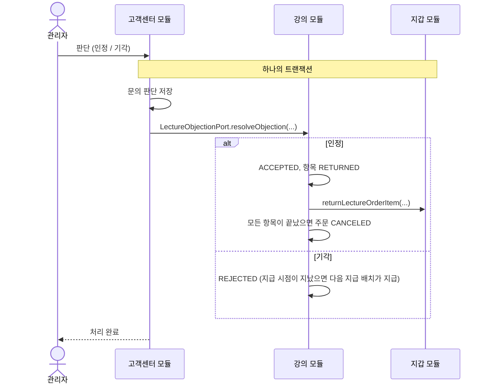

# 강의(Lecture) 모듈 설계

| 항목 | 내용 |
| --- | --- |
| 상태 | draft |
| 작성일 | 2026-10-08 |
| 관련 모듈 | 회원(member), 지갑(billing), 고객센터(customersupport) |

---

## 1. 범위

### 1.1 강의 모듈이 하는 일

기획서 MVP 표 기준: 인증된 인플루언서의 강의 등록, 구매, 구매 취소, 조회, 수정, 삭제, 검수(관리자 재량), 리뷰, 평점.

| 영역 | 기능 |
| --- | --- |
| 강의 | 등록(검수 대기로 시작), 수정, 삭제(Soft Delete), 목록·상세 조회, 판매자 본인 강의 조회 |
| 검수 | 관리자 승인·반려(사유), 반려된 강의의 영상·자료 수정 후 판매자 재검수 신청 (D11) |
| 파일 | 썸네일·강의 영상·자료의 S3 업로드(Presigned URL), 구매자 재생 URL 발급 |
| 장바구니 | 담기, 빼기, 조회 |
| 주문 | 장바구니 주문, 바로 구매(강의 1개 주문), 주문 조회, 구매 확정(직접·첫 재생·자동), 구매 취소 |
| 지급 시점 관리 | 구매일 다음 날부터 30일 경과 시 지갑 모듈에 지급 호출 |
| 내용 다름 이의 제기 | 고객센터가 접수·판단할 때 호출하는 `LectureObjectionPort` 구현: 검증·지급 중단, 판단 결과 반영(반환 또는 지급) |
| 리뷰 | 작성·수정·삭제, 평점(1~5) 및 평균 |

### 1.2 강의 모듈이 하지 않는 일

| 하지 않는 일 | 담당 |
| --- | --- |
| HP 차감, 보류, 반환, 지급, 원장 기록. **어떤 HP 종류(충전/수익)로 얼마가 결제됐는지도 모른다** | 지갑(billing) |
| 이의 제기 문의 티켓 관리, 관리자 답변 | 고객센터(customersupport) |
| 회원 역할 변경(승급), 회원 정보의 원본 | 회원(member) |
| 강의 내용 다름 이의 제기의 자동 판정 | MVP 범위 밖 |

> 강의 모듈은 "언제, 누구에게, 얼마를" 옮겨야 하는지만 판단해 지갑 모듈에 `LectureHpPort`로 동기 요청한다(6.2). 실제 HP 이동과 정합성은 지갑 모듈 한 곳에서 처리한다(기획서 아키텍처 절). 고객센터·회원과의 연동만 이벤트다.

---

## 2. 강의 모듈이 지켜야 하는 정책 요약

정책 문서에서 강의 모듈 구현에 직접 영향을 주는 규칙만 모았다.

| # | 규칙 | 출처 |
| --- | --- | --- |
| P1 | 강의 등록·판매는 **인증된 인플루언서**만 가능하다 | 기획서 권한표 |
| P2 | 장바구니·강의 구매·구매 취소는 유저·인플루언서·인증된 인플루언서만 가능하다 (관리자·비회원 불가) | 기획서 권한표 |
| P3 | 비회원은 강의 **목록만** 조회한다 | 기획서 권한표 |
| P4 | 등록한 강의는 **검수 대기(비공개)**. 승인되면 공개·판매, 반려되면 사유를 남기고 판매자가 수정 후 재신청 | 정책 6 |
| P5 | ~~판매 중인 강의의 영상·자료를 수정하면 다시 검수 대기가 되어 신규 판매를 멈춘다~~ → **MVP에서는 영상·자료를 반려된 강의만 수정할 수 있다.** 검수 대기·판매 중에는 수정 불가, 판매 중 강의를 고치려면 삭제 후 재등록 (D11). 메타 정보는 언제든 수정 | 정책 6, D11 |
| P6 | 구매 확정 = 직접 확정·첫 재생·구매일 다음 날부터 7일 경과 중 먼저. 확정 후 단순 변심 취소 불가. **지급 시점이 아니다** | 정책 4, 용어 |
| P7 | 구매 취소 = 구매 확정 전 주문 항목 취소 → 보류 HP를 구매자에게 반환 (환불과 다름) | 용어 |
| P8 | 강의 지급 = 구매일 다음 날부터 30일(내용 다름 이의 제기 기간)이 끝난 뒤 판매자 수익 HP로 지급. 수수료 없음 | 정책 4 |
| P9 | 내용 다름 이의 제기는 구매일 다음 날부터 30일 이내. 접수되면 지급을 멈추고 보류 유지. 관리자 인정 → 구매자 반환, 기각 → 판매자 지급 | 정책 6 |
| P10 | 일부 항목 반환 시 그 주문에 남은 보류분 중 충전 HP부터 반환 (→ **보류는 주문 단위**로 잡혀야 함) | 정책 1 |
| P11 | 주문은 상태값으로 관리하고 삭제하지 않는다. 강의는 Soft Delete. 그 외 모든 데이터도 Soft Delete | 기획서 데이터 모델, AGENTS 5장 |
| P12 | 모든 기간·마감·일시는 **KST** 기준 | 정책 머리말 |
| P13 | 다른 모듈과는 회원 ID와 이벤트로만 연결. 스키마 간 FK·JOIN 금지. 스키마 이름 `lecture` | AGENTS 3장 |

---

## 3. 모듈 경계



- 다른 모듈의 엔티티·Repository를 쓰지 않는다. 판매자·구매자·리뷰 작성자는 `*_user_id`(Long)로만 참조한다.
- 닉네임 표시에 필요한 회원 정보는 `LectureUser`(회원 복제, `ReplicaUser` 상속)로 강의 스키마 안에 둔다. 같은 스키마 안의 JOIN은 허용된다.
- 모듈 간 이벤트 클래스는 기존 회원 이벤트(`shared/member/event/UserJoinedEvent`)와 같은 방식으로 `shared` 모듈에 둔다. (예: `com.hapbang.shared.lecture.event`)

---

## 4. 도메인 모델

### 4.1 애그리거트 구성

| 애그리거트 루트 | 포함 | 역할 |
| --- | --- | --- |
| `Lecture` | `LectureContent` | 강의 상품, 검수 상태, 영상·자료 구성 |
| `FileResource` | - | S3 객체 메타데이터 (업로드 상태) |
| `Cart` | `CartItem` | 회원별 장바구니 (회원당 1개) |
| `LectureOrder` | `OrderItem` | 주문(결제 단위)과 항목(구매 확정·취소·지급·이의 제기 단위) |
| `LectureReview` | - | 주문 항목 1건당 리뷰 1개 |
| `LectureUser` | - | 회원 복제 (닉네임·역할·상태) |

애그리거트 사이는 ID로만 참조한다 (`OrderItem.lectureId`, `CartItem.lectureId`, `LectureContent.fileId` 등). 같은 모듈 안이어도 `@ManyToOne`은 애그리거트 내부(`Lecture`–`LectureContent`, `Cart`–`CartItem`, `LectureOrder`–`OrderItem`)에만 건다.

### 4.2 Lecture — 검수 상태

ERD의 `LECTURE.status`에 검수 상태를 담는다. 별도의 "작성 중(DRAFT)" 상태는 두지 않는다. 정책 6이 "등록한 강의는 검수 대기"라고 정하고 있으므로, **영상·자료 파일을 먼저 업로드한 뒤 등록 요청 한 번에 강의와 콘텐츠를 함께 만든다.**



| 상태 | 코드 | 목록·상세 노출 | 신규 구매 | 기존 구매자 시청 |
| --- | --- | --- | --- | --- |
| 검수 대기 | `PENDING_INSPECTION` | 판매자·관리자만 | X | - (승인 전이라 구매자 없음) |
| 반려 | `REJECTED` | 판매자·관리자만 | X | - (승인 전이라 구매자 없음) |
| 판매 중 | `ON_SALE` | 모두 | O | O |
| 삭제 | `deleted_at` 기록 | 판매자·관리자·기존 구매자 (목록 제외) | X | O (D5) |

불변식

- `ON_SALE`이 아니면 장바구니 담기·주문 생성을 거부한다.
- 판매자 본인만 수정·삭제·재검수 신청할 수 있다.
- 반려 시 `rejection_reason`은 필수다. 재검수 신청 시 이전 반려 사유는 덮어쓰지 않고 다음 반려 때 갱신한다.
- 메타 정보(제목·소개·가격·썸네일) 수정은 재검수 대상이 아니다. 정책은 "내용(영상·자료)"만 재검수 대상으로 정했다. (정책 6) 삭제 전이면 어느 상태에서든 수정할 수 있다.
- 영상·자료는 `Lecture` 애그리거트를 통해 목록 전체를 교체하는 방식으로만 바꾸고, **`REJECTED`일 때만** 허용한다 (D11). 교체된 행은 Soft Delete로 남긴다.
- 콘텐츠가 0개가 되는 수정은 거부한다.

#### 승인 후 콘텐츠 잠금 (D11)

검수 대기와 판매 중에는 영상·자료를 바꿀 수 없다. 그래서

- 관리자는 항상 판매자가 제출한 내용 그대로를 승인한다. 검수하는 동안 내용이 바뀌지 않으므로 승인 요청에 revision·version을 담을 필요가 없다.
- 구매자는 항상 승인된 내용만 본다. 승인본·검수본을 나눠 둘(revision) 필요가 없다.
- 판매 중 강의의 내용을 고치려면 삭제 후 새로 등록한다. 삭제된 강의도 기존 구매자는 계속 보고 지급도 그대로 진행된다(D5). 리뷰·평점은 새 강의로 이어지지 않는다.

> 이전 초안의 콘텐츠 revision(승인본·검수본 분리) 설계는 D11로 대체했다. MVP 이후 판매 중 수정이 필요해지면 다시 검토한다.

### 4.3 LectureContent

| 필드 | 설명 |
| --- | --- |
| `fileId` | `FileResource` ID. 업로드 완료(`UPLOADED`) 상태이고 업로더가 판매자 본인인 파일만 연결 가능 |
| `title`, `sequence` | 표시 제목, 강의 내 순서 (강의 안에서 유일) |
| `contentType` | `VIDEO`(영상), `DOCUMENT`(자료) |

> 썸네일(사진)·영상·자료 파일은 모두 S3에 저장한다 (16장 D2).

### 4.4 FileResource — S3 업로드



- `file_type`: `LECTURE_THUMBNAIL`, `LECTURE_VIDEO`, `LECTURE_DOCUMENT`
- `status`: `PENDING` → `UPLOADED` (삭제 시 `deleted_at`)
- object key 규칙(제안): `lecture/{fileType}/{uuid}` — 원본 파일명은 key에 넣지 않는다.
- 썸네일은 목록에서 비회원도 보므로 짧은 만료의 Presigned GET URL을 응답 때마다 발급하거나 공개 prefix를 둔다. (S3 버킷 정책은 인프라 담당과 확인)
- 오래된 `PENDING` 파일 정리는 MVP에서 하지 않는다.

### 4.5 Cart

- 회원당 1개. 처음 담을 때 만든다. (`cart.user_id` 유일)
- 같은 강의는 한 번만 담는다.
- 담을 때 검사: 강의가 `ON_SALE`, 본인 강의가 아님(D5), 이미 보유 중(유효한 주문 항목이 있음)이 아님.
- 담은 뒤 강의가 판매 중지·삭제되면 장바구니 조회 시 "구매 불가"로 표시하고, 주문 시에는 거부한다.
- 결제(보류)가 성공하면 해당 강의들을 장바구니에서 뺀다.
- 정책상 Soft Delete가 원칙이므로 `cart_item`에 `deleted_at`을 둔다. (ERD에 없음)

### 4.6 LectureOrder / OrderItem

#### 주문(LectureOrder)은 결제 단위

- 장바구니 주문과 바로 구매(강의 1개 주문)를 같은 모델로 처리한다.
- **HP 보류는 주문 단위**다. 정책 1의 "그 주문에 남은 보류분 중 충전 HP부터 반환"을 지키려면 지갑 모듈이 주문 하나의 보류를 하나로 보고 항목별로 나눠 반환·지급해야 하기 때문이다.
- **주문은 HP 보류가 성공한 경우에만 존재한다.** 주문 생성과 지갑 보류를 한 트랜잭션에서 처리하므로(6.4), 잔액 부족이면 주문 행 자체가 롤백되어 남지 않는다. 그래서 결제 대기·결제 실패 상태가 없다.
- 주문 상태(`status`)는 저장값이 기준이다: `PAID`(생성 시), `CANCELED`(모든 항목이 `CANCELED`·`RETURNED`가 된 때). `PAID`인 주문의 진행 상황만 항목에서 파생해 응답에 담는다.
- 항목을 `CANCELED`·`RETURNED`로 바꾸는 모든 경로(구매 취소, 이의 제기 인정)는 같은 트랜잭션에서 공통 메서드(예: `LectureOrder.closeIfAllItemsEnded()`)를 호출해, 끝나지 않은 항목이 없으면 주문을 `CANCELED`로 바꾸고 `canceled_at`을 기록한다.

| 응답용 진행 상태 (`status = PAID`일 때만) | 조건 |
| --- | --- |
| `IN_PROGRESS` | 아직 끝나지 않은 항목(`PURCHASED`, `CONFIRMED`)이 있음 |
| `COMPLETED` | 모든 항목이 `PAID_OUT`·`CANCELED`·`RETURNED` 중 하나이며 `PAID_OUT`이 1개 이상 |

#### 주문 항목(OrderItem)은 거래 단위

구매 확정·구매 취소·지급·이의 제기는 모두 항목 단위로 일어난다.

**HP가 움직이는 전이는 지갑 호출과 같은 트랜잭션에서 일어난다(16장 D3).** 구매 취소·이의 제기 인정·지급은 항목 상태 변경과 `LectureHpPort` 호출을 한 트랜잭션으로 묶는다. 지갑 호출이 실패하면 항목 상태도 롤백되므로, "화면에는 반환·지급 완료인데 HP는 안 움직인" 상태가 생기지 않는다. 그래서 처리 중 상태(`*_PENDING`)를 두지 않는다.



- `CANCELED`·`RETURNED`가 되는 순간 시청 권한은 사라진다.
- 마지막 남은 항목이 `CANCELED`·`RETURNED`가 되면 같은 트랜잭션에서 주문을 `CANCELED`로 바꾼다 (구매 취소·이의 제기 인정 공통).

이의 제기는 항목 상태와 별도로 `objection_status`로 둔다.

| `objection_status` | 의미 | 지급 | 구매 취소 |
| --- | --- | --- | --- |
| `NONE` | 이의 제기 없음 | 기간 경과 시 지급 | 확정 전이면 가능 |
| `FILED` | 접수, 관리자 판단 대기 | **멈춤** | 불가 (이중 반환 방지) |
| `ACCEPTED` | 인정 → 항목 `RETURNED` | 없음 | - |
| `REJECTED` | 기각 | 기간 경과 시 지급 (이미 지났으면 다음 지급 배치에서) | 불가 |

#### 불변식

| 동작 | 허용 조건 |
| --- | --- |
| 주문 생성 | 모든 강의가 `ON_SALE`, 본인 강의 아님(D5), 같은 강의를 이미 보유 중이 아님(D5), 한 주문에 같은 강의 중복 없음, 주문자 역할이 유저·인플루언서·인증된 인플루언서 |
| 직접 확정 | 본인 항목, `PURCHASED` |
| 첫 재생 확정 | 본인 항목, `PURCHASED`, 구매자가 **재생 동의**를 제출할 때 (D7) |
| 구매 취소 | 본인 항목, `PURCHASED`, `now < auto_confirm_at`, `objection_status = NONE` |
| 이의 제기 접수 (고객센터 호출) | 구매자 본인 항목, `PURCHASED` 또는 `CONFIRMED`, `now < payout_scheduled_at`, `objection_status = NONE` |
| 지급 | `CONFIRMED`, `now >= payout_scheduled_at`, `objection_status ∈ {NONE, REJECTED}` |
| 시청 | 본인 항목이 `PURCHASED`·`CONFIRMED`·`PAID_OUT` (이의 제기 접수 중에도 시청 가능) |

- **기한 판정은 배치가 아니라 도메인 메서드가 시각으로 한다.** 자동 구매 확정 배치가 늦게 돌아도 `now >= auto_confirm_at`이면 구매 취소를 거부한다.
- **첫 재생 = 재생 동의 (D7).** `PURCHASED` 항목의 영상을 처음 재생하기 전에 프론트가 동의서("재생하면 구매가 확정되어 단순 변심으로 구매 취소할 수 없습니다")를 보여 주고, 구매자가 동의하면 재생 동의 API를 호출한다. 서버는 이때 `CONFIRMED`(`FIRST_PLAY`)로 바꾼다.
- **서버가 강제한다.** 항목이 `PURCHASED`이면 영상·자료(`VIDEO`·`DOCUMENT`) URL 발급(`/access`)을 모두 거부하고 "재생 동의 필요" 오류를 준다. 동의 없이 영상·자료를 받을 방법이 없으므로, 화면 진입·프리로드로 확정되는 일도, 동의 없이 보거나 자료만 받고 취소하는 일도 없다. 자료 다운로드도 같은 동의를 받는다(D8).
- 이미 `CONFIRMED`·`PAID_OUT`이면(직접 확정·자동 확정 포함) 동의 없이 URL을 발급한다.
- 동의 기록은 `confirmation_type = FIRST_PLAY`와 `confirmed_at`으로 남긴다.
- 한 구매자는 같은 강의에 대해 유효한 항목(`PURCHASED`, `CONFIRMED`, `PAID_OUT`)을 하나만 가진다. 취소·반환 후에는 다시 살 수 있다. `PAID_OUT`도 보유로 본다(D5): 구매한 강의는 계속 볼 수 있으므로 다시 살 수 없다.
- 주문 시점의 강의 제목과 가격을 항목에 스냅샷으로 저장한다. 이후 강의 가격이 바뀌어도 반환·지급 금액은 스냅샷 가격이다.

### 4.7 LectureReview

- 주문 항목 1건당 살아 있는 리뷰 1개. 한 회원은 한 강의에 리뷰를 하나만 유지한다. 삭제 후 재작성은 새 행으로 만들며, 그래서 유일 제약은 모두 `WHERE deleted_at IS NULL` 부분 인덱스로 건다(7.1).
- 작성 조건: 본인 항목이 `CONFIRMED`·`PAID_OUT` (D5). 구매 확정 전 리뷰를 허용하면 리뷰 작성 후 구매 취소가 가능해지기 때문이다.
- 평점은 1~5 정수. 평균 평점과 리뷰 수는 MVP에서 조회 시 집계한다. 목록 성능 문제가 생기면 `lecture`에 캐시 컬럼을 추가한다.
- 항목이 `RETURNED`가 되면 리뷰는 남기되 평균 평점·리뷰 수에서 제외한다 (D5).

### 4.8 LectureUser (회원 복제)

- `shared`의 `ReplicaUser`를 상속한다. ID는 원본 회원 ID.
- `UserJoinedEvent`로 생성하고, 회원 정보 변경 이벤트로 `syncFrom`한다. **회원 정보 변경 이벤트는 아직 `shared`에 없다** → 회원 모듈 담당과 계약 필요 (14장 Q9).
- 용도: 강의 목록·상세의 판매자 닉네임, 리뷰 작성자 닉네임. 탈퇴 회원은 "탈퇴한 회원"으로 표시한다(정책 7).
- 권한 판단(인증된 인플루언서 여부 등)은 복제본이 아니라 **요청 시점의 Spring Security 인증 정보**로 한다. 복제본은 이벤트 지연으로 늦을 수 있다.

---

## 5. 시간 규칙

모든 계산은 KST(`Asia/Seoul`)이며 `java.time.Clock`을 주입받아 계산한다(테스트에서 시각 고정).

- **구매일** = 주문 항목이 `PURCHASED`가 된 시각(`purchased_at`, 지갑 보류 성공 시각)의 KST 날짜
- **자동 구매 확정 시각** `auto_confirm_at` = (구매일 + 8일) 00:00 KST
  - "구매일 다음 날부터 7일 경과" → 구매일 다음 날부터 7일째 되는 날 23:59:59까지 취소 가능
- **지급 예정 시각** `payout_scheduled_at` = (구매일 + 31일) 00:00 KST
  - "구매일 다음 날부터 30일(내용 다름 이의 제기 기간)" → 30일째 되는 날 23:59:59까지 이의 제기 가능

정책 문서 예시와 맞춰 본 결과:

| 구매 | 구매 취소 가능 (확정 전) | `auto_confirm_at` | 이의 제기 가능 | `payout_scheduled_at` |
| --- | --- | --- | --- | --- |
| 9/30 | ~ 10/7 23:59:59 | 10/8 00:00 | ~ 10/30 23:59:59 | 10/31 00:00 |

> 정책 예시: "9/30 구매 → 10/7까지 단순 변심 취소 가능 → 10/30까지 내용 다름 이의 제기 가능 → 10/30 기간 종료 후 판매자 수익 HP 지급" — 일치한다.

---

## 6. 모듈 간 연동

### 6.1 연동 방식

| 상대 모듈 | 내용 | 방식 |
| --- | --- | --- |
| 지갑 | 주문 HP 보류, 구매 취소·이의 제기 인정 시 HP 반환, D+30 지급 | **동기 호출** `LectureHpPort` (16장 D1, D3). 강의 트랜잭션에 참여 |
| 고객센터 | 이의 제기 접수, 관리자 판단 결과 | **동기 호출** `LectureObjectionPort` (16장 D9). 고객센터가 호출하고 강의 모듈이 구현, 고객센터 트랜잭션에 참여 |
| 회원 | 가입, 회원 정보 변경 | 이벤트 |

- `AGENTS.md`의 "모듈 간 통신은 Spring Event를 기본"에서 **HP 이동과, 지급을 멈추거나 HP를 되돌리는 이의 제기 처리만 예외**로 동기 호출한다. 돈과 관련된 상태 변경을 한 트랜잭션으로 묶어 한쪽만 반영되는 경우를 없애기 위해서다. 회원 복제만 이벤트로 남는다.
- 지갑 호출이 예외를 던지면 강의 상태 변경도 함께 롤백된다. 사용자 요청이면 오류로 응답하고, 배치면 그 항목을 건너뛰고 다음 실행에서 다시 시도한다.
- 이벤트는 이미 설정된 Spring Modulith 이벤트 발행 기록(JDBC, `republish-outstanding-events-on-restart: true`)을 쓴다. 이벤트는 발행한 트랜잭션과 함께 기록되므로 커밋된 상태 변경의 이벤트는 유실되지 않는다(최소 1회 전달).
- 받는 쪽은 `@ApplicationModuleListener`(커밋 후, 비동기, 새 트랜잭션)로 받고 **멱등하게** 처리한다(상태 전이 검사로 중복 무시).

#### 실행 중 실패한 이벤트의 재처리

현재 설정은 **재시작할 때만** 미완료 이벤트를 다시 보낸다. 서버가 계속 떠 있으면 리스너에서 실패한 이벤트는 다시 처리되지 않는다. 강의 모듈에서는 회원 복제만 해당한다(돈과 관련된 연동은 모두 동기 호출이라 해당 없음).

| 항목 | 내용 (제안) |
| --- | --- |
| 주기적 재제출 | Spring Modulith `IncompleteEventPublications.resubmitIncompletePublicationsOlderThan(...)`을 스케줄러로 5분마다 호출. 대상: 발행 후 5분 넘게 완료되지 않은 이벤트 |
| 최대 시도 | 재제출 횟수를 넘으면(예: 10회) 자동 재제출을 멈추고 경보(로그 ERROR)를 남긴다 |
| 운영자 재처리 | 원인을 고친 뒤 다시 보내는 운영 절차를 문서로 둔다 |
| 소유 | 다른 모듈에도 해당하므로 `global` 공통 설정을 제안한다 (Q17) |

### 6.2 동기 인터페이스 (제안)

#### 지갑 모듈: `LectureHpPort`

강의 모듈이 지갑 모듈에 **요구하는 것**만 정한다. 구현(잔액 검사와 보류의 원자성, 차감 순서, 원장 기록, 잠금 방식)은 지갑 담당이 정한다.

```java
// shared 모듈 (예: com.hapbang.shared.billing) — 지갑 모듈이 구현, 강의 모듈이 호출
// 모든 메서드는 호출한 쪽의 트랜잭션에 참여한다. 예외가 나면 강의 쪽 변경도 함께 롤백된다.
public interface LectureHpPort {

    /**
     * 강의 주문 금액을 구매자 HP에서 주문 단위로 보류한다.
     * @throws InsufficientHpException 사용 가능한 HP(수익 + 충전)가 amountHp보다 적을 때
     */
    void holdForLectureOrder(Long orderId, Long buyerUserId, long amountHp);

    /**
     * 주문 보류분 중 해당 항목 금액을 구매자에게 반환한다. (구매 취소, 이의 제기 인정)
     * 그 주문에 남은 보류분 중 충전 HP부터 반환한다 (정책 1).
     */
    void returnLectureOrderItem(Long orderId, Long orderItemId, Long buyerUserId, long amountHp);

    /**
     * 주문 보류분 중 해당 항목 금액을 판매자 수익 HP로 지급한다. (수수료 없음)
     * 그 주문에 남은 보류분 중 수익 HP부터 소진한다 (D10).
     */
    void payoutLectureOrderItem(Long orderId, Long orderItemId, Long sellerUserId, long amountHp);
}
```

| 항목 | 내용 |
| --- | --- |
| 위치 | `shared`에 인터페이스와 `InsufficientHpException`을 두고 지갑 모듈이 구현 빈을 제공한다. 강의 모듈은 지갑 모듈에 Gradle 의존을 걸지 않는다(지금처럼 `shared`만 의존) |
| 트랜잭션 | 같은 JVM·같은 DB이므로 강의 트랜잭션에 참여(`REQUIRED`). 강의 상태와 보류·원장이 함께 커밋되거나 함께 롤백된다 |
| 호출 순서 | 강의 항목 상태를 먼저 바꾸고 flush해 낙관적 락 충돌을 지갑 호출 전에 확인한 뒤 지갑을 호출한다. 충돌이 커밋 시점에 나더라도 같은 트랜잭션이라 지갑 변경도 롤백된다 |
| 참조 | 보류의 참조는 `(LECTURE_ORDER, orderId)`. 반환·지급은 이 보류를 항목 단위로 나눠 쓴다 |
| 멱등 키 (제안) | 보류 `LECTURE_ORDER:{orderId}:HOLD`, 반환·지급 공통 `LECTURE_ORDER_ITEM:{orderItemId}:SETTLE` — 한 항목에는 반환과 지급 중 하나만, 한 번만 일어나야 하므로 같은 키를 쓴다 |
| 착수 조건 | 지갑 담당 합의(Q15) 후 `AGENTS.md` 3장에 "돈 이동에 한해 `shared` 포트를 통한 동기 호출 허용"과 이 표의 트랜잭션·멱등 조건을 적는다. 그 전에는 인터페이스 초안과 Fake로만 작업한다 |
| 지갑 구현 전 | 강의 모듈 테스트는 이 인터페이스를 Mock/Fake로 대체한다. 애플리케이션 기동에는 구현 빈이 필요하므로 지갑 담당과 일정을 맞춘다 |
| 서비스 분리 시 | 구현체를 HTTP 클라이언트로 바꾸면 한 트랜잭션이 깨진다. 그때 처리 중 상태와 보상 처리를 다시 설계한다 (최종 프로젝트 범위) |

#### 지갑 모듈에 요구하는 보장 (Q15)

1. 보류: 잔액 검사와 보류가 원자적이다. 같은 구매자의 다른 결제(출연 요청 등)와 동시에 와도 잔액보다 많이 보류되지 않는다. 차감 순서는 수익 HP → 충전 HP.
2. 같은 주문 보류에 대한 반환·지급은 **주문 보류 단위로 직렬화**된다. 항목마다 멱등 키가 다르므로 멱등 키만으로는 항목 사이의 경쟁을 막지 못한다. 예: 수익 3,000 + 충전 7,000으로 5,000원 강의 A·B를 산 뒤 A·B 구매 취소가 동시에 들어오면, 둘 다 "남은 충전 보류 7,000"을 읽고 충전 HP 5,000씩 반환할 수 있다.
3. 남은 충전/수익 보류분은 원자적으로 줄어들며 음수가 되지 않는다.
4. `반환 누계 + 지급 누계 ≤ 최초 보류액`, 모든 항목이 끝나면 남은 보류분은 0이다.
5. 같은 항목에 대한 반환·지급은 합쳐서 한 번만 처리되고, 두 번째 호출은 예외를 던진다.
6. 소진 순서: **반환은 남은 보류분 중 충전 HP부터**(정책 1), **지급은 남은 보류분 중 수익 HP부터**(D10). 예: 수익 3,000 + 충전 7,000으로 5,000원 강의 A·B 구매 → A 지급(수익 3,000 + 충전 2,000) → B 반환(충전 5,000).

강의 모듈은 지갑의 동시성 구현 방식을 정하지 않는다(`AGENTS.md` 11장 미정 항목).

> 출연 모듈도 보류·반환·지급 패턴이 같으므로, 지갑 담당이 강의 전용 인터페이스 대신 `(referenceType, referenceId)`를 받는 범용 인터페이스로 통일할 수 있다. 그렇게 정하면 강의 모듈은 그 계약을 따른다.

#### 강의 모듈: `LectureObjectionPort` (고객센터가 호출)

고객센터가 접수 창구를 유지하면서, 접수·판단을 **고객센터 트랜잭션 안에서** 강의 모듈에 바로 반영한다(16장 D9). 접수가 저장되는 순간 항목도 `FILED`가 되어 지급이 멈춘다.

```java
// shared 모듈 (예: com.hapbang.shared.lecture) — 강의 모듈이 구현, 고객센터 모듈이 호출
// 모든 메서드는 호출한 쪽(고객센터)의 트랜잭션에 참여한다. 예외가 나면 고객센터 쪽 변경도 함께 롤백된다.
public interface LectureObjectionPort {

    /**
     * 내용 다름 이의 제기를 접수해 해당 항목의 지급을 멈춘다 (objection FILED).
     * @throws LectureObjectionRefusedException 접수할 수 없을 때. 사유 코드를 담는다.
     */
    void fileObjection(Long orderItemId, Long buyerUserId, Long inquiryId, String reason);

    /**
     * 관리자 판단을 반영한다.
     * 인정: 항목 RETURNED + LectureHpPort.returnLectureOrderItem (같은 트랜잭션)
     * 기각: REJECTED. 지급 시점이 지났으면 다음 지급 배치가 지급한다.
     */
    void resolveObjection(Long orderItemId, Long inquiryId, boolean accepted, Long adminUserId);
}
```

| 항목 | 내용 |
| --- | --- |
| 위치 | `shared`에 인터페이스와 `LectureObjectionRefusedException`을 두고 강의 모듈이 구현한다. 고객센터는 강의 모듈에 Gradle 의존을 걸지 않는다 |
| 트랜잭션 | 고객센터의 문의 저장과 강의 항목 변경(인정 시 지갑 반환까지)이 함께 커밋·롤백된다. 접수 불가 예외가 나면 고객센터는 문의를 만들지 않고 구매자에게 사유를 응답한다 |
| 접수 가능 조건 | 구매자 본인 항목, `PURCHASED` 또는 `CONFIRMED`, `objection_status = NONE`, `now < payout_scheduled_at` |
| 접수 불가 사유 | `NOT_BUYER`, `PERIOD_EXPIRED`, `ALREADY_FILED`, `NOT_OBJECTIONABLE`(취소·반환된 항목), `ALREADY_PAID_OUT` |
| 판단 조건 | `objection_status = FILED`이고 `inquiryId`가 접수 때 저장한 값과 같을 때만 처리. 아니면 예외 |
| 지급 배치와 경쟁 | 접수와 지급 배치가 같은 항목 행을 바꾸므로 `order_item.version` 낙관적 락으로 직렬화된다. 접수가 먼저면 지급 대상에서 빠지고, 지급이 먼저면 접수가 `ALREADY_PAID_OUT`으로 거부된다(기한이 지난 뒤이므로 정책상 맞음) |
| 고객센터 쪽 필요 사항 | `INQUIRY`에 대상(`target_type = LECTURE_ORDER_ITEM`, `target_id`) 컬럼 추가 (`changelog.md` 보류 항목) |

### 6.3 이벤트 계약 (제안)

이름과 필드는 회원 담당과 합의해 확정한다.

| 이벤트 | 발행 | 구독 | 필드 | 받는 쪽 처리 |
| --- | --- | --- | --- | --- |
| `UserJoinedEvent` (기존) | 회원 | 강의 | `UserDto` | `LectureUser` 생성 |
| 회원 정보 변경 이벤트 (신규 필요) | 회원 | 강의 | `UserDto` | `LectureUser.syncFrom` |

### 6.4 주요 흐름

#### 구매 (장바구니 주문 / 바로 구매)



- 주문 행을 먼저 저장하는 이유: 보류의 참조 ID(`orderId`)가 필요하고, `(buyer_user_id, lecture_id)` 부분 유일 인덱스 위반(중복 주문)을 보류 전에 걸러내기 위해서다.
- 구매 시각(`purchased_at`)은 **보류가 정상 반환된 직후** `Clock`으로 한 번 캡처한 시각이다. 보류 전에 계산하면, 23:59에 시작한 주문이 지갑 잠금 대기 후 00:01에 보류될 때 전날 구매로 기록되어 취소·이의 제기 기한이 하루 빨라진다.

#### 구매 취소



#### 자동 구매 확정과 지급 (배치)

항목마다 별도 트랜잭션으로 처리한다. 한 항목의 지갑 호출이 실패하면 그 항목만 롤백되어 `CONFIRMED`로 남고, 다음 배치에서 다시 시도한다.

- 스케줄러는 대상 항목 ID만 조회하고, 항목 처리는 **별도 빈의 `@Transactional` 메서드** 또는 `TransactionTemplate`으로 항목마다 새 트랜잭션을 연다(같은 클래스 안에서 호출하면 프록시를 거치지 않아 트랜잭션이 생기지 않는다).
- 예외는 **트랜잭션 밖(스케줄러 루프)에서** 항목별로 잡아 로그를 남기고 다음 항목으로 넘어간다. 트랜잭션 안에서 잡으면 rollback-only 상태로 커밋이 실패하거나 앞선 처리까지 롤백될 수 있다.
- `LectureHpPort`의 예외(`InsufficientHpException` 포함)는 모두 런타임 예외로 정해, 기본 `@Transactional` 설정에서 롤백되게 한다.



#### 내용 다름 이의 제기 (고객센터 접수 + 동기 호출, 16장 D4·D9)



- 구매자는 강의 모듈의 주문 조회 API에서 `orderItemId`를 받아 고객센터 문의에 담는다.
- 검증은 강의 모듈이 호출 시점에 한다. 접수 시각과 판단 시각이 같으므로 `filedAt`을 따로 비교할 필요가 없다.

관리자 판단:



---

## 7. 스키마 (`lecture`)

ERD를 기준으로 하고, 이 설계에 필요한 변경을 표시했다. 모든 테이블은 `@Table(schema = "lecture")`. 공통 컬럼 `created_at`, `updated_at`은 채팅 모듈과 같이 엔티티에 직접 두고 도메인 메서드가 받은 시각으로 기록한다(`BaseEntity`·JPA Auditing 미사용. 회원 모듈의 `BaseEntity`가 병합되면 통일 여부를 팀과 정한다).

### 7.1 테이블

**lecture**

| 컬럼 | 타입 | 비고 |
| --- | --- | --- |
| id | bigint PK | |
| seller_user_id | bigint | 회원 ID (FK 없음) |
| thumbnail_file_id | bigint | `file_resource.id` |
| title | varchar | |
| description | text | |
| price_hp | bigint | 1,000 이상, 1,000 단위 (D6) |
| status | varchar | `PENDING_INSPECTION` / `REJECTED` / `ON_SALE` |
| rejection_reason | text | **추가** |
| inspection_requested_at | timestamp | **추가** |
| inspected_at | timestamp | **추가** |
| inspected_by | bigint | **추가**, 관리자 회원 ID |
| version | bigint | **추가**. 낙관적 락 (같은 강의를 동시에 바꾸는 요청 직렬화) |
| deleted_at | timestamp | Soft Delete |

**lecture_content**: ERD + `deleted_at`. `content_type` = `VIDEO` / `DOCUMENT`. 살아 있는 행끼리 `(lecture_id, sequence)`가 겹치지 않아야 하지만, **MVP에서는 DB 제약을 두지 않고** `Lecture` 애그리거트(교체 때마다 1부터 다시 매김)와 `lecture.version` 낙관적 락으로 보장한다 (D12). DB 제약이 필요해지면 지연 검사 제약 `EXCLUDE USING btree (lecture_id WITH =, sequence WITH =) WHERE (deleted_at IS NULL) DEFERRABLE INITIALLY DEFERRED`를 쓴다. 콘텐츠 교체 때 Hibernate가 새 행 INSERT를 기존 행 Soft Delete UPDATE보다 먼저 실행하므로, 즉시 검사하는 부분 유일 인덱스는 교체를 항상 실패시킨다.

**file_resource**: ERD와 같음. `file_type` = `LECTURE_THUMBNAIL` / `LECTURE_VIDEO` / `LECTURE_DOCUMENT`, `status` = `PENDING` / `UPLOADED`.

**cart**: ERD와 같음. 유일 `(user_id)`.

**cart_item**: ERD + `deleted_at` **추가**(정책 7). 유일 인덱스 `(cart_id, lecture_id) WHERE deleted_at IS NULL`.

**lecture_order**

| 컬럼 | 타입 | 비고 |
| --- | --- | --- |
| id | bigint PK | |
| buyer_user_id | bigint | |
| total_amount_hp | bigint | 항목 가격 합 |
| status | varchar | `PAID` / `CANCELED` |
| ordered_at | timestamp | 주문 생성 시각 = 보류 성공 시각 |
| canceled_at | timestamp | 모든 항목이 `CANCELED`·`RETURNED`가 된 시각 (4.6 파생 상태 `CANCELED`) |

**order_item**

| 컬럼 | 타입 | 비고 |
| --- | --- | --- |
| id | bigint PK | |
| order_id | bigint FK | `lecture_order.id` (같은 스키마) |
| lecture_id | bigint | |
| seller_user_id | bigint | 주문 시점 판매자 |
| buyer_user_id | bigint | **추가**. 보유 여부 유일 인덱스용 비정규화 |
| lecture_title_snapshot | varchar | |
| price_hp | bigint | 주문 시점 가격 |
| status | varchar | `PURCHASED` / `CONFIRMED` / `CANCELED` / `RETURNED` / `PAID_OUT` |
| purchased_at | timestamp | **추가**. 구매일 기준 |
| confirmed_at | timestamp | |
| confirmation_type | varchar | **추가**. `DIRECT` / `FIRST_PLAY` / `AUTO` |
| auto_confirm_at | timestamp | 5장 계산식 |
| payout_scheduled_at | timestamp | 5장 계산식 |
| paid_out_at | timestamp | **추가**. 지급 시각 |
| canceled_at | timestamp | 구매 취소 시각 |
| returned_at | timestamp | ERD의 `refunded_at`을 **이름 변경**. "환불"은 충전 HP 현금화만 가리키므로 "반환"을 쓴다 |
| objection_status | varchar | `NONE` / `FILED` / `ACCEPTED` / `REJECTED` |
| objection_reason | text | **추가** |
| objection_filed_at | timestamp | |
| objection_resolved_at | timestamp | **추가** |
| version | bigint | **추가**. 낙관적 락 (10장) |

인덱스

- 유일 `(buyer_user_id, lecture_id) WHERE status IN ('PURCHASED','CONFIRMED','PAID_OUT')` — 같은 강의 중복 보유 방지 (D5)
- `(status, auto_confirm_at)`, `(status, payout_scheduled_at)` — 배치 조회용

**lecture_review**: ERD와 같음. `rating` 1~5 CHECK. 유일 `(order_item_id) WHERE deleted_at IS NULL`, 유일 `(lecture_id, reviewer_user_id) WHERE deleted_at IS NULL` — 삭제 후 재작성 허용.

**lecture_user** (**신규**, 회원 복제): `id`(회원 ID), `nickname`, `role`, `status`, `created_at`, `updated_at`. 채팅 모듈의 `CHAT_USER`와 같은 패턴.

### 7.2 ERD 반영 필요 목록

`changelog.md`의 "보류 (ERD 수정 필요)" 중 "강의 검수 상태 반영 필요" 항목을 이 설계로 해소한다.

- [ ] `LECTURE`: 검수 컬럼 4개, `version` 추가, `status` 값 정의
- [ ] `LECTURE_CONTENT`: `deleted_at` 추가
- [ ] `CART_ITEM`: `deleted_at` 추가 (정책 7)
- [ ] `LECTURE_ORDER`: `status` 값 정의(`PAID`/`CANCELED`), `canceled_at` 의미 정의
- [ ] `ORDER_ITEM`: `buyer_user_id`, `purchased_at`, `confirmation_type`, `paid_out_at`, `objection_reason`, `objection_resolved_at`, `version` 추가, `refunded_at` → `returned_at`, `status` 값 정의
- [ ] `LECTURE_USER` 추가

---

## 8. API 초안

모든 경로는 `/api/v1/lectures` 아래. 응답·예외 포맷은 팀 합의 전이므로 정하지 않는다(AGENTS 11장). Swagger로 Controller 명세를 먼저 만들어 프론트와 맞춘다.

### 8.1 강의

| 메서드 | 경로 | 권한 | 설명 |
| --- | --- | --- | --- |
| GET | `/api/v1/lectures` | 모두(비회원 포함) | `ON_SALE` 목록. 검색어(제목), 정렬(최신·가격·평점), 페이징. 판매자 닉네임·평균 평점·리뷰 수 포함 |
| GET | `/api/v1/lectures/{lectureId}` | 회원 | 상세 + 콘텐츠 목록(제목·순서·종류, 파일 URL 없음). 판매자·관리자는 비공개·삭제 상태도 조회. **보유 항목이 있는 구매자는 삭제된 강의도 조회한다** |
| POST | `/api/v1/lectures` | 인증된 인플루언서 | 등록 (메타 + 콘텐츠 목록) → `PENDING_INSPECTION` |
| PATCH | `/api/v1/lectures/{lectureId}` | 판매자 본인 | 메타 수정 (재검수 없음) |
| DELETE | `/api/v1/lectures/{lectureId}` | 판매자 본인 | Soft Delete |
| PUT | `/api/v1/lectures/{lectureId}/contents` | 판매자 본인 | 콘텐츠 목록 전체 교체 (추가·수정·삭제·순서 변경 포함). `REJECTED`일 때만 허용 (D11) |
| POST | `/api/v1/lectures/{lectureId}/inspection-requests` | 판매자 본인 | `REJECTED` → `PENDING_INSPECTION` |
| GET | `/api/v1/lectures/me` | 인증된 인플루언서 | 내가 등록한 강의 (모든 상태) |
| GET | `/api/v1/lectures/{lectureId}/contents/{contentId}/access` | 구매자·판매자·관리자 | Presigned GET URL 발급. 구매자 항목이 `PURCHASED`면 영상·자료 모두 거부(재생 동의 필요). 구매자는 삭제되지 않은 콘텐츠만 발급 |

### 8.2 검수 (관리자)

| 메서드 | 경로 | 설명 |
| --- | --- | --- |
| GET | `/api/v1/lectures/inspections?status=PENDING_INSPECTION` | 검수 대기 목록 |
| POST | `/api/v1/lectures/{lectureId}/inspection/approve` | 승인 → `ON_SALE`. 검수 대기 중에는 내용이 바뀌지 않으므로 추가 검사 없음 (D11) |
| POST | `/api/v1/lectures/{lectureId}/inspection/reject` | 반려 `{reason}` → `REJECTED` |

### 8.3 파일

| 메서드 | 경로 | 권한 | 설명 |
| --- | --- | --- | --- |
| POST | `/api/v1/lectures/files` | 인증된 인플루언서 | `{fileType, originalFilename, contentType, fileSize}` → `{fileId, uploadUrl}` |
| POST | `/api/v1/lectures/files/{fileId}/complete` | 업로더 본인 | 업로드 완료 확인 → `UPLOADED` |

### 8.4 장바구니

| 메서드 | 경로 | 설명 |
| --- | --- | --- |
| GET | `/api/v1/lectures/cart` | 장바구니 조회 (구매 가능 여부 표시) |
| POST | `/api/v1/lectures/cart/items` | `{lectureId}` 담기 |
| DELETE | `/api/v1/lectures/cart/items/{lectureId}` | 빼기 |

### 8.5 주문

| 메서드 | 경로 | 설명 |
| --- | --- | --- |
| POST | `/api/v1/lectures/orders` | `{lectureIds}` 주문 (바로 구매는 1개). HP 보류까지 끝난 뒤 응답. 잔액 부족이면 오류 |
| GET | `/api/v1/lectures/orders` | 내 주문 목록 |
| GET | `/api/v1/lectures/orders/{orderId}` | 주문 상세 (항목 상태 + 4.6 파생 상태) |
| POST | `/api/v1/lectures/orders/{orderId}/items/{orderItemId}/confirm` | 직접 구매 확정 |
| POST | `/api/v1/lectures/orders/{orderId}/items/{orderItemId}/play-consent` | 재생 동의 → 구매 확정(`FIRST_PLAY`). 이후 영상·자료 URL 발급 가능 |
| POST | `/api/v1/lectures/orders/{orderId}/items/{orderItemId}/cancel` | 구매 취소 → HP 반환까지 끝난 뒤 응답 |
| GET | `/api/v1/lectures/purchased` | 내가 시청 가능한 강의 목록 |
| GET | `/api/v1/lectures/sales` | 판매자: 판매 내역 (항목 상태·지급 예정일) |

### 8.6 리뷰

| 메서드 | 경로 | 설명 |
| --- | --- | --- |
| GET | `/api/v1/lectures/{lectureId}/reviews` | 리뷰 목록 + 평균 평점 |
| POST | `/api/v1/lectures/{lectureId}/reviews` | `{orderItemId, rating, content}` 작성 |
| PATCH | `/api/v1/lectures/reviews/{reviewId}` | 작성자 본인 수정 |
| DELETE | `/api/v1/lectures/reviews/{reviewId}` | 작성자 본인 Soft Delete |

> `global`의 `SecurityConfig`는 현재 Swagger 외 전부 인증을 요구한다. `GET /api/v1/lectures`(목록)의 비회원 허용과 역할별 인가는 회원·global 담당과 함께 추가한다.

### 8.7 용어 ↔ 코드 이름 (제안)

`glossary.md`의 "코드 레벨" 열이 비어 있어 강의 영역만 제안한다. 검수와 리뷰가 영어로 둘 다 review가 되지 않도록 **검수 = inspection, 리뷰 = review**로 나눈다.

| 용어 | 코드 |
| --- | --- |
| 강의 / 강의 콘텐츠 | `Lecture` / `LectureContent` |
| 검수, 검수 대기, 반려 | `Inspection`, `PENDING_INSPECTION`, `REJECTED` |
| 판매 중 | `ON_SALE` |
| 장바구니 / 주문 / 주문 항목 | `Cart` / `LectureOrder` / `OrderItem` |
| 구매 확정 / 구매 취소 | `confirm` (`CONFIRMED`) / `cancel` (`CANCELED`) |
| 첫 재생 | `FIRST_PLAY` |
| 내용 다름 이의 제기 | `Objection` |
| 반환 / 지급 | `return` (`RETURNED`) / `payout` (`PAID_OUT`) |
| 리뷰 / 평점 | `LectureReview` / `rating` |

---

## 9. 권한 정리

| 기능 | 비회원 | 유저 | 인플루언서 | 인증된 인플루언서 | 관리자 |
| --- | --- | --- | --- | --- | --- |
| 강의 목록 | O | O | O | O | O |
| 강의 상세 | X | O | O | O | O |
| 강의 등록·수정·삭제·재검수 신청 | X | X | X | O (본인) | X |
| 검수 승인·반려 | X | X | X | X | O |
| 장바구니·주문·구매 확정·구매 취소·이의 제기 | X | O | O | O | X |
| 콘텐츠 시청 | X | 구매자 | 구매자 | 구매자·판매자 | O (검수용) |
| 리뷰 작성 | X | 구매자 | 구매자 | 구매자 | X |

---

## 10. 동시성 · 멱등성 · 배치

| 상황 | 대응 |
| --- | --- |
| 구매 취소 ↔ 자동 구매 확정 배치가 같은 항목을 동시에 변경 | `order_item.version` 낙관적 락. 늦은 쪽은 실패하고, 같은 트랜잭션의 지갑 반환도 함께 롤백된다 (사용자 요청이면 충돌 오류) |
| 이의 제기 접수 ↔ 지급 배치 | 둘 다 항목 행을 바꾸므로 낙관적 락으로 직렬화. `FILED`가 먼저 커밋되면 지급 대상에서 빠지고, 지급이 먼저면 접수가 `ALREADY_PAID_OUT`으로 거부된다 (6.2 `LectureObjectionPort`) |
| 같은 주문의 여러 항목 반환·지급이 동시에 처리 | 지갑 모듈이 주문 보류 단위로 직렬화 (6.2 "지갑 모듈에 요구하는 보장", Q15) |
| 승인 중 판매자가 콘텐츠 수정 | 발생하지 않음. 검수 대기 중에는 콘텐츠를 수정할 수 없다 (D11) |
| 주문 버튼 중복 클릭 | `(buyer_user_id, lecture_id)` 부분 유일 인덱스로 같은 강의의 두 번째 주문이 보류 호출 전에 실패 |
| 같은 구매자의 동시 결제 (강의 주문 + 출연 요청 등) | 지갑 모듈의 `holdForLectureOrder` 내부 잠금으로 잔액 검사와 보류를 원자적으로 처리 (지갑 담당 구현) |
| 지갑 호출 실패 | 강의 상태 변경도 롤백. 사용자 요청은 오류 응답, 지급 배치는 다음 실행에서 다시 시도 |
| 같은 항목에 반환·지급이 두 번 호출 | 강의 상태 머신이 먼저 막고, 지갑도 6.2의 멱등 키로 거부 |
| 이벤트 중복 도착 (회원) | 복제본이 이미 있으면 갱신만 한다 |
| 같은 이의 제기 판단이 두 번 호출 | `objection_status = FILED`가 아니면 예외로 거부 |
| 이벤트 처리 실패 (서버 실행 중) | 6.1의 주기적 재제출 + 최대 시도 + 경보 |
| 배치 다중 실행 | EC2 1대·애플리케이션 1개이므로 분산 락은 두지 않는다. 항목마다 별도 트랜잭션으로 처리해 한 건 실패가 전체를 막지 않게 한다 |

배치 (제안, `@Scheduled`, KST)

| 배치 | 주기 | 대상 |
| --- | --- | --- |
| 자동 구매 확정 | 10분마다 | `PURCHASED` && `auto_confirm_at <= now` |
| 지급 | 매일 01:00 | `CONFIRMED` && `payout_scheduled_at <= now` && `objection_status IN (NONE, REJECTED)` |

- 지갑 동시성 제어 방식(`AGENTS.md` 11장 미정)은 강의 모듈이 정하지 않는다. 강의 모듈은 상태 머신과 트랜잭션 경계를 보장하고, 지갑에 요구하는 보장은 Q15로 합의한다.
- `@EnableScheduling`, `@ApplicationModuleListener`의 비동기 실행 설정이 애플리케이션에 켜져 있는지 구현 시 확인한다.

---

## 11. 패키지 구조 (D11 — 채팅 모듈과 같은 구조)

계층별로 나눈다. Spring Modulith 기준으로 `com.hapbang.lecture` 하위 패키지는 모두 모듈 내부다.

```
com.hapbang.lecture
├── package-info.java   (@ApplicationModule)
├── in/                 Controller, 요청 DTO, 예외 처리
├── app/                서비스, 배치, 회원 이벤트 리스너, LectureObjectionPort 구현
├── domain/             엔티티·상태·예외 (package-info.java: 테이블·제약 목록, TODO(db))
└── out/                Repository, S3 클라이언트

com.hapbang.shared.lecture.event                   다른 모듈과 주고받는 이벤트 record
```

- S3 클라이언트 설정은 출연 모듈도 쓰므로 `global`에 둘지 각 모듈에 둘지 정해야 한다 (Q10).

---

## 12. 테스트 (제안 — 팀 테스트 방식 합의 전)

| 대상 | 방식 |
| --- | --- |
| 상태 전이·불변식 (`Lecture`, `OrderItem`), 5장 시간 계산 | 순수 단위 테스트, `Clock` 고정 |
| Repository, 부분 유일 인덱스 | `@RepositoryTest` (PostgreSQL Testcontainers) |
| 주문·취소·지급과 `LectureHpPort` 호출, 지갑 예외 시 강의 상태 롤백 | `@IntegrationTest` + `LectureHpPort` Fake (지갑 구현 전) |
| **강의·지갑 실제 원자성** — 보류·반환·지급 직후 강의 쪽 예외(제약 위반, 낙관적 락 충돌)와 지갑 예외에서 두 스키마가 함께 롤백되는지 | 전체 앱 컨텍스트 + 실제 지갑 구현으로 통합 테스트 (지갑 구현 후, `apps` 모듈) |
| 이의 제기 접수·판단 (`LectureObjectionPort`), 접수 ↔ 지급 배치 경쟁 | `@IntegrationTest` |
| 모듈 경계 | 기존 `ModularityTests` |

> **스키마 생성 주의**: 엔티티를 `@Table(schema = "lecture")`로 두면, 현재 `PostgresTestcontainersConfig`는 `ddl-auto=create-drop`만 지정하므로 새 컨테이너 DB에 `lecture` 스키마가 없어 DDL이 실패한다. 테스트 설정에 Hibernate `hibernate.hbm2ddl.create_namespaces=true`를 추가하거나 스키마 생성 SQL(또는 Flyway)을 두어야 한다. 운영 DB의 스키마 생성 방식과 함께 팀에서 정한다 (Q18). 모든 모듈에 해당하는 문제다.

---

## 13. 구현 순서 (개발 기간 10/8 ~ 10/21)

MVP 완료 기준인 "충전 → 강의 구매 → 구매 확정 → 지급 → 환전"을 먼저 관통시킨다.

| 단계 | 내용 | 의존 |
| --- | --- | --- |
| 1 | `LectureHpPort` 합의(6.2, Q15), `LectureObjectionPort` 합의(고객센터), 회원 이벤트 합의(Q9, Q17), `shared`에 인터페이스·이벤트 record 추가, Swagger Controller 명세 | 지갑·고객센터·회원 담당 |
| 2 | `Lecture`·`LectureContent` 등록·조회·검수, 반려 후 콘텐츠 수정 (파일은 ID만, S3 연동 전) | Q18 (스키마 생성) |
| 3 | 장바구니, 주문 생성(`LectureHpPort` 호출, 테스트는 Fake), 직접 구매 확정, 구매 취소 | 지갑의 보류 구현·반환 |
| 4 | 자동 구매 확정·지급 배치 → **강의 쪽 돈 한 바퀴 완료** | 지갑의 지급 |
| 5 | S3 업로드·재생 URL, 재생 동의 구매 확정 | 인프라(S3 버킷 권한) |
| 6 | 리뷰·평점, `LectureUser` 복제 | 회원 이벤트 |
| 7 | 내용 다름 이의 제기 (`LectureObjectionPort` 구현) | 고객센터 호출부, `INQUIRY` 대상 컬럼 |

---

## 14. 결정 필요 사항

`AGENTS.md` 10장에 따라 추측으로 구현하지 않고 아래를 먼저 확인한다. 결정되면 이 문서와 `changelog.md`에 남긴다.

| # | 질문 | 이 문서의 제안 | 확인 대상 |
| --- | --- | --- | --- |
| ~~Q1~~ | ~~강의 결제(보류)를 이벤트로 할지 동기 호출로 할지~~ | **결정됨 → 16장 D1** | - |
| ~~Q2~~ | ~~판매자가 자기 강의를 장바구니에 담거나 살 수 있는가~~ | **결정됨 → 16장 D5** | - |
| ~~Q3~~ | ~~삭제된 강의를 기존 구매자가 계속 볼 수 있는가~~ | **결정됨 → 16장 D5** | - |
| ~~Q4~~ | ~~판매 중 강의의 메타 수정도 재검수 대상인가~~ | **정책으로 확정**: 정책 6은 "내용(영상·자료)" 수정만 재검수 대상으로 정함 → 메타 수정은 재검수 없음 | - |
| ~~Q5~~ | ~~강의 가격의 최소·최대·단위, 무료 강의 허용 여부~~ | **결정됨 → 16장 D6** | - |
| ~~Q6~~ | ~~장바구니 항목 삭제도 Soft Delete인가~~ | **정책으로 확정**: 정책 7 "모든 데이터는 Soft Delete" → `cart_item.deleted_at` 추가 | - |
| ~~Q7~~ | ~~리뷰 작성 시점(구매 확정 후만?), 반환된 항목의 리뷰 처리~~ | **결정됨 → 16장 D5** | - |
| ~~Q8~~ | ~~내용 다름 이의 제기 접수 창구~~ | **결정됨 → 16장 D4** | - |
| Q9 | 회원 정보 변경 이벤트(닉네임·역할·상태) 계약 | `UserDto`를 담은 변경 이벤트 1종 | 회원 담당 |
| Q10 | S3 클라이언트·Presigned URL 공통 코드를 `global`에 둘지 | `global`에 설정, 각 모듈은 key prefix만 다르게 | 출연 담당, 인프라 |
| ~~Q11~~ | ~~재검수 중 기존 구매자가 보는 콘텐츠~~ | **해당 없음 → 16장 D11** (판매 중 강의는 재검수되지 않음) | - |
| ~~Q12~~ | ~~"첫 재생" 판정 기준~~ | **결정됨 → 16장 D7** | - |
| ~~Q13~~ | ~~판매자가 탈퇴하거나 역할을 잃으면 판매 중 강의를 어떻게 하나~~ | **결정됨 → 16장 D8** | - |
| ~~Q14~~ | ~~같은 강의를 다시 살 수 있는가 (지급 완료 후 포함)~~ | **결정됨 → 16장 D5** | - |
| Q15 | `LectureHpPort` 3개 메서드와 지갑에 요구하는 보장 6가지 (6.2) | 6.2 그대로 합의 | 지갑 담당 |
| ~~Q16~~ | ~~강의 자료 파일을 S3에 저장해도 되는가~~ | **결정됨 → 16장 D2** | - |
| Q17 | 실행 중 실패한 이벤트(회원 복제 등)의 재처리를 공통으로 둘지 | `global` 공통 설정 (6.1) | 팀 |
| ~~Q19~~ | ~~일부 항목 지급 시 주문 보류분 중 어느 HP 종류부터 쓰는가~~ | **결정됨 → 16장 D10** | - |
| Q18 | 컨텍스트별 스키마 생성 방식 (운영·테스트) | 테스트는 `hibernate.hbm2ddl.create_namespaces=true`, 운영은 팀 결정 | 팀 (테스트 방식 미정 항목) |

---

## 15. 검수 기록

| 일자 | 검수자 | 결과 |
| --- | --- | --- |
| 2026-10-08 | Codex | 11건 지적 (High 4, Medium 6, Low 1), 전부 반영. 아래 표 참고 |

| # | 등급 | 지적 | 반영 |
| --- | --- | --- | --- |
| 1 | High | 지갑 처리 전에 항목을 `CANCELED`·`RETURNED`·`PAID_OUT`으로 확정 | 처음에는 `*_PENDING` 상태와 지갑 완료 이벤트로 반영. 이후 D3(동기 호출, 한 트랜잭션)으로 문제 자체가 없어져 처리 중 상태는 제거 |
| 2 | High | 주문 단위 보류의 항목별 동시 해제 원자성 미정의 | 지갑에 요구하는 보장 5가지 명시, Q15 (6.2) |
| 3 | High | Presigned URL 발급을 첫 재생으로 간주 | D7에서 재생 동의서로 결정. 동의 전에는 서버가 영상 URL 발급을 거부 (4.6, 8.1) |
| 4 | High | 실행 중 실패한 이벤트 재처리 경로 없음 | 주기적 재제출·최대 시도·경보, Q17 (6.1, 10) |
| 5 | Medium | 승인본·수정본 미분리로 미검수 콘텐츠 노출 | 콘텐츠 revision 도입, 승인 시 revision 비교 (4.2, 7.1, 8.2). **이후 D11로 폐기**: 승인 후 콘텐츠 수정 금지로 문제 자체가 없어짐 |
| 6 | Medium | 이의 제기 접수 소유권이 기준 문서와 충돌 | 안 A(고객센터)/안 B(강의) 비교 후 D4에서 고객센터 접수로 결정, D9에서 고객센터 → 강의 동기 호출로 보완 (1.1, 6.2, 6.4) |
| 7 | Medium | 같은 강의 재구매 금지를 근거 없이 확정 | Q14로 올린 뒤 D5에서 결정 (4.6) |
| 8 | Medium | 리뷰 삭제 후 재작성이 유일 제약과 충돌 | `order_item_id` 유일 제약을 부분 인덱스로 변경 (4.7, 7.1) |
| 9 | Medium | 주문 전체 취소 상태 미표현 | 항목 기반 파생 상태 정의, `canceled_at` 유지 (4.6, 7.1) |
| 10 | Medium | 테스트에서 `lecture` 스키마 생성 미보장 | 12장 주의 사항, Q18 |
| 11 | Low | 자료 파일 S3 저장이 `AGENTS.md` S3 용도와 충돌 | Q16 (4.3) |

**2차 검수 (2026-10-08, Codex)** — 13건 (High 3, Medium 9, Low 1). 전부 반영.

| # | 등급 | 지적 | 반영 |
| --- | --- | --- | --- |
| 1 | High | 이벤트로 받은 이의 제기가 지급보다 늦게 반영되면 지급을 막지 못함 | D9: 고객센터 → 강의 동기 호출(`LectureObjectionPort`)로 접수와 지급 중단을 한 트랜잭션에 (6.2, 6.4) |
| 2 | High | 판단 결과 이벤트가 접수 이벤트보다 먼저 처리되면 유실 | D9로 이벤트 자체가 없어짐. 판단은 `FILED` + `inquiryId` 일치 시에만 처리 (6.2) |
| 3 | High | 돈 관련 이벤트 재처리가 미확정 | D9로 돈 관련 이벤트가 없어짐. Q17은 회원 복제만 남음 (6.1) |
| 4 | Medium | `purchased_at`을 보류 전에 계산 | 보류 정상 반환 직후 `Clock` 캡처 (6.4) |
| 5 | Medium | 일부 지급 시 어느 HP 보류분부터 쓰는지 없음 | D10: 지급은 수익 HP 보류분부터 (6.2) |
| 6 | Medium | 배치 항목별 트랜잭션의 프록시 경계·예외 처리 미정 | 별도 빈/`TransactionTemplate`, 루프 밖에서 예외 처리, 포트 예외는 런타임 예외 (6.4) |
| 7 | Medium | Fake 테스트로는 실제 원자성 검증 불가 | 지갑 구현 후 전체 컨텍스트 통합 테스트 추가 (12) |
| 8 | Medium | 저장 상태와 파생 상태 모순, 이의 제기 반환 시 주문 종료 누락 | 저장 상태 기준으로 정리, 취소·반환 공통 `closeIfAllItemsEnded()` (4.6) |
| 9 | Medium | revision이 실제로 불변이 아님, 승인 경쟁 | 제출·승인된 revision 불변, `lecture.version` 추가 (4.2, 7.1). **이후 D11로 revision 폐기**, `lecture.version`은 유지 |
| 10 | Medium | 기존 구매자의 비공개·삭제 강의 상세 조회가 API에 없음 | 상세·`/access`에 구매자 조회와 `approved_revision` 제한 명시 (8.1). **이후 D11로** 삭제 강의 조회만 남김 |
| 11 | Medium | `INQUIRY`에 이의 제기 대상 컬럼 없음 | 고객센터 쪽 필요 사항으로 명시 (6.2, 13) |
| 12 | Medium | 동기 호출 예외가 `AGENTS.md`에 미반영 | 착수 조건으로 명시 (6.2) |
| 13 | Low | 1.2에 이벤트 방식 문장이 남음 | 동기 호출로 수정 (1.2) |


**3차 검수 (2026-10-12, Codex, 첫 구현 코드 대상)** — 5건 (Medium 2, Low 3).

| # | 등급 | 지적 | 반영 |
| --- | --- | --- | --- |
| 1 | Medium | 콘텐츠 교체가 예정된 부분 유일 인덱스와 충돌 (INSERT가 Soft Delete UPDATE보다 먼저 실행) | 실제로 재현됨. 지연 검사 제약으로 해결됨을 확인했으나, MVP에서는 DB 제약을 두지 않기로 함 (D12, 7.1) |
| 2 | Medium | Repository·`CascadeType.ALL`로 Hard Delete 경로 노출 | cascade를 `PERSIST`로 축소. `JpaRepository`의 delete 노출은 모든 모듈 공통이라 팀 컨벤션으로 남김 |
| 3 | Low | `now == null`이면 불변식이 깨짐 | 반영 안 함. `now`는 서비스가 `Clock`으로 넘기는 값이라 null은 호출부 오류 |
| 4 | Low | `@Version` 경쟁 테스트 없음 | 서비스 PR의 `@IntegrationTest`에서 실제 흐름으로 확인 |
| 5 | Low | `BaseEntity` 문구, revision 검수 기록, `replaceContents` 주석이 D11과 어긋남 | 수정 (7, 15장, `Lecture.replaceContents`) |

---

## 16. 결정 기록

| # | 일자 | 결정 | 이유 | 남은 일 |
| --- | --- | --- | --- | --- |
| D1 | 2026-10-08 | 강의 주문 시 HP 보류는 이벤트가 아니라 **지갑 모듈 인터페이스 동기 호출**(`LectureHpPort.holdForLectureOrder`)로 한다. 호출은 Java 인터페이스(같은 JVM)이며, 잔액 조회와 보류를 따로 두지 않고 **보류 요청 하나**로 한다 | 주문 응답에서 바로 성공·잔액 부족을 알 수 있고, 결제 대기·결제 실패 상태와 결과 이벤트가 필요 없어진다. 잔액 조회만 따로 하면 조회와 보류 사이에 잔액이 바뀔 수 있어 실패 처리를 그대로 남겨야 한다 | 지갑 담당과 인터페이스 합의, `AGENTS.md` "Spring Event 기본" 규칙의 예외로 팀 공유 |
| D2 | 2026-10-08 | 강의 썸네일(사진)·영상·자료 등 강의 파일은 모두 S3에 저장한다 (`FileResource` + Presigned URL, 4.4) | 사진·영상 등 파일 저장소로 S3를 쓰기로 함 | `AGENTS.md` 8장의 "S3 용도는 사진 및 영상 업로드" 문구에 자료 파일 포함 여부를 팀과 맞춤 |
| D3 | 2026-10-08 | 구매 취소·이의 제기 인정 시 HP 반환과 D+30 지급도 **동기 호출**(`LectureHpPort.returnLectureOrderItem`, `payoutLectureOrderItem`)로 하고, 강의 항목 상태 변경과 한 트랜잭션으로 묶는다 | HP 이동과 강의 상태가 함께 커밋·롤백되어 처리 중 상태(`*_PENDING`), 지갑 완료 이벤트, 지갑 이벤트 재처리가 필요 없어진다 | 지갑 담당과 인터페이스 합의 (Q15) |
| D4 | 2026-10-08 | MVP에서 내용 다름 이의 제기는 **고객센터가 접수**하고 이벤트로 강의 모듈에 알린다(안 A). 강의 모듈은 `filedAt` 기준으로 검증해 지급을 멈추거나 접수 불가를 통보한다 | `AGENTS.md`·정책과 일치하고 문서 변경이 없다 | **D9로 보완**: 이벤트 대신 동기 호출 |
| D5 | 2026-10-08 | (1) 판매자는 자기 강의를 담거나 살 수 없다. (2) 같은 강의는 보유 중(`PURCHASED`·`CONFIRMED`·`PAID_OUT`)이면 다시 살 수 없고, 취소·반환 후에만 재구매할 수 있다. (3) 삭제된 강의도 기존 구매자는 계속 볼 수 있다(목록·신규 판매만 중단, 지급도 그대로). (4) 리뷰는 구매 확정 후에만 쓰고, 반환된 항목의 리뷰는 남기되 평균에서 뺀다 | 자기 거래로 리뷰·실적 조작 방지, 구매한 강의는 계속 시청하는 상품, 돈을 낸 구매자 보호, 리뷰 후 구매 취소 방지 | 기획 문서(정책 6)에 반영할지 팀과 맞춤 |
| D6 | 2026-10-08 | (1) 강의 가격은 1,000 HP 이상, 1,000 HP 단위. 무료 강의 없음. (2) ~~재검수 중 기존 구매자는 승인본(`approved_revision`)을 본다~~ → D11로 해당 없음 | (1) 충전·환전의 1,000원 단위와 맞춤 (2) 검수받지 않은 수정본 노출 방지 | 정책 6에 반영할지 팀과 맞춤 |
| D7 | 2026-10-08 | "첫 재생"은 **재생 동의**로 판정한다. 첫 재생 전 동의서를 받고, 동의 API 호출 시 구매 확정(`FIRST_PLAY`). 동의 전에는 서버가 영상 URL 발급을 거부한다 | 구매자가 확정 시점을 알고 동의하며, 서버가 강제하므로 프리로드 오확정·동의 없는 시청 후 취소가 없다 | 동의 문구는 프론트·기획과 맞춤. 정책 6에 정의 반영 |
| D8 | 2026-10-08 | (1) 강의 자료 다운로드도 영상과 같은 재생 동의를 받은 뒤 제공한다(동의 시 구매 확정). (2) 판매자가 탈퇴하거나 인증된 인플루언서 자격을 잃어도 MVP에서는 판매 중 강의를 따로 처리하지 않는다 | (1) 자료만 받고 구매 취소하는 것 방지 (2) MVP 범위 축소 | (2)는 MVP 이후 다시 검토 |
| D9 | 2026-10-08 | 이의 제기는 고객센터가 접수·판단하되, 이벤트가 아니라 **강의 모듈 인터페이스 `LectureObjectionPort`를 동기 호출**해 같은 트랜잭션에서 지급 중단(`FILED`)과 판단 결과(인정 시 HP 반환)를 반영한다 (D4 보완) | 이벤트 방식은 (1) 기한 직전 접수가 지급보다 늦게 반영되면 이미 나간 지급을 되돌릴 수 없고 (2) 판단 결과가 접수보다 먼저 처리되면 유실되며 (3) 실행 중 재처리 장치가 필수였다. 접수 시각을 이벤트에 담아도 "기한 내 접수인가"는 판단되지만 지급 차단은 못 한다 | 고객센터 담당과 인터페이스 합의, `INQUIRY` 대상 컬럼 추가 |
| D10 | 2026-10-08 | 한 주문의 일부 항목을 판매자에게 지급할 때는 그 주문에 남은 보류분 중 **수익 HP부터** 소진한다 | 반환(충전 HP부터)과 짝을 이뤄, 나중에 반환되는 항목에서 구매자가 현금 환불 가능한 충전 HP를 최대한 돌려받는다 | 지갑 담당과 포트 계약(Q15)에 포함 |
| D11 | 2026-10-12 | (1) MVP에서 강의의 영상·자료는 **반려된 강의만** 수정할 수 있다. 검수 대기·판매 중에는 수정 불가이며, 판매 중 강의를 고치려면 삭제 후 재등록한다. 메타 정보(제목·소개·가격·썸네일)는 삭제 전이면 언제든 수정할 수 있다. 이에 따라 콘텐츠 revision(이전 4.2)과 승인 요청의 revision 비교를 두지 않는다. (2) 패키지는 채팅 모듈과 같은 `in / app / domain / out` 구조를 쓴다(11장) | (1) 관리자는 제출된 그대로를 승인하고 구매자는 승인된 내용만 보므로, 승인본·검수본 분리와 승인 경쟁 처리가 필요 없어진다. 메타 정보는 검수 대상이 아니고, 가격은 주문 항목에 스냅샷으로 남아 기존 주문에 영향이 없다 (2) 기존 모듈과 일관성 | 정책 6의 "판매 중 영상·자료 수정 시 재검수"(P5)를 바꾸므로 기획에 반영 |
| D12 | 2026-10-12 | MVP에서 `lecture_content`의 순서 유일성에 DB 제약을 두지 않는다. `Lecture` 애그리거트가 교체 때마다 순서를 1부터 다시 매기고, 동시 교체는 `lecture.version` 낙관적 락으로 막는다 | DB 제약이 추가로 막는 것은 애그리거트를 우회한 직접 SQL뿐인데, 엔티티로 표현할 수 없어 별도 SQL(테스트 `import.sql`, 운영 마이그레이션)과 환경별 스키마 차이를 관리해야 한다 | 스키마 관리 방식(Q18)을 정할 때 지연 검사 제약(7.1) 도입 여부를 다시 본다 |
