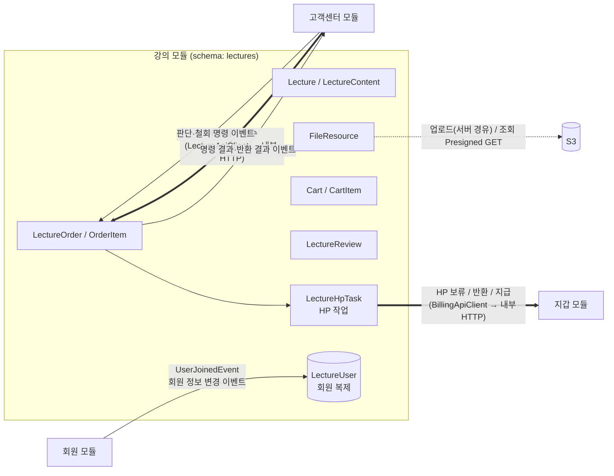
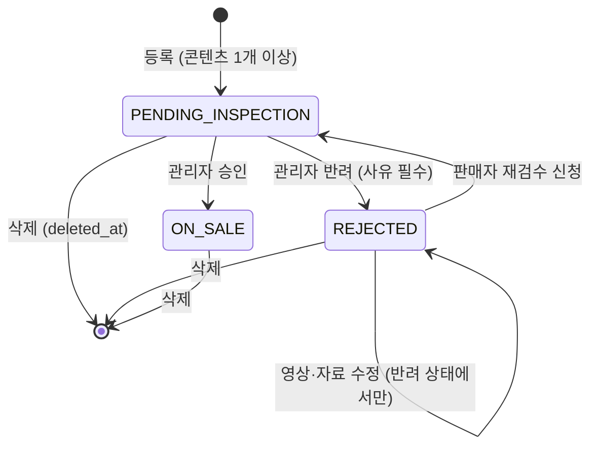
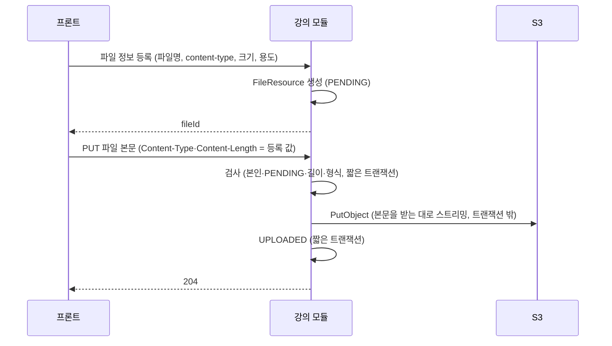
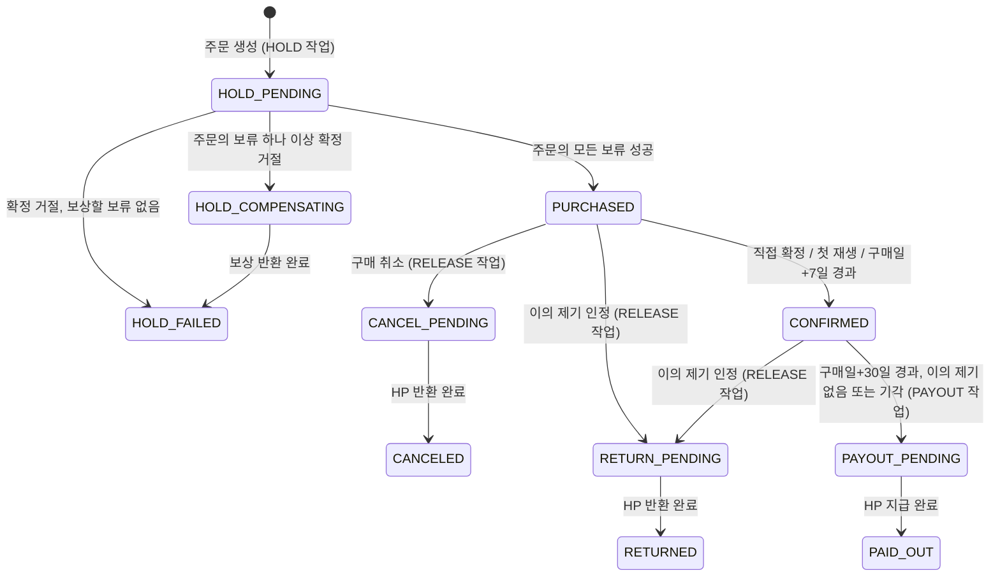

# 강의(Lecture) 모듈 설계

| 항목 | 내용 |
| --- | --- |
| 상태 | draft |
| 작성일 | 2026-10-08 |
| 관련 모듈 | 회원(member), 지갑(billing), 고객센터(customersupport) |

---

## 문서 지도

이 문서는 강의 모듈의 범위·핵심 정책·도메인 모델을 설명한다. 세부 계약과 변경 이력은 아래 문서에서 관리한다.

| 문서 | 내용 |
| --- | --- |
| 현재 문서 | 범위, 정책, 모듈 경계, 도메인 모델, 시간 규칙 |
| [모듈 연동·운영](integration.md) | 내부 HTTP·이벤트 계약, 주요 흐름, 동시성·멱등성·배치 |
| [스키마·API·구현 참고](reference.md) | 테이블, API, 권한, 패키지, 테스트, 구현 순서 |
| [결정 기록](decisions.md) | 미정 사항, 검수 기록, D1~D63 결정 이력 |

> 분리 전 문서의 장 번호와 D 번호는 기존 이슈·PR 참조를 위해 유지한다.

---

## 1. 범위

### 1.1 강의 모듈이 하는 일

기획서 MVP 표 기준: 인증된 인플루언서의 강의 등록, 구매, 구매 취소, 조회, 수정, 삭제, 검수(관리자 재량), 리뷰, 평점.

| 영역 | 기능 |
| --- | --- |
| 강의 | 등록(검수 대기로 시작), 수정, 삭제(Soft Delete), 목록·상세 조회, 판매자 본인 강의 조회 |
| 검수 | 관리자 승인·반려(사유), 반려된 강의의 영상·자료 수정 후 판매자 재검수 신청 (D11) |
| 파일 | 썸네일·강의 영상·자료의 S3 업로드(서버 경유, D22), 구매자 재생 URL 발급(Presigned GET) |
| 장바구니 | 담기, 빼기, 조회 |
| 주문 | 장바구니 주문, 바로 구매(강의 1개 주문), 주문 조회, 구매 확정(직접·첫 재생·자동), 구매 취소 |
| 지급 시점 관리 | 구매일 다음 날부터 30일 경과 시 지갑 모듈에 지급 호출 |
| 내용 다름 이의 제기 | 고객센터의 접수(동기 호출)와 판단·철회(명령 이벤트)를 처리: 검증·지급 중단, 판단 결과 반영(반환 또는 지급), 판단 전 철회(지급 중단 해제, D52). 명령 이력으로 멱등하게 처리하고 결과를 이벤트로 알린다 (D60) |
| 리뷰 | 작성·수정·삭제, 평점(1~5) 및 평균 |

### 1.2 강의 모듈이 하지 않는 일

| 하지 않는 일 | 담당 |
| --- | --- |
| HP 차감, 보류, 반환, 지급, 원장 기록. **어떤 HP 종류(충전/수익)로 얼마가 결제됐는지도 모른다** | 지갑(billing) |
| 이의 제기 문의 티켓 관리, 관리자 답변 | 고객센터(customersupport) |
| 회원 역할 변경(승급), 회원 정보의 원본 | 회원(member) |
| 강의 내용 다름 이의 제기의 자동 판정 | MVP 범위 밖 |

> 강의 모듈은 "언제, 누구에게, 얼마를" 옮겨야 하는지만 판단해 HP 작업으로 기록하고, 강의 트랜잭션 밖에서 shared의 `BillingApiClient`로 지갑 모듈 내부 HTTP API에 요청한다([6.2 동기 HTTP 인터페이스](integration.md#62-동기-http-인터페이스), D62). 실제 HP 이동과 정합성은 지갑 모듈 한 곳에서 처리한다(기획서 아키텍처 절). 고객센터와는 접수 내부 HTTP 호출과 판단·철회 이벤트로, 회원과는 이벤트로 연동한다.

---

## 2. 강의 모듈이 지켜야 하는 정책 요약

정책 문서([`docs/policy.md`](../policy.md))에서 강의 모듈 구현에 직접 영향을 주는 규칙만 모았다. 출처의 "정책 N"은 그 문서의 N장이다.

| # | 규칙 | 출처 |
| --- | --- | --- |
| P1 | 강의 등록·판매는 **인증된 인플루언서**만 가능하다 | 기획서 권한표 |
| P2 | 장바구니·강의 구매·구매 취소는 유저·인플루언서·인증된 인플루언서만 가능하다 (관리자·비회원 불가) | 기획서 권한표 |
| P3 | 비회원은 강의 **목록만** 조회한다 | 기획서 권한표 |
| P4 | 등록한 강의는 **검수 대기(비공개)**. 승인되면 공개·판매, 반려되면 사유를 남기고 판매자가 수정 후 재신청 | 정책 6 |
| P5 | ~~판매 중인 강의의 영상·자료를 수정하면 다시 검수 대기가 되어 신규 판매를 멈춘다~~ → **MVP에서는 영상·자료를 반려된 강의만 수정할 수 있다.** 검수 대기·판매 중에는 수정 불가, 판매 중 강의를 고치려면 삭제 후 재등록 (D11). 메타 정보는 언제든 수정 | 정책 6, D11 |
| P6 | 구매 확정 = 직접 확정·첫 재생·구매일 다음 날부터 7일 경과 중 먼저. 확정 후 단순 변심 취소 불가. **지급 시점이 아니다** | 정책 4, 용어 |
| P7 | 구매 취소 = 구매 확정 전 주문 항목 취소 → 보류 HP를 구매자에게 반환 (환불과 다름) | 용어 |
| P8 | 강의 지급 = 구매일 다음 날부터 30일(내용 다름 이의 제기 기간)이 끝난 뒤 판매자 수익 HP로 지급. 수수료 없음 | 정책 4 |
| P9 | 내용 다름 이의 제기는 구매일 다음 날부터 30일 이내. 접수되면 지급을 멈추고 보류 유지. 관리자 인정 → 구매자 반환, 기각 → 판매자 지급 | 정책 6 |
| P10 | ~~일부 항목 반환 시 그 주문에 남은 보류분 중 충전 HP부터 반환~~ → **보류는 주문 항목 단위이고(D36), 항목마다 그 항목을 결제할 때 차감한 HP 종류 그대로 반환·지급한다 (D42).** 주문 단위 우선순위는 두지 않는다 | 정책 1, AGENTS 5장, D42 |
| P11 | 주문은 상태값으로 관리하고 삭제하지 않는다. 강의는 Soft Delete. 그 외 모든 데이터도 Soft Delete | 기획서 데이터 모델, AGENTS 5장 |
| P12 | 모든 기간·마감·일시는 **KST** 기준 | 정책 머리말 |
| P13 | 다른 모듈과는 회원 ID와 이벤트로만 연결. 스키마 간 FK·JOIN 금지. 스키마 이름 `lectures` (회원 `members`·출연 `appearances`와 같은 복수형) | AGENTS 3장 |

---

## 3. 모듈 경계

- 다른 모듈의 엔티티·Repository를 쓰지 않는다. 판매자·구매자·리뷰 작성자는 `*_user_id`(Long)로만 참조한다.
- 닉네임 표시에 필요한 회원 정보는 `LectureUser`(회원 복제, `ReplicaUser` 상속)로 강의 스키마 안에 둔다. 같은 스키마 안의 JOIN은 허용된다.
- 다른 모듈과의 트랜잭션은 공유하지 않는다. 강의는 자기 로컬 트랜잭션만 보장하고, 다른 모듈 HTTP 호출은 강의 트랜잭션 밖에서 한다 ([6.1 연동 원칙](integration.md#원칙-d62), D62).
- 모듈 간 데이터 계약과 공통 HTTP Client SDK는 `shared.[제공 모듈].dto|domain|event|out`에 둔다. bounded context 사이의 Java Port와 Application 직접 호출은 두지 않으며, `apps`는 bootstrap과 공통 설정만 담당한다 (D62).

---

## 4. 도메인 모델

### 4.1 애그리거트 구성

| 애그리거트 루트 | 포함 | 역할 |
| --- | --- | --- |
| `Lecture` | `LectureContent` | 강의 상품, 검수 상태, 영상·자료 구성 |
| `FileResource` | - | S3 객체 메타데이터 (업로드 상태) |
| `Cart` | `CartItem` | 회원별 장바구니 (회원당 1개) |
| `LectureOrder` | `OrderItem` | 주문(결제 단위)과 항목(구매 확정·취소·지급·이의 제기 단위) |
| `LectureReview` | - | 주문 항목 1건당 리뷰 1개 |
| `LectureUser` | - | 회원 복제 (닉네임·역할·상태) |

애그리거트 사이는 ID로만 참조한다 (`OrderItem.lectureId`, `CartItem.lectureId`, `LectureContent.fileId` 등). 같은 모듈 안이어도 `@ManyToOne`은 애그리거트 내부(`Lecture`–`LectureContent`, `Cart`–`CartItem`, `LectureOrder`–`OrderItem`)에만 건다.

### 4.2 Lecture — 검수 상태

ERD의 `LECTURE.status`에 검수 상태를 담는다. 별도의 "작성 중(DRAFT)" 상태는 두지 않는다. 정책 6이 "등록한 강의는 검수 대기"라고 정하고 있으므로, **영상·자료 파일을 먼저 업로드한 뒤 등록 요청 한 번에 강의와 콘텐츠를 함께 만든다.**

| 상태 | 코드 | 목록·상세 노출 | 신규 구매 | 기존 구매자 시청 |
| --- | --- | --- | --- | --- |
| 검수 대기 | `PENDING_INSPECTION` | 판매자·관리자만 | X | - (승인 전이라 구매자 없음) |
| 반려 | `REJECTED` | 판매자·관리자만 | X | - (승인 전이라 구매자 없음) |
| 판매 중 | `ON_SALE` | 모두 | O | O |
| 삭제 | `deleted_at` 기록 | 판매자·관리자·기존 구매자 (목록 제외) | X | O (D5) |

불변식

- `ON_SALE`이 아니면 장바구니 담기·주문 생성을 거부한다.
- 판매자 본인만 수정·삭제·재검수 신청할 수 있다.
- 반려 시 `rejection_reason`은 필수다. 재검수 신청 시 이전 반려 사유는 덮어쓰지 않고 다음 반려 때 갱신한다.
- 메타 정보(제목·소개·가격·썸네일) 수정은 재검수 대상이 아니다. 정책은 "내용(영상·자료)"만 재검수 대상으로 정했다. (정책 6) 삭제 전이면 어느 상태에서든 수정할 수 있다.
- 영상·자료는 `Lecture` 애그리거트를 통해 목록 전체를 교체하는 방식으로만 바꾸고, **`REJECTED`일 때만** 허용한다 (D11). 교체된 행은 Soft Delete로 남긴다.
- 콘텐츠가 0개가 되는 수정은 거부한다.

#### 승인 후 콘텐츠 잠금 (D11)

검수 대기와 판매 중에는 영상·자료를 바꿀 수 없다. 그래서

- 관리자는 항상 판매자가 제출한 내용 그대로를 승인한다. 검수하는 동안 내용이 바뀌지 않으므로 승인 요청에 revision·version을 담을 필요가 없다.
- 구매자는 항상 승인된 내용만 본다. 승인본·검수본을 나눠 둘(revision) 필요가 없다.
- 판매 중 강의의 내용을 고치려면 삭제 후 새로 등록한다. 삭제된 강의도 기존 구매자는 계속 보고 지급도 그대로 진행된다(D5). 리뷰·평점은 새 강의로 이어지지 않는다.

> 이전 초안의 콘텐츠 revision(승인본·검수본 분리) 설계는 D11로 대체했다. MVP 이후 판매 중 수정이 필요해지면 다시 검토한다.

### 4.3 LectureContent

| 필드 | 설명 |
| --- | --- |
| `fileId` | `FileResource` ID. 업로드 완료(`UPLOADED`) 상태이고 업로더가 판매자 본인인 파일만 연결 가능 |
| `title`, `sequence` | 표시 제목, 강의 내 순서 (강의 안에서 유일) |
| `contentType` | `VIDEO`(영상), `DOCUMENT`(자료) |

> 썸네일(사진)·영상·자료 파일은 모두 S3에 저장한다 ([결정 기록 D2](decisions.md#16-결정-기록)).

### 4.4 FileResource — S3 업로드

- 업로드는 서버 경유다 (D22). 인스턴스 역할로 서명한 Presigned PUT은 EC2 밖에서 조직 정책으로 거부된다(`docs/deploy/s3.md`).
- 본문 업로드 규칙은 D24, 트랜잭션 경계는 D25를 따른다. 저장에 실패하거나 연결이 끊기면 `PENDING`으로 남아 처음부터 다시 올린다.

- `file_type`: `LECTURE_THUMBNAIL`, `LECTURE_VIDEO`, `LECTURE_DOCUMENT`
- `status`: `PENDING` → `UPLOADED` (삭제 시 `deleted_at`)
- object key 규칙: `lecture/{fileType}/{uuid}` — 원본 파일명은 key에 넣지 않는다. 환경 prefix(`dev/` 등)는 `global/storage`가 붙인다.
- 용도별 허용 형식·최대 크기는 D19를 따른다.
- 강의 등록·정보 수정·콘텐츠 교체에서는 `UPLOADED`이고 판매자 본인이 올렸고 용도(썸네일/영상/자료)가 맞는 파일만 연결한다. 한 파일을 여러 강의에 연결할 수 있다 (D21).
- 썸네일은 목록에서 비회원도 보므로 Presigned GET URL을 응답 때마다 발급한다. 조회 URL 만료는 D23을 따른다. 강의 응답의 썸네일 URL 규칙은 D28을 따른다.
- 오래된 `PENDING` 파일 정리는 MVP에서 하지 않는다.

### 4.5 Cart

- 회원당 1개. 처음 담을 때 만든다. (`cart.user_id` 유일, 동시에 처음 담아도 하나만 생기도록 `INSERT … ON CONFLICT DO NOTHING`, D18)
- 같은 강의는 한 번만 담는다. 동시에 담으면 부분 유일 인덱스가 막고 `ALREADY_IN_CART`(409)로 응답한다 (D18).
- 담을 때 검사 순서: 본인 강의가 아님(D5, `OWN_LECTURE_NOT_PURCHASABLE` 403) → 강의가 `ON_SALE`(아니면 상세 조회처럼 `LECTURE_NOT_FOUND` 404) → 이미 담지 않음(`ALREADY_IN_CART` 409) → 이미 보유 중(유효한 주문 항목이 있음)이 아님(**주문 구현 때 추가**).
- 담은 뒤 강의가 판매 중지·삭제되면 장바구니 조회 시 "구매 불가"(`purchasable=false`)로 표시하고 합계(`purchasableTotalHp`)에서 빼며, 주문 시에는 거부한다. 조회는 최근 담은 순이다.
- 담지 않은 강의를 빼면 무시하고 204로 응답한다 (D18). 개수 제한은 없다.
- 주문의 모든 보류가 성공해 주문을 `PAID`로 기록하는 트랜잭션에서 **그 주문에 포함된 강의만** 장바구니에서 뺀다. 결과 기록을 다시 실행해도 같은 결과가 되게 멱등하게 뺀다. 보류 처리 중(`HOLD_PENDING`·`HOLD_COMPENSATING`)이거나 보류에 실패(`HOLD_FAILED`)하면 장바구니를 그대로 둔다. 처음부터 빼고 실패 시 복원하면 처리 중 사용자가 바꾼 장바구니를 덮어쓸 수 있어 그렇게 하지 않는다 (D58).
- 정책상 Soft Delete가 원칙이므로 `cart_item`에 `deleted_at`을 둔다. (ERD에 없음)

### 4.6 LectureOrder / OrderItem

#### 주문(LectureOrder)은 결제 단위

- 장바구니 주문과 바로 구매(강의 1개 주문)를 같은 모델로 처리한다.
- **HP 보류는 주문 항목 단위**다(D36). 항목마다 그 가격을 보류하고(참조 `LECTURE_ORDER_ITEM`, 주문 항목 ID), 구매 취소·지급도 그 항목의 보류만 쓴다. 혼합 HP는 항목마다 차감한 HP 종류 그대로 반환·지급한다(D42).
- **주문은 보류보다 먼저 저장된다(D58).** 주문·항목과 항목별 HOLD 작업을 한 강의 트랜잭션에 커밋한 뒤, 트랜잭션 밖에서 보류한다. 모든 보류가 성공해야 `PAID`가 되고, 하나라도 확정 거절되면 이미 성공한 보류를 반환(보상)한 뒤 `HOLD_FAILED`가 된다. 돈과 관련된 처리 이력이므로 `HOLD_FAILED` 주문도 지우지 않는다.
- 주문 상태(`status`)는 저장값이 기준이다.

| 주문 상태 | 의미 |
| --- | --- |
| `HOLD_PENDING` | 주문 생성. 보류 진행 중이거나 결과를 확인하는 중 |
| `HOLD_COMPENSATING` | 한 항목 이상의 보류가 확정 거절되어, 성공한 보류를 반환하는 중 |
| `HOLD_FAILED` | 보류 실패. 남은 보류 HP가 없음이 확인됨 (보상 완료 또는 보상 불필요) |
| `PAID` | 모든 항목의 보류 성공 (구매 완료) |
| `CANCELED` | 모든 항목이 `CANCELED`·`RETURNED`가 된 때 (반환이 실제로 끝난 뒤) |

- 항목을 `CANCELED`·`RETURNED`로 바꾸는 모든 경로(구매 취소 반환 완료, 이의 제기 인정 반환 완료)는 **반환 결과를 기록하는 트랜잭션에서** 주문 행을 잠그고(D46) 공통 메서드(예: `LectureOrder.closeIfAllItemsEnded()`)를 호출해, 끝나지 않은 항목이 없으면 주문을 `CANCELED`로 바꾸고 `canceled_at`을 기록한다. 반환 진행 중(`CANCEL_PENDING`·`RETURN_PENDING`) 항목은 끝나지 않은 항목이다.

| 응답용 진행 상태 (`status = PAID`일 때만) | 조건 |
| --- | --- |
| `IN_PROGRESS` | 아직 끝나지 않은 항목(`PURCHASED`, `CONFIRMED`, `CANCEL_PENDING`, `RETURN_PENDING`, `PAYOUT_PENDING`)이 있음 |
| `COMPLETED` | 모든 항목이 `PAID_OUT`·`CANCELED`·`RETURNED` 중 하나이며 `PAID_OUT`이 1개 이상 |

#### 주문 항목(OrderItem)은 거래 단위

구매 확정·구매 취소·지급·이의 제기는 모두 항목 단위로 일어난다.

**HP가 움직이는 전이는 처리 중 상태를 거친다(D56·D59).** 강의 트랜잭션은 항목을 처리 중 상태로 바꾸고 HP 작업을 기록하는 데까지만 한다. billing 호출은 트랜잭션 밖에서 하고, 성공한 결과를 짧은 트랜잭션으로 기록할 때 완료 상태가 된다. 그래서 완료 상태(`PURCHASED`, `CANCELED`, `RETURNED`, `PAID_OUT`)는 HP가 실제로 움직인 뒤에만 보인다.

- 항목의 `HOLD_PENDING`·`HOLD_COMPENSATING`·`HOLD_FAILED`는 **주문 전체 보류 단계를 그대로 복제한 상태**다. 모든 항목이 주문과 같은 값을 갖는다. 개별 항목의 보류 성공·거절·반환 진행은 HP 작업(`LectureHpTask`)이 나타낸다. 항목에도 상태를 두는 이유는 보유 판정 부분 유일 인덱스가 `order_item`에 있기 때문이다.
- 작업이 `DEAD`가 되어도 항목은 처리 중 상태에 남는다(`HOLD_PENDING`·`HOLD_COMPENSATING`·`CANCEL_PENDING`·`RETURN_PENDING`·`PAYOUT_PENDING`). 완료 상태는 실제 HP 이동이 끝났다는 뜻이므로 실패로 바꾸지 않는다. 관리자가 복구한다 (D57).
- `CANCEL_PENDING`·`RETURN_PENDING`이 되는 순간 시청 권한은 사라진다. `PAYOUT_PENDING`은 구매 확정 뒤의 상태라 시청·리뷰를 유지한다.
- 마지막 남은 항목의 반환이 끝나 `CANCELED`·`RETURNED`가 되면 같은 결과 기록 트랜잭션에서 주문을 `CANCELED`로 바꾼다 (구매 취소·이의 제기 인정 공통).

상태별 허용 범위 (D58, D59)

| 항목 상태 | 주문 내역 | 보유(재구매 차단, 부분 유일 인덱스) | `/purchased`·시청 | 새 리뷰 | 판매 내역 | 처리 상태(`processingStatus`) |
| --- | --- | --- | --- | --- | --- | --- |
| `HOLD_PENDING` | "결제 처리 중" | O | X | X | X | O |
| `HOLD_COMPENSATING` | "결제 취소 처리 중" | O | X | X | X | O |
| `HOLD_FAILED` | "결제 실패" | X | X | X | X | - |
| `PURCHASED` | 구매 완료 | O | O (재생 동의 후 시청) | X | O | - |
| `CONFIRMED` | 구매 확정 | O | O | O | O | - |
| `CANCEL_PENDING` | "구매 취소 처리 중" | O | X | X | O | O |
| `CANCELED` | 구매 취소 | X | X | X | O | - |
| `RETURN_PENDING` | "반환 처리 중" | O | X | X | O | O |
| `RETURNED` | 반환 | X | X | X | O | - |
| `PAYOUT_PENDING` | 구매 확정 | O | O | O | O | O |
| `PAID_OUT` | 구매 확정 | O | O | O | O | - |

- 처리 상태(`processingStatus`)는 처리 중 항목에만 내려 준다. 내부 작업 상태(`PENDING`·`PROCESSING`·`DEAD`)를 그대로 보여 주지 않고 업무 의미로 바꾼다. 한 항목에는 생애 동안 HOLD·RELEASE·PAYOUT 작업이 여러 개 생기므로, 지금 상태에 해당하는 작업으로 판정한다.
  - `PROCESSING`: 정상 처리 중
  - `DELAYED`: 실패 후 재시도 중
  - `ACTION_REQUIRED`: 자동 처리가 멈춤(작업 `DEAD`), 고객센터 확인 필요
- 관리자 응답에는 원래 작업 상태, 시도 횟수, 오류 코드를 모두 보여 준다 ([8.2.1 HP 작업 관리자 API](reference.md#821-hp-작업-관리자-d57-275)).

이의 제기는 항목 상태와 별도로 `objection_status`로 둔다.

| `objection_status` | 의미 | 지급 | 구매 취소 |
| --- | --- | --- | --- |
| `NONE` | 이의 제기 없음 (판단 전에 철회하면 이 상태로 돌아간다, D52) | 기간 경과 시 지급 대상 선점 (이미 지났으면 다음 지급 배치에서) | 확정 전이면 가능 |
| `FILED` | 접수, 관리자 판단 대기 | **멈춤** | 불가 (이중 반환 방지) |
| `ACCEPTED` | 인정 → 항목 `RETURN_PENDING` → 반환 완료 시 `RETURNED` | 없음 | - |
| `REJECTED` | 기각 | 기간 경과 시 지급 대상 선점 (이미 지났으면 다음 지급 배치에서) | 불가 |

#### 불변식

| 동작 | 허용 조건 |
| --- | --- |
| 주문 생성 | 모든 강의가 `ON_SALE`, 본인 강의 아님(D5), 같은 강의를 이미 보유 중이 아님(D5, 보유 = 위 표의 "보유" 상태), 한 주문에 같은 강의 중복 없음, 주문자 역할이 유저·인플루언서·인증된 인플루언서 |
| 직접 확정 | 본인 항목, `PURCHASED` |
| 첫 재생 확정 | 본인 항목, `PURCHASED`, 구매자가 **재생 동의**를 제출할 때 (D7). 자동 구매 확정 시각이 지났으면 직접 확정과 같이 `AUTO`(D34). 이미 `CONFIRMED`·`PAYOUT_PENDING`·`PAID_OUT`이면 그대로 둔다 (D38) |
| 구매 취소 | 본인 항목, `PURCHASED`, `now < auto_confirm_at`, `objection_status = NONE` → `CANCEL_PENDING` |
| 이의 제기 접수 (고객센터 호출) | 구매자 본인 항목, `PURCHASED` 또는 `CONFIRMED`, `now < payout_scheduled_at`, `objection_status = NONE`. `PAYOUT_PENDING`은 기한이 지난 뒤의 상태라 `PERIOD_EXPIRED`다 ([6.2 동기 HTTP 인터페이스](integration.md#62-동기-http-인터페이스)) |
| 이의 제기 철회 (고객센터 명령) | 구매자 본인 항목, `objection_status = FILED`, 접수한 문의 ID와 같음. 기한 없음. 철회하면 `NONE`으로 돌아가고 문의 ID·사유·접수 시각을 비운다 (D52) |
| 지급 대상 선점 | `CONFIRMED`, `now >= payout_scheduled_at`, `objection_status ∈ {NONE, REJECTED}` → `PAYOUT_PENDING` |
| 시청 | 본인 항목이 `CONFIRMED`·`PAYOUT_PENDING`·`PAID_OUT` (이의 제기 접수 중에도 시청 가능, 삭제된 강의 포함). `PURCHASED`면 재생 동의 후 (D38) |

- **기한 판정은 배치가 아니라 도메인 메서드가 시각으로 한다.** 자동 구매 확정 배치가 늦게 돌아도 `now >= auto_confirm_at`이면 구매 취소를 거부한다.
- **첫 재생 = 재생 동의 (D7).** `PURCHASED` 항목의 영상을 처음 재생하기 전에 프론트가 동의서("재생하면 구매가 확정되어 단순 변심으로 구매 취소할 수 없습니다")를 보여 주고, 구매자가 동의하면 재생 동의 API를 호출한다. 서버는 이때 `CONFIRMED`(`FIRST_PLAY`)로 바꾼다.
- **서버가 강제한다.** 항목이 `PURCHASED`이면 영상·자료(`VIDEO`·`DOCUMENT`) URL 발급(`/access`)을 모두 거부하고 "재생 동의 필요" 오류를 준다. 동의 없이 영상·자료를 받을 방법이 없으므로, 화면 진입·프리로드로 확정되는 일도, 동의 없이 보거나 자료만 받고 취소하는 일도 없다. 자료 다운로드도 같은 동의를 받는다(D8).
- 이미 `CONFIRMED`·`PAYOUT_PENDING`·`PAID_OUT`이면(직접 확정·자동 확정 포함) 동의 없이 URL을 발급한다.
- "재생 동의 필요" 오류는 403 `PLAY_CONSENT_REQUIRED`이고, 프론트가 바로 재생 동의 API를 호출할 수 있게 `orderId`·`orderItemId`를 담는다 (D38).
- 동의 기록은 `confirmation_type = FIRST_PLAY`와 `confirmed_at`으로 남긴다.
- 한 구매자는 같은 강의에 대해 **보유 상태**(`HOLD_PENDING`, `HOLD_COMPENSATING`, `PURCHASED`, `CONFIRMED`, `CANCEL_PENDING`, `RETURN_PENDING`, `PAYOUT_PENDING`, `PAID_OUT`)의 항목을 하나만 가진다. HP가 남아 있을 수 있는 처리 중 상태도 보유로 본다. 보류 실패(`HOLD_FAILED`, 남은 보류 없음 확인)·취소·반환 후에는 다시 살 수 있다. `PAID_OUT`도 보유로 본다(D5): 구매한 강의는 계속 볼 수 있으므로 다시 살 수 없다.
- 주문 시점의 강의 제목과 가격을 항목에 스냅샷으로 저장한다. 이후 강의 가격이 바뀌어도 반환·지급 금액은 스냅샷 가격이다.

### 4.7 LectureReview

- 주문 항목 1건당 살아 있는 리뷰 1개. 한 회원은 한 강의에 리뷰를 하나만 유지한다. 삭제 후 재작성은 새 행으로 만들며, 그래서 유일 제약은 모두 `WHERE deleted_at IS NULL` 부분 인덱스로 건다([7.1 테이블](reference.md#71-테이블)).
- 작성 조건: 본인 항목이 `CONFIRMED`·`PAYOUT_PENDING`·`PAID_OUT` (D5, D59). 구매 확정 전 리뷰를 허용하면 리뷰 작성 후 구매 취소가 가능해지기 때문이다. `CANCEL_PENDING`·`RETURN_PENDING`부터는 새 리뷰를 쓸 수 없다.
- 평점은 1~5 정수. 본문은 선택이며 1,000자 이하다 (D47). 평균 평점과 리뷰 수는 MVP에서 조회 시 집계한다. 목록 성능 문제가 생기면 `lecture`에 캐시 컬럼을 추가한다.
- 항목이 `RETURN_PENDING`이 되는 순간부터(반환 완료 `RETURNED` 포함) 리뷰는 남기되 리뷰 목록·평균 평점·리뷰 수에서 제외한다 (D5, D47, D59). 반환 여부는 컬럼으로 복사하지 않고 조회할 때 `order_item`과 JOIN해 판정한다.
- 리뷰 수정·Soft Delete 권한은 항목 상태와 관계없이 작성자에게 그대로 둔다(`ReviewEditUseCase`·`ReviewDeleteUseCase`). 반환 진행 중·반환된 항목의 리뷰 수정을 막을지는 별도 제품 결정이다 (D59).
- 반환 후 같은 강의를 다시 사서 새 리뷰를 쓰면, 반환된 항목에 남은 기존 리뷰를 Soft Delete하고 새 리뷰로 대체한다 (D47).

### 4.8 LectureUser (회원 복제)

- `shared`의 `ReplicaUser`를 상속한다. ID는 원본 회원 ID.
- `UserJoinedEvent`로만 생성한다(이미 있으면 무시). 회원 정보 변경 이벤트(`UserModifiedEvent`, #56)는 있는 복제본만 `syncFrom`으로 갱신하고, 없으면 `LECTURE_USER_NOT_FOUND`로 실패시켜 미완료 이벤트로 남긴다(재시작 시 재처리) (D17).
- 용도: 강의 목록·상세의 판매자 닉네임, 리뷰 작성자 닉네임. 탈퇴 회원은 "탈퇴한 회원"으로 표시한다(정책 7).
- 권한 판단(인증된 인플루언서 여부 등)은 복제본이 아니라 **요청 시점의 Spring Security 인증 정보**로 한다. 복제본은 이벤트 지연으로 늦을 수 있다.

---

## 5. 시간 규칙

모든 계산은 KST(`Asia/Seoul`)이며 `java.time.Clock`을 주입받아 계산한다(테스트에서 시각 고정).

- **구매일** = 주문 항목이 `PURCHASED`가 된 시각(`purchased_at`, 주문의 모든 보류가 성공했음을 기록한 시각, D35·D58)의 KST 날짜. 보류가 끝나기 전(`HOLD_*`)에는 `purchased_at`·`auto_confirm_at`·`payout_scheduled_at`이 없다
- **자동 구매 확정 시각** `auto_confirm_at` = (구매일 + 8일) 00:00 KST
  - "구매일 다음 날부터 7일 경과" → 구매일 다음 날부터 7일째 되는 날 23:59:59까지 취소 가능
- **지급 예정 시각** `payout_scheduled_at` = (구매일 + 31일) 00:00 KST
  - "구매일 다음 날부터 30일(내용 다름 이의 제기 기간)" → 30일째 되는 날 23:59:59까지 이의 제기 가능

정책 문서 예시와 맞춰 본 결과:

| 구매 | 구매 취소 가능 (확정 전) | `auto_confirm_at` | 이의 제기 가능 | `payout_scheduled_at` |
| --- | --- | --- | --- | --- |
| 9/30 | ~ 10/7 23:59:59 | 10/8 00:00 | ~ 10/30 23:59:59 | 10/31 00:00 |

> 정책 예시: "9/30 구매 → 10/7까지 단순 변심 취소 가능 → 10/30까지 내용 다름 이의 제기 가능 → 10/30 기간 종료 후 판매자 수익 HP 지급" — 일치한다.
