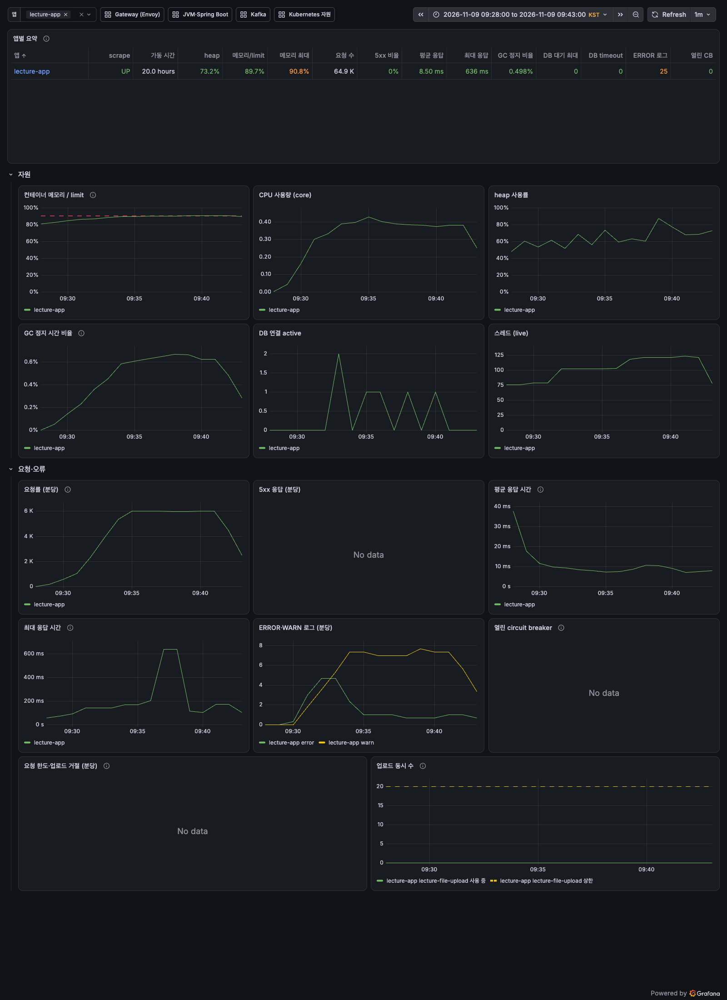
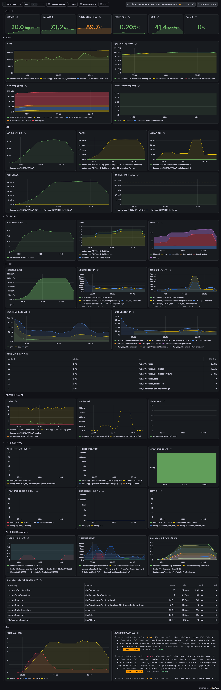
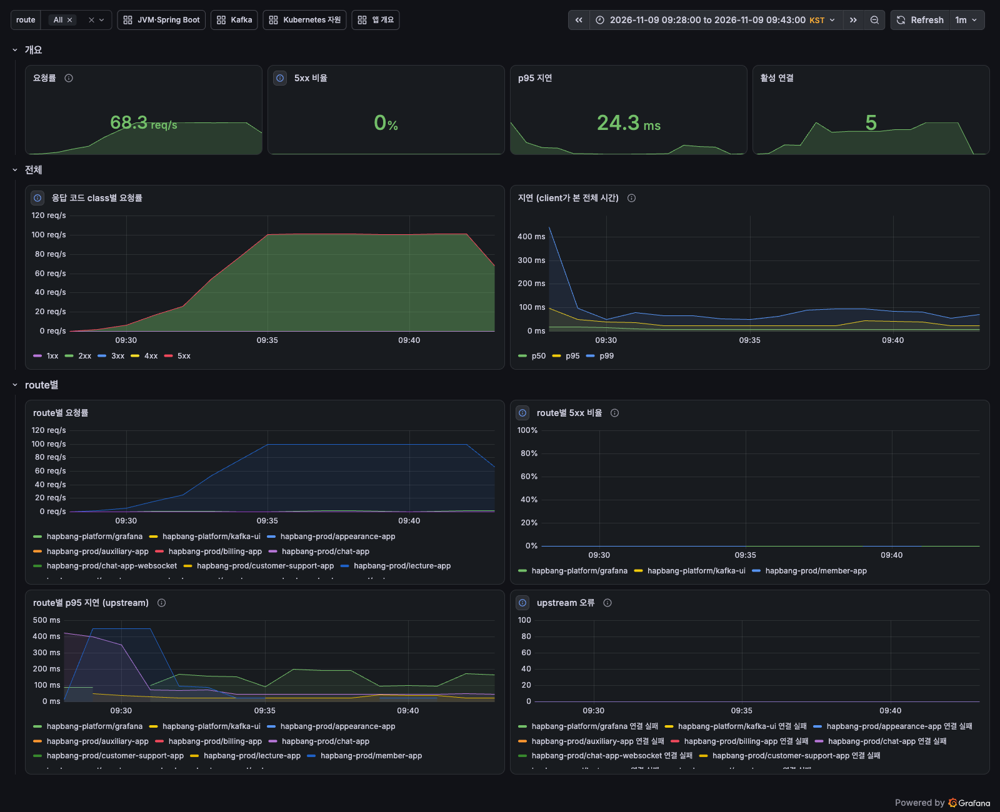
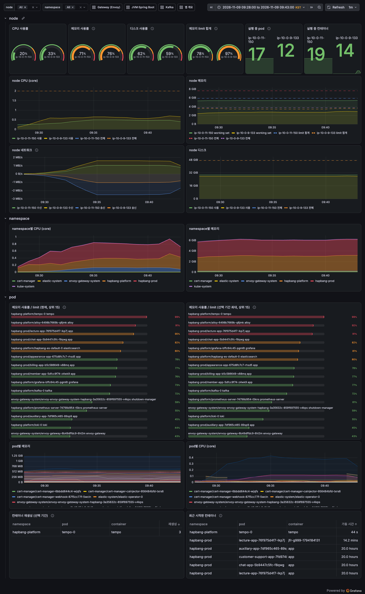

# 강의 조회 API 기준선

lecture-app 조회 API에 100 RPS를 10분 동안 보내고, 응답 시간·자원·JFR을 기록했다(#690). 측정 절차와 규칙은 [README](README.md)에 있다.

## 요약

- **합격.** 본 측정 10분 동안 59,980건을 보냈다. 모두 200으로 끝났고, k6가 본 p95는 132.9 ms였다. 목표는 p95 500 ms 이하, 5xx 1% 미만이다.
- 서버 쪽은 더 빠르다. 앱 p95는 22.7 ms, Envoy가 본 lecture-app upstream p95는 24.3 ms다. k6 p95와의 차이(약 100 ms)는 서버 밖(개발 PC와 집 네트워크) 구간에서 생긴 것으로 본다(아래 "한계").
- 100 RPS에서 lecture-app은 CPU 약 0.4 core를 썼고, DB 연결은 최대 2개만 동시에 썼다. medium node CPU는 평균 33%였다.
- 메모리는 대기 570 MiB에서 639 MiB(limit 704 MiB의 91%)까지 올랐다. 이 값에는 JFR 버퍼가 들어 있다.
- 요청 처리 CPU의 25%를 강의 썸네일 S3 presigned URL 서명이 쓴다. Hibernate가 22%, Micrometer·OpenTelemetry가 12%다.

## 조건

| 항목 | 값 |
| --- | --- |
| 측정 시각 (KST) | 2026-11-09 09:29:11 ~ 09:41:12. 워밍업 09:29~09:31, 본 측정 09:31~09:41 |
| 대상 | `lecture-app-76f975d4f7-lkp7j`, 이미지 `sha-d3c6f2d`(dev `d3c6f2da`, 쿠폰 모듈 #749 포함). 11-08 13:43 기동, 재시작 0 |
| 메모리·JVM | request·limit 704 MiB, CPU limit 없음(request 100m). `JAVA_TOOL_OPTIONS=-Xmx224m`, `MALLOC_ARENA_MAX=2`(#727). heap 상한 216.6 MiB. GC는 Serial(Copy·MarkSweepCompact) |
| 배치 | medium node(t3.medium, `app-observe`). 같은 node에 Prometheus·Loki·Tempo·Grafana·Alloy, chat·customer-support·web |
| 데이터 | 공개 강의 7건, 목록 한 페이지 20건 |
| 공용 구성 | PostgreSQL limit 512 MiB, Prometheus limit 448 MiB |
| trace | Envoy 샘플링 100%(#679). Tempo는 측정 전부터 limit 160 MiB에서 OOMKilled를 되풀이했다(재시작 475회 → 측정 뒤 478회) |
| 부하 생성 | k6 v2.3.0, 개발 PC(macOS, 집 네트워크). TCP 연결 약 10 ms, 단건 요청 67~99 ms |
| JFR | 09:28~09:41, `settings=default`, `loadtest/jfr.sh`로 임시 컨테이너에서 기록 |
| 실행 직전 점검 | 진행 중인 배포 없음(마지막 배포 11-08 13:26). 운영 변경을 하던 세션에 측정 시간을 알림 |
| CPU credit | 두 instance 모두 standard. 측정 전 large 864·medium 576(최대), 측정 뒤 863.8·571.7 |

#690 본문은 "`MaxRAMPercentage=60`, limit 704 MiB로 잰다"였다. 그 사이 #727(11-06)로 lecture-app이 `-Xmx224m`이 되어, 이번 기준선은 #727 뒤의 설정이다.

## 시나리오

`loadtest/k6/lecture/baseline.js`, `PROFILE=baseline`.

| 요청 | 비율 | 인증 |
| --- | ---: | --- |
| 강의 목록 `GET /api/v1/lectures?sort=LATEST&page=0&size=20` | 40% | 없음 |
| keyword 검색 `GET /api/v1/lectures?keyword=…` (AI, 크리에이터, 유튜브, 편집, 마케팅, 촬영, 없는검색어) | 20% | 없음 |
| 강의 상세 `GET /api/v1/lectures/{id}` | 30% | 일반 회원 JWT |
| 리뷰 목록 `GET /api/v1/lectures/{id}/reviews` | 10% | 일반 회원 JWT |

- 부하: `constant-arrival-rate` 30 RPS 2분 → 100 RPS 10분. 강의 ID는 `setup()`에서 목록 API로 받는다.
- threshold(본 측정만): p95 500 ms 이하(전체와 요청별), 5xx 1% 미만, check 성공률 99% 초과. 5xx가 5%를 넘으면 중단.

## 결과

### k6 (클라이언트)

본 측정 구간. 요약 JSON은 [`results/lecture-baseline-20261109-0929.json`](results/lecture-baseline-20261109-0929.json)(워밍업 포함 전체 값도 들어 있다).

| 요청 | p50 | p90 | p95 | p99 | 최대 |
| --- | ---: | ---: | ---: | ---: | ---: |
| 전체 | 25.6 | 81.9 | **132.9** | 349.7 | 1,073 |
| 강의 목록 | 31.3 | 103.2 | 172.1 | 429.3 | 1,073 |
| 검색 | 17.9 | 61.0 | 108.0 | 267.9 | 799 |
| 강의 상세 | 20.1 | 62.8 | 109.4 | 278.7 | 835 |
| 리뷰 목록 | 16.3 | 55.8 | 103.2 | 272.1 | 758 |

(단위 ms)

- 요청 59,980건, 5xx 0, check 실패 0. 보내지 못한 요청(`dropped_iterations`) 21건. 최대 동시 VU 51.
- 워밍업 포함 전체에서 응답 시간을 나누면 서버 응답 대기(`http_req_waiting`) p95 124.0 ms, 본문 수신 p95 12.9 ms, 연결·TLS p95 0 ms다.

### 서버 쪽 (Prometheus, 09:32~09:42의 10분)

| 항목 | 값 |
| --- | --- |
| 앱 처리량 | 초당 100건, 모두 200 |
| 앱 응답 시간(`http_server_requests`) | p95 22.7 ms, p99 47.9 ms. URI별 p95: 목록 23.7, 상세 21.5, 리뷰 11.2 ms |
| Envoy → lecture-app upstream | p50 7.5, p95 24.3, p99 71.4 ms |
| Envoy downstream(모든 https route) | p95 27.1 ms |
| lecture-app CPU | 0.37~0.47 core |
| lecture-app 메모리(working set) | 570 → 639 MiB(limit의 91%). JFR 버퍼 포함 |
| heap | 사용 104~189 MiB / committed 210 MiB / 상한 216.6 MiB. non-heap 244 MiB |
| GC | minor 471회, major 0회, 정지 합 3.54초(시간의 0.59%), 최대 정지 85 ms. 할당 속도 약 50 MB/s |
| DB 연결(Hikari, 최대 10) | active 최대 2, pending 0. 연결 획득 54,900회, 평균 0.5 ms, 최대 506 ms(09:37) |
| 앱 최대 응답 | 636 ms(09:37). 같은 분에 연결 획득 최대 506 ms, GC 최대 정지 85 ms가 겹친다. 원인은 나누지 않았다 |
| 앱 로그 | ERROR 25건, WARN 분당 약 7건. 모두 OpenTelemetry span 전송 실패(`Failed to export spans. Server is UNAVAILABLE`)와 전송 대기열이 차서 버린 span(`BatchSpanProcessor dropped … span(s)`)이다. Tempo가 OOM으로 내려가 있었기 때문이다 |
| 스레드 | 76 → 123 |
| node CPU 평균/최대 | medium 33% / 43%, large 24% / 25% |
| node 메모리 최대 | medium 78%, large 71% |
| PostgreSQL | CPU 최대 0.12 core, 메모리 200 MiB |
| Tempo | 재시작 3회, CPU 최대 0.28 core(medium node) |
| CloudWatch CPUUtilization(5분 최대) | medium 48%, large 33% |

## JFR

12분 31초 기록(워밍업 포함), `jdk.ExecutionSample` 7,446개 중 요청 스레드(`http-nio-8080-exec`) 7,213개.

**요청 CPU를 어디서 쓰나.** 표본마다 stack의 가장 안쪽(실행 중인 쪽)에서 처음 만나는 라이브러리로 나눴다.

| 구분 | 비중 |
| --- | ---: |
| AWS SDK S3 presign(썸네일 URL 서명) | 24.8% |
| Hibernate | 22.4% |
| Spring(Web·Data·Security 제외 나머지) | 11.9% |
| Micrometer·OpenTelemetry | 11.5% |
| Tomcat | 7.0% |
| PostgreSQL JDBC·Hikari | 6.2% |
| Spring Web·MVC | 3.8% |
| Spring Data | 3.4% |
| Jackson | 3.2% |
| Spring Security | 2.9% |
| 앱 코드(`com.hapbang`) | 1.8% |
| Logback | 1.1% |

단일 hot method는 없다(가장 많은 `HashMap.getNode`가 2.9%). presign 쪽은 `URI$Parser.scan`, `URLEncoder.encode`, `MessageDigest.update`로 보인다.

**GC 정지**(JFR): 547회, 합 4.08초, 중앙값 6.5 ms, p95 11.5 ms, p99 23.2 ms.

**할당**: `byte[]` 42.5%, `java.time.Instant` 10.4%, `ArrayList` 5.4%.

**lock 경합**: 요청 경로에는 없다(Kafka heartbeat·OkHttp 각 1건, 20 ms대).

**예외**: 요청 처리 중 라이브러리가 던지고 잡는 예외가 두 가지 있다. 응답은 200이고, 예외 생성이 들어간 CPU 표본은 0.1%라 CPU 영향은 작다. JFR 기본 설정은 예외 이벤트를 초당 100개로 제한하므로 아래 수는 최소값이다.

| 예외 | 기록 수 | 원인 |
| --- | ---: | --- |
| `IllegalArgumentException` | 37,884 | 강의 목록 API의 `sort=LATEST`를 Spring Data `Pageable`도 정렬 파라미터로 읽어 `Sort.Direction`으로 바꾸려다 실패한다. 강의 목록·검색 요청마다 생긴다 |
| Hibernate `CoercionException` | 24,891 | `LectureRatingSupport.of`가 강의 ID 묶음으로 리뷰 통계를 조회할 때, Hibernate가 IN 절 값(`Set`·`List`)을 먼저 `Long` 하나로 바꿔 보다 실패한다 |

## Grafana 캡처

2026-11-09 09:28~09:43(KST)으로 맞췄다. Prometheus는 1분마다 수집하므로 그래프는 1분 단위다.

- 앱 개요: 요청률이 분당 6천(초당 100)으로 평평하고 5xx는 없다. 메모리/limit은 80%에서 90%로 올라 머문다.
- JVM: heap은 상한(216.6 MiB) 아래에서 오르내리고, GC는 minor만 있다. Repository 호출 중 `LectureReviewRepository.summarize`(52.9K회)와 `FileResourceRepository.findAllById`(58.4K회)가 많다.
- Gateway: Envoy가 본 전체 p95는 25~45 ms, p99는 100 ms 안팎이다. upstream 오류는 없다.
- Kubernetes 자원: medium node의 memory limit 합계가 97%다. Tempo가 측정 중에 3번 다시 떴다.

## 한계

- **클라이언트 쪽 꼬리 지연.** k6 응답 대기 p95(124 ms)가 Envoy downstream p95(27 ms)보다 약 100 ms 크다. 연결은 재사용되어 연결·TLS 시간은 p95 0이다. 그래서 차이는 개발 PC와 집 네트워크 구간(또는 k6를 돌린 PC)에서 생긴 것으로 보지만, 어느 쪽인지는 나누지 않았다. 서버 성능은 Envoy·앱 값으로 본다.
- 데이터가 7건뿐이라 DB는 거의 캐시에서 답한다. 데이터가 늘었을 때의 쿼리 비용은 재지 않았다.
- trace 100%를 받는 Tempo가 OOM으로 재시작을 되풀이해, 이 구간의 trace는 거의 남지 않았다. Tempo 재시작은 같은 medium node의 CPU를 잠깐씩 쓴다.
- lecture-app 메모리에는 JFR 기록 버퍼가 들어 있다. JFR 없는 메모리는 #730에서 따로 본다.
- 한계점(어디서 무너지는지)은 재지 않았다. 100 RPS에서 CPU 여유가 있다.

## 측정 중 장애 기록: PostgreSQL 재시작 (2026-11-06)

첫 본 측정(11-06 14:36~14:48, `lecture-app-5bfcdc7666-xn9lk`)은 측정 도중 공용 PostgreSQL이 재시작되어 기준선에서 뺐다. 대신 DB가 잠깐 멈추면 lecture-app이 어떻게 되는지 보여 주어 기록한다(요약 JSON과 JFR 파일은 남아 있지 않다).

- 14:41:13에 #731의 PostgreSQL HelmChart(limit 768 → 512 MiB)를 운영에 적용해 `postgres-0`가 다시 만들어졌다. 14:41:18 종료, 14:41:21 다시 연결을 받았다(약 3초).
- lecture-app의 열린 DB 연결이 모두 `57P01 terminating connection due to administrator command`로 끊겼다. 직후 Hikari pool이 active 0·pending 106에서 멈췄고, 기다리던 요청은 최대 30초(Hikari `connectionTimeout` 기본값) 뒤 500으로 끝났다. 5xx 311건이 모두 이 구간에서 나왔다.
- Tomcat 스레드가 77 → 267로 늘고, 메모리가 632 → 672 MiB(limit의 95%)까지 올랐다. 재시작·OOM은 없었다.
- k6는 응답을 30초씩 기다려 VU 상한 300에 닿았고, 요청 3,995건을 보내지 못했다. p95 111.9 ms·5xx 0.55%로 threshold는 넘었지만 p99 12.2초, 최대 30.1초였다.
- 3초 DB 중단이 30초 오류로 커진 셈이다. Hikari `connectionTimeout`을 짧게 두어 빨리 실패시킬지는 다음 과제로 둔다.

## 다음 과제

- 한계점 측정: 100 → 200 → 300 RPS 단계로 올려 CPU·GC·DB 연결 중 무엇이 먼저 막히는지 본다.
- 썸네일 presigned URL 서명(요청 CPU의 25%) 줄이기: URL을 일정 시간 캐시하거나 서명 횟수를 줄이는 방안을 비교한다.
- 강의 목록 API의 `sort` 파라미터 이름이 `Pageable`의 `sort`와 겹치는 문제를 정리한다.
- DB 재시작 때 오류 구간을 줄이는 Hikari 설정(`connectionTimeout` 등)을 검토한다.
- 클라이언트 쪽 꼬리 지연을 나누기 위해 같은 리전에서 k6를 돌리거나, Envoy access log의 응답 시간과 비교한다.
